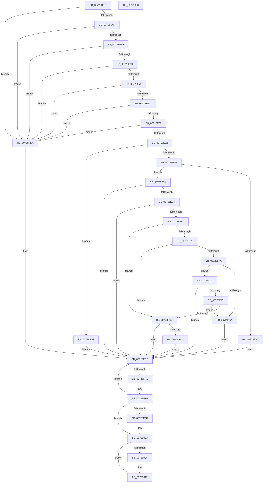

# PiCreateServiceKeyUnderPath

- RVA: `0x00728DEC`–`0x00729031` (길이 `581` bytes)
- VA: `0x0000000140728DEC`
- 실행 섹션: `PAGE`
- PDB 이름 있음: `예`; PDB Function 태그: `아니요`
- unwind 정보 RVA: `0x000C83A8`
- 디코드: `154`개 명령, `581/581` bytes 표시
- 미해석 바이트: `0` (있으면 어셈블리에 `.byte`로 보존)

> 이 문서는 커널 이미지의 기계어와 PDB 기호를 분석해 생성했습니다. 4번과 5번은 함수 원형과 자료형을 바이너리 사용 방식에서 추정한 C 해석이며 원본 소스 복구 결과는 아닙니다.

## 1. Dependencies

- 직접 호출 지점: **11**; 고유 호출 대상: **10**
- 직접 호출자로 확인된 함수: **2**
- RIP 상대 이미지 참조: **1**

### Outgoing calls
- `0x00728E41` → [RtlInitUnicodeString](../../text/42/RtlInitUnicodeString_function_0042A780.md) (function, `0x0042A780`)
- `0x00728EB5` → [IopAllocateUnicodeString](../95/IopAllocateUnicodeString_function_00951F0C.md) (function, `0x00951F0C`)
- `0x00728EE1` → [RtlUnicodeStringPrintfEx](../../text/4A/RtlUnicodeStringPrintfEx_function_004A8FD0.md) (function, `0x004A8FD0`)
- `0x00728F1F` → [ZwOpenKey](../../text/6A/ZwOpenKey_function_006AD310.md) (function, `0x006AD310`)
- `0x00728F37` → [PiAuGetServiceStateSecurityObject](../73/PiAuGetServiceStateSecurityObject_function_007314F0.md) (function, `0x007314F0`)
- `0x00728F54` → [PiCreateRegistryPath](PiCreateRegistryPath_function_00728B58.md) (function, `0x00728B58`)
- `0x00728FB4` → [ZwCreateKey](../../text/6A/ZwCreateKey_function_006AD470.md) (function, `0x006AD470`)
- `0x00728FE3` → [RtlFreeAnsiString](../9C/RtlFreeAnsiString_function_009C0800.md) (function, `0x009C0800`)
- `0x00728FF1` → [ZwClose](../../text/6A/ZwClose_function_006AD2B0.md) (function, `0x006AD2B0`)
- `0x00728FFE` → [ZwClose](../../text/6A/ZwClose_function_006AD2B0.md) (function, `0x006AD2B0`)
- `0x0072900D` → [ExFreePoolWithTag](../../poolcode/B8/ExFreePoolWithTag_function_00B82870.md) (function, `0x00B82870`)

### Direct callers
- [PiCreateServiceStateKey](../99/PiCreateServiceStateKey_function_009993E0.md) at `0x0099952E`
- [PiCreateDriverRedirectedStateKey](../99/PiCreateDriverRedirectedStateKey_function_0099957C.md) at `0x00999673`

### Static image references
- `0x00728EC9` → RVA `0x00AFD600` (` ?? ::NNGAKEGL::`string'`; read)

## 2. Other-region calls and transfers

- 다른 실행 섹션으로 향하는 call: **7**
  - `0x00728E41` → [RtlInitUnicodeString](../../text/42/RtlInitUnicodeString_function_0042A780.md) (`PAGE` → `.text`)
  - `0x00728EE1` → [RtlUnicodeStringPrintfEx](../../text/4A/RtlUnicodeStringPrintfEx_function_004A8FD0.md) (`PAGE` → `.text`)
  - `0x00728F1F` → [ZwOpenKey](../../text/6A/ZwOpenKey_function_006AD310.md) (`PAGE` → `.text`)
  - `0x00728FB4` → [ZwCreateKey](../../text/6A/ZwCreateKey_function_006AD470.md) (`PAGE` → `.text`)
  - `0x00728FF1` → [ZwClose](../../text/6A/ZwClose_function_006AD2B0.md) (`PAGE` → `.text`)
  - `0x00728FFE` → [ZwClose](../../text/6A/ZwClose_function_006AD2B0.md) (`PAGE` → `.text`)
  - `0x0072900D` → [ExFreePoolWithTag](../../poolcode/B8/ExFreePoolWithTag_function_00B82870.md) (`PAGE` → `POOLCODE`)
- 별도 외부 분기/꼬리 이동을 확인하지 못했습니다.

## 3. Assembly (complete function range)

```asm
00728DEC  48 89 5C 24 10                  mov qword ptr [rsp + 0x10], rbx
00728DF1  48 89 74 24 18                  mov qword ptr [rsp + 0x18], rsi
00728DF6  55                              push rbp
00728DF7  57                              push rdi
00728DF8  41 54                           push r12
00728DFA  41 56                           push r14
00728DFC  41 57                           push r15
00728DFE  48 8D 6C 24 C9                  lea rbp, [rsp - 0x37]
00728E03  48 81 EC 90 00 00 00            sub rsp, 0x90
00728E0A  33 C0                           xor eax, eax
00728E0C  0F 57 C0                        xorps xmm0, xmm0
00728E0F  48 21 45 67                     and qword ptr [rbp + 0x67], rax
00728E13  4C 8B F2                        mov r14, rdx
00728E16  4C 8B F9                        mov r15, rcx
00728E19  48 89 45 27                     mov qword ptr [rbp + 0x27], rax
00728E1D  33 F6                           xor esi, esi
00728E1F  89 45 2F                        mov dword ptr [rbp + 0x2f], eax
00728E22  33 FF                           xor edi, edi
00728E24  48 89 75 EF                     mov qword ptr [rbp - 0x11], rsi
00728E28  33 D2                           xor edx, edx
00728E2A  48 89 7D E7                     mov qword ptr [rbp - 0x19], rdi
00728E2E  48 8D 4D F7                     lea rcx, [rbp - 9]
00728E32  4D 8B E1                        mov r12, r9
00728E35  0F 11 45 07                     movups xmmword ptr [rbp + 7], xmm0
00728E39  0F 11 45 17                     movups xmmword ptr [rbp + 0x17], xmm0
00728E3D  0F 11 45 F7                     movups xmmword ptr [rbp - 9], xmm0
00728E41  E8 3A 19 D0 FF                  call 0x14042a780
00728E46  4D 85 FF                        test r15, r15
00728E49  0F 84 8B 01 00 00               je 0x140728fda
00728E4F  49 39 77 08                     cmp qword ptr [r15 + 8], rsi
00728E53  0F 84 81 01 00 00               je 0x140728fda
00728E59  41 0F B7 0F                     movzx ecx, word ptr [r15]
00728E5D  8D 56 02                        lea edx, [rsi + 2]
00728E60  66 3B CA                        cmp cx, dx
00728E63  0F 82 71 01 00 00               jb 0x140728fda
00728E69  4D 85 F6                        test r14, r14
00728E6C  0F 84 68 01 00 00               je 0x140728fda
00728E72  49 39 76 08                     cmp qword ptr [r14 + 8], rsi
00728E76  0F 84 5E 01 00 00               je 0x140728fda
00728E7C  41 0F B7 06                     movzx eax, word ptr [r14]
00728E80  66 3B C2                        cmp ax, dx
00728E83  0F 82 51 01 00 00               jb 0x140728fda
00728E89  4D 85 E4                        test r12, r12
00728E8C  0F 84 48 01 00 00               je 0x140728fda
00728E92  03 CA                           add ecx, edx
00728E94  8D 14 01                        lea edx, [rcx + rax]
00728E97  3B D1                           cmp edx, ecx
00728E99  0F 82 34 01 00 00               jb 0x140728fd3
00728E9F  81 FA FE FF 00 00               cmp edx, 0xfffe
00728EA5  76 0A                           jbe 0x140728eb1
00728EA7  BB 05 00 00 80                  mov ebx, 0x80000005
00728EAC  E9 2E 01 00 00                  jmp 0x140728fdf
00728EB1  48 8D 4D F7                     lea rcx, [rbp - 9]
00728EB5  E8 52 90 22 00                  call 0x140951f0c
00728EBA  8B D8                           mov ebx, eax
00728EBC  85 C0                           test eax, eax
00728EBE  0F 88 1B 01 00 00               js 0x140728fdf
00728EC4  4C 89 7C 24 28                  mov qword ptr [rsp + 0x28], r15
00728EC9  4C 8D 0D 30 47 3D 00            lea r9, [rip + 0x3d4730]
00728ED0  33 D2                           xor edx, edx
00728ED2  4C 89 74 24 20                  mov qword ptr [rsp + 0x20], r14
00728ED7  41 B8 00 08 00 00               mov r8d, 0x800
00728EDD  48 8D 4D F7                     lea rcx, [rbp - 9]
00728EE1  E8 EA 00 D8 FF                  call 0x1404a8fd0
00728EE6  8B D8                           mov ebx, eax
00728EE8  85 C0                           test eax, eax
00728EEA  0F 88 EF 00 00 00               js 0x140728fdf
00728EF0  48 21 75 0F                     and qword ptr [rbp + 0xf], rsi
00728EF4  48 8D 45 F7                     lea rax, [rbp - 9]
00728EF8  0F 57 C0                        xorps xmm0, xmm0
00728EFB  48 89 45 17                     mov qword ptr [rbp + 0x17], rax
00728EFF  4C 8D 45 07                     lea r8, [rbp + 7]
00728F03  C7 45 07 30 00 00 00            mov dword ptr [rbp + 7], 0x30
00728F0A  BA 04 00 00 00                  mov edx, 4
00728F0F  C7 45 1F 40 02 00 00            mov dword ptr [rbp + 0x1f], 0x240
00728F16  48 8D 4D 67                     lea rcx, [rbp + 0x67]
00728F1A  F3 0F 7F 45 27                  movdqu xmmword ptr [rbp + 0x27], xmm0
00728F1F  E8 EC 43 F8 FF                  call 0x1406ad310
00728F24  8B D8                           mov ebx, eax
00728F26  3D 34 00 00 C0                  cmp eax, 0xc0000034
00728F2B  0F 85 8F 00 00 00               jne 0x140728fc0
00728F31  48 8D 55 EF                     lea rdx, [rbp - 0x11]
00728F35  33 C9                           xor ecx, ecx
00728F37  E8 B4 85 00 00                  call 0x1407314f0
00728F3C  48 8B 75 EF                     mov rsi, qword ptr [rbp - 0x11]
00728F40  8B D8                           mov ebx, eax
00728F42  85 C0                           test eax, eax
00728F44  0F 88 95 00 00 00               js 0x140728fdf
00728F4A  4C 8D 4D E7                     lea r9, [rbp - 0x19]
00728F4E  4C 8B C6                        mov r8, rsi
00728F51  49 8B CE                        mov rcx, r14
00728F54  E8 FF FB FF FF                  call 0x140728b58
00728F59  48 8B 7D E7                     mov rdi, qword ptr [rbp - 0x19]
00728F5D  41 BE 34 00 00 C0               mov r14d, 0xc0000034
00728F63  8B D8                           mov ebx, eax
00728F65  41 3B C6                        cmp eax, r14d
00728F68  75 07                           jne 0x140728f71
00728F6A  BB E5 00 00 C0                  mov ebx, 0xc00000e5
00728F6F  EB 6E                           jmp 0x140728fdf
00728F71  85 C0                           test eax, eax
00728F73  78 6A                           js 0x140728fdf
00728F75  48 83 64 24 30 00               and qword ptr [rsp + 0x30], 0
00728F7B  4C 8D 45 07                     lea r8, [rbp + 7]
00728F7F  83 64 24 28 00                  and dword ptr [rsp + 0x28], 0
00728F84  48 8D 4D 67                     lea rcx, [rbp + 0x67]
00728F88  48 83 65 2F 00                  and qword ptr [rbp + 0x2f], 0
00728F8D  45 33 C9                        xor r9d, r9d
00728F90  48 83 64 24 20 00               and qword ptr [rsp + 0x20], 0
00728F96  C7 45 07 30 00 00 00            mov dword ptr [rbp + 7], 0x30
00728F9D  48 89 7D 0F                     mov qword ptr [rbp + 0xf], rdi
00728FA1  41 8D 51 04                     lea edx, [r9 + 4]
00728FA5  C7 45 1F 40 02 00 00            mov dword ptr [rbp + 0x1f], 0x240
00728FAC  4C 89 7D 17                     mov qword ptr [rbp + 0x17], r15
00728FB0  48 89 75 27                     mov qword ptr [rbp + 0x27], rsi
00728FB4  E8 B7 44 F8 FF                  call 0x1406ad470
00728FB9  8B D8                           mov ebx, eax
00728FBB  41 3B C6                        cmp eax, r14d
00728FBE  74 AA                           je 0x140728f6a
00728FC0  85 C0                           test eax, eax
00728FC2  78 1B                           js 0x140728fdf
00728FC4  48 8B 45 67                     mov rax, qword ptr [rbp + 0x67]
00728FC8  48 83 65 67 00                  and qword ptr [rbp + 0x67], 0
00728FCD  49 89 04 24                     mov qword ptr [r12], rax
00728FD1  EB 0C                           jmp 0x140728fdf
00728FD3  BB 95 00 00 C0                  mov ebx, 0xc0000095
00728FD8  EB 05                           jmp 0x140728fdf
00728FDA  BB 0D 00 00 C0                  mov ebx, 0xc000000d
00728FDF  48 8D 4D F7                     lea rcx, [rbp - 9]
00728FE3  E8 18 78 29 00                  call 0x1409c0800
00728FE8  48 8B 4D 67                     mov rcx, qword ptr [rbp + 0x67]
00728FEC  48 85 C9                        test rcx, rcx
00728FEF  74 05                           je 0x140728ff6
00728FF1  E8 BA 42 F8 FF                  call 0x1406ad2b0
00728FF6  48 85 FF                        test rdi, rdi
00728FF9  74 08                           je 0x140729003
00728FFB  48 8B CF                        mov rcx, rdi
00728FFE  E8 AD 42 F8 FF                  call 0x1406ad2b0
00729003  48 85 F6                        test rsi, rsi
00729006  74 0A                           je 0x140729012
00729008  33 D2                           xor edx, edx
0072900A  48 8B CE                        mov rcx, rsi
0072900D  E8 5E 98 45 00                  call 0x140b82870
00729012  4C 8D 9C 24 90 00 00 00         lea r11, [rsp + 0x90]
0072901A  8B C3                           mov eax, ebx
0072901C  49 8B 5B 38                     mov rbx, qword ptr [r11 + 0x38]
00729020  49 8B 73 40                     mov rsi, qword ptr [r11 + 0x40]
00729024  49 8B E3                        mov rsp, r11
00729027  41 5F                           pop r15
00729029  41 5E                           pop r14
0072902B  41 5C                           pop r12
0072902D  5F                              pop rdi
0072902E  5D                              pop rbp
0072902F  C3                              ret
00729030  CC                              int3
```

## 4. C-style interpretation (structured pseudocode)

```c
__int64 __fastcall PiCreateServiceKeyUnderPath(__int64 a1, __int64 a2, __int64 a3, __int64 a4)
{
    __int64 result;
    __int64 v_rdi;
    __int64 v_rsi;
    __int64 v_rsp;
    unsigned __int64 v_stack_m28;
    unsigned int v_stack_m30;
    unsigned __int64 v_stack_m38;
    unsigned int v_stack_m40;
    unsigned __int64 v_stack_m48;
    unsigned __int64 v_stack_m50;
    unsigned __int64 v_stack_m58;
    unsigned __int64 v_stack_m5F;
    unsigned __int64 v_stack_m68;
    unsigned __int64 v_stack_m70;
    unsigned __int64 v_stack_m78;
    unsigned __int64 v_stack_m88;
    unsigned __int64 v_stack_m90;
    unsigned __int64 v_stack_m98;
    unsigned __int64 v_stack_p10;
    unsigned __int64 v_stack_p18;
    unsigned __int64 v_stack_p8;

    v_stack_p10 = v_rbx;
    v_stack_p18 = v_rsi;
    v_rsp = (v_rsp) - (144);
    result = 0;
    v_stack_m38 = 0;
    v_rsi = 0;
    v_stack_m30 = 0;
    v_rdi = 0;
    v_stack_m70 = 0;
    a2 = 0;
    v_stack_m78 = 0;
    v_stack_m58 = v_xmm0;
    v_stack_m48 = v_xmm0;
    v_stack_m68 = v_xmm0;
    result = RtlInitUnicodeString(v_stack_m68, a2, a3, a4);
    if (a1 == 0) goto loc_00728FDA;
    if ((*(unsigned __int64 *)(a1 + 8)) == 0) goto loc_00728FDA;
    if (((unsigned __int16)(*(unsigned __int16 *)(a1))) < ((unsigned __int16)(v_rsi + 2))) goto loc_00728FDA;
    if (0 == 0) goto loc_00728FDA;
    if ((*(unsigned __int64 *)(a2 + 8)) == 0) goto loc_00728FDA;
    if (((unsigned __int16)(*(unsigned __int16 *)(a2))) < ((unsigned __int16)(v_rsi + 2))) goto loc_00728FDA;
    if (a4 == 0) goto loc_00728FDA;
    a1 = (unsigned int)((*(unsigned __int16 *)(a1)) + ((unsigned int)(v_rsi + 2)));
    if (((unsigned int)(a1 + *(unsigned __int16 *)(a2) * 1)) < ((unsigned int)(a1))) goto loc_00728FD3;
    if (((unsigned int)(a1 + *(unsigned __int16 *)(a2) * 1)) <= 0xFFFEULL) goto loc_00728EB1;
    goto loc_00728FDF;
loc_00728EB1:
    result = IopAllocateUnicodeString(v_stack_m68, a1 + *(unsigned __int16 *)(a2) * 1, a3, a4);
    if (sign_flag) goto loc_00728FDF;
    v_stack_m90 = a1;
    a2 = 0;
    v_stack_m98 = 0;
    result = RtlUnicodeStringPrintfEx(v_stack_m68, a2, (unsigned int)(0x800ULL), v_rip + 4015920);
    if (sign_flag) goto loc_00728FDF;
    v_stack_m48 = v_stack_m68;
    v_stack_m58 = 48;
    v_stack_m40 = 576;
    v_stack_m38 = v_xmm0;
    result = ZwOpenKey(v_stack_p8, 4, v_stack_m58, v_rip + 4015920);
    if (((unsigned int)(result)) != 0xC0000034ULL) goto loc_00728FC0;
    a1 = 0;
    result = PiAuGetServiceStateSecurityObject(a1, v_stack_m70, v_stack_m58, v_rip + 4015920);
    if (sign_flag) goto loc_00728FDF;
    result = PiCreateRegistryPath(0, v_stack_m70, v_stack_m70, v_stack_m78);
    if (((unsigned int)(result)) != ((unsigned int)((unsigned int)(0xC0000034ULL)))) goto loc_00728F71;
loc_00728F6A:
    goto loc_00728FDF;
loc_00728F71:
    if (sign_flag) goto loc_00728FDF;
    a4 = 0;
    v_stack_m58 = 48;
    v_stack_m50 = v_stack_m78;
    v_stack_m40 = 576;
    v_stack_m48 = 0;
    v_stack_m38 = v_stack_m70;
    result = ZwCreateKey(v_stack_p8, a4 + 4, v_stack_m58, a4);
    if (((unsigned int)(result)) == ((unsigned int)((unsigned int)(0xC0000034ULL)))) goto loc_00728F6A;
loc_00728FC0:
    if (sign_flag) goto loc_00728FDF;
    *(unsigned __int64 *)(a4) = v_stack_p8;
    goto loc_00728FDF;
loc_00728FD3:
    goto loc_00728FDF;
loc_00728FDA:
loc_00728FDF:
    result = RtlFreeAnsiString(v_stack_m68, a4 + 4, v_stack_m58, a4);
    if (v_stack_p8 != 0) {
        result = ZwClose(v_stack_p8, a4 + 4, v_stack_m58, a4);
    }
    if (v_stack_m78 != 0) {
        a1 = v_stack_m78;
        result = ZwClose(a1, a4 + 4, v_stack_m58, a4);
    }
    if (v_stack_m70 != 0) {
        a2 = 0;
        a1 = v_stack_m70;
        result = ExFreePoolWithTag(a1, a2, v_stack_m58, a4);
    }
    return (unsigned int)((unsigned int)((unsigned int)(0xC000000DULL)));
}
```

## 5. (Beta) C Style

```c
int64_t PiCreateServiceKeyUnderPath(int64_t Arg1, int64_t Arg2, int64_t Arg3, int64_t Arg4)
{
    int64_t result;
    int64_t local_rdi;
    int64_t local_rsi;
    int64_t local_rsp;
    uint64_t v_stack_m28;
    uint32_t v_stack_m30;
    uint64_t v_stack_m38;
    uint32_t v_stack_m40;
    uint64_t v_stack_m48;
    uint64_t v_stack_m50;
    uint64_t v_stack_m58;
    uint64_t v_stack_m5F;
    uint64_t v_stack_m68;
    uint64_t v_stack_m70;
    uint64_t v_stack_m78;
    uint64_t v_stack_m88;
    uint64_t v_stack_m90;
    uint64_t v_stack_m98;
    uint64_t v_stack_p10;
    uint64_t v_stack_p18;
    uint64_t v_stack_p8;

    v_stack_p10 = local_rbx;
    v_stack_p18 = local_rsi;
    local_rsp = (local_rsp) - (144);
    result = 0;
    v_stack_m38 = 0;
    local_rsi = 0;
    v_stack_m30 = 0;
    local_rdi = 0;
    v_stack_m70 = 0;
    Arg2 = 0;
    v_stack_m78 = 0;
    v_stack_m58 = v_xmm0;
    v_stack_m48 = v_xmm0;
    v_stack_m68 = v_xmm0;
    result = RtlInitUnicodeString(v_stack_m68, Arg2, Arg3, Arg4);
    if (Arg1 == 0) goto loc_00728FDA;
    if ((*(uint64_t *)(Arg1 + 0x8)) == 0) goto loc_00728FDA;
    if (((uint16_t)(*(uint16_t *)(Arg1))) < ((uint16_t)(local_rsi + 2))) goto loc_00728FDA;
    if (0 == 0) goto loc_00728FDA;
    if ((*(uint64_t *)(Arg2 + 0x8)) == 0) goto loc_00728FDA;
    if (((uint16_t)(*(uint16_t *)(Arg2))) < ((uint16_t)(local_rsi + 2))) goto loc_00728FDA;
    if (Arg4 == 0) goto loc_00728FDA;
    Arg1 = (uint32_t)((*(uint16_t *)(Arg1)) + ((uint32_t)(local_rsi + 2)));
    if (((uint32_t)(Arg1 + *(uint16_t *)(Arg2) * 1)) < ((uint32_t)(Arg1))) goto loc_00728FD3;
    if (((uint32_t)(Arg1 + *(uint16_t *)(Arg2) * 1)) <= 0xFFFEULL) goto loc_00728EB1;
    goto loc_00728FDF;
loc_00728EB1:
    result = IopAllocateUnicodeString(v_stack_m68, Arg1 + *(uint16_t *)(Arg2) * 1, Arg3, Arg4);
    if (sign_flag) goto loc_00728FDF;
    v_stack_m90 = Arg1;
    Arg2 = 0;
    v_stack_m98 = 0;
    result = RtlUnicodeStringPrintfEx(v_stack_m68, Arg2, (uint32_t)(0x800ULL), v_rip + 4015920);
    if (sign_flag) goto loc_00728FDF;
    v_stack_m48 = v_stack_m68;
    v_stack_m58 = 48;
    v_stack_m40 = 576;
    v_stack_m38 = v_xmm0;
    result = ZwOpenKey(v_stack_p8, 4, v_stack_m58, v_rip + 4015920);
    if (((uint32_t)(result)) != 0xC0000034ULL) goto loc_00728FC0;
    Arg1 = 0;
    result = PiAuGetServiceStateSecurityObject(Arg1, v_stack_m70, v_stack_m58, v_rip + 4015920);
    if (sign_flag) goto loc_00728FDF;
    result = PiCreateRegistryPath(0, v_stack_m70, v_stack_m70, v_stack_m78);
    if (((uint32_t)(result)) != ((uint32_t)((uint32_t)(0xC0000034ULL)))) goto loc_00728F71;
loc_00728F6A:
    goto loc_00728FDF;
loc_00728F71:
    if (sign_flag) goto loc_00728FDF;
    Arg4 = 0;
    v_stack_m58 = 48;
    v_stack_m50 = v_stack_m78;
    v_stack_m40 = 576;
    v_stack_m48 = 0;
    v_stack_m38 = v_stack_m70;
    result = ZwCreateKey(v_stack_p8, Arg4 + 4, v_stack_m58, Arg4);
    if (((uint32_t)(result)) == ((uint32_t)((uint32_t)(0xC0000034ULL)))) goto loc_00728F6A;
loc_00728FC0:
    if (sign_flag) goto loc_00728FDF;
    *(uint64_t *)(Arg4) = v_stack_p8;
    goto loc_00728FDF;
loc_00728FD3:
    goto loc_00728FDF;
loc_00728FDA:
loc_00728FDF:
    result = RtlFreeAnsiString(v_stack_m68, Arg4 + 4, v_stack_m58, Arg4);
    if (v_stack_p8 != 0) {
        result = ZwClose(v_stack_p8, Arg4 + 4, v_stack_m58, Arg4);
    }
    if (v_stack_m78 != 0) {
        Arg1 = v_stack_m78;
        result = ZwClose(Arg1, Arg4 + 4, v_stack_m58, Arg4);
    }
    if (v_stack_m70 != 0) {
        Arg2 = 0;
        Arg1 = v_stack_m70;
        result = ExFreePoolWithTag(Arg1, Arg2, v_stack_m58, Arg4);
    }
    return (uint32_t)((uint32_t)((uint32_t)(0xC000000DULL)));
}
```

## 6. Execution-region graph

[열기: 2D/3D 그래프와 함수 탐색 컨트롤 패널](../../../control-panel.html?section=page&rva=0x00728DEC&view=graph)

- 2D 그래프는 위에서 아래로 흐르고, 3D 그래프는 빈 공간을 드래그해 회전합니다. Shift+드래그는 이동, 휠은 확대·축소, 함수 노드 선택은 대상 보고서 이동입니다.

### Static fallback


