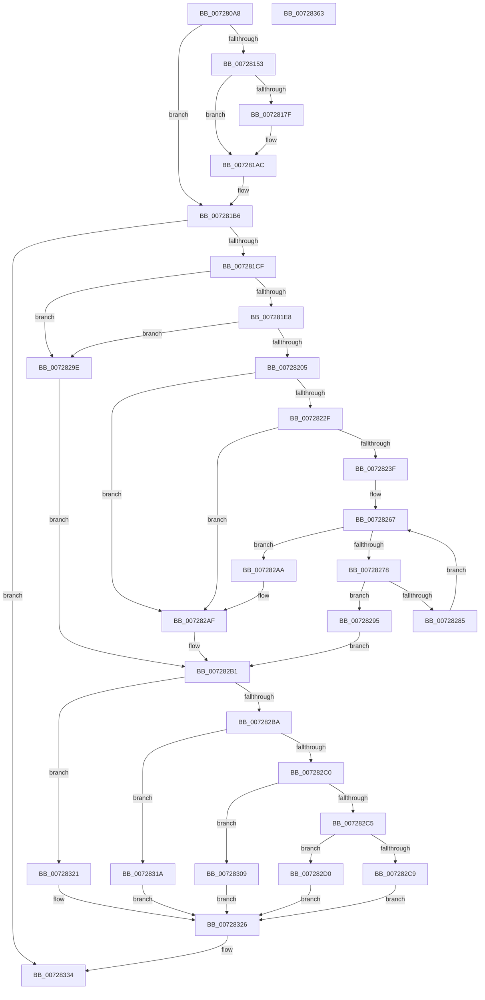

# PiGetDeviceRegistryProperty

- RVA: `0x007280A8`–`0x00728364` (길이 `700` bytes)
- VA: `0x00000001407280A8`
- 실행 섹션: `PAGE`
- PDB 이름 있음: `예`; PDB Function 태그: `아니요`
- unwind 정보 RVA: `0x000C8360`
- 디코드: `183`개 명령, `700/700` bytes 표시
- 미해석 바이트: `0` (있으면 어셈블리에 `.byte`로 보존)

> 이 문서는 커널 이미지의 기계어와 PDB 기호를 분석해 생성했습니다. 4번과 5번은 함수 원형과 자료형을 바이너리 사용 방식에서 추정한 C 해석이며 원본 소스 복구 결과는 아닙니다.

## 1. Dependencies

- 직접 호출 지점: **17**; 고유 호출 대상: **16**
- 직접 호출자로 확인된 함수: **1**
- RIP 상대 이미지 참조: **5**

### Outgoing calls
- `0x00728133` → [ExAcquireResourceExclusiveLite](../../text/21/ExAcquireResourceExclusiveLite_function_00214E20.md) (function, `0x00214E20`)
- `0x00728148` → [PnpDeviceObjectToDeviceInstance](../8F/PnpDeviceObjectToDeviceInstance_function_008FD630.md) (function, `0x008FD630`)
- `0x0072815E` → [RtlInitUnicodeString](../../text/42/RtlInitUnicodeString_function_0042A780.md) (function, `0x0042A780`)
- `0x00728174` → [IopOpenRegistryKeyEx](../A5/IopOpenRegistryKeyEx_function_00A51B44.md) (function, `0x00A51B44`)
- `0x00728184` → [ZwClose](../../text/6A/ZwClose_function_006AD2B0.md) (function, `0x006AD2B0`)
- `0x007281A5` → [IopGetRegistryValue](../99/IopGetRegistryValue_function_009990EC.md) (function, `0x009990EC`)
- `0x007281B1` → [ZwClose](../../text/6A/ZwClose_function_006AD2B0.md) (function, `0x006AD2B0`)
- `0x007281BD` → [ExReleaseResourceLite](../../text/25/ExReleaseResourceLite_function_0025FA10.md) (function, `0x0025FA10`)
- `0x007281C2` → [KeLeaveCriticalRegion](../../text/25/KeLeaveCriticalRegion_function_0025D8B0.md) (function, `0x0025D8B0`)
- `0x007281F8` → [PnpFindAlternateStringData](../A2/PnpFindAlternateStringData_function_00A2D4A8.md) (function, `0x00A2D4A8`)
- `0x0072821C` → [wcsstr](../../text/50/wcsstr_function_00501F80.md) (function, `0x00501F80`)
- `0x00728255` → [memset](../../text/6C/memset_function_006C6C40.md) (function, `0x006C6C40`)
- `0x0072826C` → [wcschr](../../text/50/wcschr_function_00501A60.md) (function, `0x00501A60`)
- `0x00728300` → [RtlFormatMessageEx](../A8/RtlFormatMessageEx_function_00A860E0.md) (function, `0x00A860E0`)
- `0x00728313` → [memcpy](../../text/6C/memcpy_function_006C6840.md) (function, `0x006C6840`)
- `0x0072832F` → [ExFreePoolWithTag](../../poolcode/B8/ExFreePoolWithTag_function_00B82870.md) (function, `0x00B82870`)
- `0x0072833D` → [_security_check_cookie](../../text/6A/_security_check_cookie_function_006AC640.md) (function, `0x006AC640`)

### Direct callers
- [sub_00B1F43A](../B1/Unknown_function_00B1F43A.md) at `0x00B1F44A`

### Static image references
- `0x007280CB` → RVA `0x00E0A740` (`.data`; read)
- `0x007280FA` → RVA `0x00F8C600` (`.data`; read)
- `0x00728153` → RVA `0x00AFD5E0` (` ?? ::NNGAKEGL::`string'`; read)
- `0x0072819E` → RVA `0x00AFD500` (` ?? ::NNGAKEGL::`string'`; read)
- `0x0072820A` → RVA `0x00AFD5F0` (` ?? ::NNGAKEGL::`string'`; read)

## 2. Other-region calls and transfers

- 다른 실행 섹션으로 향하는 call: **12**
  - `0x00728133` → [ExAcquireResourceExclusiveLite](../../text/21/ExAcquireResourceExclusiveLite_function_00214E20.md) (`PAGE` → `.text`)
  - `0x0072815E` → [RtlInitUnicodeString](../../text/42/RtlInitUnicodeString_function_0042A780.md) (`PAGE` → `.text`)
  - `0x00728184` → [ZwClose](../../text/6A/ZwClose_function_006AD2B0.md) (`PAGE` → `.text`)
  - `0x007281B1` → [ZwClose](../../text/6A/ZwClose_function_006AD2B0.md) (`PAGE` → `.text`)
  - `0x007281BD` → [ExReleaseResourceLite](../../text/25/ExReleaseResourceLite_function_0025FA10.md) (`PAGE` → `.text`)
  - `0x007281C2` → [KeLeaveCriticalRegion](../../text/25/KeLeaveCriticalRegion_function_0025D8B0.md) (`PAGE` → `.text`)
  - `0x0072821C` → [wcsstr](../../text/50/wcsstr_function_00501F80.md) (`PAGE` → `.text`)
  - `0x00728255` → [memset](../../text/6C/memset_function_006C6C40.md) (`PAGE` → `.text`)
  - `0x0072826C` → [wcschr](../../text/50/wcschr_function_00501A60.md) (`PAGE` → `.text`)
  - `0x00728313` → [memcpy](../../text/6C/memcpy_function_006C6840.md) (`PAGE` → `.text`)
  - `0x0072832F` → [ExFreePoolWithTag](../../poolcode/B8/ExFreePoolWithTag_function_00B82870.md) (`PAGE` → `POOLCODE`)
  - `0x0072833D` → [_security_check_cookie](../../text/6A/_security_check_cookie_function_006AC640.md) (`PAGE` → `.text`)
- 별도 외부 분기/꼬리 이동을 확인하지 못했습니다.

## 3. Assembly (complete function range)

```asm
007280A8  48 8B C4                        mov rax, rsp
007280AB  48 89 58 10                     mov qword ptr [rax + 0x10], rbx
007280AF  48 89 70 18                     mov qword ptr [rax + 0x18], rsi
007280B3  48 89 78 20                     mov qword ptr [rax + 0x20], rdi
007280B7  55                              push rbp
007280B8  41 54                           push r12
007280BA  41 55                           push r13
007280BC  41 56                           push r14
007280BE  41 57                           push r15
007280C0  48 8D 68 88                     lea rbp, [rax - 0x78]
007280C4  48 81 EC 50 01 00 00            sub rsp, 0x150
007280CB  48 8B 05 6E 26 6E 00            mov rax, qword ptr [rip + 0x6e266e]
007280D2  48 33 C4                        xor rax, rsp
007280D5  48 89 45 40                     mov qword ptr [rbp + 0x40], rax
007280D9  48 8B 85 A0 00 00 00            mov rax, qword ptr [rbp + 0xa0]
007280E0  45 33 FF                        xor r15d, r15d
007280E3  4C 8B AD A8 00 00 00            mov r13, qword ptr [rbp + 0xa8]
007280EA  0F 57 C0                        xorps xmm0, xmm0
007280ED  4C 89 7C 24 58                  mov qword ptr [rsp + 0x58], r15
007280F2  48 8B D9                        mov rbx, rcx
007280F5  4C 89 7C 24 68                  mov qword ptr [rsp + 0x68], r15
007280FA  48 8D 0D FF 44 86 00            lea rcx, [rip + 0x8644ff]
00728101  0F 11 45 88                     movups xmmword ptr [rbp - 0x78], xmm0
00728105  48 89 45 80                     mov qword ptr [rbp - 0x80], rax
00728109  B2 01                           mov dl, 1
0072810B  65 48 8B 04 25 88 01 00 00      mov rax, qword ptr gs:[0x188]
00728114  45 8B E7                        mov r12d, r15d
00728117  4C 89 6C 24 78                  mov qword ptr [rsp + 0x78], r13
0072811C  4C 89 7C 24 70                  mov qword ptr [rsp + 0x70], r15
00728121  44 89 7C 24 54                  mov dword ptr [rsp + 0x54], r15d
00728126  66 FF 88 E4 01 00 00            dec word ptr [rax + 0x1e4]
0072812D  90                              nop
0072812E  4C 89 7C 24 60                  mov qword ptr [rsp + 0x60], r15
00728133  E8 E8 CC AE FF                  call 0x140214e20
00728138  BF 19 00 02 00                  mov edi, 0x20019
0072813D  48 8D 54 24 58                  lea rdx, [rsp + 0x58]
00728142  44 8B C7                        mov r8d, edi
00728145  48 8B CB                        mov rcx, rbx
00728148  E8 E3 54 1D 00                  call 0x1408fd630
0072814D  8B D8                           mov ebx, eax
0072814F  85 C0                           test eax, eax
00728151  78 63                           js 0x1407281b6
00728153  48 8D 15 86 54 3D 00            lea rdx, [rip + 0x3d5486]
0072815A  48 8D 4D 88                     lea rcx, [rbp - 0x78]
0072815E  E8 1D 26 D0 FF                  call 0x14042a780
00728163  48 8B 54 24 58                  mov rdx, qword ptr [rsp + 0x58]
00728168  4C 8D 45 88                     lea r8, [rbp - 0x78]
0072816C  44 8B CF                        mov r9d, edi
0072816F  48 8D 4C 24 68                  lea rcx, [rsp + 0x68]
00728174  E8 CB 99 32 00                  call 0x140a51b44
00728179  8B D8                           mov ebx, eax
0072817B  85 C0                           test eax, eax
0072817D  78 2D                           js 0x1407281ac
0072817F  48 8B 4C 24 58                  mov rcx, qword ptr [rsp + 0x58]
00728184  E8 27 51 F8 FF                  call 0x1406ad2b0
00728189  48 8B 4C 24 68                  mov rcx, qword ptr [rsp + 0x68]
0072818E  4C 8D 4C 24 70                  lea r9, [rsp + 0x70]
00728193  41 B8 40 01 00 00               mov r8d, 0x140
00728199  48 89 4C 24 58                  mov qword ptr [rsp + 0x58], rcx
0072819E  48 8D 15 5B 53 3D 00            lea rdx, [rip + 0x3d535b]
007281A5  E8 42 0F 27 00                  call 0x1409990ec
007281AA  8B D8                           mov ebx, eax
007281AC  48 8B 4C 24 58                  mov rcx, qword ptr [rsp + 0x58]
007281B1  E8 FA 50 F8 FF                  call 0x1406ad2b0
007281B6  48 8D 0D 43 44 86 00            lea rcx, [rip + 0x864443]
007281BD  E8 4E 78 B3 FF                  call 0x14025fa10
007281C2  E8 E9 56 B3 FF                  call 0x14025d8b0
007281C7  85 DB                           test ebx, ebx
007281C9  0F 88 65 01 00 00               js 0x140728334
007281CF  48 8B 74 24 70                  mov rsi, qword ptr [rsp + 0x70]
007281D4  8B 7E 08                        mov edi, dword ptr [rsi + 8]
007281D7  44 8B 76 0C                     mov r14d, dword ptr [rsi + 0xc]
007281DB  48 03 FE                        add rdi, rsi
007281DE  83 7E 04 01                     cmp dword ptr [rsi + 4], 1
007281E2  0F 85 B6 00 00 00               jne 0x14072829e
007281E8  4C 8D 4C 24 54                  lea r9, [rsp + 0x54]
007281ED  41 8B D6                        mov edx, r14d
007281F0  4C 8D 44 24 60                  lea r8, [rsp + 0x60]
007281F5  48 8B CF                        mov rcx, rdi
007281F8  E8 AB 52 30 00                  call 0x140a2d4a8
007281FD  85 C0                           test eax, eax
007281FF  0F 84 99 00 00 00               je 0x14072829e
00728205  4C 8B 7C 24 60                  mov r15, qword ptr [rsp + 0x60]
0072820A  48 8D 15 DF 53 3D 00            lea rdx, [rip + 0x3d53df]
00728211  44 8B 74 24 54                  mov r14d, dword ptr [rsp + 0x54]
00728216  49 8B CF                        mov rcx, r15
00728219  49 8B FF                        mov rdi, r15
0072821C  E8 5F 9D DD FF                  call 0x140501f80
00728221  33 D2                           xor edx, edx
00728223  4C 8B E0                        mov r12, rax
00728226  48 85 C0                        test rax, rax
00728229  0F 84 80 00 00 00               je 0x1407282af
0072822F  41 8B CE                        mov ecx, r14d
00728232  D1 E9                           shr ecx, 1
00728234  83 E9 02                        sub ecx, 2
00728237  66 41 83 3C 4F 29               cmp word ptr [r15 + rcx*2], 0x29
0072823D  75 70                           jne 0x1407282af
0072823F  66 89 10                        mov word ptr [rax], dx
00728242  49 83 C4 04                     add r12, 4
00728246  66 41 89 14 4F                  mov word ptr [r15 + rcx*2], dx
0072824B  41 B8 98 00 00 00               mov r8d, 0x98
00728251  48 8D 4D A8                     lea rcx, [rbp - 0x58]
00728255  E8 E6 E9 F9 FF                  call 0x1406c6c40
0072825A  49 8B CC                        mov rcx, r12
0072825D  4C 89 65 A0                     mov qword ptr [rbp - 0x60], r12
00728261  41 BD 01 00 00 00               mov r13d, 1
00728267  BA 2C 00 00 00                  mov edx, 0x2c
0072826C  E8 EF 97 DD FF                  call 0x140501a60
00728271  33 D2                           xor edx, edx
00728273  48 85 C0                        test rax, rax
00728276  74 32                           je 0x1407282aa
00728278  66 89 10                        mov word ptr [rax], dx
0072827B  48 83 C0 02                     add rax, 2
0072827F  41 83 FD 13                     cmp r13d, 0x13
00728283  73 10                           jae 0x140728295
00728285  41 8B CD                        mov ecx, r13d
00728288  41 FF C5                        inc r13d
0072828B  48 89 44 CD A0                  mov qword ptr [rbp + rcx*8 - 0x60], rax
00728290  48 8B C8                        mov rcx, rax
00728293  EB D2                           jmp 0x140728267
00728295  4C 8B 6C 24 78                  mov r13, qword ptr [rsp + 0x78]
0072829A  B1 01                           mov cl, 1
0072829C  EB 13                           jmp 0x1407282b1
0072829E  4C 8B 7C 24 60                  mov r15, qword ptr [rsp + 0x60]
007282A3  41 8A CC                        mov cl, r12b
007282A6  33 D2                           xor edx, edx
007282A8  EB 07                           jmp 0x1407282b1
007282AA  4C 8B 6C 24 78                  mov r13, qword ptr [rsp + 0x78]
007282AF  8A CA                           mov cl, dl
007282B1  41 8B 45 00                     mov eax, dword ptr [r13]
007282B5  41 3B C6                        cmp eax, r14d
007282B8  72 67                           jb 0x140728321
007282BA  83 7E 04 08                     cmp dword ptr [rsi + 4], 8
007282BE  75 5A                           jne 0x14072831a
007282C0  4D 85 E4                        test r12, r12
007282C3  74 44                           je 0x140728309
007282C5  84 C9                           test cl, cl
007282C7  74 07                           je 0x1407282d0
007282C9  BB CD 00 00 C0                  mov ebx, 0xc00000cd
007282CE  EB 56                           jmp 0x140728326
007282D0  48 8B 4D 80                     mov rcx, qword ptr [rbp - 0x80]
007282D4  45 33 C9                        xor r9d, r9d
007282D7  48 89 54 24 48                  mov qword ptr [rsp + 0x48], rdx
007282DC  45 33 C0                        xor r8d, r8d
007282DF  4C 89 6C 24 40                  mov qword ptr [rsp + 0x40], r13
007282E4  33 D2                           xor edx, edx
007282E6  89 44 24 38                     mov dword ptr [rsp + 0x38], eax
007282EA  48 8D 45 A0                     lea rax, [rbp - 0x60]
007282EE  48 89 4C 24 30                  mov qword ptr [rsp + 0x30], rcx
007282F3  49 8B CF                        mov rcx, r15
007282F6  48 89 44 24 28                  mov qword ptr [rsp + 0x28], rax
007282FB  C6 44 24 20 01                  mov byte ptr [rsp + 0x20], 1
00728300  E8 DB DD 35 00                  call 0x140a860e0
00728305  8B D8                           mov ebx, eax
00728307  EB 1D                           jmp 0x140728326
00728309  48 8B 4D 80                     mov rcx, qword ptr [rbp - 0x80]
0072830D  48 8B D7                        mov rdx, rdi
00728310  45 8B C6                        mov r8d, r14d
00728313  E8 28 E5 F9 FF                  call 0x1406c6840
00728318  EB 0C                           jmp 0x140728326
0072831A  BB F0 00 00 C0                  mov ebx, 0xc00000f0
0072831F  EB 05                           jmp 0x140728326
00728321  BB 23 00 00 C0                  mov ebx, 0xc0000023
00728326  33 D2                           xor edx, edx
00728328  45 89 75 00                     mov dword ptr [r13], r14d
0072832C  48 8B CE                        mov rcx, rsi
0072832F  E8 3C A5 45 00                  call 0x140b82870
00728334  8B C3                           mov eax, ebx
00728336  48 8B 4D 40                     mov rcx, qword ptr [rbp + 0x40]
0072833A  48 33 CC                        xor rcx, rsp
0072833D  E8 FE 42 F8 FF                  call 0x1406ac640
00728342  4C 8D 9C 24 50 01 00 00         lea r11, [rsp + 0x150]
0072834A  49 8B 5B 38                     mov rbx, qword ptr [r11 + 0x38]
0072834E  49 8B 73 40                     mov rsi, qword ptr [r11 + 0x40]
00728352  49 8B 7B 48                     mov rdi, qword ptr [r11 + 0x48]
00728356  49 8B E3                        mov rsp, r11
00728359  41 5F                           pop r15
0072835B  41 5E                           pop r14
0072835D  41 5D                           pop r13
0072835F  41 5C                           pop r12
00728361  5D                              pop rbp
00728362  C3                              ret
00728363  CC                              int3
```

## 4. C-style interpretation (structured pseudocode)

```c
__int64 __fastcall PiGetDeviceRegistryProperty(__int64 a1)
{
    __int64 result;
    __int64 v_r12;
    __int64 v_r13;
    __int64 v_r15;
    __int64 v_rbx;
    __int64 v_rdi;
    __int64 v_rsp;
    unsigned __int64 v_stack_m100;
    unsigned __int64 v_stack_m108;
    unsigned __int64 v_stack_m110;
    unsigned __int64 v_stack_m118;
    unsigned __int64 v_stack_m120;
    unsigned int v_stack_m124;
    unsigned __int64 v_stack_m130;
    unsigned __int64 v_stack_m138;
    unsigned int v_stack_m140;
    unsigned __int64 v_stack_m148;
    unsigned __int64 v_stack_m150;
    unsigned __int8 v_stack_m158;
    unsigned __int64 v_stack_m28;

    *(unsigned __int64 *)(v_rsp + 16) = v_rbx;
    *(unsigned __int64 *)(v_rsp + 24) = v_rsi;
    *(unsigned __int64 *)(v_rsp + 32) = v_rdi;
    v_rsp = (v_rsp) - (336);
    result = (*(unsigned __int64 *)(v_rip + 7218798)) ^ (v_rsp);
    *(unsigned __int64 *)(v_rsp - 120 + 64) = result;
    v_r15 = 0;
    v_stack_m120 = 0;
    v_stack_m110 = 0;
    *(unsigned __int64 *)(v_rsp - 120 - 120) = v_xmm0;
    *(unsigned __int64 *)(v_rsp - 120 - 128) = *(unsigned __int64 *)(v_rsp - 120 + 160);
    v_stack_m100 = *(unsigned __int64 *)(v_rsp - 120 + 168);
    v_stack_m108 = 0;
    v_stack_m124 = 0;
    v_stack_m118 = 0;
    result = ExAcquireResourceExclusiveLite(v_rip + 8799487, 1, a3, a4);
    result = PnpDeviceObjectToDeviceInstance(a1, v_stack_m120, (unsigned int)((unsigned int)((unsigned int)(0x20019ULL))), a4);
    if (sign_flag) goto loc_007281B6;
    result = RtlInitUnicodeString(v_rsp - 120 - 120, v_rip + 4019334, (unsigned int)((unsigned int)((unsigned int)(0x20019ULL))), a4);
    result = IopOpenRegistryKeyEx(v_stack_m110, v_stack_m120, v_rsp - 120 - 120, (unsigned int)((unsigned int)((unsigned int)(0x20019ULL))));
    v_rbx = (unsigned int)((unsigned int)(result));
    if (!(sign_flag)) {
        a1 = v_stack_m120;
        result = ZwClose(a1, v_stack_m120, v_rsp - 120 - 120, (unsigned int)((unsigned int)((unsigned int)(0x20019ULL))));
        a1 = v_stack_m110;
        a4 = v_stack_m108;
        a3 = 320;
        v_stack_m120 = a1;
        a2 = v_rip + 4019035;
        result = IopGetRegistryValue(a1, a2, a3, a4);
        v_rbx = (unsigned int)(result);
    }
    result = ZwClose(v_stack_m120, a2, a3, a4);
loc_007281B6:
    result = ExReleaseResourceLite(v_rip + 8799299, a2, a3, a4);
    result = KeLeaveCriticalRegion(v_rip + 8799299, a2, a3, a4);
    if (sign_flag) goto loc_00728334;
    v_rdi = ((unsigned int)(*(unsigned int *)(v_stack_m108 + 8))) + (v_stack_m108);
    if ((*(unsigned int *)(v_stack_m108 + 4)) != 1) goto loc_0072829E;
    result = PnpFindAlternateStringData(v_rdi, (unsigned int)((unsigned int)((unsigned int)(*(unsigned int *)(v_stack_m108 + 12)))), v_stack_m118, v_stack_m124);
    if ((unsigned int)(result) == 0) goto loc_0072829E;
    result = wcsstr(v_stack_m118, v_rip + 4019167, v_stack_m118, v_stack_m124);
    a2 = 0;
    if (result == 0) goto loc_007282AF;
    a1 = (unsigned int)(((unsigned int)((unsigned int)((unsigned int)(v_stack_m124)))) >> (1));
    a1 = (unsigned int)((a1) - (2));
    if ((*(unsigned __int16 *)(v_stack_m118 + a1 * 2)) != 41) goto loc_007282AF;
    *(unsigned __int16 *)(result) = 0;
    v_r12 = (result) + (4);
    *(unsigned __int16 *)(v_stack_m118 + a1 * 2) = 0;
    result = memset(v_rsp - 120 - 88, a2, 152, v_stack_m124);
    *(unsigned __int64 *)(v_rsp - 120 - 96) = v_r12;
loc_00728267:
    result = wcschr(v_r12, 44, 152, v_stack_m124);
    a2 = 0;
    if (result == 0) goto loc_007282AA;
    *(unsigned __int16 *)(result) = 0;
    result = (result) + (2);
    if (1 >= 19) goto loc_00728295;
    v_r13 = (unsigned int)((1) + 1);
    *(unsigned __int64 *)(v_rsp - 120 + 1 * 8 - 96) = result;
    goto loc_00728267;
loc_00728295:
    goto loc_007282B1;
loc_0072829E:
    a2 = 0;
    goto loc_007282B1;
loc_007282AA:
loc_007282AF:
loc_007282B1:
    if (((unsigned int)((unsigned int)(*(unsigned int *)(v_stack_m100)))) < ((unsigned int)((unsigned int)(v_stack_m124)))) goto loc_00728321;
    if ((*(unsigned int *)(v_stack_m108 + 4)) != 8) goto loc_0072831A;
    if (v_r12 == 0) goto loc_00728309;
    if (0 == 0) goto loc_007282D0;
    goto loc_00728326;
loc_007282D0:
    a4 = 0;
    v_stack_m130 = 0;
    a3 = 0;
    v_stack_m138 = v_stack_m100;
    a2 = 0;
    v_stack_m140 = (unsigned int)((unsigned int)(*(unsigned int *)(v_stack_m100)));
    v_stack_m148 = *(unsigned __int64 *)(v_rsp - 120 - 128);
    v_stack_m150 = v_rsp - 120 - 96;
    v_stack_m158 = 1;
    result = RtlFormatMessageEx(v_stack_m118, a2, a3, a4);
    goto loc_00728326;
loc_00728309:
    result = memcpy(*(unsigned __int64 *)(v_rsp - 120 - 128), v_stack_m118, (unsigned int)((unsigned int)((unsigned int)(v_stack_m124))), a4);
    goto loc_00728326;
loc_0072831A:
    goto loc_00728326;
loc_00728321:
loc_00728326:
    a2 = 0;
    *(unsigned int *)(v_stack_m100) = (unsigned int)((unsigned int)(v_stack_m124));
    result = ExFreePoolWithTag(v_stack_m108, a2, (unsigned int)((unsigned int)((unsigned int)(v_stack_m124))), a4);
loc_00728334:
    a1 = (*(unsigned __int64 *)(v_rsp - 120 + 64)) ^ (v_rsp);
    result = _security_check_cookie(a1, a2, (unsigned int)((unsigned int)((unsigned int)(v_stack_m124))), a4);
    return result;
}
```

## 5. (Beta) C Style

```c
int64_t PiGetDeviceRegistryProperty(int64_t Arg1)
{
    int64_t result;
    int64_t local_r12;
    int64_t local_r13;
    int64_t local_r15;
    int64_t local_rbx;
    int64_t local_rdi;
    int64_t local_rsp;
    uint64_t v_stack_m100;
    uint64_t v_stack_m108;
    uint64_t v_stack_m110;
    uint64_t v_stack_m118;
    uint64_t v_stack_m120;
    uint32_t v_stack_m124;
    uint64_t v_stack_m130;
    uint64_t v_stack_m138;
    uint32_t v_stack_m140;
    uint64_t v_stack_m148;
    uint64_t v_stack_m150;
    uint8_t v_stack_m158;
    uint64_t v_stack_m28;

    *(uint64_t *)(local_rsp + 0x10) = local_rbx;
    *(uint64_t *)(local_rsp + 0x18) = local_rsi;
    *(uint64_t *)(local_rsp + 0x20) = local_rdi;
    local_rsp = (local_rsp) - (336);
    result = (*(uint64_t *)(v_rip + 0x6E266E)) ^ (local_rsp);
    *(uint64_t *)(local_rsp - 0x78 + 0x40) = result;
    local_r15 = 0;
    v_stack_m120 = 0;
    v_stack_m110 = 0;
    *(uint64_t *)(local_rsp - 0x78 - 0x78) = v_xmm0;
    *(uint64_t *)(local_rsp - 0x78 - 0x80) = *(uint64_t *)(local_rsp - 0x78 + 0xA0);
    v_stack_m100 = *(uint64_t *)(local_rsp - 0x78 + 0xA8);
    v_stack_m108 = 0;
    v_stack_m124 = 0;
    v_stack_m118 = 0;
    result = ExAcquireResourceExclusiveLite(v_rip + 8799487, 1, a3, a4);
    result = PnpDeviceObjectToDeviceInstance(Arg1, v_stack_m120, (uint32_t)((uint32_t)((uint32_t)(0x20019ULL))), a4);
    if (sign_flag) goto loc_007281B6;
    result = RtlInitUnicodeString(local_rsp - 120 - 120, v_rip + 4019334, (uint32_t)((uint32_t)((uint32_t)(0x20019ULL))), a4);
    result = IopOpenRegistryKeyEx(v_stack_m110, v_stack_m120, local_rsp - 120 - 120, (uint32_t)((uint32_t)((uint32_t)(0x20019ULL))));
    local_rbx = (uint32_t)((uint32_t)(result));
    if (!(sign_flag)) {
        Arg1 = v_stack_m120;
        result = ZwClose(Arg1, v_stack_m120, local_rsp - 120 - 120, (uint32_t)((uint32_t)((uint32_t)(0x20019ULL))));
        Arg1 = v_stack_m110;
        a4 = v_stack_m108;
        a3 = 320;
        v_stack_m120 = Arg1;
        a2 = v_rip + 4019035;
        result = IopGetRegistryValue(Arg1, a2, a3, a4);
        local_rbx = (uint32_t)(result);
    }
    result = ZwClose(v_stack_m120, a2, a3, a4);
loc_007281B6:
    result = ExReleaseResourceLite(v_rip + 8799299, a2, a3, a4);
    result = KeLeaveCriticalRegion(v_rip + 8799299, a2, a3, a4);
    if (sign_flag) goto loc_00728334;
    local_rdi = ((uint32_t)(*(uint32_t *)(v_stack_m108 + 0x8))) + (v_stack_m108);
    if ((*(uint32_t *)(v_stack_m108 + 0x4)) != 1) goto loc_0072829E;
    result = PnpFindAlternateStringData(local_rdi, (uint32_t)((uint32_t)((uint32_t)(*(uint32_t *)(v_stack_m108 + 0xC)))), v_stack_m118, v_stack_m124);
    if ((uint32_t)(result) == 0) goto loc_0072829E;
    result = wcsstr(v_stack_m118, v_rip + 4019167, v_stack_m118, v_stack_m124);
    a2 = 0;
    if (result == 0) goto loc_007282AF;
    Arg1 = (uint32_t)(((uint32_t)((uint32_t)((uint32_t)(v_stack_m124)))) >> (1));
    Arg1 = (uint32_t)((Arg1) - (2));
    if ((*(uint16_t *)(v_stack_m118 + Arg1 * 2)) != 41) goto loc_007282AF;
    *(uint16_t *)(result) = 0;
    local_r12 = (result) + (4);
    *(uint16_t *)(v_stack_m118 + Arg1 * 2) = 0;
    result = memset(local_rsp - 120 - 88, a2, 152, v_stack_m124);
    *(uint64_t *)(local_rsp - 0x78 - 0x60) = local_r12;
loc_00728267:
    result = wcschr(local_r12, 44, 152, v_stack_m124);
    a2 = 0;
    if (result == 0) goto loc_007282AA;
    *(uint16_t *)(result) = 0;
    result = (result) + (2);
    if (1 >= 19) goto loc_00728295;
    local_r13 = (uint32_t)((1) + 1);
    *(uint64_t *)(local_rsp - 0x78 + 0x1 * 8 - 0x60) = result;
    goto loc_00728267;
loc_00728295:
    goto loc_007282B1;
loc_0072829E:
    a2 = 0;
    goto loc_007282B1;
loc_007282AA:
loc_007282AF:
loc_007282B1:
    if (((uint32_t)((uint32_t)(*(uint32_t *)(v_stack_m100)))) < ((uint32_t)((uint32_t)(v_stack_m124)))) goto loc_00728321;
    if ((*(uint32_t *)(v_stack_m108 + 0x4)) != 8) goto loc_0072831A;
    if (local_r12 == 0) goto loc_00728309;
    if (0 == 0) goto loc_007282D0;
    goto loc_00728326;
loc_007282D0:
    a4 = 0;
    v_stack_m130 = 0;
    a3 = 0;
    v_stack_m138 = v_stack_m100;
    a2 = 0;
    v_stack_m140 = (uint32_t)((uint32_t)(*(uint32_t *)(v_stack_m100)));
    v_stack_m148 = *(uint64_t *)(local_rsp - 0x78 - 0x80);
    v_stack_m150 = local_rsp - 120 - 96;
    v_stack_m158 = 1;
    result = RtlFormatMessageEx(v_stack_m118, a2, a3, a4);
    goto loc_00728326;
loc_00728309:
    result = memcpy(*(uint64_t *)(local_rsp - 0x78 - 0x80), v_stack_m118, (uint32_t)((uint32_t)((uint32_t)(v_stack_m124))), a4);
    goto loc_00728326;
loc_0072831A:
    goto loc_00728326;
loc_00728321:
loc_00728326:
    a2 = 0;
    *(uint32_t *)(v_stack_m100) = (uint32_t)((uint32_t)(v_stack_m124));
    result = ExFreePoolWithTag(v_stack_m108, a2, (uint32_t)((uint32_t)((uint32_t)(v_stack_m124))), a4);
loc_00728334:
    Arg1 = (*(uint64_t *)(local_rsp - 0x78 + 0x40)) ^ (local_rsp);
    result = _security_check_cookie(Arg1, a2, (uint32_t)((uint32_t)((uint32_t)(v_stack_m124))), a4);
    return result;
}
```

## 6. Execution-region graph

[열기: 2D/3D 그래프와 함수 탐색 컨트롤 패널](../../../control-panel.html?section=page&rva=0x007280A8&view=graph)

- 2D 그래프는 위에서 아래로 흐르고, 3D 그래프는 빈 공간을 드래그해 회전합니다. Shift+드래그는 이동, 휠은 확대·축소, 함수 노드 선택은 대상 보고서 이동입니다.

### Static fallback


