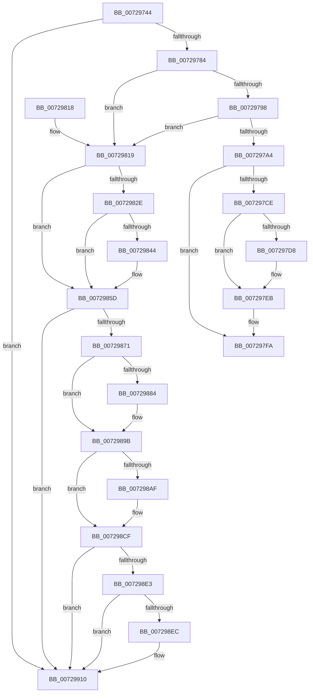

# PiGetDmaAdapterFromBusInterface

- RVA: `0x00729744`–`0x00729929` (길이 `485` bytes)
- VA: `0x0000000140729744`
- 실행 섹션: `PAGE`
- PDB 이름 있음: `예`; PDB Function 태그: `아니요`
- unwind 정보 RVA: `0x000C8400`
- 디코드: `123`개 명령, `485/485` bytes 표시
- 미해석 바이트: `0` (있으면 어셈블리에 `.byte`로 보존)

> 이 문서는 커널 이미지의 기계어와 PDB 기호를 분석해 생성했습니다. 4번과 5번은 함수 원형과 자료형을 바이너리 사용 방식에서 추정한 C 해석이며 원본 소스 복구 결과는 아닙니다.

## 1. Dependencies

- 직접 호출 지점: **16**; 고유 호출 대상: **5**
- 직접 호출자로 확인된 함수: **1**
- RIP 상대 이미지 참조: **1**

### Outgoing calls
- `0x00729770` → [memset](../../text/6C/memset_function_006C6C40.md) (function, `0x006C6C40`)
- `0x007297C5` → [PnpQueryInterface](../A2/PnpQueryInterface_function_00A28D38.md) (function, `0x00A28D38`)
- `0x007297E3` → [guard_dispatch_icall](../../text/6B/guard_dispatch_icall_function_006BAAD0.md) (function, `0x006BAAD0`)
- `0x007297F5` → [guard_dispatch_icall](../../text/6B/guard_dispatch_icall_function_006BAAD0.md) (function, `0x006BAAD0`)
- `0x00729820` → [IoAddTriageDumpDataBlock](../../text/42/IoAddTriageDumpDataBlock_function_00428374.md) (function, `0x00428374`)
- `0x00729832` → [IoAddTriageDumpDataBlock](../../text/42/IoAddTriageDumpDataBlock_function_00428374.md) (function, `0x00428374`)
- `0x00729847` → [IoAddTriageDumpDataBlock](../../text/42/IoAddTriageDumpDataBlock_function_00428374.md) (function, `0x00428374`)
- `0x00729858` → [IoAddTriageDumpDataBlock](../../text/42/IoAddTriageDumpDataBlock_function_00428374.md) (function, `0x00428374`)
- `0x0072987A` → [IoAddTriageDumpDataBlock](../../text/42/IoAddTriageDumpDataBlock_function_00428374.md) (function, `0x00428374`)
- `0x0072988A` → [IoAddTriageDumpDataBlock](../../text/42/IoAddTriageDumpDataBlock_function_00428374.md) (function, `0x00428374`)
- `0x00729896` → [IoAddTriageDumpDataBlock](../../text/42/IoAddTriageDumpDataBlock_function_00428374.md) (function, `0x00428374`)
- `0x007298B2` → [IoAddTriageDumpDataBlock](../../text/42/IoAddTriageDumpDataBlock_function_00428374.md) (function, `0x00428374`)
- `0x007298CA` → [IoAddTriageDumpDataBlock](../../text/42/IoAddTriageDumpDataBlock_function_00428374.md) (function, `0x00428374`)
- `0x007298EF` → [IoAddTriageDumpDataBlock](../../text/42/IoAddTriageDumpDataBlock_function_00428374.md) (function, `0x00428374`)
- `0x0072990B` → [IoAddTriageDumpDataBlock](../../text/42/IoAddTriageDumpDataBlock_function_00428374.md) (function, `0x00428374`)
- `0x00729923` → [KeBugCheckEx](../../text/4F/KeBugCheckEx_function_004FD660.md) (function, `0x004FD660`)

### Direct callers
- [IoGetDmaAdapter](IoGetDmaAdapter_function_00729450.md) at `0x0072954A`

### Static image references
- `0x007297BE` → RVA `0x00024098` (`.rdata`; read)

## 2. Other-region calls and transfers

- 다른 실행 섹션으로 향하는 call: **15**
  - `0x00729770` → [memset](../../text/6C/memset_function_006C6C40.md) (`PAGE` → `.text`)
  - `0x007297E3` → [guard_dispatch_icall](../../text/6B/guard_dispatch_icall_function_006BAAD0.md) (`PAGE` → `.text`)
  - `0x007297F5` → [guard_dispatch_icall](../../text/6B/guard_dispatch_icall_function_006BAAD0.md) (`PAGE` → `.text`)
  - `0x00729820` → [IoAddTriageDumpDataBlock](../../text/42/IoAddTriageDumpDataBlock_function_00428374.md) (`PAGE` → `.text`)
  - `0x00729832` → [IoAddTriageDumpDataBlock](../../text/42/IoAddTriageDumpDataBlock_function_00428374.md) (`PAGE` → `.text`)
  - `0x00729847` → [IoAddTriageDumpDataBlock](../../text/42/IoAddTriageDumpDataBlock_function_00428374.md) (`PAGE` → `.text`)
  - `0x00729858` → [IoAddTriageDumpDataBlock](../../text/42/IoAddTriageDumpDataBlock_function_00428374.md) (`PAGE` → `.text`)
  - `0x0072987A` → [IoAddTriageDumpDataBlock](../../text/42/IoAddTriageDumpDataBlock_function_00428374.md) (`PAGE` → `.text`)
  - `0x0072988A` → [IoAddTriageDumpDataBlock](../../text/42/IoAddTriageDumpDataBlock_function_00428374.md) (`PAGE` → `.text`)
  - `0x00729896` → [IoAddTriageDumpDataBlock](../../text/42/IoAddTriageDumpDataBlock_function_00428374.md) (`PAGE` → `.text`)
  - `0x007298B2` → [IoAddTriageDumpDataBlock](../../text/42/IoAddTriageDumpDataBlock_function_00428374.md) (`PAGE` → `.text`)
  - `0x007298CA` → [IoAddTriageDumpDataBlock](../../text/42/IoAddTriageDumpDataBlock_function_00428374.md) (`PAGE` → `.text`)
  - `0x007298EF` → [IoAddTriageDumpDataBlock](../../text/42/IoAddTriageDumpDataBlock_function_00428374.md) (`PAGE` → `.text`)
  - `0x0072990B` → [IoAddTriageDumpDataBlock](../../text/42/IoAddTriageDumpDataBlock_function_00428374.md) (`PAGE` → `.text`)
  - `0x00729923` → [KeBugCheckEx](../../text/4F/KeBugCheckEx_function_004FD660.md) (`PAGE` → `.text`)
- 별도 외부 분기/꼬리 이동을 확인하지 못했습니다.

## 3. Assembly (complete function range)

```asm
00729744  48 8B C4                        mov rax, rsp
00729747  48 89 58 08                     mov qword ptr [rax + 8], rbx
0072974B  48 89 68 10                     mov qword ptr [rax + 0x10], rbp
0072974F  48 89 70 18                     mov qword ptr [rax + 0x18], rsi
00729753  48 89 78 20                     mov qword ptr [rax + 0x20], rdi
00729757  41 56                           push r14
00729759  48 83 EC 70                     sub rsp, 0x70
0072975D  48 8B EA                        mov rbp, rdx
00729760  49 8B F0                        mov rsi, r8
00729763  33 D2                           xor edx, edx
00729765  48 8B F9                        mov rdi, rcx
00729768  48 8D 48 B8                     lea rcx, [rax - 0x48]
0072976C  44 8D 42 40                     lea r8d, [rdx + 0x40]
00729770  E8 CB D4 F9 FF                  call 0x1406c6c40
00729775  33 DB                           xor ebx, ebx
00729777  44 8D 73 02                     lea r14d, [rbx + 2]
0072977B  48 85 FF                        test rdi, rdi
0072977E  0F 84 8C 01 00 00               je 0x140729910
00729784  48 8B 87 38 01 00 00            mov rax, qword ptr [rdi + 0x138]
0072978B  48 8B 40 28                     mov rax, qword ptr [rax + 0x28]
0072978F  48 85 C0                        test rax, rax
00729792  0F 84 81 00 00 00               je 0x140729819
00729798  F7 80 8C 01 00 00 00 00 02 00   test dword ptr [rax + 0x18c], 0x20000
007297A2  75 75                           jne 0x140729819
007297A4  48 8D 44 24 30                  lea rax, [rsp + 0x30]
007297A9  48 8B CF                        mov rcx, rdi
007297AC  48 89 44 24 28                  mov qword ptr [rsp + 0x28], rax
007297B1  44 8D 4B 40                     lea r9d, [rbx + 0x40]
007297B5  44 8D 43 01                     lea r8d, [rbx + 1]
007297B9  48 89 5C 24 20                  mov qword ptr [rsp + 0x20], rbx
007297BE  48 8D 15 D3 A8 8F FF            lea rdx, [rip - 0x70572d]
007297C5  E8 6E F5 2F 00                  call 0x140a28d38
007297CA  85 C0                           test eax, eax
007297CC  78 2C                           js 0x1407297fa
007297CE  48 8B 44 24 58                  mov rax, qword ptr [rsp + 0x58]
007297D3  48 85 C0                        test rax, rax
007297D6  74 13                           je 0x1407297eb
007297D8  48 8B 4C 24 38                  mov rcx, qword ptr [rsp + 0x38]
007297DD  4C 8B C6                        mov r8, rsi
007297E0  48 8B D5                        mov rdx, rbp
007297E3  E8 E8 12 F9 FF                  call 0x1406baad0
007297E8  48 8B D8                        mov rbx, rax
007297EB  48 8B 4C 24 38                  mov rcx, qword ptr [rsp + 0x38]
007297F0  48 8B 44 24 48                  mov rax, qword ptr [rsp + 0x48]
007297F5  E8 D6 12 F9 FF                  call 0x1406baad0
007297FA  4C 8D 5C 24 70                  lea r11, [rsp + 0x70]
007297FF  48 8B C3                        mov rax, rbx
00729802  49 8B 5B 10                     mov rbx, qword ptr [r11 + 0x10]
00729806  49 8B 6B 18                     mov rbp, qword ptr [r11 + 0x18]
0072980A  49 8B 73 20                     mov rsi, qword ptr [r11 + 0x20]
0072980E  49 8B 7B 28                     mov rdi, qword ptr [r11 + 0x28]
00729812  49 8B E3                        mov rsp, r11
00729815  41 5E                           pop r14
00729817  C3                              ret
00729818  CC                              int3
00729819  0F B7 57 02                     movzx edx, word ptr [rdi + 2]
0072981D  48 8B CF                        mov rcx, rdi
00729820  E8 4F EB CF FF                  call 0x140428374
00729825  48 8B 4F 08                     mov rcx, qword ptr [rdi + 8]
00729829  48 85 C9                        test rcx, rcx
0072982C  74 2F                           je 0x14072985d
0072982E  0F BF 51 02                     movsx edx, word ptr [rcx + 2]
00729832  E8 3D EB CF FF                  call 0x140428374
00729837  48 8B 4F 08                     mov rcx, qword ptr [rdi + 8]
0072983B  48 83 C1 38                     add rcx, 0x38
0072983F  66 39 19                        cmp word ptr [rcx], bx
00729842  74 19                           je 0x14072985d
00729844  41 8B D6                        mov edx, r14d
00729847  E8 28 EB CF FF                  call 0x140428374
0072984C  48 8B 4F 08                     mov rcx, qword ptr [rdi + 8]
00729850  0F B7 51 38                     movzx edx, word ptr [rcx + 0x38]
00729854  48 8B 49 40                     mov rcx, qword ptr [rcx + 0x40]
00729858  E8 17 EB CF FF                  call 0x140428374
0072985D  48 8B 87 38 01 00 00            mov rax, qword ptr [rdi + 0x138]
00729864  48 8B 48 28                     mov rcx, qword ptr [rax + 0x28]
00729868  48 85 C9                        test rcx, rcx
0072986B  0F 84 9F 00 00 00               je 0x140729910
00729871  BA 88 03 00 00                  mov edx, 0x388
00729876  48 8D 71 28                     lea rsi, [rcx + 0x28]
0072987A  E8 F5 EA CF FF                  call 0x140428374
0072987F  66 39 1E                        cmp word ptr [rsi], bx
00729882  74 17                           je 0x14072989b
00729884  41 8B D6                        mov edx, r14d
00729887  48 8B CE                        mov rcx, rsi
0072988A  E8 E5 EA CF FF                  call 0x140428374
0072988F  0F B7 16                        movzx edx, word ptr [rsi]
00729892  48 8B 4E 08                     mov rcx, qword ptr [rsi + 8]
00729896  E8 D9 EA CF FF                  call 0x140428374
0072989B  48 8B 87 38 01 00 00            mov rax, qword ptr [rdi + 0x138]
007298A2  48 8B 48 28                     mov rcx, qword ptr [rax + 0x28]
007298A6  48 83 C1 38                     add rcx, 0x38
007298AA  66 39 19                        cmp word ptr [rcx], bx
007298AD  74 20                           je 0x1407298cf
007298AF  41 8B D6                        mov edx, r14d
007298B2  E8 BD EA CF FF                  call 0x140428374
007298B7  48 8B 87 38 01 00 00            mov rax, qword ptr [rdi + 0x138]
007298BE  48 8B 48 28                     mov rcx, qword ptr [rax + 0x28]
007298C2  0F B7 51 38                     movzx edx, word ptr [rcx + 0x38]
007298C6  48 8B 49 40                     mov rcx, qword ptr [rcx + 0x40]
007298CA  E8 A5 EA CF FF                  call 0x140428374
007298CF  48 8B 87 38 01 00 00            mov rax, qword ptr [rdi + 0x138]
007298D6  48 8B 48 28                     mov rcx, qword ptr [rax + 0x28]
007298DA  48 8B 41 10                     mov rax, qword ptr [rcx + 0x10]
007298DE  48 85 C0                        test rax, rax
007298E1  74 2D                           je 0x140729910
007298E3  48 8D 48 38                     lea rcx, [rax + 0x38]
007298E7  66 39 19                        cmp word ptr [rcx], bx
007298EA  74 24                           je 0x140729910
007298EC  41 8B D6                        mov edx, r14d
007298EF  E8 80 EA CF FF                  call 0x140428374
007298F4  48 8B 87 38 01 00 00            mov rax, qword ptr [rdi + 0x138]
007298FB  48 8B 48 28                     mov rcx, qword ptr [rax + 0x28]
007298FF  48 8B 49 10                     mov rcx, qword ptr [rcx + 0x10]
00729903  0F B7 51 38                     movzx edx, word ptr [rcx + 0x38]
00729907  48 8B 49 40                     mov rcx, qword ptr [rcx + 0x40]
0072990B  E8 64 EA CF FF                  call 0x140428374
00729910  45 33 C9                        xor r9d, r9d
00729913  48 89 5C 24 20                  mov qword ptr [rsp + 0x20], rbx
00729918  4C 8B C7                        mov r8, rdi
0072991B  49 8B D6                        mov rdx, r14
0072991E  B9 CA 00 00 00                  mov ecx, 0xca
00729923  E8 38 3D DD FF                  call 0x1404fd660
00729928  CC                              int3
```

## 4. C-style interpretation (structured pseudocode)

```c
__int64 __fastcall PiGetDmaAdapterFromBusInterface(__int64 a1, __int64 a2, __int64 a3)
{
    __int64 result;
    __int64 v_rbx;
    __int64 v_rsp;
    unsigned __int64 v_stack_m20;
    unsigned __int64 v_stack_m30;
    unsigned __int64 v_stack_m40;
    unsigned __int64 v_stack_m48;
    unsigned __int64 v_stack_m50;
    unsigned __int64 v_stack_m58;
    unsigned __int64 v_stack_m8;

    *(unsigned __int64 *)(v_rsp + 8) = v_rbx;
    *(unsigned __int64 *)(v_rsp + 16) = v_rbp;
    *(unsigned __int64 *)(v_rsp + 24) = v_rsi;
    *(unsigned __int64 *)(v_rsp + 32) = v_rdi;
    v_rsp = (v_rsp) - (112);
    a2 = 0;
    result = memset(v_rsp - 72, a2, a2 + 64, a4);
    v_rbx = 0;
    if (a1 == 0) goto loc_00729910;
    if (*(unsigned __int64 *)(*(unsigned __int64 *)(a1 + 312) + 40) == 0) goto loc_00729819;
    if (((*(unsigned int *)(*(unsigned __int64 *)(*(unsigned __int64 *)(a1 + 312) + 40) + 396)) & (0x20000ULL)) != 0) goto loc_00729819;
    v_stack_m50 = v_stack_m48;
    v_stack_m58 = 0;
    result = PnpQueryInterface(a1, v_rip - 7362349, v_rbx + 1, v_rbx + 64);
    if (sign_flag) goto loc_007297FA;
    result = v_stack_m20;
    if (v_stack_m20 != 0) {
        a1 = v_stack_m40;
        a3 = a3;
        a2 = 0;
        result = guard_dispatch_icall(a1, a2, a3, v_rbx + 64);
        v_rbx = result;
    }
    result = guard_dispatch_icall(v_stack_m40, a2, a3, v_rbx + 64);
loc_007297FA:
    return v_rbx;
loc_00729819:
    result = IoAddTriageDumpDataBlock(*(unsigned __int64 *)(v_stack_m8 + 40), *(unsigned __int16 *)(*(unsigned __int64 *)(v_stack_m8 + 40) + 2), a3, v_rbx + 64);
    if (*(unsigned __int64 *)(*(unsigned __int64 *)(v_stack_m8 + 40) + 8) == 0) goto loc_0072985D;
    result = IoAddTriageDumpDataBlock(*(unsigned __int64 *)(*(unsigned __int64 *)(v_stack_m8 + 40) + 8), (__int16)(*(unsigned __int16 *)(*(unsigned __int64 *)(*(unsigned __int64 *)(v_stack_m8 + 40) + 8) + 2)), a3, v_rbx + 64);
    a1 = (*(unsigned __int64 *)(*(unsigned __int64 *)(v_stack_m8 + 40) + 8)) + (56);
    if ((*(unsigned __int16 *)(a1)) != ((unsigned __int16)(*(unsigned __int64 *)(v_stack_m8 + 16)))) {
        a2 = (unsigned int)(v_rbx + 2);
        result = IoAddTriageDumpDataBlock(a1, a2, a3, v_rbx + 64);
        a1 = *(unsigned __int64 *)(*(unsigned __int64 *)(v_stack_m8 + 40) + 8);
        a2 = *(unsigned __int16 *)(a1 + 56);
        a1 = *(unsigned __int64 *)(a1 + 64);
        result = IoAddTriageDumpDataBlock(a1, a2, a3, v_rbx + 64);
    }
    if (*(unsigned __int64 *)(*(unsigned __int64 *)(*(unsigned __int64 *)(v_stack_m8 + 40) + 312) + 40) == 0) goto loc_00729910;
    result = IoAddTriageDumpDataBlock(*(unsigned __int64 *)(*(unsigned __int64 *)(*(unsigned __int64 *)(v_stack_m8 + 40) + 312) + 40), 904, a3, v_rbx + 64);
    if ((*(unsigned __int16 *)(*(unsigned __int64 *)(*(unsigned __int64 *)(*(unsigned __int64 *)(v_stack_m8 + 40) + 312) + 40) + 40)) != ((unsigned __int16)(*(unsigned __int64 *)(v_stack_m8 + 16)))) {
        a2 = (unsigned int)(v_rbx + 2);
        a1 = *(unsigned __int64 *)(*(unsigned __int64 *)(*(unsigned __int64 *)(v_stack_m8 + 40) + 312) + 40) + 40;
        result = IoAddTriageDumpDataBlock(a1, a2, a3, v_rbx + 64);
        a2 = *(unsigned __int16 *)(*(unsigned __int64 *)(*(unsigned __int64 *)(*(unsigned __int64 *)(v_stack_m8 + 40) + 312) + 40) + 40);
        a1 = *(unsigned __int64 *)(*(unsigned __int64 *)(*(unsigned __int64 *)(*(unsigned __int64 *)(v_stack_m8 + 40) + 312) + 40) + 40 + 8);
        result = IoAddTriageDumpDataBlock(a1, a2, a3, v_rbx + 64);
    }
    a1 = (*(unsigned __int64 *)(*(unsigned __int64 *)(*(unsigned __int64 *)(v_stack_m8 + 40) + 312) + 40)) + (56);
    result = *(unsigned __int64 *)(*(unsigned __int64 *)(v_stack_m8 + 40) + 312);
    if ((*(unsigned __int16 *)(a1)) != ((unsigned __int16)(*(unsigned __int64 *)(v_stack_m8 + 16)))) {
        a2 = (unsigned int)(v_rbx + 2);
        result = IoAddTriageDumpDataBlock(a1, a2, a3, v_rbx + 64);
        result = *(unsigned __int64 *)(*(unsigned __int64 *)(v_stack_m8 + 40) + 312);
        a1 = *(unsigned __int64 *)(result + 40);
        a2 = *(unsigned __int16 *)(a1 + 56);
        a1 = *(unsigned __int64 *)(a1 + 64);
        result = IoAddTriageDumpDataBlock(a1, a2, a3, v_rbx + 64);
    }
    if (*(unsigned __int64 *)(*(unsigned __int64 *)(*(unsigned __int64 *)(*(unsigned __int64 *)(v_stack_m8 + 40) + 312) + 40) + 16) == 0) goto loc_00729910;
    result = *(unsigned __int64 *)(*(unsigned __int64 *)(*(unsigned __int64 *)(*(unsigned __int64 *)(v_stack_m8 + 40) + 312) + 40) + 16);
    if ((*(unsigned __int16 *)(*(unsigned __int64 *)(*(unsigned __int64 *)(*(unsigned __int64 *)(*(unsigned __int64 *)(v_stack_m8 + 40) + 312) + 40) + 16) + 56)) != ((unsigned __int16)(*(unsigned __int64 *)(v_stack_m8 + 16)))) {
        a2 = (unsigned int)(v_rbx + 2);
        result = IoAddTriageDumpDataBlock(*(unsigned __int64 *)(*(unsigned __int64 *)(*(unsigned __int64 *)(*(unsigned __int64 *)(v_stack_m8 + 40) + 312) + 40) + 16) + 56, a2, a3, v_rbx + 64);
        result = *(unsigned __int64 *)(*(unsigned __int64 *)(v_stack_m8 + 40) + 312);
        a1 = *(unsigned __int64 *)(result + 40);
        a1 = *(unsigned __int64 *)(a1 + 16);
        a2 = *(unsigned __int16 *)(a1 + 56);
        a1 = *(unsigned __int64 *)(a1 + 64);
        result = IoAddTriageDumpDataBlock(a1, a2, a3, v_rbx + 64);
    }
    a4 = 0;
    v_stack_m50 = *(unsigned __int64 *)(v_stack_m8 + 16);
    result = KeBugCheckEx(202, v_rbx + 2, *(unsigned __int64 *)(v_stack_m8 + 40), a4);
    return result;
}
```

## 5. (Beta) C Style

```c
int64_t PiGetDmaAdapterFromBusInterface(int64_t Arg1, int64_t Arg2, int64_t Arg3)
{
    int64_t result;
    int64_t local_rbx;
    int64_t local_rsp;
    uint64_t v_stack_m20;
    uint64_t v_stack_m30;
    uint64_t v_stack_m40;
    uint64_t v_stack_m48;
    uint64_t v_stack_m50;
    uint64_t v_stack_m58;
    uint64_t v_stack_m8;

    *(uint64_t *)(local_rsp + 0x8) = local_rbx;
    *(uint64_t *)(local_rsp + 0x10) = local_rbp;
    *(uint64_t *)(local_rsp + 0x18) = local_rsi;
    *(uint64_t *)(local_rsp + 0x20) = local_rdi;
    local_rsp = (local_rsp) - (112);
    Arg2 = 0;
    result = memset(local_rsp - 72, Arg2, Arg2 + 64, a4);
    local_rbx = 0;
    if (Arg1 == 0) goto loc_00729910;
    if (*(uint64_t *)(*(uint64_t *)(Arg1 + 0x138) + 0x28) == 0) goto loc_00729819;
    if (((*(uint32_t *)(*(uint64_t *)(*(uint64_t *)(Arg1 + 0x138) + 0x28) + 0x18C)) & (0x20000ULL)) != 0) goto loc_00729819;
    v_stack_m50 = v_stack_m48;
    v_stack_m58 = 0;
    result = PnpQueryInterface(Arg1, v_rip - 7362349, local_rbx + 1, local_rbx + 64);
    if (sign_flag) goto loc_007297FA;
    result = v_stack_m20;
    if (v_stack_m20 != 0) {
        Arg1 = v_stack_m40;
        Arg3 = Arg3;
        Arg2 = 0;
        result = guard_dispatch_icall(Arg1, Arg2, Arg3, local_rbx + 64);
        local_rbx = result;
    }
    result = guard_dispatch_icall(v_stack_m40, Arg2, Arg3, local_rbx + 64);
loc_007297FA:
    return local_rbx;
loc_00729819:
    result = IoAddTriageDumpDataBlock(*(uint64_t *)(v_stack_m8 + 0x28), *(uint16_t *)(*(uint64_t *)(v_stack_m8 + 0x28) + 0x2), Arg3, local_rbx + 64);
    if (*(uint64_t *)(*(uint64_t *)(v_stack_m8 + 0x28) + 0x8) == 0) goto loc_0072985D;
    result = IoAddTriageDumpDataBlock(*(uint64_t *)(*(uint64_t *)(v_stack_m8 + 0x28) + 0x8), (int16_t)(*(uint16_t *)(*(uint64_t *)(*(uint64_t *)(v_stack_m8 + 0x28) + 0x8) + 0x2)), Arg3, local_rbx + 64);
    Arg1 = (*(uint64_t *)(*(uint64_t *)(v_stack_m8 + 0x28) + 0x8)) + (56);
    if ((*(uint16_t *)(Arg1)) != ((uint16_t)(*(uint64_t *)(v_stack_m8 + 0x10)))) {
        Arg2 = (uint32_t)(local_rbx + 2);
        result = IoAddTriageDumpDataBlock(Arg1, Arg2, Arg3, local_rbx + 64);
        Arg1 = *(uint64_t *)(*(uint64_t *)(v_stack_m8 + 0x28) + 0x8);
        Arg2 = *(uint16_t *)(Arg1 + 0x38);
        Arg1 = *(uint64_t *)(Arg1 + 0x40);
        result = IoAddTriageDumpDataBlock(Arg1, Arg2, Arg3, local_rbx + 64);
    }
    if (*(uint64_t *)(*(uint64_t *)(*(uint64_t *)(v_stack_m8 + 0x28) + 0x138) + 0x28) == 0) goto loc_00729910;
    result = IoAddTriageDumpDataBlock(*(uint64_t *)(*(uint64_t *)(*(uint64_t *)(v_stack_m8 + 0x28) + 0x138) + 0x28), 904, Arg3, local_rbx + 64);
    if ((*(uint16_t *)(*(uint64_t *)(*(uint64_t *)(*(uint64_t *)(v_stack_m8 + 0x28) + 0x138) + 0x28) + 0x28)) != ((uint16_t)(*(uint64_t *)(v_stack_m8 + 0x10)))) {
        Arg2 = (uint32_t)(local_rbx + 2);
        Arg1 = *(uint64_t *)(*(uint64_t *)(*(uint64_t *)(v_stack_m8 + 0x28) + 0x138) + 0x28) + 40;
        result = IoAddTriageDumpDataBlock(Arg1, Arg2, Arg3, local_rbx + 64);
        Arg2 = *(uint16_t *)(*(uint64_t *)(*(uint64_t *)(*(uint64_t *)(v_stack_m8 + 0x28) + 0x138) + 0x28) + 0x28);
        Arg1 = *(uint64_t *)(*(uint64_t *)(*(uint64_t *)(*(uint64_t *)(v_stack_m8 + 0x28) + 0x138) + 0x28) + 0x28 + 0x8);
        result = IoAddTriageDumpDataBlock(Arg1, Arg2, Arg3, local_rbx + 64);
    }
    Arg1 = (*(uint64_t *)(*(uint64_t *)(*(uint64_t *)(v_stack_m8 + 0x28) + 0x138) + 0x28)) + (56);
    result = *(uint64_t *)(*(uint64_t *)(v_stack_m8 + 0x28) + 0x138);
    if ((*(uint16_t *)(Arg1)) != ((uint16_t)(*(uint64_t *)(v_stack_m8 + 0x10)))) {
        Arg2 = (uint32_t)(local_rbx + 2);
        result = IoAddTriageDumpDataBlock(Arg1, Arg2, Arg3, local_rbx + 64);
        result = *(uint64_t *)(*(uint64_t *)(v_stack_m8 + 0x28) + 0x138);
        Arg1 = *(uint64_t *)(result + 0x28);
        Arg2 = *(uint16_t *)(Arg1 + 0x38);
        Arg1 = *(uint64_t *)(Arg1 + 0x40);
        result = IoAddTriageDumpDataBlock(Arg1, Arg2, Arg3, local_rbx + 64);
    }
    if (*(uint64_t *)(*(uint64_t *)(*(uint64_t *)(*(uint64_t *)(v_stack_m8 + 0x28) + 0x138) + 0x28) + 0x10) == 0) goto loc_00729910;
    result = *(uint64_t *)(*(uint64_t *)(*(uint64_t *)(*(uint64_t *)(v_stack_m8 + 0x28) + 0x138) + 0x28) + 0x10);
    if ((*(uint16_t *)(*(uint64_t *)(*(uint64_t *)(*(uint64_t *)(*(uint64_t *)(v_stack_m8 + 0x28) + 0x138) + 0x28) + 0x10) + 0x38)) != ((uint16_t)(*(uint64_t *)(v_stack_m8 + 0x10)))) {
        Arg2 = (uint32_t)(local_rbx + 2);
        result = IoAddTriageDumpDataBlock(*(uint64_t *)(*(uint64_t *)(*(uint64_t *)(*(uint64_t *)(v_stack_m8 + 0x28) + 0x138) + 0x28) + 0x10) + 56, Arg2, Arg3, local_rbx + 64);
        result = *(uint64_t *)(*(uint64_t *)(v_stack_m8 + 0x28) + 0x138);
        Arg1 = *(uint64_t *)(result + 0x28);
        Arg1 = *(uint64_t *)(Arg1 + 0x10);
        Arg2 = *(uint16_t *)(Arg1 + 0x38);
        Arg1 = *(uint64_t *)(Arg1 + 0x40);
        result = IoAddTriageDumpDataBlock(Arg1, Arg2, Arg3, local_rbx + 64);
    }
    a4 = 0;
    v_stack_m50 = *(uint64_t *)(v_stack_m8 + 0x10);
    result = KeBugCheckEx(202, local_rbx + 2, *(uint64_t *)(v_stack_m8 + 0x28), a4);
    return result;
}
```

## 6. Execution-region graph

[열기: 2D/3D 그래프와 함수 탐색 컨트롤 패널](../../../control-panel.html?section=page&rva=0x00729744&view=graph)

- 2D 그래프는 위에서 아래로 흐르고, 3D 그래프는 빈 공간을 드래그해 회전합니다. Shift+드래그는 이동, 휠은 확대·축소, 함수 노드 선택은 대상 보고서 이동입니다.

### Static fallback


