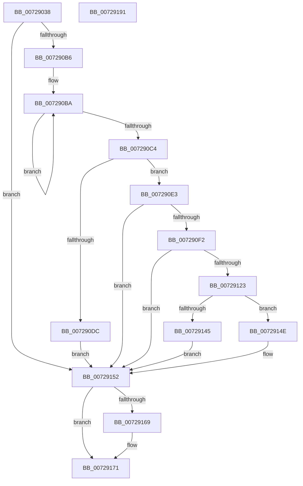

# PiGetDriverMutableStateDirectory

- RVA: `0x00729038`–`0x00729192` (길이 `346` bytes)
- VA: `0x0000000140729038`
- 실행 섹션: `PAGE`
- PDB 이름 있음: `예`; PDB Function 태그: `아니요`
- unwind 정보 RVA: `0x000AD928`
- 디코드: `100`개 명령, `346/346` bytes 표시
- 미해석 바이트: `0` (있으면 어셈블리에 `.byte`로 보존)

> 이 문서는 커널 이미지의 기계어와 PDB 기호를 분석해 생성했습니다. 4번과 5번은 함수 원형과 자료형을 바이너리 사용 방식에서 추정한 C 해석이며 원본 소스 복구 결과는 아닙니다.

## 1. Dependencies

- 직접 호출 지점: **9**; 고유 호출 대상: **7**
- 직접 호출자로 확인된 함수: **1**
- RIP 상대 이미지 참조: **3**

### Outgoing calls
- `0x00729081` → [RtlInitUnicodeString](../../text/42/RtlInitUnicodeString_function_0042A780.md) (function, `0x0042A780`)
- `0x0072908C` → [RtlInitUnicodeString](../../text/42/RtlInitUnicodeString_function_0042A780.md) (function, `0x0042A780`)
- `0x007290A7` → [PiGetStateRootPath](../A6/PiGetStateRootPath_function_00A67A70.md) (function, `0x00A67A70`)
- `0x007290E7` → [IopAllocateUnicodeString](../95/IopAllocateUnicodeString_function_00951F0C.md) (function, `0x00951F0C`)
- `0x00729118` → [RtlUnicodeStringPrintfEx](../../text/4A/RtlUnicodeStringPrintfEx_function_004A8FD0.md) (function, `0x004A8FD0`)
- `0x0072913A` → [PiOpenDirectoryWithRoot](PiOpenDirectoryWithRoot_function_00729198.md) (function, `0x00729198`)
- `0x00729156` → [RtlFreeAnsiString](../9C/RtlFreeAnsiString_function_009C0800.md) (function, `0x009C0800`)
- `0x0072915F` → [RtlFreeAnsiString](../9C/RtlFreeAnsiString_function_009C0800.md) (function, `0x009C0800`)
- `0x0072916C` → [ZwClose](../../text/6A/ZwClose_function_006AD2B0.md) (function, `0x006AD2B0`)

### Direct callers
- [sub_00B3FE64](../B3/Unknown_function_00B3FE64.md) at `0x00B3FE85`

### Static image references
- `0x00729099` → RVA `0x00AFD6B0` (` ?? ::NNGAKEGL::`string'`; read)
- `0x007290A0` → RVA `0x00AFD6F0` (` ?? ::NNGAKEGL::`string'`; read)
- `0x00729100` → RVA `0x00AFD720` (` ?? ::NNGAKEGL::`string'`; read)

## 2. Other-region calls and transfers

- 다른 실행 섹션으로 향하는 call: **4**
  - `0x00729081` → [RtlInitUnicodeString](../../text/42/RtlInitUnicodeString_function_0042A780.md) (`PAGE` → `.text`)
  - `0x0072908C` → [RtlInitUnicodeString](../../text/42/RtlInitUnicodeString_function_0042A780.md) (`PAGE` → `.text`)
  - `0x00729118` → [RtlUnicodeStringPrintfEx](../../text/4A/RtlUnicodeStringPrintfEx_function_004A8FD0.md) (`PAGE` → `.text`)
  - `0x0072916C` → [ZwClose](../../text/6A/ZwClose_function_006AD2B0.md) (`PAGE` → `.text`)
- 별도 외부 분기/꼬리 이동을 확인하지 못했습니다.

## 3. Assembly (complete function range)

```asm
00729038  48 89 5C 24 08                  mov qword ptr [rsp + 8], rbx
0072903D  48 89 74 24 10                  mov qword ptr [rsp + 0x10], rsi
00729042  48 89 7C 24 18                  mov qword ptr [rsp + 0x18], rdi
00729047  55                              push rbp
00729048  41 54                           push r12
0072904A  41 55                           push r13
0072904C  41 56                           push r14
0072904E  41 57                           push r15
00729050  48 8B EC                        mov rbp, rsp
00729053  48 83 EC 70                     sub rsp, 0x70
00729057  48 8B F2                        mov rsi, rdx
0072905A  4C 8B F1                        mov r14, rcx
0072905D  0F 57 C0                        xorps xmm0, xmm0
00729060  48 8D 4D D8                     lea rcx, [rbp - 0x28]
00729064  0F 57 C9                        xorps xmm1, xmm1
00729067  45 33 ED                        xor r13d, r13d
0072906A  33 D2                           xor edx, edx
0072906C  4C 89 6D D0                     mov qword ptr [rbp - 0x30], r13
00729070  0F 11 45 D8                     movups xmmword ptr [rbp - 0x28], xmm0
00729074  41 8B FD                        mov edi, r13d
00729077  4D 8B F9                        mov r15, r9
0072907A  0F 11 4D E8                     movups xmmword ptr [rbp - 0x18], xmm1
0072907E  45 8A E0                        mov r12b, r8b
00729081  E8 FA 16 D0 FF                  call 0x14042a780
00729086  33 D2                           xor edx, edx
00729088  48 8D 4D E8                     lea rcx, [rbp - 0x18]
0072908C  E8 EF 16 D0 FF                  call 0x14042a780
00729091  4C 8D 4D D8                     lea r9, [rbp - 0x28]
00729095  45 8D 45 01                     lea r8d, [r13 + 1]
00729099  48 8D 15 10 46 3D 00            lea rdx, [rip + 0x3d4610]
007290A0  48 8D 0D 49 46 3D 00            lea rcx, [rip + 0x3d4649]
007290A7  E8 C4 E9 33 00                  call 0x140a67a70
007290AC  8B D8                           mov ebx, eax
007290AE  85 C0                           test eax, eax
007290B0  0F 88 9C 00 00 00               js 0x140729152
007290B6  48 83 C9 FF                     or rcx, 0xffffffffffffffff
007290BA  48 FF C1                        inc rcx
007290BD  66 44 39 2C 4E                  cmp word ptr [rsi + rcx*2], r13w
007290C2  75 F6                           jne 0x1407290ba
007290C4  41 0F B7 16                     movzx edx, word ptr [r14]
007290C8  0F B7 45 D8                     movzx eax, word ptr [rbp - 0x28]
007290CC  83 C2 04                        add edx, 4
007290CF  8D 14 4A                        lea edx, [rdx + rcx*2]
007290D2  03 D0                           add edx, eax
007290D4  81 FA FE FF 00 00               cmp edx, 0xfffe
007290DA  76 07                           jbe 0x1407290e3
007290DC  BB 05 00 00 80                  mov ebx, 0x80000005
007290E1  EB 6F                           jmp 0x140729152
007290E3  48 8D 4D E8                     lea rcx, [rbp - 0x18]
007290E7  E8 20 8E 22 00                  call 0x140951f0c
007290EC  8B D8                           mov ebx, eax
007290EE  85 C0                           test eax, eax
007290F0  78 60                           js 0x140729152
007290F2  48 89 74 24 30                  mov qword ptr [rsp + 0x30], rsi
007290F7  48 8D 45 D8                     lea rax, [rbp - 0x28]
007290FB  4C 89 74 24 28                  mov qword ptr [rsp + 0x28], r14
00729100  4C 8D 0D 19 46 3D 00            lea r9, [rip + 0x3d4619]
00729107  33 D2                           xor edx, edx
00729109  48 89 44 24 20                  mov qword ptr [rsp + 0x20], rax
0072910E  41 B8 00 08 00 00               mov r8d, 0x800
00729114  48 8D 4D E8                     lea rcx, [rbp - 0x18]
00729118  E8 B3 FE D7 FF                  call 0x1404a8fd0
0072911D  8B D8                           mov ebx, eax
0072911F  85 C0                           test eax, eax
00729121  78 2F                           js 0x140729152
00729123  48 8D 45 D0                     lea rax, [rbp - 0x30]
00729127  45 8A CC                        mov r9b, r12b
0072912A  41 B0 01                        mov r8b, 1
0072912D  48 89 44 24 20                  mov qword ptr [rsp + 0x20], rax
00729132  48 8D 55 E8                     lea rdx, [rbp - 0x18]
00729136  48 8D 4D D8                     lea rcx, [rbp - 0x28]
0072913A  E8 59 00 00 00                  call 0x140729198
0072913F  8B D8                           mov ebx, eax
00729141  85 C0                           test eax, eax
00729143  78 09                           js 0x14072914e
00729145  48 8B 45 D0                     mov rax, qword ptr [rbp - 0x30]
00729149  49 89 07                        mov qword ptr [r15], rax
0072914C  EB 04                           jmp 0x140729152
0072914E  48 8B 7D D0                     mov rdi, qword ptr [rbp - 0x30]
00729152  48 8D 4D D8                     lea rcx, [rbp - 0x28]
00729156  E8 A5 76 29 00                  call 0x1409c0800
0072915B  48 8D 4D E8                     lea rcx, [rbp - 0x18]
0072915F  E8 9C 76 29 00                  call 0x1409c0800
00729164  48 85 FF                        test rdi, rdi
00729167  74 08                           je 0x140729171
00729169  48 8B CF                        mov rcx, rdi
0072916C  E8 3F 41 F8 FF                  call 0x1406ad2b0
00729171  4C 8D 5C 24 70                  lea r11, [rsp + 0x70]
00729176  8B C3                           mov eax, ebx
00729178  49 8B 5B 30                     mov rbx, qword ptr [r11 + 0x30]
0072917C  49 8B 73 38                     mov rsi, qword ptr [r11 + 0x38]
00729180  49 8B 7B 40                     mov rdi, qword ptr [r11 + 0x40]
00729184  49 8B E3                        mov rsp, r11
00729187  41 5F                           pop r15
00729189  41 5E                           pop r14
0072918B  41 5D                           pop r13
0072918D  41 5C                           pop r12
0072918F  5D                              pop rbp
00729190  C3                              ret
00729191  CC                              int3
```

## 4. C-style interpretation (structured pseudocode)

```c
__int64 __fastcall PiGetDriverMutableStateDirectory(__int64 a1, __int64 a2, unsigned __int8 a3, __int64 a4)
{
    __int64 result;
    __int64 v_r13;
    __int64 v_rsp;
    unsigned __int64 v_stack_m28;
    unsigned __int64 v_stack_m40;
    unsigned __int64 v_stack_m50;
    unsigned __int64 v_stack_m58;
    unsigned __int64 v_stack_m68;
    unsigned __int64 v_stack_m70;
    unsigned __int64 v_stack_m78;
    unsigned __int64 v_stack_p10;
    unsigned __int64 v_stack_p18;
    unsigned __int64 v_stack_p8;

    v_stack_p8 = v_rbx;
    v_stack_p10 = v_rsi;
    v_stack_p18 = v_rdi;
    v_rsp = (v_rsp) - (112);
    v_r13 = 0;
    a2 = 0;
    v_stack_m58 = 0;
    v_stack_m50 = v_xmm0;
    v_stack_m40 = v_xmm1;
    result = RtlInitUnicodeString(v_stack_m50, a2, a3, a4);
    a2 = 0;
    result = RtlInitUnicodeString(v_stack_m40, a2, a3, a4);
    result = PiGetStateRootPath(v_rip + 4015689, v_rip + 4015632, v_r13 + 1, v_stack_m50);
    if (sign_flag) goto loc_00729152;
    a1 = (v_rip + 4015689) | (-1);
loc_007290BA:
    a1 = (a1) + 1;
    if ((*(unsigned __int16 *)(a2 + a1 * 2)) != 0) goto loc_007290BA;
    a2 = (unsigned int)((*(unsigned __int16 *)(a1)) + (4));
    a2 = (unsigned int)((a2 + a1 * 2) + ((unsigned int)(v_stack_m50)));
    if (((unsigned int)(a2)) <= 0xFFFEULL) goto loc_007290E3;
    goto loc_00729152;
loc_007290E3:
    result = IopAllocateUnicodeString(v_stack_m40, a2, v_r13 + 1, v_stack_m50);
    if (sign_flag) goto loc_00729152;
    v_stack_m68 = a2;
    v_stack_m70 = a1;
    a2 = 0;
    v_stack_m78 = v_stack_m50;
    result = RtlUnicodeStringPrintfEx(v_stack_m40, a2, (unsigned int)(0x800ULL), v_rip + 4015641);
    if (sign_flag) goto loc_00729152;
    v_stack_m78 = v_stack_m58;
    result = PiOpenDirectoryWithRoot(v_stack_m50, v_stack_m40, 1, a3);
    if (sign_flag) goto loc_0072914E;
    *(unsigned __int64 *)(a4) = v_stack_m58;
    goto loc_00729152;
loc_0072914E:
loc_00729152:
    result = RtlFreeAnsiString(v_stack_m50, v_stack_m40, 1, a3);
    result = RtlFreeAnsiString(v_stack_m40, v_stack_m40, 1, a3);
    if (v_stack_m58 != 0) {
        a1 = v_stack_m58;
        result = ZwClose(a1, v_stack_m40, 1, a3);
    }
    return (unsigned int)((unsigned int)((unsigned int)((unsigned int)(result))));
}
```

## 5. (Beta) C Style

```c
int64_t PiGetDriverMutableStateDirectory(void *Arg1, void *Arg2, uint8_t Arg3, void *Arg4)
{
    uint8_t *arg1 = (uint8_t *)Arg1;
    uint8_t *arg2 = (uint8_t *)Arg2;
    uint8_t *arg4 = (uint8_t *)Arg4;

    int64_t result;
    int64_t local_r13;
    int64_t local_rsp;
    uint64_t v_stack_m28;
    uint64_t v_stack_m40;
    uint64_t v_stack_m50;
    uint64_t v_stack_m58;
    uint64_t v_stack_m68;
    uint64_t v_stack_m70;
    uint64_t v_stack_m78;
    uint64_t v_stack_p10;
    uint64_t v_stack_p18;
    uint64_t v_stack_p8;

    v_stack_p8 = local_rbx;
    v_stack_p10 = local_rsi;
    v_stack_p18 = local_rdi;
    local_rsp = (local_rsp) - (112);
    local_r13 = 0;
    Arg2 = 0;
    v_stack_m58 = 0;
    v_stack_m50 = v_xmm0;
    v_stack_m40 = v_xmm1;
    result = RtlInitUnicodeString(v_stack_m50, Arg2, Arg3, Arg4);
    Arg2 = 0;
    result = RtlInitUnicodeString(v_stack_m40, Arg2, Arg3, Arg4);
    result = PiGetStateRootPath(v_rip + 4015689, v_rip + 4015632, local_r13 + 1, v_stack_m50);
    if (sign_flag) goto loc_00729152;
    Arg1 = (v_rip + 4015689) | (-1);
loc_007290BA:
    Arg1 = (Arg1) + 1;
    if ((*(uint16_t *)(arg2 + arg1 * 2)) != 0) goto loc_007290BA;
    Arg2 = (uint32_t)((*(uint16_t *)(arg1)) + (4));
    Arg2 = (uint32_t)((Arg2 + Arg1 * 2) + ((uint32_t)(v_stack_m50)));
    if (((uint32_t)(Arg2)) <= 0xFFFEULL) goto loc_007290E3;
    goto loc_00729152;
loc_007290E3:
    result = IopAllocateUnicodeString(v_stack_m40, Arg2, local_r13 + 1, v_stack_m50);
    if (sign_flag) goto loc_00729152;
    v_stack_m68 = Arg2;
    v_stack_m70 = Arg1;
    Arg2 = 0;
    v_stack_m78 = v_stack_m50;
    result = RtlUnicodeStringPrintfEx(v_stack_m40, Arg2, (uint32_t)(0x800ULL), v_rip + 4015641);
    if (sign_flag) goto loc_00729152;
    v_stack_m78 = v_stack_m58;
    result = PiOpenDirectoryWithRoot(v_stack_m50, v_stack_m40, 1, Arg3);
    if (sign_flag) goto loc_0072914E;
    *(uint64_t *)(arg4) = v_stack_m58;
    goto loc_00729152;
loc_0072914E:
loc_00729152:
    result = RtlFreeAnsiString(v_stack_m50, v_stack_m40, 1, Arg3);
    result = RtlFreeAnsiString(v_stack_m40, v_stack_m40, 1, Arg3);
    if (v_stack_m58 != 0) {
        Arg1 = v_stack_m58;
        result = ZwClose(Arg1, v_stack_m40, 1, Arg3);
    }
    return (uint32_t)((uint32_t)((uint32_t)((uint32_t)(result))));
}
```

### 관측된 메모리 오프셋

구조체 형식이 확인되지 않은 접근은 인자 기준의 오프셋으로만 기록했습니다.

| 기준 인자 | 오프셋 표현 | 폭 (bit) | 접근 |
|---|---:|---:|---|
| `Arg1` | `+ 0x0` | `16` | `R` |
| `Arg2` | `+ 0x0 + rcx*2` | `16` | `R` |
| `Arg4` | `+ 0x0` | `64` | `W` |

## 6. Execution-region graph

[열기: 2D/3D 그래프와 함수 탐색 컨트롤 패널](../../../control-panel.html?section=page&rva=0x00729038&view=graph)

- 2D 그래프는 위에서 아래로 흐르고, 3D 그래프는 빈 공간을 드래그해 회전합니다. Shift+드래그는 이동, 휠은 확대·축소, 함수 노드 선택은 대상 보고서 이동입니다.

### Static fallback


