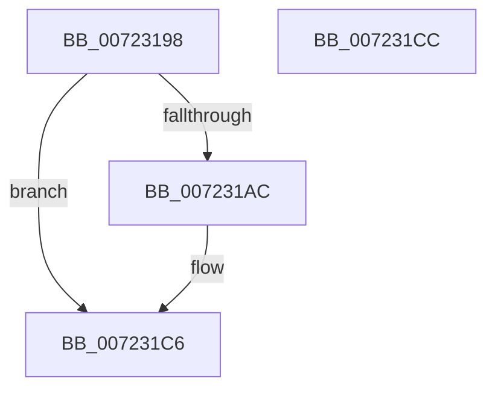

# PiInitReleaseCachedGroupInformation

- RVA: `0x00723198`–`0x007231CD` (길이 `53` bytes)
- VA: `0x0000000140723198`
- 실행 섹션: `PAGE`
- PDB 이름 있음: `예`; PDB Function 태그: `아니요`
- unwind 정보 RVA: `0x0005CF00`
- 디코드: `14`개 명령, `53/53` bytes 표시
- 미해석 바이트: `0` (있으면 어셈블리에 `.byte`로 보존)

> 이 문서는 커널 이미지의 기계어와 PDB 기호를 분석해 생성했습니다. 4번과 5번은 함수 원형과 자료형을 바이너리 사용 방식에서 추정한 C 해석이며 원본 소스 복구 결과는 아닙니다.

## 1. Dependencies

- 직접 호출 지점: **1**; 고유 호출 대상: **1**
- 직접 호출자로 확인된 함수: **1**
- RIP 상대 이미지 참조: **4**

### Outgoing calls
- `0x007231B3` → [PnpFreeUnicodeStringList](../../text/5A/PnpFreeUnicodeStringList_function_005AA43C.md) (function, `0x005AA43C`)

### Direct callers
- [PnpCompleteSystemStartProcess](../../text/5A/PnpCompleteSystemStartProcess_function_005A6F2C.md) at `0x005A6F82`

### Static image references
- `0x0072319E` → RVA `0x00E66248` (`.data`; read)
- `0x007231AC` → RVA `0x00E66250` (`.data`; read)
- `0x007231B8` → RVA `0x00E66248` (`.data`; write)
- `0x007231BF` → RVA `0x00E66250` (`.data`; write)

## 2. Other-region calls and transfers

- 다른 실행 섹션으로 향하는 call: **1**
  - `0x007231B3` → [PnpFreeUnicodeStringList](../../text/5A/PnpFreeUnicodeStringList_function_005AA43C.md) (`PAGE` → `.text`)
- 별도 외부 분기/꼬리 이동을 확인하지 못했습니다.

## 3. Assembly (complete function range)

```asm
00723198  40 53                           push rbx
0072319A  48 83 EC 20                     sub rsp, 0x20
0072319E  48 8B 0D A3 30 74 00            mov rcx, qword ptr [rip + 0x7430a3]
007231A5  33 DB                           xor ebx, ebx
007231A7  48 85 C9                        test rcx, rcx
007231AA  74 1A                           je 0x1407231c6
007231AC  0F B7 15 9D 30 74 00            movzx edx, word ptr [rip + 0x74309d]
007231B3  E8 84 72 E8 FF                  call 0x1405aa43c
007231B8  48 89 1D 89 30 74 00            mov qword ptr [rip + 0x743089], rbx
007231BF  66 89 1D 8A 30 74 00            mov word ptr [rip + 0x74308a], bx
007231C6  48 83 C4 20                     add rsp, 0x20
007231CA  5B                              pop rbx
007231CB  C3                              ret
007231CC  CC                              int3
```

## 4. C-style interpretation (structured pseudocode)

```c
__int64 __fastcall PiInitReleaseCachedGroupInformation(void)
{
    __int64 result;
    __int64 v_rbx;
    __int64 v_rsp;

    v_rsp = (v_rsp) - (32);
    v_rbx = 0;
    if (*(unsigned __int64 *)(v_rip + 7614627) != 0) {
        a2 = *(unsigned __int16 *)(v_rip + 7614621);
        result = PnpFreeUnicodeStringList(*(unsigned __int64 *)(v_rip + 7614627), a2, a3, a4);
        *(unsigned __int64 *)(v_rip + 7614601) = 0;
        *(unsigned __int16 *)(v_rip + 7614602) = 0;
    }
    v_rsp = (v_rsp) + (32);
    return result;
}
```

## 5. (Beta) C Style

```c
void PiInitReleaseCachedGroupInformation(void)
{
    int64_t result;
    int64_t local_rbx;
    int64_t local_rsp;

    local_rsp = (local_rsp) - (32);
    local_rbx = 0;
    if (*(uint64_t *)(v_rip + 0x7430A3) != 0) {
        a2 = *(uint16_t *)(v_rip + 0x74309D);
        result = PnpFreeUnicodeStringList(*(uint64_t *)(v_rip + 0x7430A3), a2, a3, a4);
        *(uint64_t *)(v_rip + 0x743089) = 0;
        *(uint16_t *)(v_rip + 0x74308A) = 0;
    }
    local_rsp = (local_rsp) + (32);
    return result;
}
```

## 6. Execution-region graph

[열기: 2D/3D 그래프와 함수 탐색 컨트롤 패널](../../../control-panel.html?section=page&rva=0x00723198&view=graph)

- 2D 그래프는 위에서 아래로 흐르고, 3D 그래프는 빈 공간을 드래그해 회전합니다. Shift+드래그는 이동, 휠은 확대·축소, 함수 노드 선택은 대상 보고서 이동입니다.

### Static fallback


