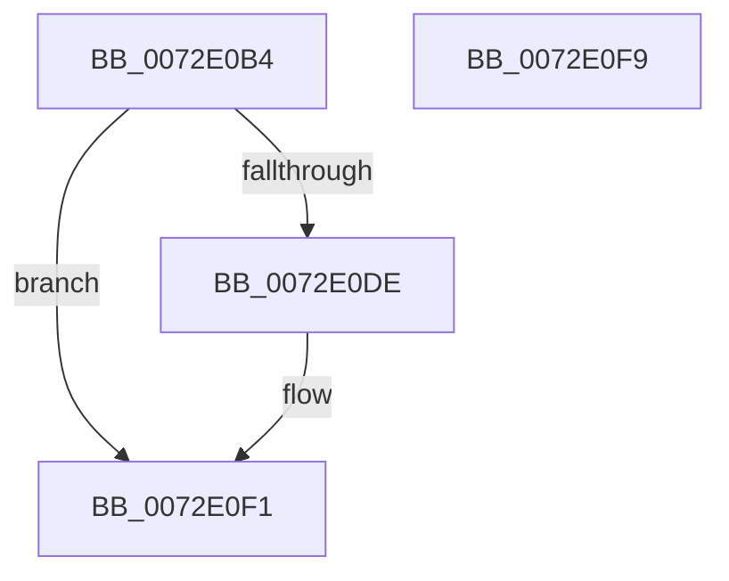

# PiIsHVCIEnabled

- RVA: `0x0072E0B4`–`0x0072E0FA` (길이 `70` bytes)
- VA: `0x000000014072E0B4`
- 실행 섹션: `PAGE`
- PDB 이름 있음: `예`; PDB Function 태그: `아니요`
- unwind 정보 RVA: `0x0005CF00`
- 디코드: `21`개 명령, `70/70` bytes 표시
- 미해석 바이트: `0` (있으면 어셈블리에 `.byte`로 보존)

> 이 문서는 커널 이미지의 기계어와 PDB 기호를 분석해 생성했습니다. 4번과 5번은 함수 원형과 자료형을 바이너리 사용 방식에서 추정한 C 해석이며 원본 소스 복구 결과는 아닙니다.

## 1. Dependencies

- 직접 호출 지점: **1**; 고유 호출 대상: **1**
- 직접 호출자로 확인된 함수: **1**
- RIP 상대 이미지 참조: **0**

### Outgoing calls
- `0x0072E0D5` → [ZwQuerySystemInformation](../../text/6A/ZwQuerySystemInformation_function_006AD790.md) (function, `0x006AD790`)

### Direct callers
- [PiIsDriverBlocked](../99/PiIsDriverBlocked_function_0099C254.md) at `0x0099C339`

### Static image references
- 디코드된 RIP-relative 메모리 참조가 없습니다.

## 2. Other-region calls and transfers

- 다른 실행 섹션으로 향하는 call: **1**
  - `0x0072E0D5` → [ZwQuerySystemInformation](../../text/6A/ZwQuerySystemInformation_function_006AD790.md) (`PAGE` → `.text`)
- 별도 외부 분기/꼬리 이동을 확인하지 못했습니다.

## 3. Assembly (complete function range)

```asm
0072E0B4  40 53                           push rbx
0072E0B6  48 83 EC 20                     sub rsp, 0x20
0072E0BA  33 DB                           xor ebx, ebx
0072E0BC  48 8D 54 24 30                  lea rdx, [rsp + 0x30]
0072E0C1  48 89 5C 24 30                  mov qword ptr [rsp + 0x30], rbx
0072E0C6  45 33 C9                        xor r9d, r9d
0072E0C9  44 8D 43 08                     lea r8d, [rbx + 8]
0072E0CD  8D 4B 67                        lea ecx, [rbx + 0x67]
0072E0D0  44 89 44 24 30                  mov dword ptr [rsp + 0x30], r8d
0072E0D5  E8 B6 F6 F7 FF                  call 0x1406ad790
0072E0DA  85 C0                           test eax, eax
0072E0DC  78 13                           js 0x14072e0f1
0072E0DE  F7 44 24 34 00 04 00 00         test dword ptr [rsp + 0x34], 0x400
0072E0E6  B9 01 00 00 00                  mov ecx, 1
0072E0EB  0F B6 DB                        movzx ebx, bl
0072E0EE  0F 45 D9                        cmovne ebx, ecx
0072E0F1  8A C3                           mov al, bl
0072E0F3  48 83 C4 20                     add rsp, 0x20
0072E0F7  5B                              pop rbx
0072E0F8  C3                              ret
0072E0F9  CC                              int3
```

## 4. C-style interpretation (structured pseudocode)

```c
__int64 __fastcall PiIsHVCIEnabled(__int64 a1, __int64 a2, __int64 a3, int a4)
{
    __int64 result;
    __int64 v_rbx;
    __int64 v_rsp;
    unsigned __int64 v_stack_p8;
    unsigned int v_stack_pC;

    v_rsp = (v_rsp) - (32);
    v_rbx = 0;
    v_stack_p8 = 0;
    a4 = 0;
    v_stack_p8 = (unsigned int)(v_rbx + 8);
    result = ZwQuerySystemInformation(v_rbx + 103, v_stack_p8, v_rbx + 8, a4);
    if (!(sign_flag)) {
        a1 = 1;
        v_rbx = 0;
        if (((v_stack_pC) & (0x400ULL)) != 0) { v_rbx = (unsigned int)(a1); }
    }
    v_rsp = (v_rsp) + (32);
    return (unsigned __int8)(v_rbx);
}
```

## 5. (Beta) C Style

```c
int64_t PiIsHVCIEnabled(int64_t Arg1, int64_t Arg2, int64_t Arg3, int32_t Arg4)
{
    int64_t result;
    int64_t local_rbx;
    int64_t local_rsp;
    uint64_t v_stack_p8;
    uint32_t v_stack_pC;

    local_rsp = (local_rsp) - (32);
    local_rbx = 0;
    v_stack_p8 = 0;
    Arg4 = 0;
    v_stack_p8 = (uint32_t)(local_rbx + 8);
    result = ZwQuerySystemInformation(local_rbx + 103, v_stack_p8, local_rbx + 8, Arg4);
    if (!(sign_flag)) {
        Arg1 = 1;
        local_rbx = 0;
        if (((v_stack_pC) & (0x400ULL)) != 0) { local_rbx = (uint32_t)(Arg1); }
    }
    local_rsp = (local_rsp) + (32);
    return (uint8_t)(local_rbx);
}
```

## 6. Execution-region graph

[열기: 2D/3D 그래프와 함수 탐색 컨트롤 패널](../../../control-panel.html?section=page&rva=0x0072E0B4&view=graph)

- 2D 그래프는 위에서 아래로 흐르고, 3D 그래프는 빈 공간을 드래그해 회전합니다. Shift+드래그는 이동, 휠은 확대·축소, 함수 노드 선택은 대상 보고서 이동입니다.

### Static fallback


