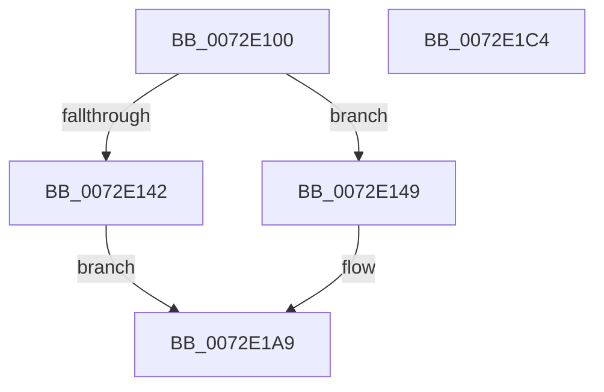

# PiNotifyCiDriverBlocked

- RVA: `0x0072E100`–`0x0072E1C5` (길이 `197` bytes)
- VA: `0x000000014072E100`
- 실행 섹션: `PAGE`
- PDB 이름 있음: `예`; PDB Function 태그: `아니요`
- unwind 정보 RVA: `0x00060130`
- 디코드: `53`개 명령, `197/197` bytes 표시
- 미해석 바이트: `0` (있으면 어셈블리에 `.byte`로 보존)

> 이 문서는 커널 이미지의 기계어와 PDB 기호를 분석해 생성했습니다. 4번과 5번은 함수 원형과 자료형을 바이너리 사용 방식에서 추정한 C 해석이며 원본 소스 복구 결과는 아닙니다.

## 1. Dependencies

- 직접 호출 지점: **4**; 고유 호출 대상: **4**
- 직접 호출자로 확인된 함수: **1**
- RIP 상대 이미지 참조: **1**

### Outgoing calls
- `0x0072E135` → [ExAllocatePool2](../../poolcode/B8/ExAllocatePool2_function_00B820F0.md) (function, `0x00B820F0`)
- `0x0072E167` → [memcpy](../../text/6C/memcpy_function_006C6840.md) (function, `0x006C6840`)
- `0x0072E196` → [ZwUpdateWnfStateData](../../text/6B/ZwUpdateWnfStateData_function_006B0D10.md) (function, `0x006B0D10`)
- `0x0072E1A2` → [ExFreePoolWithTag](../../poolcode/B8/ExFreePoolWithTag_function_00B82870.md) (function, `0x00B82870`)

### Direct callers
- [PiIsDriverBlocked](../99/PiIsDriverBlocked_function_0099C254.md) at `0x0099C4C4`

### Static image references
- `0x0072E172` → RVA `0x00020B98` (`.rdata`; read)

## 2. Other-region calls and transfers

- 다른 실행 섹션으로 향하는 call: **4**
  - `0x0072E135` → [ExAllocatePool2](../../poolcode/B8/ExAllocatePool2_function_00B820F0.md) (`PAGE` → `POOLCODE`)
  - `0x0072E167` → [memcpy](../../text/6C/memcpy_function_006C6840.md) (`PAGE` → `.text`)
  - `0x0072E196` → [ZwUpdateWnfStateData](../../text/6B/ZwUpdateWnfStateData_function_006B0D10.md) (`PAGE` → `.text`)
  - `0x0072E1A2` → [ExFreePoolWithTag](../../poolcode/B8/ExFreePoolWithTag_function_00B82870.md) (`PAGE` → `POOLCODE`)
- 별도 외부 분기/꼬리 이동을 확인하지 못했습니다.

## 3. Assembly (complete function range)

```asm
0072E100  48 8B C4                        mov rax, rsp
0072E103  48 89 58 08                     mov qword ptr [rax + 8], rbx
0072E107  48 89 68 10                     mov qword ptr [rax + 0x10], rbp
0072E10B  48 89 70 18                     mov qword ptr [rax + 0x18], rsi
0072E10F  48 89 78 20                     mov qword ptr [rax + 0x20], rdi
0072E113  41 56                           push r14
0072E115  48 83 EC 40                     sub rsp, 0x40
0072E119  41 0F B7 18                     movzx ebx, word ptr [r8]
0072E11D  49 8B F0                        mov rsi, r8
0072E120  8B EA                           mov ebp, edx
0072E122  4C 8B F1                        mov r14, rcx
0072E125  83 C3 16                        add ebx, 0x16
0072E128  B9 00 01 00 00                  mov ecx, 0x100
0072E12D  8B D3                           mov edx, ebx
0072E12F  41 B8 50 70 20 20               mov r8d, 0x20207050
0072E135  E8 B6 3F 45 00                  call 0x140b820f0
0072E13A  48 8B F8                        mov rdi, rax
0072E13D  48 85 C0                        test rax, rax
0072E140  75 07                           jne 0x14072e149
0072E142  B8 17 00 00 C0                  mov eax, 0xc0000017
0072E147  EB 60                           jmp 0x14072e1a9
0072E149  41 0F 10 06                     movups xmm0, xmmword ptr [r14]
0072E14D  89 68 10                        mov dword ptr [rax + 0x10], ebp
0072E150  48 8D 4F 16                     lea rcx, [rdi + 0x16]
0072E154  F3 0F 7F 00                     movdqu xmmword ptr [rax], xmm0
0072E158  0F B7 06                        movzx eax, word ptr [rsi]
0072E15B  66 89 47 14                     mov word ptr [rdi + 0x14], ax
0072E15F  44 0F B7 06                     movzx r8d, word ptr [rsi]
0072E163  48 8B 56 08                     mov rdx, qword ptr [rsi + 8]
0072E167  E8 D4 86 F9 FF                  call 0x1406c6840
0072E16C  41 B8 00 10 00 00               mov r8d, 0x1000
0072E172  48 8D 0D 1F 2A 8F FF            lea rcx, [rip - 0x70d5e1]
0072E179  41 3B D8                        cmp ebx, r8d
0072E17C  48 8B D7                        mov rdx, rdi
0072E17F  44 0F 42 C3                     cmovb r8d, ebx
0072E183  83 64 24 30 00                  and dword ptr [rsp + 0x30], 0
0072E188  83 64 24 28 00                  and dword ptr [rsp + 0x28], 0
0072E18D  45 33 C9                        xor r9d, r9d
0072E190  48 83 64 24 20 00               and qword ptr [rsp + 0x20], 0
0072E196  E8 75 2B F8 FF                  call 0x1406b0d10
0072E19B  33 D2                           xor edx, edx
0072E19D  48 8B CF                        mov rcx, rdi
0072E1A0  8B D8                           mov ebx, eax
0072E1A2  E8 C9 46 45 00                  call 0x140b82870
0072E1A7  8B C3                           mov eax, ebx
0072E1A9  48 8B 5C 24 50                  mov rbx, qword ptr [rsp + 0x50]
0072E1AE  48 8B 6C 24 58                  mov rbp, qword ptr [rsp + 0x58]
0072E1B3  48 8B 74 24 60                  mov rsi, qword ptr [rsp + 0x60]
0072E1B8  48 8B 7C 24 68                  mov rdi, qword ptr [rsp + 0x68]
0072E1BD  48 83 C4 40                     add rsp, 0x40
0072E1C1  41 5E                           pop r14
0072E1C3  C3                              ret
0072E1C4  CC                              int3
```

## 4. C-style interpretation (structured pseudocode)

```c
__int64 __fastcall PiNotifyCiDriverBlocked(__int64 a1, int a2, __int64 a3, int a4)
{
    __int64 result;
    __int64 v_rbx;
    __int64 v_rsp;
    unsigned int v_stack_m18;
    unsigned int v_stack_m20;
    unsigned __int64 v_stack_m28;
    unsigned __int64 v_stack_p10;
    unsigned __int64 v_stack_p18;
    unsigned __int64 v_stack_p20;
    unsigned __int64 v_stack_p8;

    *(unsigned __int64 *)(v_rsp + 8) = v_rbx;
    *(unsigned __int64 *)(v_rsp + 16) = v_rbp;
    *(unsigned __int64 *)(v_rsp + 24) = v_rsi;
    *(unsigned __int64 *)(v_rsp + 32) = v_rdi;
    v_rsp = (v_rsp) - (64);
    v_rbx = (unsigned int)((*(unsigned __int16 *)(a3)) + (22));
    result = ExAllocatePool2(256, (unsigned int)((unsigned int)(v_rbx)), (unsigned int)(0x20207050ULL), a4);
    if (result != 0) goto loc_0072E149;
    goto loc_0072E1A9;
loc_0072E149:
    *(unsigned int *)((unsigned int)(0xC0000017ULL) + 16) = (unsigned int)((unsigned int)(a2));
    *(unsigned __int64 *)((unsigned int)(0xC0000017ULL)) = v_xmm0;
    *(unsigned __int16 *)(result + 20) = (unsigned __int16)(*(unsigned __int16 *)(a3));
    result = memcpy(result + 22, *(unsigned __int64 *)(a3 + 8), *(unsigned __int16 *)(a3), a4);
    a3 = (unsigned int)(0x1000ULL);
    if (((unsigned int)(v_rbx)) < ((unsigned int)((unsigned int)(0x1000ULL)))) { a3 = (unsigned int)(v_rbx); }
    a4 = 0;
    result = ZwUpdateWnfStateData(v_rip - 7394785, result, a3, a4);
    a2 = 0;
    result = ExFreePoolWithTag(result, a2, a3, a4);
loc_0072E1A9:
    v_rsp = (v_rsp) + (64);
    return (unsigned int)((unsigned int)((unsigned int)((unsigned int)(result))));
}
```

## 5. (Beta) C Style

```c
int64_t PiNotifyCiDriverBlocked(void *Arg1, int32_t Arg2, void *Arg3, int32_t Arg4)
{
    uint8_t *arg1 = (uint8_t *)Arg1;
    uint8_t *arg3 = (uint8_t *)Arg3;

    int64_t result;
    int64_t local_rbx;
    int64_t local_rsp;
    uint32_t v_stack_m18;
    uint32_t v_stack_m20;
    uint64_t v_stack_m28;
    uint64_t v_stack_p10;
    uint64_t v_stack_p18;
    uint64_t v_stack_p20;
    uint64_t v_stack_p8;

    *(uint64_t *)(local_rsp + 0x8) = local_rbx;
    *(uint64_t *)(local_rsp + 0x10) = local_rbp;
    *(uint64_t *)(local_rsp + 0x18) = local_rsi;
    *(uint64_t *)(local_rsp + 0x20) = local_rdi;
    local_rsp = (local_rsp) - (64);
    local_rbx = (uint32_t)((*(uint16_t *)(arg3)) + (22));
    result = ExAllocatePool2(256, (uint32_t)((uint32_t)(local_rbx)), (uint32_t)(0x20207050ULL), Arg4);
    if (result != 0) goto loc_0072E149;
    goto loc_0072E1A9;
loc_0072E149:
    *(uint32_t *)((uint32_t)(0xC0000017ULL) + 0x10) = (uint32_t)((uint32_t)(Arg2));
    *(uint64_t *)((uint32_t)(0xC0000017ULL)) = v_xmm0;
    *(uint16_t *)(result + 0x14) = (uint16_t)(*(uint16_t *)(arg3));
    result = memcpy(result + 22, *(uint64_t *)(arg3 + 0x8), *(uint16_t *)(arg3), Arg4);
    Arg3 = (uint32_t)(0x1000ULL);
    if (((uint32_t)(local_rbx)) < ((uint32_t)((uint32_t)(0x1000ULL)))) { Arg3 = (uint32_t)(local_rbx); }
    Arg4 = 0;
    result = ZwUpdateWnfStateData(v_rip - 7394785, result, Arg3, Arg4);
    Arg2 = 0;
    result = ExFreePoolWithTag(result, Arg2, Arg3, Arg4);
loc_0072E1A9:
    local_rsp = (local_rsp) + (64);
    return (uint32_t)((uint32_t)((uint32_t)((uint32_t)(result))));
}
```

### 관측된 메모리 오프셋

구조체 형식이 확인되지 않은 접근은 인자 기준의 오프셋으로만 기록했습니다.

| 기준 인자 | 오프셋 표현 | 폭 (bit) | 접근 |
|---|---:|---:|---|
| `Arg1` | `+ 0x0` | `128` | `R` |
| `Arg3` | `+ 0x0` | `16` | `R` |
| `Arg3` | `+ 0x8` | `64` | `R` |

## 6. Execution-region graph

[열기: 2D/3D 그래프와 함수 탐색 컨트롤 패널](../../../control-panel.html?section=page&rva=0x0072E100&view=graph)

- 2D 그래프는 위에서 아래로 흐르고, 3D 그래프는 빈 공간을 드래그해 회전합니다. Shift+드래그는 이동, 휠은 확대·축소, 함수 노드 선택은 대상 보고서 이동입니다.

### Static fallback


