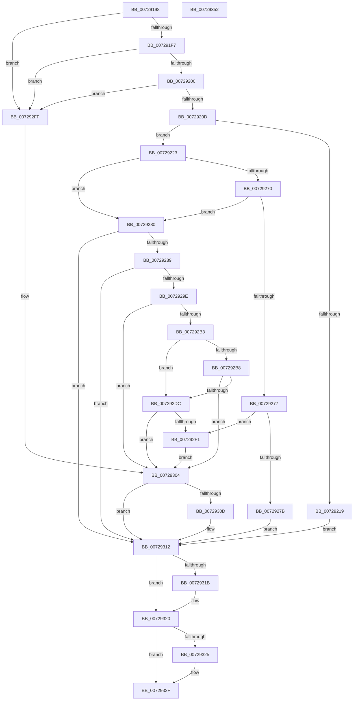

# PiOpenDirectoryWithRoot

- RVA: `0x00729198`–`0x00729353` (길이 `443` bytes)
- VA: `0x0000000140729198`
- 실행 섹션: `PAGE`
- PDB 이름 있음: `예`; PDB Function 태그: `아니요`
- unwind 정보 RVA: `0x0008FAA4`
- 디코드: `127`개 명령, `443/443` bytes 표시
- 미해석 바이트: `0` (있으면 어셈블리에 `.byte`로 보존)

> 이 문서는 커널 이미지의 기계어와 PDB 기호를 분석해 생성했습니다. 4번과 5번은 함수 원형과 자료형을 바이너리 사용 방식에서 추정한 C 해석이며 원본 소스 복구 결과는 아닙니다.

## 1. Dependencies

- 직접 호출 지점: **10**; 고유 호출 대상: **6**
- 직접 호출자로 확인된 함수: **2**
- RIP 상대 이미지 참조: **0**

### Outgoing calls
- `0x00729210` → [RtlPrefixUnicodeString](../8F/RtlPrefixUnicodeString_function_008F4F70.md) (function, `0x008F4F70`)
- `0x00729262` → [ZwOpenFile](../../text/6A/ZwOpenFile_function_006AD730.md) (function, `0x006AD730`)
- `0x0072928F` → [PiAuGetStateDirectorySecurityObject](../73/PiAuGetStateDirectorySecurityObject_function_00731738.md) (function, `0x00731738`)
- `0x007292A8` → [PiCreateDirectoryPath](PiCreateDirectoryPath_function_0072885C.md) (function, `0x0072885C`)
- `0x007292BD` → [ExFreePoolWithTag](../../poolcode/B8/ExFreePoolWithTag_function_00B82870.md) (function, `0x00B82870`)
- `0x007292CD` → [PiAuGetStateDirectorySecurityObject](../73/PiAuGetStateDirectorySecurityObject_function_00731738.md) (function, `0x00731738`)
- `0x007292E6` → [PiCreateDirectoryPath](PiCreateDirectoryPath_function_0072885C.md) (function, `0x0072885C`)
- `0x0072930D` → [ZwClose](../../text/6A/ZwClose_function_006AD2B0.md) (function, `0x006AD2B0`)
- `0x0072931B` → [ZwClose](../../text/6A/ZwClose_function_006AD2B0.md) (function, `0x006AD2B0`)
- `0x0072932A` → [ExFreePoolWithTag](../../poolcode/B8/ExFreePoolWithTag_function_00B82870.md) (function, `0x00B82870`)

### Direct callers
- [PiBuildAndOpenDeviceDirectoryPath](PiBuildAndOpenDeviceDirectoryPath_function_00728724.md) at `0x007287F9`
- [PiGetDriverMutableStateDirectory](PiGetDriverMutableStateDirectory_function_00729038.md) at `0x0072913A`

### Static image references
- 디코드된 RIP-relative 메모리 참조가 없습니다.

## 2. Other-region calls and transfers

- 다른 실행 섹션으로 향하는 call: **5**
  - `0x00729262` → [ZwOpenFile](../../text/6A/ZwOpenFile_function_006AD730.md) (`PAGE` → `.text`)
  - `0x007292BD` → [ExFreePoolWithTag](../../poolcode/B8/ExFreePoolWithTag_function_00B82870.md) (`PAGE` → `POOLCODE`)
  - `0x0072930D` → [ZwClose](../../text/6A/ZwClose_function_006AD2B0.md) (`PAGE` → `.text`)
  - `0x0072931B` → [ZwClose](../../text/6A/ZwClose_function_006AD2B0.md) (`PAGE` → `.text`)
  - `0x0072932A` → [ExFreePoolWithTag](../../poolcode/B8/ExFreePoolWithTag_function_00B82870.md) (`PAGE` → `POOLCODE`)
- 별도 외부 분기/꼬리 이동을 확인하지 못했습니다.

## 3. Assembly (complete function range)

```asm
00729198  48 89 5C 24 10                  mov qword ptr [rsp + 0x10], rbx
0072919D  48 89 74 24 18                  mov qword ptr [rsp + 0x18], rsi
007291A2  48 89 7C 24 20                  mov qword ptr [rsp + 0x20], rdi
007291A7  55                              push rbp
007291A8  41 54                           push r12
007291AA  41 55                           push r13
007291AC  41 56                           push r14
007291AE  41 57                           push r15
007291B0  48 8B EC                        mov rbp, rsp
007291B3  48 81 EC 80 00 00 00            sub rsp, 0x80
007291BA  33 DB                           xor ebx, ebx
007291BC  33 C0                           xor eax, eax
007291BE  48 89 45 F0                     mov qword ptr [rbp - 0x10], rax
007291C2  0F 57 C0                        xorps xmm0, xmm0
007291C5  89 45 F8                        mov dword ptr [rbp - 8], eax
007291C8  45 8A E9                        mov r13b, r9b
007291CB  48 89 5D B0                     mov qword ptr [rbp - 0x50], rbx
007291CF  45 8A E0                        mov r12b, r8b
007291D2  48 89 5D 30                     mov qword ptr [rbp + 0x30], rbx
007291D6  48 8B F2                        mov rsi, rdx
007291D9  48 89 5D B8                     mov qword ptr [rbp - 0x48], rbx
007291DD  4C 8B F9                        mov r15, rcx
007291E0  8B FB                           mov edi, ebx
007291E2  0F 11 45 C0                     movups xmmword ptr [rbp - 0x40], xmm0
007291E6  0F 11 45 D0                     movups xmmword ptr [rbp - 0x30], xmm0
007291EA  0F 11 45 E0                     movups xmmword ptr [rbp - 0x20], xmm0
007291EE  48 85 C9                        test rcx, rcx
007291F1  0F 84 08 01 00 00               je 0x1407292ff
007291F7  48 85 D2                        test rdx, rdx
007291FA  0F 84 FF 00 00 00               je 0x1407292ff
00729200  4C 8B 75 50                     mov r14, qword ptr [rbp + 0x50]
00729204  4D 85 F6                        test r14, r14
00729207  0F 84 F2 00 00 00               je 0x1407292ff
0072920D  41 B0 01                        mov r8b, 1
00729210  E8 5B BD 1C 00                  call 0x1408f4f70
00729215  84 C0                           test al, al
00729217  75 0A                           jne 0x140729223
00729219  BB 0D 00 00 C0                  mov ebx, 0xc000000d
0072921E  E9 EF 00 00 00                  jmp 0x140729312
00729223  0F 57 C0                        xorps xmm0, xmm0
00729226  C7 44 24 28 21 00 00 00         mov dword ptr [rsp + 0x28], 0x21
0072922E  4C 8D 4D C0                     lea r9, [rbp - 0x40]
00729232  C7 45 D0 30 00 00 00            mov dword ptr [rbp - 0x30], 0x30
00729239  4C 8D 45 D0                     lea r8, [rbp - 0x30]
0072923D  48 89 5D D8                     mov qword ptr [rbp - 0x28], rbx
00729241  BA 01 00 10 00                  mov edx, 0x100001
00729246  C7 45 E8 40 02 00 00            mov dword ptr [rbp - 0x18], 0x240
0072924D  48 8D 4D B0                     lea rcx, [rbp - 0x50]
00729251  48 89 75 E0                     mov qword ptr [rbp - 0x20], rsi
00729255  F3 0F 7F 45 F0                  movdqu xmmword ptr [rbp - 0x10], xmm0
0072925A  C7 44 24 20 03 00 00 00         mov dword ptr [rsp + 0x20], 3
00729262  E8 C9 44 F8 FF                  call 0x1406ad730
00729267  8B D8                           mov ebx, eax
00729269  3D 3A 00 00 C0                  cmp eax, 0xc000003a
0072926E  74 10                           je 0x140729280
00729270  3D 34 00 00 C0                  cmp eax, 0xc0000034
00729275  74 09                           je 0x140729280
00729277  85 C0                           test eax, eax
00729279  79 76                           jns 0x1407292f1
0072927B  E9 92 00 00 00                  jmp 0x140729312
00729280  45 84 E4                        test r12b, r12b
00729283  0F 84 89 00 00 00               je 0x140729312
00729289  48 8D 55 30                     lea rdx, [rbp + 0x30]
0072928D  33 C9                           xor ecx, ecx
0072928F  E8 A4 84 00 00                  call 0x140731738
00729294  48 8B 7D 30                     mov rdi, qword ptr [rbp + 0x30]
00729298  8B D8                           mov ebx, eax
0072929A  85 C0                           test eax, eax
0072929C  78 74                           js 0x140729312
0072929E  4C 8D 45 B8                     lea r8, [rbp - 0x48]
007292A2  48 8B D7                        mov rdx, rdi
007292A5  49 8B CF                        mov rcx, r15
007292A8  E8 AF F5 FF FF                  call 0x14072885c
007292AD  8B D8                           mov ebx, eax
007292AF  85 C0                           test eax, eax
007292B1  78 51                           js 0x140729304
007292B3  45 84 ED                        test r13b, r13b
007292B6  74 24                           je 0x1407292dc
007292B8  33 D2                           xor edx, edx
007292BA  48 8B CF                        mov rcx, rdi
007292BD  E8 AE 95 45 00                  call 0x140b82870
007292C2  48 83 65 30 00                  and qword ptr [rbp + 0x30], 0
007292C7  48 8D 55 30                     lea rdx, [rbp + 0x30]
007292CB  B1 01                           mov cl, 1
007292CD  E8 66 84 00 00                  call 0x140731738
007292D2  48 8B 7D 30                     mov rdi, qword ptr [rbp + 0x30]
007292D6  8B D8                           mov ebx, eax
007292D8  85 C0                           test eax, eax
007292DA  78 28                           js 0x140729304
007292DC  4C 8D 45 B0                     lea r8, [rbp - 0x50]
007292E0  48 8B D7                        mov rdx, rdi
007292E3  48 8B CE                        mov rcx, rsi
007292E6  E8 71 F5 FF FF                  call 0x14072885c
007292EB  8B D8                           mov ebx, eax
007292ED  85 C0                           test eax, eax
007292EF  78 13                           js 0x140729304
007292F1  48 8B 45 B0                     mov rax, qword ptr [rbp - 0x50]
007292F5  48 83 65 B0 00                  and qword ptr [rbp - 0x50], 0
007292FA  49 89 06                        mov qword ptr [r14], rax
007292FD  EB 05                           jmp 0x140729304
007292FF  BB 0D 00 00 C0                  mov ebx, 0xc000000d
00729304  48 8B 4D B8                     mov rcx, qword ptr [rbp - 0x48]
00729308  48 85 C9                        test rcx, rcx
0072930B  74 05                           je 0x140729312
0072930D  E8 9E 3F F8 FF                  call 0x1406ad2b0
00729312  48 8B 4D B0                     mov rcx, qword ptr [rbp - 0x50]
00729316  48 85 C9                        test rcx, rcx
00729319  74 05                           je 0x140729320
0072931B  E8 90 3F F8 FF                  call 0x1406ad2b0
00729320  48 85 FF                        test rdi, rdi
00729323  74 0A                           je 0x14072932f
00729325  33 D2                           xor edx, edx
00729327  48 8B CF                        mov rcx, rdi
0072932A  E8 41 95 45 00                  call 0x140b82870
0072932F  4C 8D 9C 24 80 00 00 00         lea r11, [rsp + 0x80]
00729337  8B C3                           mov eax, ebx
00729339  49 8B 5B 38                     mov rbx, qword ptr [r11 + 0x38]
0072933D  49 8B 73 40                     mov rsi, qword ptr [r11 + 0x40]
00729341  49 8B 7B 48                     mov rdi, qword ptr [r11 + 0x48]
00729345  49 8B E3                        mov rsp, r11
00729348  41 5F                           pop r15
0072934A  41 5E                           pop r14
0072934C  41 5D                           pop r13
0072934E  41 5C                           pop r12
00729350  5D                              pop rbp
00729351  C3                              ret
00729352  CC                              int3
```

## 4. C-style interpretation (structured pseudocode)

```c
__int64 __fastcall PiOpenDirectoryWithRoot(__int64 a1, __int64 a2, unsigned __int8 a3, unsigned __int8 a4, __int64 a5)
{
    __int64 result;
    __int64 v_rbx;
    __int64 v_rsp;
    unsigned __int64 v_stack_m28;
    unsigned int v_stack_m30;
    unsigned __int64 v_stack_m38;
    unsigned int v_stack_m40;
    unsigned __int64 v_stack_m48;
    unsigned __int64 v_stack_m50;
    unsigned __int64 v_stack_m58;
    unsigned __int64 v_stack_m68;
    unsigned __int64 v_stack_m70;
    unsigned __int64 v_stack_m78;
    unsigned int v_stack_m80;
    unsigned int v_stack_m88;
    unsigned __int64 v_stack_p10;
    unsigned __int64 v_stack_p18;
    unsigned __int64 v_stack_p20;
    unsigned __int64 v_stack_p8;

    v_stack_p10 = v_rbx;
    v_stack_p18 = v_rsi;
    v_stack_p20 = v_rdi;
    v_rsp = (v_rsp) - (128);
    v_rbx = 0;
    result = 0;
    v_stack_m38 = 0;
    v_stack_m30 = 0;
    v_stack_m78 = 0;
    v_stack_p8 = 0;
    v_stack_m70 = 0;
    v_stack_m68 = v_xmm0;
    v_stack_m58 = v_xmm0;
    v_stack_m48 = v_xmm0;
    if (a1 == 0) goto loc_007292FF;
    if (a2 == 0) goto loc_007292FF;
    if (a5 == 0) goto loc_007292FF;
    result = RtlPrefixUnicodeString(a1, a2, 1, a4);
    if ((unsigned __int8)(result) != 0) goto loc_00729223;
    goto loc_00729312;
loc_00729223:
    v_stack_m80 = 33;
    v_stack_m58 = 48;
    v_stack_m50 = (unsigned int)(0xC000000DULL);
    v_stack_m40 = 576;
    v_stack_m48 = a2;
    v_stack_m38 = v_xmm0;
    v_stack_m88 = 3;
    result = ZwOpenFile(v_stack_m78, (unsigned int)(0x100001ULL), v_stack_m58, v_stack_m68);
    if (((unsigned int)(result)) == 0xC000003AULL) goto loc_00729280;
    if (((unsigned int)(result)) == 0xC0000034ULL) goto loc_00729280;
    if (!sign_flag) goto loc_007292F1;
    goto loc_00729312;
loc_00729280:
    if (a3 == 0) goto loc_00729312;
    a1 = 0;
    result = PiAuGetStateDirectorySecurityObject(a1, v_stack_p8, v_stack_m58, v_stack_m68);
    if (sign_flag) goto loc_00729312;
    result = PiCreateDirectoryPath(0, v_stack_p8, v_stack_m70, v_stack_m68);
    if (sign_flag) goto loc_00729304;
    if (a4 == 0) goto loc_007292DC;
    a2 = 0;
    result = ExFreePoolWithTag(v_stack_p8, a2, v_stack_m70, v_stack_m68);
    result = PiAuGetStateDirectorySecurityObject(1, v_stack_p8, v_stack_m70, v_stack_m68);
    if (sign_flag) goto loc_00729304;
loc_007292DC:
    result = PiCreateDirectoryPath(0, v_stack_p8, v_stack_m78, v_stack_m68);
    if (sign_flag) goto loc_00729304;
loc_007292F1:
    *(unsigned __int64 *)(a5) = v_stack_m78;
    goto loc_00729304;
loc_007292FF:
loc_00729304:
    result = v_stack_m78;
    if (v_stack_m70 != 0) {
        result = ZwClose(v_stack_m70, v_stack_p8, v_stack_m78, v_stack_m68);
    }
    if (v_stack_m78 != 0) {
        result = ZwClose(v_stack_m78, v_stack_p8, v_stack_m78, v_stack_m68);
    }
    if (v_stack_p8 != 0) {
        a2 = 0;
        a1 = v_stack_p8;
        result = ExFreePoolWithTag(a1, a2, v_stack_m78, v_stack_m68);
    }
    return (unsigned int)((unsigned int)((unsigned int)(0xC000000DULL)));
}
```

## 5. (Beta) C Style

```c
int64_t PiOpenDirectoryWithRoot(int64_t Arg1, int64_t Arg2, uint8_t Arg3, uint8_t Arg4, int64_t Arg5)
{
    int64_t result;
    int64_t local_rbx;
    int64_t local_rsp;
    uint64_t v_stack_m28;
    uint32_t v_stack_m30;
    uint64_t v_stack_m38;
    uint32_t v_stack_m40;
    uint64_t v_stack_m48;
    uint64_t v_stack_m50;
    uint64_t v_stack_m58;
    uint64_t v_stack_m68;
    uint64_t v_stack_m70;
    uint64_t v_stack_m78;
    uint32_t v_stack_m80;
    uint32_t v_stack_m88;
    uint64_t v_stack_p10;
    uint64_t v_stack_p18;
    uint64_t v_stack_p20;
    uint64_t v_stack_p8;

    v_stack_p10 = local_rbx;
    v_stack_p18 = local_rsi;
    v_stack_p20 = local_rdi;
    local_rsp = (local_rsp) - (128);
    local_rbx = 0;
    result = 0;
    v_stack_m38 = 0;
    v_stack_m30 = 0;
    v_stack_m78 = 0;
    v_stack_p8 = 0;
    v_stack_m70 = 0;
    v_stack_m68 = v_xmm0;
    v_stack_m58 = v_xmm0;
    v_stack_m48 = v_xmm0;
    if (Arg1 == 0) goto loc_007292FF;
    if (Arg2 == 0) goto loc_007292FF;
    if (Arg5 == 0) goto loc_007292FF;
    result = RtlPrefixUnicodeString(Arg1, Arg2, 1, Arg4);
    if ((uint8_t)(result) != 0) goto loc_00729223;
    goto loc_00729312;
loc_00729223:
    v_stack_m80 = 33;
    v_stack_m58 = 48;
    v_stack_m50 = (uint32_t)(0xC000000DULL);
    v_stack_m40 = 576;
    v_stack_m48 = Arg2;
    v_stack_m38 = v_xmm0;
    v_stack_m88 = 3;
    result = ZwOpenFile(v_stack_m78, (uint32_t)(0x100001ULL), v_stack_m58, v_stack_m68);
    if (((uint32_t)(result)) == 0xC000003AULL) goto loc_00729280;
    if (((uint32_t)(result)) == 0xC0000034ULL) goto loc_00729280;
    if (!sign_flag) goto loc_007292F1;
    goto loc_00729312;
loc_00729280:
    if (Arg3 == 0) goto loc_00729312;
    Arg1 = 0;
    result = PiAuGetStateDirectorySecurityObject(Arg1, v_stack_p8, v_stack_m58, v_stack_m68);
    if (sign_flag) goto loc_00729312;
    result = PiCreateDirectoryPath(0, v_stack_p8, v_stack_m70, v_stack_m68);
    if (sign_flag) goto loc_00729304;
    if (Arg4 == 0) goto loc_007292DC;
    Arg2 = 0;
    result = ExFreePoolWithTag(v_stack_p8, Arg2, v_stack_m70, v_stack_m68);
    result = PiAuGetStateDirectorySecurityObject(1, v_stack_p8, v_stack_m70, v_stack_m68);
    if (sign_flag) goto loc_00729304;
loc_007292DC:
    result = PiCreateDirectoryPath(0, v_stack_p8, v_stack_m78, v_stack_m68);
    if (sign_flag) goto loc_00729304;
loc_007292F1:
    *(uint64_t *)(Arg5) = v_stack_m78;
    goto loc_00729304;
loc_007292FF:
loc_00729304:
    result = v_stack_m78;
    if (v_stack_m70 != 0) {
        result = ZwClose(v_stack_m70, v_stack_p8, v_stack_m78, v_stack_m68);
    }
    if (v_stack_m78 != 0) {
        result = ZwClose(v_stack_m78, v_stack_p8, v_stack_m78, v_stack_m68);
    }
    if (v_stack_p8 != 0) {
        Arg2 = 0;
        Arg1 = v_stack_p8;
        result = ExFreePoolWithTag(Arg1, Arg2, v_stack_m78, v_stack_m68);
    }
    return (uint32_t)((uint32_t)((uint32_t)(0xC000000DULL)));
}
```

## 6. Execution-region graph

[열기: 2D/3D 그래프와 함수 탐색 컨트롤 패널](../../../control-panel.html?section=page&rva=0x00729198&view=graph)

- 2D 그래프는 위에서 아래로 흐르고, 3D 그래프는 빈 공간을 드래그해 회전합니다. Shift+드래그는 이동, 휠은 확대·축소, 함수 노드 선택은 대상 보고서 이동입니다.

### Static fallback


