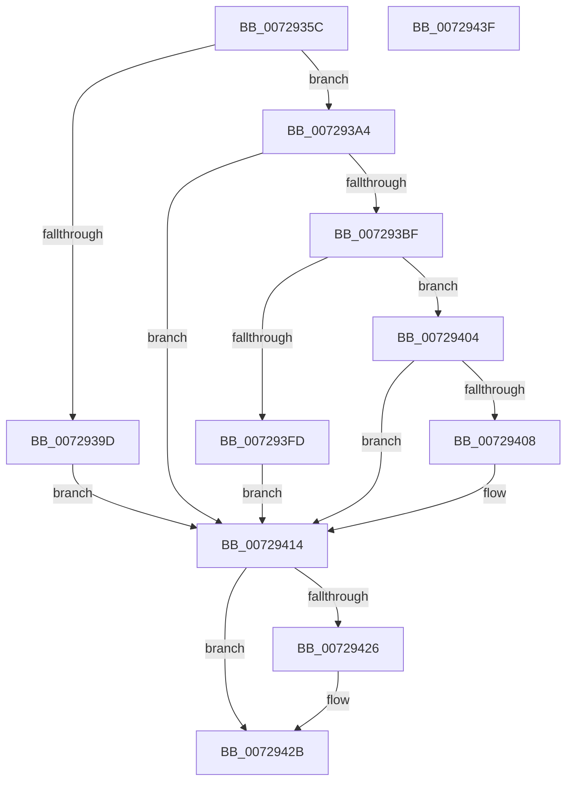

# PiOpenDriverRedirectedStateRootKey

- RVA: `0x0072935C`–`0x00729440` (길이 `228` bytes)
- VA: `0x000000014072935C`
- 실행 섹션: `PAGE`
- PDB 이름 있음: `예`; PDB Function 태그: `아니요`
- unwind 정보 RVA: `0x000C572C`
- 디코드: `64`개 명령, `228/228` bytes 표시
- 미해석 바이트: `0` (있으면 어셈블리에 `.byte`로 보존)

> 이 문서는 커널 이미지의 기계어와 PDB 기호를 분석해 생성했습니다. 4번과 5번은 함수 원형과 자료형을 바이너리 사용 방식에서 추정한 C 해석이며 원본 소스 복구 결과는 아닙니다.

## 1. Dependencies

- 직접 호출 지점: **5**; 고유 호출 대상: **5**
- 직접 호출자로 확인된 함수: **1**
- RIP 상대 이미지 참조: **1**

### Outgoing calls
- `0x00729393` → [RtlInitUnicodeString](../../text/42/RtlInitUnicodeString_function_0042A780.md) (function, `0x0042A780`)
- `0x007293B4` → [PiGetStateRootPath](../A6/PiGetStateRootPath_function_00A67A70.md) (function, `0x00A67A70`)
- `0x007293EF` → [ZwOpenKey](../../text/6A/ZwOpenKey_function_006AD310.md) (function, `0x006AD310`)
- `0x00729418` → [RtlFreeAnsiString](../9C/RtlFreeAnsiString_function_009C0800.md) (function, `0x009C0800`)
- `0x00729426` → [ZwClose](../../text/6A/ZwClose_function_006AD2B0.md) (function, `0x006AD2B0`)

### Direct callers
- [PipHardwareConfigClearStartOverrides](PipHardwareConfigClearStartOverrides_function_007234A4.md) at `0x007234E0`

### Static image references
- `0x007293AD` → RVA `0x00AFD690` (` ?? ::NNGAKEGL::`string'`; read)

## 2. Other-region calls and transfers

- 다른 실행 섹션으로 향하는 call: **3**
  - `0x00729393` → [RtlInitUnicodeString](../../text/42/RtlInitUnicodeString_function_0042A780.md) (`PAGE` → `.text`)
  - `0x007293EF` → [ZwOpenKey](../../text/6A/ZwOpenKey_function_006AD310.md) (`PAGE` → `.text`)
  - `0x00729426` → [ZwClose](../../text/6A/ZwClose_function_006AD2B0.md) (`PAGE` → `.text`)
- 별도 외부 분기/꼬리 이동을 확인하지 못했습니다.

## 3. Assembly (complete function range)

```asm
0072935C  48 89 5C 24 08                  mov qword ptr [rsp + 8], rbx
00729361  48 89 7C 24 18                  mov qword ptr [rsp + 0x18], rdi
00729366  55                              push rbp
00729367  48 8B EC                        mov rbp, rsp
0072936A  48 83 EC 60                     sub rsp, 0x60
0072936E  33 C0                           xor eax, eax
00729370  48 8D 4D C0                     lea rcx, [rbp - 0x40]
00729374  48 21 45 18                     and qword ptr [rbp + 0x18], rax
00729378  0F 57 C0                        xorps xmm0, xmm0
0072937B  48 8B FA                        mov rdi, rdx
0072937E  48 89 45 F0                     mov qword ptr [rbp - 0x10], rax
00729382  33 D2                           xor edx, edx
00729384  89 45 F8                        mov dword ptr [rbp - 8], eax
00729387  0F 11 45 D0                     movups xmmword ptr [rbp - 0x30], xmm0
0072938B  0F 11 45 E0                     movups xmmword ptr [rbp - 0x20], xmm0
0072938F  0F 11 45 C0                     movups xmmword ptr [rbp - 0x40], xmm0
00729393  E8 E8 13 D0 FF                  call 0x14042a780
00729398  48 85 FF                        test rdi, rdi
0072939B  75 07                           jne 0x1407293a4
0072939D  BB 0D 00 00 C0                  mov ebx, 0xc000000d
007293A2  EB 70                           jmp 0x140729414
007293A4  4C 8D 4D C0                     lea r9, [rbp - 0x40]
007293A8  45 33 C0                        xor r8d, r8d
007293AB  33 D2                           xor edx, edx
007293AD  48 8D 0D DC 42 3D 00            lea rcx, [rip + 0x3d42dc]
007293B4  E8 B7 E6 33 00                  call 0x140a67a70
007293B9  8B D8                           mov ebx, eax
007293BB  85 C0                           test eax, eax
007293BD  78 55                           js 0x140729414
007293BF  48 83 65 D8 00                  and qword ptr [rbp - 0x28], 0
007293C4  48 8D 45 C0                     lea rax, [rbp - 0x40]
007293C8  0F 57 C0                        xorps xmm0, xmm0
007293CB  48 89 45 E0                     mov qword ptr [rbp - 0x20], rax
007293CF  4C 8D 45 D0                     lea r8, [rbp - 0x30]
007293D3  C7 45 D0 30 00 00 00            mov dword ptr [rbp - 0x30], 0x30
007293DA  BA 19 00 02 00                  mov edx, 0x20019
007293DF  C7 45 E8 40 02 00 00            mov dword ptr [rbp - 0x18], 0x240
007293E6  48 8D 4D 18                     lea rcx, [rbp + 0x18]
007293EA  F3 0F 7F 45 F0                  movdqu xmmword ptr [rbp - 0x10], xmm0
007293EF  E8 1C 3F F8 FF                  call 0x1406ad310
007293F4  8B D8                           mov ebx, eax
007293F6  3D 34 00 00 C0                  cmp eax, 0xc0000034
007293FB  75 07                           jne 0x140729404
007293FD  BB 25 02 00 C0                  mov ebx, 0xc0000225
00729402  EB 10                           jmp 0x140729414
00729404  85 C0                           test eax, eax
00729406  78 0C                           js 0x140729414
00729408  48 8B 45 18                     mov rax, qword ptr [rbp + 0x18]
0072940C  48 83 65 18 00                  and qword ptr [rbp + 0x18], 0
00729411  48 89 07                        mov qword ptr [rdi], rax
00729414  48 8D 4D C0                     lea rcx, [rbp - 0x40]
00729418  E8 E3 73 29 00                  call 0x1409c0800
0072941D  48 8B 4D 18                     mov rcx, qword ptr [rbp + 0x18]
00729421  48 85 C9                        test rcx, rcx
00729424  74 05                           je 0x14072942b
00729426  E8 85 3E F8 FF                  call 0x1406ad2b0
0072942B  4C 8D 5C 24 60                  lea r11, [rsp + 0x60]
00729430  8B C3                           mov eax, ebx
00729432  49 8B 5B 10                     mov rbx, qword ptr [r11 + 0x10]
00729436  49 8B 7B 20                     mov rdi, qword ptr [r11 + 0x20]
0072943A  49 8B E3                        mov rsp, r11
0072943D  5D                              pop rbp
0072943E  C3                              ret
0072943F  CC                              int3
```

## 4. C-style interpretation (structured pseudocode)

```c
__int64 __fastcall PiOpenDriverRedirectedStateRootKey(__int64 a1, __int64 a2, int a3)
{
    __int64 result;
    __int64 v_rsp;
    unsigned int v_stack_m10;
    unsigned __int64 v_stack_m18;
    unsigned int v_stack_m20;
    unsigned __int64 v_stack_m28;
    unsigned __int64 v_stack_m30;
    unsigned __int64 v_stack_m38;
    unsigned __int64 v_stack_m48;
    unsigned __int64 v_stack_m8;
    unsigned __int64 v_stack_p10;
    unsigned __int64 v_stack_p18;
    unsigned __int64 v_stack_p8;

    v_stack_p8 = v_rbx;
    v_stack_p18 = v_rdi;
    v_rsp = (v_rsp) - (96);
    result = 0;
    v_stack_m18 = 0;
    a2 = 0;
    v_stack_m10 = 0;
    v_stack_m38 = v_xmm0;
    v_stack_m28 = v_xmm0;
    v_stack_m48 = v_xmm0;
    result = RtlInitUnicodeString(v_stack_m48, a2, a3, a4);
    if (0 != 0) goto loc_007293A4;
    goto loc_00729414;
loc_007293A4:
    a3 = 0;
    a2 = 0;
    result = PiGetStateRootPath(v_rip + 4014812, a2, a3, v_stack_m48);
    if (sign_flag) goto loc_00729414;
    v_stack_m28 = v_stack_m48;
    v_stack_m38 = 48;
    v_stack_m20 = 576;
    v_stack_m18 = v_xmm0;
    result = ZwOpenKey(v_stack_p10, (unsigned int)(0x20019ULL), v_stack_m38, v_stack_m48);
    if (((unsigned int)(result)) != 0xC0000034ULL) goto loc_00729404;
    goto loc_00729414;
loc_00729404:
    if (!(sign_flag)) {
        result = v_stack_p10;
        *(unsigned __int64 *)(a2) = result;
    }
    result = RtlFreeAnsiString(v_stack_m48, (unsigned int)(0x20019ULL), v_stack_m38, v_stack_m48);
    if (v_stack_p10 != 0) {
        result = ZwClose(v_stack_p10, (unsigned int)(0x20019ULL), v_stack_m38, v_stack_m48);
    }
    return (unsigned int)((unsigned int)((unsigned int)(0xC0000225ULL)));
}
```

## 5. (Beta) C Style

```c
int64_t PiOpenDriverRedirectedStateRootKey(int64_t Arg1, int64_t Arg2, int32_t Arg3)
{
    int64_t result;
    int64_t local_rsp;
    uint32_t v_stack_m10;
    uint64_t v_stack_m18;
    uint32_t v_stack_m20;
    uint64_t v_stack_m28;
    uint64_t v_stack_m30;
    uint64_t v_stack_m38;
    uint64_t v_stack_m48;
    uint64_t v_stack_m8;
    uint64_t v_stack_p10;
    uint64_t v_stack_p18;
    uint64_t v_stack_p8;

    v_stack_p8 = local_rbx;
    v_stack_p18 = local_rdi;
    local_rsp = (local_rsp) - (96);
    result = 0;
    v_stack_m18 = 0;
    Arg2 = 0;
    v_stack_m10 = 0;
    v_stack_m38 = v_xmm0;
    v_stack_m28 = v_xmm0;
    v_stack_m48 = v_xmm0;
    result = RtlInitUnicodeString(v_stack_m48, Arg2, Arg3, a4);
    if (0 != 0) goto loc_007293A4;
    goto loc_00729414;
loc_007293A4:
    Arg3 = 0;
    Arg2 = 0;
    result = PiGetStateRootPath(v_rip + 4014812, Arg2, Arg3, v_stack_m48);
    if (sign_flag) goto loc_00729414;
    v_stack_m28 = v_stack_m48;
    v_stack_m38 = 48;
    v_stack_m20 = 576;
    v_stack_m18 = v_xmm0;
    result = ZwOpenKey(v_stack_p10, (uint32_t)(0x20019ULL), v_stack_m38, v_stack_m48);
    if (((uint32_t)(result)) != 0xC0000034ULL) goto loc_00729404;
    goto loc_00729414;
loc_00729404:
    if (!(sign_flag)) {
        result = v_stack_p10;
        *(uint64_t *)(Arg2) = result;
    }
    result = RtlFreeAnsiString(v_stack_m48, (uint32_t)(0x20019ULL), v_stack_m38, v_stack_m48);
    if (v_stack_p10 != 0) {
        result = ZwClose(v_stack_p10, (uint32_t)(0x20019ULL), v_stack_m38, v_stack_m48);
    }
    return (uint32_t)((uint32_t)((uint32_t)(0xC0000225ULL)));
}
```

## 6. Execution-region graph

[열기: 2D/3D 그래프와 함수 탐색 컨트롤 패널](../../../control-panel.html?section=page&rva=0x0072935C&view=graph)

- 2D 그래프는 위에서 아래로 흐르고, 3D 그래프는 빈 공간을 드래그해 회전합니다. Shift+드래그는 이동, 휠은 확대·축소, 함수 노드 선택은 대상 보고서 이동입니다.

### Static fallback


