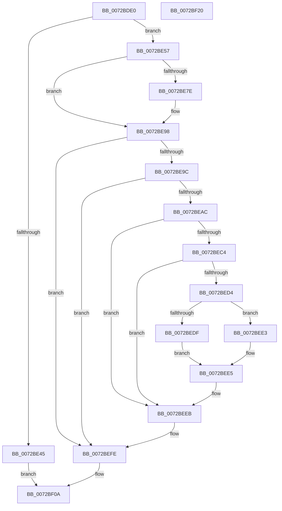

# PiPagePathSetState

- RVA: `0x0072BDE0`–`0x0072BF21` (길이 `321` bytes)
- VA: `0x000000014072BDE0`
- 실행 섹션: `PAGE`
- PDB 이름 있음: `예`; PDB Function 태그: `아니요`
- unwind 정보 RVA: `0x000C86A4`
- 디코드: `88`개 명령, `321/321` bytes 표시
- 미해석 바이트: `0` (있으면 어셈블리에 `.byte`로 보존)

> 이 문서는 커널 이미지의 기계어와 PDB 기호를 분석해 생성했습니다. 4번과 5번은 함수 원형과 자료형을 바이너리 사용 방식에서 추정한 C 해석이며 원본 소스 복구 결과는 아닙니다.

## 1. Dependencies

- 직접 호출 지점: **14**; 고유 호출 대상: **13**
- 직접 호출자로 확인된 함수: **5**
- RIP 상대 이미지 참조: **0**

### Outgoing calls
- `0x0072BE07` → [memset](../../text/6C/memset_function_006C6C40.md) (function, `0x006C6C40`)
- `0x0072BE14` → [ObfReferenceObject](../../text/20/ObfReferenceObject_function_0020FA20.md) (function, `0x0020FA20`)
- `0x0072BE1C` → [IoGetRelatedDeviceObject](../../text/29/IoGetRelatedDeviceObject_function_0029B120.md) (function, `0x0029B120`)
- `0x0072BE38` → [PpIrpAllocateDeviceUsageNotification](../73/PpIrpAllocateDeviceUsageNotification_function_0073E1DC.md) (function, `0x0073E1DC`)
- `0x0072BE48` → [ObfDereferenceObject](../../text/2F/ObfDereferenceObject_function_002F9350.md) (function, `0x002F9350`)
- `0x0072BE5A` → [IoQueueThreadIrp](../../text/4B/IoQueueThreadIrp_function_004BBFC0.md) (function, `0x004BBFC0`)
- `0x0072BE64` → [PpDevNodeLockTree](../A1/PpDevNodeLockTree_function_00A19310.md) (function, `0x00A19310`)
- `0x0072BE70` → [IofCallDriver](../../text/29/IofCallDriver_function_0029B4B0.md) (function, `0x0029B4B0`)
- `0x0072BE90` → [KeWaitForSingleObject](../../text/20/KeWaitForSingleObject_function_0020E6B0.md) (function, `0x0020E6B0`)
- `0x0072BEA3` → [IoGetRelatedTargetDevice](../A6/IoGetRelatedTargetDevice_function_00A6DBFC.md) (function, `0x00A6DBFC`)
- `0x0072BEB7` → [IoGetDeviceAttachmentBaseRefWithTag](../../text/27/IoGetDeviceAttachmentBaseRefWithTag_function_00272788.md) (function, `0x00272788`)
- `0x0072BEF0` → [ObfDereferenceObjectWithTag](../../text/2F/ObfDereferenceObjectWithTag_function_002F78E0.md) (function, `0x002F78E0`)
- `0x0072BEF9` → [ObfDereferenceObject](../../text/2F/ObfDereferenceObject_function_002F9350.md) (function, `0x002F9350`)
- `0x0072BF03` → [PpDevNodeUnlockTree](../A2/PpDevNodeUnlockTree_function_00A21290.md) (function, `0x00A21290`)

### Direct callers
- [PpPagePathAssign](PpPagePathAssign_function_0072BF28.md) at `0x0072BF2E`
- [CmpVolumeContextSendDeviceUsageNotification](../7E/CmpVolumeContextSendDeviceUsageNotification_function_007E87DC.md) at `0x007E8863`
- [CmpVolumeContextSendDeviceUsageNotification](../7E/CmpVolumeContextSendDeviceUsageNotification_function_007E87DC.md) at `0x007E8896`
- [MiCreatePagingFile](../7F/MiCreatePagingFile_function_007FEFF4.md) at `0x007FF689`
- [MiCreatePagingFile](../7F/MiCreatePagingFile_function_007FEFF4.md) at `0x007FF6D0`
- [MiDeletePagefile](../7F/MiDeletePagefile_function_007FFB88.md) at `0x007FFCBD`
- [CmpVolumeContextCleanup](../AB/CmpVolumeContextCleanup_function_00AB1D14.md) at `0x00AB1D38`

### Static image references
- 디코드된 RIP-relative 메모리 참조가 없습니다.

## 2. Other-region calls and transfers

- 다른 실행 섹션으로 향하는 call: **10**
  - `0x0072BE07` → [memset](../../text/6C/memset_function_006C6C40.md) (`PAGE` → `.text`)
  - `0x0072BE14` → [ObfReferenceObject](../../text/20/ObfReferenceObject_function_0020FA20.md) (`PAGE` → `.text`)
  - `0x0072BE1C` → [IoGetRelatedDeviceObject](../../text/29/IoGetRelatedDeviceObject_function_0029B120.md) (`PAGE` → `.text`)
  - `0x0072BE48` → [ObfDereferenceObject](../../text/2F/ObfDereferenceObject_function_002F9350.md) (`PAGE` → `.text`)
  - `0x0072BE5A` → [IoQueueThreadIrp](../../text/4B/IoQueueThreadIrp_function_004BBFC0.md) (`PAGE` → `.text`)
  - `0x0072BE70` → [IofCallDriver](../../text/29/IofCallDriver_function_0029B4B0.md) (`PAGE` → `.text`)
  - `0x0072BE90` → [KeWaitForSingleObject](../../text/20/KeWaitForSingleObject_function_0020E6B0.md) (`PAGE` → `.text`)
  - `0x0072BEB7` → [IoGetDeviceAttachmentBaseRefWithTag](../../text/27/IoGetDeviceAttachmentBaseRefWithTag_function_00272788.md) (`PAGE` → `.text`)
  - `0x0072BEF0` → [ObfDereferenceObjectWithTag](../../text/2F/ObfDereferenceObjectWithTag_function_002F78E0.md) (`PAGE` → `.text`)
  - `0x0072BEF9` → [ObfDereferenceObject](../../text/2F/ObfDereferenceObject_function_002F9350.md) (`PAGE` → `.text`)
- 별도 외부 분기/꼬리 이동을 확인하지 못했습니다.

## 3. Assembly (complete function range)

```asm
0072BDE0  48 89 5C 24 10                  mov qword ptr [rsp + 0x10], rbx
0072BDE5  48 89 74 24 18                  mov qword ptr [rsp + 0x18], rsi
0072BDEA  48 89 7C 24 20                  mov qword ptr [rsp + 0x20], rdi
0072BDEF  55                              push rbp
0072BDF0  48 8B EC                        mov rbp, rsp
0072BDF3  48 83 EC 70                     sub rsp, 0x70
0072BDF7  40 8A F2                        mov sil, dl
0072BDFA  48 8B F9                        mov rdi, rcx
0072BDFD  33 D2                           xor edx, edx
0072BDFF  48 8D 4D C0                     lea rcx, [rbp - 0x40]
0072BE03  44 8D 42 40                     lea r8d, [rdx + 0x40]
0072BE07  E8 34 AE F9 FF                  call 0x1406c6c40
0072BE0C  48 83 65 10 00                  and qword ptr [rbp + 0x10], 0
0072BE11  48 8B CF                        mov rcx, rdi
0072BE14  E8 07 3C AE FF                  call 0x14020fa20
0072BE19  48 8B CF                        mov rcx, rdi
0072BE1C  E8 FF F2 B6 FF                  call 0x14029b120
0072BE21  48 8D 4D C0                     lea rcx, [rbp - 0x40]
0072BE25  48 89 45 C0                     mov qword ptr [rbp - 0x40], rax
0072BE29  C7 45 C8 01 00 00 00            mov dword ptr [rbp - 0x38], 1
0072BE30  40 88 75 CC                     mov byte ptr [rbp - 0x34], sil
0072BE34  48 89 7D D0                     mov qword ptr [rbp - 0x30], rdi
0072BE38  E8 9F 23 01 00                  call 0x14073e1dc
0072BE3D  48 8B D8                        mov rbx, rax
0072BE40  48 85 C0                        test rax, rax
0072BE43  75 12                           jne 0x14072be57
0072BE45  48 8B CF                        mov rcx, rdi
0072BE48  E8 03 D5 BC FF                  call 0x1402f9350
0072BE4D  B8 17 00 00 C0                  mov eax, 0xc0000017
0072BE52  E9 B3 00 00 00                  jmp 0x14072bf0a
0072BE57  48 8B CB                        mov rcx, rbx
0072BE5A  E8 61 01 D9 FF                  call 0x1404bbfc0
0072BE5F  B9 01 00 00 00                  mov ecx, 1
0072BE64  E8 A7 D4 2E 00                  call 0x140a19310
0072BE69  48 8B 4D C0                     mov rcx, qword ptr [rbp - 0x40]
0072BE6D  48 8B D3                        mov rdx, rbx
0072BE70  E8 3B F6 B6 FF                  call 0x14029b4b0
0072BE75  8B D8                           mov ebx, eax
0072BE77  3D 03 01 00 00                  cmp eax, 0x103
0072BE7C  75 1A                           jne 0x14072be98
0072BE7E  48 83 64 24 20 00               and qword ptr [rsp + 0x20], 0
0072BE84  48 8D 4D E8                     lea rcx, [rbp - 0x18]
0072BE88  45 33 C9                        xor r9d, r9d
0072BE8B  45 33 C0                        xor r8d, r8d
0072BE8E  33 D2                           xor edx, edx
0072BE90  E8 1B 28 AE FF                  call 0x14020e6b0
0072BE95  8B 5D D8                        mov ebx, dword ptr [rbp - 0x28]
0072BE98  85 DB                           test ebx, ebx
0072BE9A  78 62                           js 0x14072befe
0072BE9C  48 8D 55 10                     lea rdx, [rbp + 0x10]
0072BEA0  48 8B CF                        mov rcx, rdi
0072BEA3  E8 54 1D 34 00                  call 0x140a6dbfc
0072BEA8  85 C0                           test eax, eax
0072BEAA  78 52                           js 0x14072befe
0072BEAC  48 8B 4D 10                     mov rcx, qword ptr [rbp + 0x10]
0072BEB0  BF 50 6F 44 64                  mov edi, 0x64446f50
0072BEB5  8B D7                           mov edx, edi
0072BEB7  E8 CC 68 B4 FF                  call 0x140272788
0072BEBC  4C 8B C0                        mov r8, rax
0072BEBF  48 85 C0                        test rax, rax
0072BEC2  74 27                           je 0x14072beeb
0072BEC4  48 8B 88 38 01 00 00            mov rcx, qword ptr [rax + 0x138]
0072BECB  48 8B 51 28                     mov rdx, qword ptr [rcx + 0x28]
0072BECF  48 85 D2                        test rdx, rdx
0072BED2  74 17                           je 0x14072beeb
0072BED4  8B 82 00 03 00 00               mov eax, dword ptr [rdx + 0x300]
0072BEDA  40 84 F6                        test sil, sil
0072BEDD  75 04                           jne 0x14072bee3
0072BEDF  FF C8                           dec eax
0072BEE1  EB 02                           jmp 0x14072bee5
0072BEE3  FF C0                           inc eax
0072BEE5  89 82 00 03 00 00               mov dword ptr [rdx + 0x300], eax
0072BEEB  8B D7                           mov edx, edi
0072BEED  49 8B C8                        mov rcx, r8
0072BEF0  E8 EB B9 BC FF                  call 0x1402f78e0
0072BEF5  48 8B 4D 10                     mov rcx, qword ptr [rbp + 0x10]
0072BEF9  E8 52 D4 BC FF                  call 0x1402f9350
0072BEFE  B9 01 00 00 00                  mov ecx, 1
0072BF03  E8 88 53 2F 00                  call 0x140a21290
0072BF08  8B C3                           mov eax, ebx
0072BF0A  4C 8D 5C 24 70                  lea r11, [rsp + 0x70]
0072BF0F  49 8B 5B 18                     mov rbx, qword ptr [r11 + 0x18]
0072BF13  49 8B 73 20                     mov rsi, qword ptr [r11 + 0x20]
0072BF17  49 8B 7B 28                     mov rdi, qword ptr [r11 + 0x28]
0072BF1B  49 8B E3                        mov rsp, r11
0072BF1E  5D                              pop rbp
0072BF1F  C3                              ret
0072BF20  CC                              int3
```

## 4. C-style interpretation (structured pseudocode)

```c
__int64 __fastcall PiPagePathSetState(__int64 a1, int a2, __int64 a3, int a4)
{
    __int64 result;
    __int64 v_rbx;
    __int64 v_rsp;
    unsigned __int64 v_stack_m20;
    unsigned int v_stack_m30;
    unsigned __int64 v_stack_m38;
    unsigned __int8 v_stack_m3C;
    unsigned int v_stack_m40;
    unsigned __int64 v_stack_m48;
    unsigned __int64 v_stack_m58;
    unsigned __int64 v_stack_m8;
    unsigned __int64 v_stack_p10;
    unsigned __int64 v_stack_p18;
    unsigned __int64 v_stack_p20;
    unsigned __int64 v_stack_p8;

    v_stack_p10 = v_rbx;
    v_stack_p18 = v_rsi;
    v_stack_p20 = v_rdi;
    v_rsp = (v_rsp) - (112);
    a2 = 0;
    result = memset(v_stack_m48, a2, a2 + 64, a4);
    result = ObfReferenceObject(a1, a2, a2 + 64, a4);
    result = IoGetRelatedDeviceObject(a1, a2, a2 + 64, a4);
    v_stack_m48 = result;
    v_stack_m40 = 1;
    v_stack_m3C = (unsigned __int8)((unsigned __int8)(a2));
    v_stack_m38 = a1;
    result = PpIrpAllocateDeviceUsageNotification(v_stack_m48, a2, a2 + 64, a4);
    if (result != 0) goto loc_0072BE57;
    result = ObfDereferenceObject(a1, a2, a2 + 64, a4);
    goto loc_0072BF0A;
loc_0072BE57:
    result = IoQueueThreadIrp(result, a2, a2 + 64, a4);
    result = PpDevNodeLockTree(1, a2, a2 + 64, a4);
    result = IofCallDriver(v_stack_m48, result, a2 + 64, a4);
    v_rbx = (unsigned int)((unsigned int)(result));
    if (((unsigned int)(result)) == 259) {
        a1 = v_stack_m20;
        a4 = 0;
        a3 = 0;
        a2 = 0;
        result = KeWaitForSingleObject(a1, a2, a3, a4);
        v_rbx = v_stack_m30;
    }
    if (sign_flag) goto loc_0072BEFE;
    result = IoGetRelatedTargetDevice(a1, v_stack_p8, a3, a4);
    if (sign_flag) goto loc_0072BEFE;
    result = IoGetDeviceAttachmentBaseRefWithTag(v_stack_p8, (unsigned int)((unsigned int)((unsigned int)(0x64446F50ULL))), a3, a4);
    if (result == 0) goto loc_0072BEEB;
    if (*(unsigned __int64 *)(*(unsigned __int64 *)(result + 312) + 40) == 0) goto loc_0072BEEB;
    if ((unsigned __int8)((unsigned __int8)(a2)) != 0) goto loc_0072BEE3;
    result = (unsigned int)(((unsigned int)(*(unsigned int *)(*(unsigned __int64 *)(*(unsigned __int64 *)(result + 312) + 40) + 768))) - 1);
    goto loc_0072BEE5;
loc_0072BEE3:
    result = (unsigned int)((result) + 1);
loc_0072BEE5:
    *(unsigned int *)(*(unsigned __int64 *)(*(unsigned __int64 *)(result + 312) + 40) + 768) = (unsigned int)(result);
loc_0072BEEB:
    result = ObfDereferenceObjectWithTag(result, (unsigned int)((unsigned int)((unsigned int)(0x64446F50ULL))), result, a4);
    result = ObfDereferenceObject(v_stack_p8, (unsigned int)((unsigned int)((unsigned int)(0x64446F50ULL))), result, a4);
loc_0072BEFE:
    result = PpDevNodeUnlockTree(1, (unsigned int)((unsigned int)((unsigned int)(0x64446F50ULL))), result, a4);
loc_0072BF0A:
    return (unsigned int)((unsigned int)(v_rbx));
}
```

## 5. (Beta) C Style

```c
int64_t PiPagePathSetState(int64_t Arg1, int32_t Arg2, int64_t Arg3, int32_t Arg4)
{
    int64_t result;
    int64_t local_rbx;
    int64_t local_rsp;
    uint64_t v_stack_m20;
    uint32_t v_stack_m30;
    uint64_t v_stack_m38;
    uint8_t v_stack_m3C;
    uint32_t v_stack_m40;
    uint64_t v_stack_m48;
    uint64_t v_stack_m58;
    uint64_t v_stack_m8;
    uint64_t v_stack_p10;
    uint64_t v_stack_p18;
    uint64_t v_stack_p20;
    uint64_t v_stack_p8;

    v_stack_p10 = local_rbx;
    v_stack_p18 = local_rsi;
    v_stack_p20 = local_rdi;
    local_rsp = (local_rsp) - (112);
    Arg2 = 0;
    result = memset(v_stack_m48, Arg2, Arg2 + 64, Arg4);
    result = ObfReferenceObject(Arg1, Arg2, Arg2 + 64, Arg4);
    result = IoGetRelatedDeviceObject(Arg1, Arg2, Arg2 + 64, Arg4);
    v_stack_m48 = result;
    v_stack_m40 = 1;
    v_stack_m3C = (uint8_t)((uint8_t)(Arg2));
    v_stack_m38 = Arg1;
    result = PpIrpAllocateDeviceUsageNotification(v_stack_m48, Arg2, Arg2 + 64, Arg4);
    if (result != 0) goto loc_0072BE57;
    result = ObfDereferenceObject(Arg1, Arg2, Arg2 + 64, Arg4);
    goto loc_0072BF0A;
loc_0072BE57:
    result = IoQueueThreadIrp(result, Arg2, Arg2 + 64, Arg4);
    result = PpDevNodeLockTree(1, Arg2, Arg2 + 64, Arg4);
    result = IofCallDriver(v_stack_m48, result, Arg2 + 64, Arg4);
    local_rbx = (uint32_t)((uint32_t)(result));
    if (((uint32_t)(result)) == 259) {
        Arg1 = v_stack_m20;
        Arg4 = 0;
        Arg3 = 0;
        Arg2 = 0;
        result = KeWaitForSingleObject(Arg1, Arg2, Arg3, Arg4);
        local_rbx = v_stack_m30;
    }
    if (sign_flag) goto loc_0072BEFE;
    result = IoGetRelatedTargetDevice(Arg1, v_stack_p8, Arg3, Arg4);
    if (sign_flag) goto loc_0072BEFE;
    result = IoGetDeviceAttachmentBaseRefWithTag(v_stack_p8, (uint32_t)((uint32_t)((uint32_t)(0x64446F50ULL))), Arg3, Arg4);
    if (result == 0) goto loc_0072BEEB;
    if (*(uint64_t *)(*(uint64_t *)(result + 0x138) + 0x28) == 0) goto loc_0072BEEB;
    if ((uint8_t)((uint8_t)(Arg2)) != 0) goto loc_0072BEE3;
    result = (uint32_t)(((uint32_t)(*(uint32_t *)(*(uint64_t *)(*(uint64_t *)(result + 0x138) + 0x28) + 0x300))) - 1);
    goto loc_0072BEE5;
loc_0072BEE3:
    result = (uint32_t)((result) + 1);
loc_0072BEE5:
    *(uint32_t *)(*(uint64_t *)(*(uint64_t *)(result + 0x138) + 0x28) + 0x300) = (uint32_t)(result);
loc_0072BEEB:
    result = ObfDereferenceObjectWithTag(result, (uint32_t)((uint32_t)((uint32_t)(0x64446F50ULL))), result, Arg4);
    result = ObfDereferenceObject(v_stack_p8, (uint32_t)((uint32_t)((uint32_t)(0x64446F50ULL))), result, Arg4);
loc_0072BEFE:
    result = PpDevNodeUnlockTree(1, (uint32_t)((uint32_t)((uint32_t)(0x64446F50ULL))), result, Arg4);
loc_0072BF0A:
    return (uint32_t)((uint32_t)(local_rbx));
}
```

## 6. Execution-region graph

[열기: 2D/3D 그래프와 함수 탐색 컨트롤 패널](../../../control-panel.html?section=page&rva=0x0072BDE0&view=graph)

- 2D 그래프는 위에서 아래로 흐르고, 3D 그래프는 빈 공간을 드래그해 회전합니다. Shift+드래그는 이동, 휠은 확대·축소, 함수 노드 선택은 대상 보고서 이동입니다.

### Static fallback


