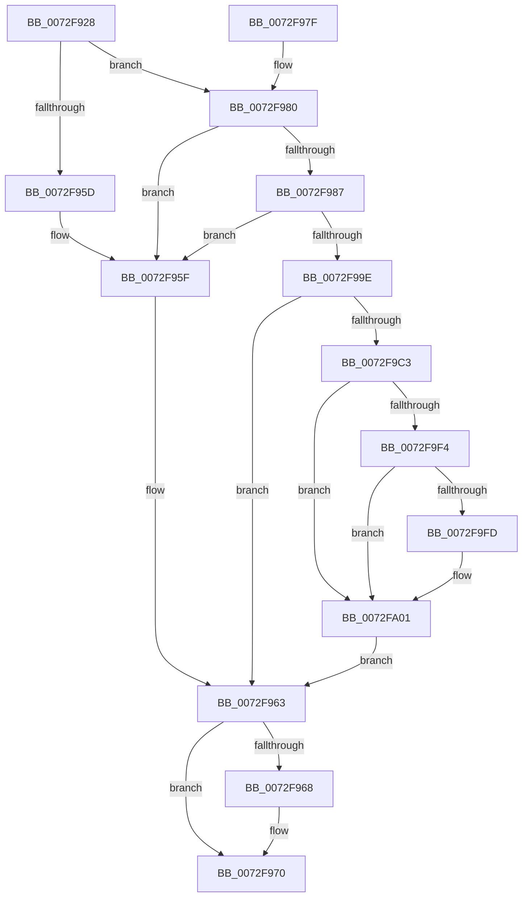

# PiPnpRtlEnsureObjectCached

- RVA: `0x0072F928`–`0x0072FA0F` (길이 `231` bytes)
- VA: `0x000000014072F928`
- 실행 섹션: `PAGE`
- PDB 이름 있음: `예`; PDB Function 태그: `아니요`
- unwind 정보 RVA: `0x000C8900`
- 디코드: `68`개 명령, `231/231` bytes 표시
- 미해석 바이트: `0` (있으면 어셈블리에 `.byte`로 보존)

> 이 문서는 커널 이미지의 기계어와 PDB 기호를 분석해 생성했습니다. 4번과 5번은 함수 원형과 자료형을 바이너리 사용 방식에서 추정한 C 해석이며 원본 소스 복구 결과는 아닙니다.

## 1. Dependencies

- 직접 호출 지점: **11**; 고유 호출 대상: **11**
- 직접 호출자로 확인된 함수: **1**
- RIP 상대 이미지 참조: **1**

### Outgoing calls
- `0x0072F952` → [PiDmGetObject](../8D/PiDmGetObject_function_008DFAE0.md) (function, `0x008DFAE0`)
- `0x0072F96B` → [PiDmObjectRelease](../8E/PiDmObjectRelease_function_008E4F70.md) (function, `0x008E4F70`)
- `0x0072F993` → [PiDmAddCacheReferenceForObject](../95/PiDmAddCacheReferenceForObject_function_00950FB4.md) (function, `0x00950FB4`)
- `0x0072F9A5` → [CmpLockSiloKeyLockTrackerExclusive](../8F/CmpLockSiloKeyLockTrackerExclusive_function_008F9EF8.md) (function, `0x008F9EF8`)
- `0x0072F9B1` → [PiDmObjectReleaseLock](../8E/PiDmObjectReleaseLock_function_008E5584.md) (function, `0x008E5584`)
- `0x0072F9BA` → [PiPnpRtlBeginOperation](../8E/PiPnpRtlBeginOperation_function_008E033C.md) (function, `0x008E033C`)
- `0x0072F9C3` → [PiPnpRtlDisableRemoveOperationDispatch](../8E/PiPnpRtlDisableRemoveOperationDispatch_function_008E0AAC.md) (function, `0x008E0AAC`)
- `0x0072F9D8` → [PiPnpRtlObjectEventCreate](../8D/PiPnpRtlObjectEventCreate_function_008DF7E0.md) (function, `0x008DF7E0`)
- `0x0072F9E6` → [ExReleaseResourceLite](../../text/25/ExReleaseResourceLite_function_0025FA10.md) (function, `0x0025FA10`)
- `0x0072F9EB` → [KeLeaveCriticalRegion](../../text/25/KeLeaveCriticalRegion_function_0025D8B0.md) (function, `0x0025D8B0`)
- `0x0072FA05` → [PiPnpRtlEndOperation](../8E/PiPnpRtlEndOperation_function_008E0518.md) (function, `0x008E0518`)

### Direct callers
- [PiCMCreateDevice](../AC/PiCMCreateDevice_function_00ACB824.md) at `0x00ACBBC8`

### Static image references
- `0x0072F9DD` → RVA `0x00F8B960` (`.data`; read)

## 2. Other-region calls and transfers

- 다른 실행 섹션으로 향하는 call: **2**
  - `0x0072F9E6` → [ExReleaseResourceLite](../../text/25/ExReleaseResourceLite_function_0025FA10.md) (`PAGE` → `.text`)
  - `0x0072F9EB` → [KeLeaveCriticalRegion](../../text/25/KeLeaveCriticalRegion_function_0025D8B0.md) (`PAGE` → `.text`)
- 별도 외부 분기/꼬리 이동을 확인하지 못했습니다.

## 3. Assembly (complete function range)

```asm
0072F928  48 89 5C 24 08                  mov qword ptr [rsp + 8], rbx
0072F92D  55                              push rbp
0072F92E  56                              push rsi
0072F92F  57                              push rdi
0072F930  48 8B EC                        mov rbp, rsp
0072F933  48 83 EC 30                     sub rsp, 0x30
0072F937  48 83 65 30 00                  and qword ptr [rbp + 0x30], 0
0072F93C  4C 8D 45 30                     lea r8, [rbp + 0x30]
0072F940  48 83 65 38 00                  and qword ptr [rbp + 0x38], 0
0072F945  B9 01 00 00 00                  mov ecx, 1
0072F94A  48 83 65 F0 00                  and qword ptr [rbp - 0x10], 0
0072F94F  48 8B DA                        mov rbx, rdx
0072F952  E8 89 01 1B 00                  call 0x1408dfae0
0072F957  8B F0                           mov esi, eax
0072F959  85 C0                           test eax, eax
0072F95B  78 23                           js 0x14072f980
0072F95D  33 F6                           xor esi, esi
0072F95F  48 8B 7D 30                     mov rdi, qword ptr [rbp + 0x30]
0072F963  48 85 FF                        test rdi, rdi
0072F966  74 08                           je 0x14072f970
0072F968  48 8B CF                        mov rcx, rdi
0072F96B  E8 00 56 1B 00                  call 0x1408e4f70
0072F970  48 8B 5C 24 50                  mov rbx, qword ptr [rsp + 0x50]
0072F975  8B C6                           mov eax, esi
0072F977  48 83 C4 30                     add rsp, 0x30
0072F97B  5F                              pop rdi
0072F97C  5E                              pop rsi
0072F97D  5D                              pop rbp
0072F97E  C3                              ret
0072F97F  CC                              int3
0072F980  3D 34 00 00 C0                  cmp eax, 0xc0000034
0072F985  75 D8                           jne 0x14072f95f
0072F987  4C 8D 45 30                     lea r8, [rbp + 0x30]
0072F98B  48 8B D3                        mov rdx, rbx
0072F98E  B9 01 00 00 00                  mov ecx, 1
0072F993  E8 1C 16 22 00                  call 0x140950fb4
0072F998  8B F0                           mov esi, eax
0072F99A  85 C0                           test eax, eax
0072F99C  78 C1                           js 0x14072f95f
0072F99E  48 8B 7D 30                     mov rdi, qword ptr [rbp + 0x30]
0072F9A2  48 8B CF                        mov rcx, rdi
0072F9A5  E8 4E A5 1C 00                  call 0x1408f9ef8
0072F9AA  83 4F 20 01                     or dword ptr [rdi + 0x20], 1
0072F9AE  48 8B CF                        mov rcx, rdi
0072F9B1  E8 CE 5B 1B 00                  call 0x1408e5584
0072F9B6  48 8D 4D 38                     lea rcx, [rbp + 0x38]
0072F9BA  E8 7D 09 1B 00                  call 0x1408e033c
0072F9BF  85 C0                           test eax, eax
0072F9C1  78 A0                           js 0x14072f963
0072F9C3  E8 E4 10 1B 00                  call 0x1408e0aac
0072F9C8  4C 8B 45 38                     mov r8, qword ptr [rbp + 0x38]
0072F9CC  4C 8D 4D F0                     lea r9, [rbp - 0x10]
0072F9D0  BA 01 00 00 00                  mov edx, 1
0072F9D5  48 8B CB                        mov rcx, rbx
0072F9D8  E8 03 FE 1A 00                  call 0x1408df7e0
0072F9DD  48 8D 0D 7C BF 85 00            lea rcx, [rip + 0x85bf7c]
0072F9E4  8B D8                           mov ebx, eax
0072F9E6  E8 25 00 B3 FF                  call 0x14025fa10
0072F9EB  E8 C0 DE B2 FF                  call 0x14025d8b0
0072F9F0  85 DB                           test ebx, ebx
0072F9F2  78 0D                           js 0x14072fa01
0072F9F4  48 8B 45 F0                     mov rax, qword ptr [rbp - 0x10]
0072F9F8  48 85 C0                        test rax, rax
0072F9FB  74 04                           je 0x14072fa01
0072F9FD  83 48 04 01                     or dword ptr [rax + 4], 1
0072FA01  48 8B 4D 38                     mov rcx, qword ptr [rbp + 0x38]
0072FA05  E8 0E 0B 1B 00                  call 0x1408e0518
0072FA0A  E9 54 FF FF FF                  jmp 0x14072f963
```

## 4. C-style interpretation (structured pseudocode)

```c
__int64 __fastcall PiPnpRtlEnsureObjectCached(__int64 a1, __int64 a2)
{
    __int64 result;
    __int64 v_rsi;
    __int64 v_rsp;
    unsigned __int64 v_stack_m28;
    unsigned __int64 v_stack_p18;
    unsigned __int64 v_stack_p20;
    unsigned __int64 v_stack_p8;

    v_stack_p8 = v_rbx;
    v_rsp = (v_rsp) - (48);
    result = PiDmGetObject(1, a2, v_stack_p18, a4);
    if (sign_flag) goto loc_0072F980;
    v_rsi = 0;
loc_0072F95F:
loc_0072F963:
    if (v_stack_p18 != 0) {
        a1 = v_stack_p18;
        result = PiDmObjectRelease(a1, a2, v_stack_p18, a4);
    }
    v_rsp = (v_rsp) + (48);
    return 0;
loc_0072F980:
    if (0 != 0xC0000034ULL) goto loc_0072F95F;
    result = PiDmAddCacheReferenceForObject(1, v_stack_p8, v_stack_p18, a4);
    if (sign_flag) goto loc_0072F95F;
    result = CmpLockSiloKeyLockTrackerExclusive(v_stack_p18, v_stack_p8, v_stack_p18, a4);
    result = PiDmObjectReleaseLock(v_stack_p18, v_stack_p8, v_stack_p18, a4);
    result = PiPnpRtlBeginOperation(v_stack_p20, v_stack_p8, v_stack_p18, a4);
    if (sign_flag) goto loc_0072F963;
    result = PiPnpRtlDisableRemoveOperationDispatch(v_stack_p20, v_stack_p8, v_stack_p18, a4);
    result = PiPnpRtlObjectEventCreate(v_stack_p8, 1, v_stack_p20, v_stack_m28);
    result = ExReleaseResourceLite(v_rip + 8765308, 1, v_stack_p20, v_stack_m28);
    result = KeLeaveCriticalRegion(v_rip + 8765308, 1, v_stack_p20, v_stack_m28);
    if (sign_flag) goto loc_0072FA01;
    if (v_stack_m28 != 0) {
    }
    result = PiPnpRtlEndOperation(v_stack_p20, 1, v_stack_p20, v_stack_m28);
    goto loc_0072F963;
}
```

## 5. (Beta) C Style

```c
int64_t PiPnpRtlEnsureObjectCached(int64_t Arg1, int64_t Arg2)
{
    int64_t result;
    int64_t local_rsi;
    int64_t local_rsp;
    uint64_t v_stack_m28;
    uint64_t v_stack_p18;
    uint64_t v_stack_p20;
    uint64_t v_stack_p8;

    v_stack_p8 = local_rbx;
    local_rsp = (local_rsp) - (48);
    result = PiDmGetObject(1, Arg2, v_stack_p18, a4);
    if (sign_flag) goto loc_0072F980;
    local_rsi = 0;
loc_0072F95F:
loc_0072F963:
    if (v_stack_p18 != 0) {
        Arg1 = v_stack_p18;
        result = PiDmObjectRelease(Arg1, Arg2, v_stack_p18, a4);
    }
    local_rsp = (local_rsp) + (48);
    return 0;
loc_0072F980:
    if (0 != 0xC0000034ULL) goto loc_0072F95F;
    result = PiDmAddCacheReferenceForObject(1, v_stack_p8, v_stack_p18, a4);
    if (sign_flag) goto loc_0072F95F;
    result = CmpLockSiloKeyLockTrackerExclusive(v_stack_p18, v_stack_p8, v_stack_p18, a4);
    result = PiDmObjectReleaseLock(v_stack_p18, v_stack_p8, v_stack_p18, a4);
    result = PiPnpRtlBeginOperation(v_stack_p20, v_stack_p8, v_stack_p18, a4);
    if (sign_flag) goto loc_0072F963;
    result = PiPnpRtlDisableRemoveOperationDispatch(v_stack_p20, v_stack_p8, v_stack_p18, a4);
    result = PiPnpRtlObjectEventCreate(v_stack_p8, 1, v_stack_p20, v_stack_m28);
    result = ExReleaseResourceLite(v_rip + 8765308, 1, v_stack_p20, v_stack_m28);
    result = KeLeaveCriticalRegion(v_rip + 8765308, 1, v_stack_p20, v_stack_m28);
    if (sign_flag) goto loc_0072FA01;
    if (v_stack_m28 != 0) {
    }
    result = PiPnpRtlEndOperation(v_stack_p20, 1, v_stack_p20, v_stack_m28);
    goto loc_0072F963;
}
```

## 6. Execution-region graph

[열기: 2D/3D 그래프와 함수 탐색 컨트롤 패널](../../../control-panel.html?section=page&rva=0x0072F928&view=graph)

- 2D 그래프는 위에서 아래로 흐르고, 3D 그래프는 빈 공간을 드래그해 회전합니다. Shift+드래그는 이동, 휠은 확대·축소, 함수 노드 선택은 대상 보고서 이동입니다.

### Static fallback


