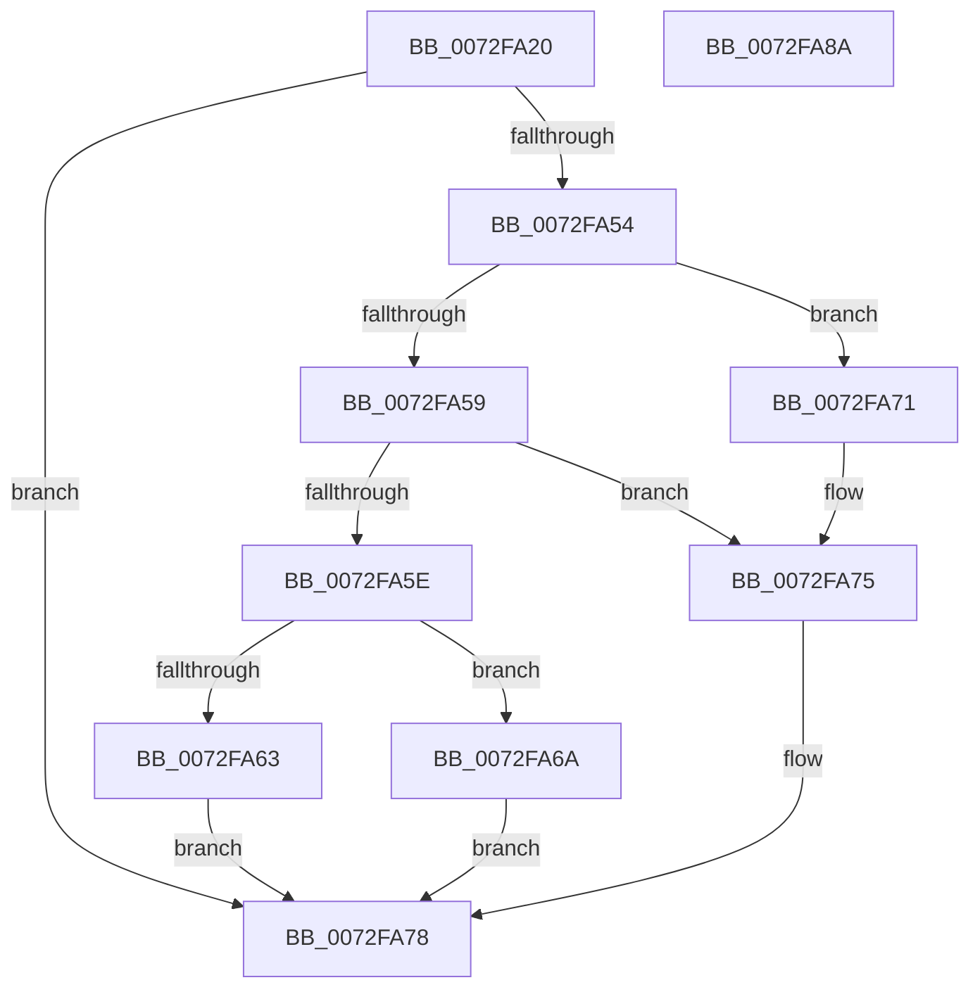

# PiPnpRtlEnumDevicesCallback

- RVA: `0x0072FA20`–`0x0072FA8B` (길이 `107` bytes)
- VA: `0x000000014072FA20`
- 실행 섹션: `PAGE`
- PDB 이름 있음: `예`; PDB Function 태그: `아니요`
- unwind 정보 RVA: `0x00060BC4`
- 디코드: `35`개 명령, `107/107` bytes 표시
- 미해석 바이트: `0` (있으면 어셈블리에 `.byte`로 보존)

> 이 문서는 커널 이미지의 기계어와 PDB 기호를 분석해 생성했습니다. 4번과 5번은 함수 원형과 자료형을 바이너리 사용 방식에서 추정한 C 해석이며 원본 소스 복구 결과는 아닙니다.

## 1. Dependencies

- 직접 호출 지점: **1**; 고유 호출 대상: **1**
- 직접 호출자로 확인된 함수: **0**
- RIP 상대 이미지 참조: **0**

### Outgoing calls
- `0x0072FA49` → [guard_dispatch_icall](../../text/6B/guard_dispatch_icall_function_006BAAD0.md) (function, `0x006BAAD0`)

### Direct callers
- 이 함수 시작 RVA로 연결되는 직접 call은 확인되지 않았습니다. 간접 호출은 완전히 역산할 수 없습니다.

### Static image references
- 디코드된 RIP-relative 메모리 참조가 없습니다.

## 2. Other-region calls and transfers

- 다른 실행 섹션으로 향하는 call: **1**
  - `0x0072FA49` → [guard_dispatch_icall](../../text/6B/guard_dispatch_icall_function_006BAAD0.md) (`PAGE` → `.text`)
- 별도 외부 분기/꼬리 이동을 확인하지 못했습니다.

## 3. Assembly (complete function range)

```asm
0072FA20  48 89 5C 24 08                  mov qword ptr [rsp + 8], rbx
0072FA25  48 89 74 24 10                  mov qword ptr [rsp + 0x10], rsi
0072FA2A  57                              push rdi
0072FA2B  48 83 EC 20                     sub rsp, 0x20
0072FA2F  48 8B F2                        mov rsi, rdx
0072FA32  49 8B F8                        mov rdi, r8
0072FA35  33 DB                           xor ebx, ebx
0072FA37  41 88 18                        mov byte ptr [r8], bl
0072FA3A  48 8B 42 08                     mov rax, qword ptr [rdx + 8]
0072FA3E  4C 8B 42 10                     mov r8, qword ptr [rdx + 0x10]
0072FA42  48 8B 51 10                     mov rdx, qword ptr [rcx + 0x10]
0072FA46  48 8B 0E                        mov rcx, qword ptr [rsi]
0072FA49  E8 82 B0 F8 FF                  call 0x1406baad0
0072FA4E  8B C8                           mov ecx, eax
0072FA50  85 C0                           test eax, eax
0072FA52  74 24                           je 0x14072fa78
0072FA54  83 E9 01                        sub ecx, 1
0072FA57  74 18                           je 0x14072fa71
0072FA59  83 E9 01                        sub ecx, 1
0072FA5C  74 17                           je 0x14072fa75
0072FA5E  83 F9 01                        cmp ecx, 1
0072FA61  74 07                           je 0x14072fa6a
0072FA63  BB E5 00 00 C0                  mov ebx, 0xc00000e5
0072FA68  EB 0E                           jmp 0x14072fa78
0072FA6A  BB 40 02 00 C0                  mov ebx, 0xc0000240
0072FA6F  EB 07                           jmp 0x14072fa78
0072FA71  C6 46 18 01                     mov byte ptr [rsi + 0x18], 1
0072FA75  C6 07 01                        mov byte ptr [rdi], 1
0072FA78  48 8B 74 24 38                  mov rsi, qword ptr [rsp + 0x38]
0072FA7D  8B C3                           mov eax, ebx
0072FA7F  48 8B 5C 24 30                  mov rbx, qword ptr [rsp + 0x30]
0072FA84  48 83 C4 20                     add rsp, 0x20
0072FA88  5F                              pop rdi
0072FA89  C3                              ret
0072FA8A  CC                              int3
```

## 4. C-style interpretation (structured pseudocode)

```c
__int64 __fastcall PiPnpRtlEnumDevicesCallback(__int64 a1, __int64 a2, __int64 a3)
{
    __int64 result;
    __int64 v_rbx;
    __int64 v_rsp;
    unsigned __int64 v_stack_p10;
    unsigned __int64 v_stack_p8;

    v_stack_p8 = v_rbx;
    v_stack_p10 = v_rsi;
    v_rsp = (v_rsp) - (32);
    v_rbx = 0;
    *(unsigned __int8 *)(a3) = 0;
    result = guard_dispatch_icall(*(unsigned __int64 *)(a2), *(unsigned __int64 *)(a1 + 16), *(unsigned __int64 *)(a2 + 16), a4);
    if ((unsigned int)(result) == 0) goto loc_0072FA78;
    a1 = (unsigned int)(((unsigned int)((unsigned int)(result))) - (1));
    if (condition_is_equal) goto loc_0072FA71;
    a1 = (unsigned int)((a1) - (1));
    if (condition_is_equal) goto loc_0072FA75;
    if (((unsigned int)(a1)) == 1) goto loc_0072FA6A;
    goto loc_0072FA78;
loc_0072FA6A:
    goto loc_0072FA78;
loc_0072FA71:
    *(unsigned __int8 *)(a2 + 24) = 1;
loc_0072FA75:
    *(unsigned __int8 *)(a3) = 1;
loc_0072FA78:
    v_rsp = (v_rsp) + (32);
    return (unsigned int)((unsigned int)((unsigned int)(0xC0000240ULL)));
}
```

## 5. (Beta) C Style

```c
int64_t PiPnpRtlEnumDevicesCallback(void *Arg1, void *Arg2, void *Arg3)
{
    uint8_t *arg1 = (uint8_t *)Arg1;
    uint8_t *arg2 = (uint8_t *)Arg2;
    uint8_t *arg3 = (uint8_t *)Arg3;

    int64_t result;
    int64_t local_rbx;
    int64_t local_rsp;
    uint64_t v_stack_p10;
    uint64_t v_stack_p8;

    v_stack_p8 = local_rbx;
    v_stack_p10 = local_rsi;
    local_rsp = (local_rsp) - (32);
    local_rbx = 0;
    *(uint8_t *)(arg3) = 0;
    result = guard_dispatch_icall(*(uint64_t *)(arg2), *(uint64_t *)(arg1 + 0x10), *(uint64_t *)(arg2 + 0x10), a4);
    if ((uint32_t)(result) == 0) goto loc_0072FA78;
    Arg1 = (uint32_t)(((uint32_t)((uint32_t)(result))) - (1));
    if (condition_is_equal) goto loc_0072FA71;
    Arg1 = (uint32_t)((Arg1) - (1));
    if (condition_is_equal) goto loc_0072FA75;
    if (((uint32_t)(Arg1)) == 1) goto loc_0072FA6A;
    goto loc_0072FA78;
loc_0072FA6A:
    goto loc_0072FA78;
loc_0072FA71:
    *(uint8_t *)(arg2 + 0x18) = 1;
loc_0072FA75:
    *(uint8_t *)(arg3) = 1;
loc_0072FA78:
    local_rsp = (local_rsp) + (32);
    return (uint32_t)((uint32_t)((uint32_t)(0xC0000240ULL)));
}
```

### 관측된 메모리 오프셋

구조체 형식이 확인되지 않은 접근은 인자 기준의 오프셋으로만 기록했습니다.

| 기준 인자 | 오프셋 표현 | 폭 (bit) | 접근 |
|---|---:|---:|---|
| `Arg1` | `+ 0x10` | `64` | `R` |
| `Arg2` | `+ 0x0` | `64` | `R` |
| `Arg2` | `+ 0x8` | `64` | `R` |
| `Arg2` | `+ 0x10` | `64` | `R` |
| `Arg2` | `+ 0x18` | `8` | `W` |
| `Arg3` | `+ 0x0` | `8` | `W` |

## 6. Execution-region graph

[열기: 2D/3D 그래프와 함수 탐색 컨트롤 패널](../../../control-panel.html?section=page&rva=0x0072FA20&view=graph)

- 2D 그래프는 위에서 아래로 흐르고, 3D 그래프는 빈 공간을 드래그해 회전합니다. Shift+드래그는 이동, 휠은 확대·축소, 함수 노드 선택은 대상 보고서 이동입니다.

### Static fallback


