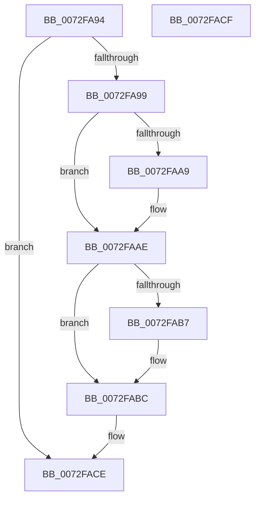

# PiPnpRtlFreeContainerRemoveInfo

- RVA: `0x0072FA94`–`0x0072FAD0` (길이 `60` bytes)
- VA: `0x000000014072FA94`
- 실행 섹션: `PAGE`
- PDB 이름 있음: `예`; PDB Function 태그: `아니요`
- unwind 정보 RVA: `0x000805BC`
- 디코드: `20`개 명령, `60/60` bytes 표시
- 미해석 바이트: `0` (있으면 어셈블리에 `.byte`로 보존)

> 이 문서는 커널 이미지의 기계어와 PDB 기호를 분석해 생성했습니다. 4번과 5번은 함수 원형과 자료형을 바이너리 사용 방식에서 추정한 C 해석이며 원본 소스 복구 결과는 아닙니다.

## 1. Dependencies

- 직접 호출 지점: **3**; 고유 호출 대상: **2**
- 직접 호출자로 확인된 함수: **3**
- RIP 상대 이미지 참조: **0**

### Outgoing calls
- `0x0072FAA9` → [PiDmObjectRelease](../8E/PiDmObjectRelease_function_008E4F70.md) (function, `0x008E4F70`)
- `0x0072FAB7` → [PiDmObjectRelease](../8E/PiDmObjectRelease_function_008E4F70.md) (function, `0x008E4F70`)
- `0x0072FAC4` → [ExFreePoolWithTag](../../poolcode/B8/ExFreePoolWithTag_function_00B82870.md) (function, `0x00B82870`)

### Direct callers
- [PiPnpRtlGatherContainerRemoveInfo](PiPnpRtlGatherContainerRemoveInfo_function_0072FB58.md) at `0x0072FBE2`
- [PiPnpRtlGatherPanelRemoveInfo](PiPnpRtlGatherPanelRemoveInfo_function_0072FFF8.md) at `0x00730082`
- [sub_00B1DC0E](../B1/Unknown_function_00B1DC0E.md) at `0x00B1E0C1`
- [sub_00B1DC0E](../B1/Unknown_function_00B1DC0E.md) at `0x00B1E0FF`

### Static image references
- 디코드된 RIP-relative 메모리 참조가 없습니다.

## 2. Other-region calls and transfers

- 다른 실행 섹션으로 향하는 call: **1**
  - `0x0072FAC4` → [ExFreePoolWithTag](../../poolcode/B8/ExFreePoolWithTag_function_00B82870.md) (`PAGE` → `POOLCODE`)
- 별도 외부 분기/꼬리 이동을 확인하지 못했습니다.

## 3. Assembly (complete function range)

```asm
0072FA94  48 85 C9                        test rcx, rcx
0072FA97  74 35                           je 0x14072face
0072FA99  53                              push rbx
0072FA9A  48 83 EC 20                     sub rsp, 0x20
0072FA9E  48 8B D9                        mov rbx, rcx
0072FAA1  48 8B 09                        mov rcx, qword ptr [rcx]
0072FAA4  48 85 C9                        test rcx, rcx
0072FAA7  74 05                           je 0x14072faae
0072FAA9  E8 C2 54 1B 00                  call 0x1408e4f70
0072FAAE  48 8B 4B 08                     mov rcx, qword ptr [rbx + 8]
0072FAB2  48 85 C9                        test rcx, rcx
0072FAB5  74 05                           je 0x14072fabc
0072FAB7  E8 B4 54 1B 00                  call 0x1408e4f70
0072FABC  BA 50 6E 70 47                  mov edx, 0x47706e50
0072FAC1  48 8B CB                        mov rcx, rbx
0072FAC4  E8 A7 2D 45 00                  call 0x140b82870
0072FAC9  48 83 C4 20                     add rsp, 0x20
0072FACD  5B                              pop rbx
0072FACE  C3                              ret
0072FACF  CC                              int3
```

## 4. C-style interpretation (structured pseudocode)

```c
__int64 __fastcall PiPnpRtlFreeContainerRemoveInfo(__int64 a1)
{
    __int64 result;
    __int64 v_rsp;

    if (a1 == 0) goto loc_0072FACE;
    v_rsp = (v_rsp) - (32);
    if (*(unsigned __int64 *)(a1) != 0) {
        result = PiDmObjectRelease(*(unsigned __int64 *)(a1), a2, a3, a4);
    }
    if (*(unsigned __int64 *)(a1 + 8) != 0) {
        result = PiDmObjectRelease(*(unsigned __int64 *)(a1 + 8), a2, a3, a4);
    }
    result = ExFreePoolWithTag(a1, (unsigned int)(0x47706E50ULL), a3, a4);
    v_rsp = (v_rsp) + (32);
loc_0072FACE:
    return result;
}
```

## 5. (Beta) C Style

```c
int64_t PiPnpRtlFreeContainerRemoveInfo(int64_t Arg1)
{
    int64_t result;
    int64_t local_rsp;

    if (Arg1 == 0) goto loc_0072FACE;
    local_rsp = (local_rsp) - (32);
    if (*(uint64_t *)(Arg1) != 0) {
        result = PiDmObjectRelease(*(uint64_t *)(Arg1), a2, a3, a4);
    }
    if (*(uint64_t *)(Arg1 + 0x8) != 0) {
        result = PiDmObjectRelease(*(uint64_t *)(Arg1 + 0x8), a2, a3, a4);
    }
    result = ExFreePoolWithTag(Arg1, (uint32_t)(0x47706E50ULL), a3, a4);
    local_rsp = (local_rsp) + (32);
loc_0072FACE:
    return result;
}
```

## 6. Execution-region graph

[열기: 2D/3D 그래프와 함수 탐색 컨트롤 패널](../../../control-panel.html?section=page&rva=0x0072FA94&view=graph)

- 2D 그래프는 위에서 아래로 흐르고, 3D 그래프는 빈 공간을 드래그해 회전합니다. Shift+드래그는 이동, 휠은 확대·축소, 함수 노드 선택은 대상 보고서 이동입니다.

### Static fallback


