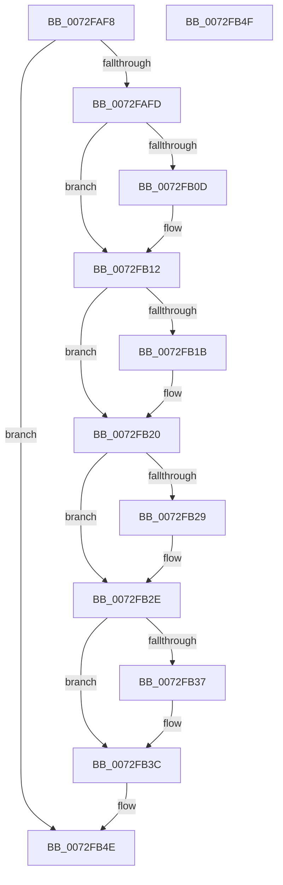

# PiPnpRtlFreeInterfaceDeleteInfo

- RVA: `0x0072FAF8`–`0x0072FB50` (길이 `88` bytes)
- VA: `0x000000014072FAF8`
- 실행 섹션: `PAGE`
- PDB 이름 있음: `예`; PDB Function 태그: `아니요`
- unwind 정보 RVA: `0x000805BC`
- 디코드: `28`개 명령, `88/88` bytes 표시
- 미해석 바이트: `0` (있으면 어셈블리에 `.byte`로 보존)

> 이 문서는 커널 이미지의 기계어와 PDB 기호를 분석해 생성했습니다. 4번과 5번은 함수 원형과 자료형을 바이너리 사용 방식에서 추정한 C 해석이며 원본 소스 복구 결과는 아닙니다.

## 1. Dependencies

- 직접 호출 지점: **5**; 고유 호출 대상: **2**
- 직접 호출자로 확인된 함수: **2**
- RIP 상대 이미지 참조: **0**

### Outgoing calls
- `0x0072FB0D` → [PiDmObjectRelease](../8E/PiDmObjectRelease_function_008E4F70.md) (function, `0x008E4F70`)
- `0x0072FB1B` → [PiDmObjectRelease](../8E/PiDmObjectRelease_function_008E4F70.md) (function, `0x008E4F70`)
- `0x0072FB29` → [PiDmObjectRelease](../8E/PiDmObjectRelease_function_008E4F70.md) (function, `0x008E4F70`)
- `0x0072FB37` → [PiDmObjectRelease](../8E/PiDmObjectRelease_function_008E4F70.md) (function, `0x008E4F70`)
- `0x0072FB44` → [ExFreePoolWithTag](../../poolcode/B8/ExFreePoolWithTag_function_00B82870.md) (function, `0x00B82870`)

### Direct callers
- [PiPnpRtlGatherInterfaceDeleteInfo](PiPnpRtlGatherInterfaceDeleteInfo_function_0072FD48.md) at `0x0072FFA7`
- [sub_00B1DC0E](../B1/Unknown_function_00B1DC0E.md) at `0x00B1DE68`

### Static image references
- 디코드된 RIP-relative 메모리 참조가 없습니다.

## 2. Other-region calls and transfers

- 다른 실행 섹션으로 향하는 call: **1**
  - `0x0072FB44` → [ExFreePoolWithTag](../../poolcode/B8/ExFreePoolWithTag_function_00B82870.md) (`PAGE` → `POOLCODE`)
- 별도 외부 분기/꼬리 이동을 확인하지 못했습니다.

## 3. Assembly (complete function range)

```asm
0072FAF8  48 85 C9                        test rcx, rcx
0072FAFB  74 51                           je 0x14072fb4e
0072FAFD  53                              push rbx
0072FAFE  48 83 EC 20                     sub rsp, 0x20
0072FB02  48 8B D9                        mov rbx, rcx
0072FB05  48 8B 09                        mov rcx, qword ptr [rcx]
0072FB08  48 85 C9                        test rcx, rcx
0072FB0B  74 05                           je 0x14072fb12
0072FB0D  E8 5E 54 1B 00                  call 0x1408e4f70
0072FB12  48 8B 4B 08                     mov rcx, qword ptr [rbx + 8]
0072FB16  48 85 C9                        test rcx, rcx
0072FB19  74 05                           je 0x14072fb20
0072FB1B  E8 50 54 1B 00                  call 0x1408e4f70
0072FB20  48 8B 4B 10                     mov rcx, qword ptr [rbx + 0x10]
0072FB24  48 85 C9                        test rcx, rcx
0072FB27  74 05                           je 0x14072fb2e
0072FB29  E8 42 54 1B 00                  call 0x1408e4f70
0072FB2E  48 8B 4B 18                     mov rcx, qword ptr [rbx + 0x18]
0072FB32  48 85 C9                        test rcx, rcx
0072FB35  74 05                           je 0x14072fb3c
0072FB37  E8 34 54 1B 00                  call 0x1408e4f70
0072FB3C  BA 50 6E 70 47                  mov edx, 0x47706e50
0072FB41  48 8B CB                        mov rcx, rbx
0072FB44  E8 27 2D 45 00                  call 0x140b82870
0072FB49  48 83 C4 20                     add rsp, 0x20
0072FB4D  5B                              pop rbx
0072FB4E  C3                              ret
0072FB4F  CC                              int3
```

## 4. C-style interpretation (structured pseudocode)

```c
__int64 __fastcall PiPnpRtlFreeInterfaceDeleteInfo(__int64 a1)
{
    __int64 result;
    __int64 v_rsp;

    if (a1 == 0) goto loc_0072FB4E;
    v_rsp = (v_rsp) - (32);
    if (*(unsigned __int64 *)(a1) != 0) {
        result = PiDmObjectRelease(*(unsigned __int64 *)(a1), a2, a3, a4);
    }
    if (*(unsigned __int64 *)(a1 + 8) != 0) {
        result = PiDmObjectRelease(*(unsigned __int64 *)(a1 + 8), a2, a3, a4);
    }
    if (*(unsigned __int64 *)(a1 + 16) != 0) {
        result = PiDmObjectRelease(*(unsigned __int64 *)(a1 + 16), a2, a3, a4);
    }
    if (*(unsigned __int64 *)(a1 + 24) != 0) {
        result = PiDmObjectRelease(*(unsigned __int64 *)(a1 + 24), a2, a3, a4);
    }
    result = ExFreePoolWithTag(a1, (unsigned int)(0x47706E50ULL), a3, a4);
    v_rsp = (v_rsp) + (32);
loc_0072FB4E:
    return result;
}
```

## 5. (Beta) C Style

```c
int64_t PiPnpRtlFreeInterfaceDeleteInfo(int64_t Arg1)
{
    int64_t result;
    int64_t local_rsp;

    if (Arg1 == 0) goto loc_0072FB4E;
    local_rsp = (local_rsp) - (32);
    if (*(uint64_t *)(Arg1) != 0) {
        result = PiDmObjectRelease(*(uint64_t *)(Arg1), a2, a3, a4);
    }
    if (*(uint64_t *)(Arg1 + 0x8) != 0) {
        result = PiDmObjectRelease(*(uint64_t *)(Arg1 + 0x8), a2, a3, a4);
    }
    if (*(uint64_t *)(Arg1 + 0x10) != 0) {
        result = PiDmObjectRelease(*(uint64_t *)(Arg1 + 0x10), a2, a3, a4);
    }
    if (*(uint64_t *)(Arg1 + 0x18) != 0) {
        result = PiDmObjectRelease(*(uint64_t *)(Arg1 + 0x18), a2, a3, a4);
    }
    result = ExFreePoolWithTag(Arg1, (uint32_t)(0x47706E50ULL), a3, a4);
    local_rsp = (local_rsp) + (32);
loc_0072FB4E:
    return result;
}
```

## 6. Execution-region graph

[열기: 2D/3D 그래프와 함수 탐색 컨트롤 패널](../../../control-panel.html?section=page&rva=0x0072FAF8&view=graph)

- 2D 그래프는 위에서 아래로 흐르고, 3D 그래프는 빈 공간을 드래그해 회전합니다. Shift+드래그는 이동, 휠은 확대·축소, 함수 노드 선택은 대상 보고서 이동입니다.

### Static fallback


