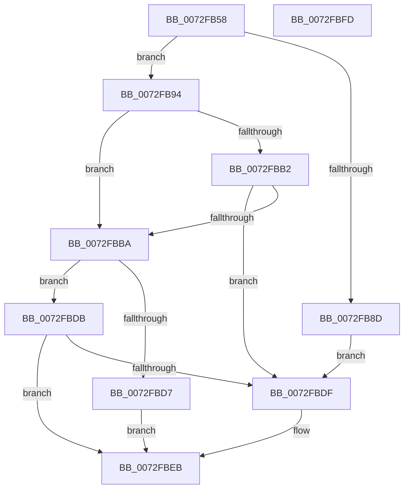

# PiPnpRtlGatherContainerRemoveInfo

- RVA: `0x0072FB58`–`0x0072FBFE` (길이 `166` bytes)
- VA: `0x000000014072FB58`
- 실행 섹션: `PAGE`
- PDB 이름 있음: `예`; PDB Function 태그: `아니요`
- unwind 정보 RVA: `0x00060BC4`
- 디코드: `49`개 명령, `166/166` bytes 표시
- 미해석 바이트: `0` (있으면 어셈블리에 `.byte`로 보존)

> 이 문서는 커널 이미지의 기계어와 PDB 기호를 분석해 생성했습니다. 4번과 5번은 함수 원형과 자료형을 바이너리 사용 방식에서 추정한 C 해석이며 원본 소스 복구 결과는 아닙니다.

## 1. Dependencies

- 직접 호출 지점: **4**; 고유 호출 대상: **3**
- 직접 호출자로 확인된 함수: **1**
- RIP 상대 이미지 참조: **0**

### Outgoing calls
- `0x0072FB80` → [ExAllocatePool2](../../poolcode/B8/ExAllocatePool2_function_00B820F0.md) (function, `0x00B820F0`)
- `0x0072FB9F` → [PiDmGetObject](../8D/PiDmGetObject_function_008DFAE0.md) (function, `0x008DFAE0`)
- `0x0072FBC9` → [PiDmGetObject](../8D/PiDmGetObject_function_008DFAE0.md) (function, `0x008DFAE0`)
- `0x0072FBE2` → [PiPnpRtlFreeContainerRemoveInfo](PiPnpRtlFreeContainerRemoveInfo_function_0072FA94.md) (function, `0x0072FA94`)

### Direct callers
- [PiPnpRtlCmActionCallback](../8E/PiPnpRtlCmActionCallback_function_008EF110.md) at `0x008EF7A6`

### Static image references
- 디코드된 RIP-relative 메모리 참조가 없습니다.

## 2. Other-region calls and transfers

- 다른 실행 섹션으로 향하는 call: **1**
  - `0x0072FB80` → [ExAllocatePool2](../../poolcode/B8/ExAllocatePool2_function_00B820F0.md) (`PAGE` → `POOLCODE`)
- 별도 외부 분기/꼬리 이동을 확인하지 못했습니다.

## 3. Assembly (complete function range)

```asm
0072FB58  48 89 5C 24 08                  mov qword ptr [rsp + 8], rbx
0072FB5D  48 89 74 24 10                  mov qword ptr [rsp + 0x10], rsi
0072FB62  57                              push rdi
0072FB63  48 83 EC 20                     sub rsp, 0x20
0072FB67  49 8B F8                        mov rdi, r8
0072FB6A  48 8B F2                        mov rsi, rdx
0072FB6D  48 8B D9                        mov rbx, rcx
0072FB70  BA 10 00 00 00                  mov edx, 0x10
0072FB75  B9 00 01 00 00                  mov ecx, 0x100
0072FB7A  41 B8 50 6E 70 47               mov r8d, 0x47706e50
0072FB80  E8 6B 25 45 00                  call 0x140b820f0
0072FB85  48 89 07                        mov qword ptr [rdi], rax
0072FB88  48 85 C0                        test rax, rax
0072FB8B  75 07                           jne 0x14072fb94
0072FB8D  BB 9A 00 00 C0                  mov ebx, 0xc000009a
0072FB92  EB 4B                           jmp 0x14072fbdf
0072FB94  4C 8B C0                        mov r8, rax
0072FB97  48 8B D3                        mov rdx, rbx
0072FB9A  B9 01 00 00 00                  mov ecx, 1
0072FB9F  E8 3C FF 1A 00                  call 0x1408dfae0
0072FBA4  8B D8                           mov ebx, eax
0072FBA6  B8 00 00 00 80                  mov eax, 0x80000000
0072FBAB  8D 0C 03                        lea ecx, [rbx + rax]
0072FBAE  85 C8                           test eax, ecx
0072FBB0  75 08                           jne 0x14072fbba
0072FBB2  81 FB 34 00 00 C0               cmp ebx, 0xc0000034
0072FBB8  75 25                           jne 0x14072fbdf
0072FBBA  4C 8B 07                        mov r8, qword ptr [rdi]
0072FBBD  48 8B D6                        mov rdx, rsi
0072FBC0  49 83 C0 08                     add r8, 8
0072FBC4  B9 05 00 00 00                  mov ecx, 5
0072FBC9  E8 12 FF 1A 00                  call 0x1408dfae0
0072FBCE  8B D8                           mov ebx, eax
0072FBD0  3D 34 00 00 C0                  cmp eax, 0xc0000034
0072FBD5  75 04                           jne 0x14072fbdb
0072FBD7  33 DB                           xor ebx, ebx
0072FBD9  EB 10                           jmp 0x14072fbeb
0072FBDB  85 C0                           test eax, eax
0072FBDD  79 0C                           jns 0x14072fbeb
0072FBDF  48 8B 0F                        mov rcx, qword ptr [rdi]
0072FBE2  E8 AD FE FF FF                  call 0x14072fa94
0072FBE7  48 83 27 00                     and qword ptr [rdi], 0
0072FBEB  48 8B 74 24 38                  mov rsi, qword ptr [rsp + 0x38]
0072FBF0  8B C3                           mov eax, ebx
0072FBF2  48 8B 5C 24 30                  mov rbx, qword ptr [rsp + 0x30]
0072FBF7  48 83 C4 20                     add rsp, 0x20
0072FBFB  5F                              pop rdi
0072FBFC  C3                              ret
0072FBFD  CC                              int3
```

## 4. C-style interpretation (structured pseudocode)

```c
__int64 __fastcall PiPnpRtlGatherContainerRemoveInfo(__int64 a1, __int64 a2, __int64 a3)
{
    __int64 result;
    __int64 v_rbx;
    __int64 v_rsp;
    unsigned __int64 v_stack_p10;
    unsigned __int64 v_stack_p8;

    v_stack_p8 = v_rbx;
    v_stack_p10 = v_rsi;
    v_rsp = (v_rsp) - (32);
    result = ExAllocatePool2(256, 16, (unsigned int)(0x47706E50ULL), a4);
    *(unsigned __int64 *)(a3) = result;
    if (result != 0) goto loc_0072FB94;
    goto loc_0072FBDF;
loc_0072FB94:
    result = PiDmGetObject(1, (unsigned int)(0xC000009AULL), result, a4);
    if ((((unsigned int)((unsigned int)(0x80000000ULL))) & ((unsigned int)((unsigned int)((unsigned int)(result)) + (unsigned int)(0x80000000ULL) * 1))) != 0) goto loc_0072FBBA;
    if (((unsigned int)((unsigned int)((unsigned int)(result)))) != 0xC0000034ULL) goto loc_0072FBDF;
loc_0072FBBA:
    a3 = (*(unsigned __int64 *)(a3)) + (8);
    result = PiDmGetObject(5, a2, a3, a4);
    if (((unsigned int)(result)) != 0xC0000034ULL) goto loc_0072FBDB;
    v_rbx = 0;
    goto loc_0072FBEB;
loc_0072FBDB:
    if (sign_flag) {
        a1 = *(unsigned __int64 *)(a3);
        result = PiPnpRtlFreeContainerRemoveInfo(a1, a2, a3, a4);
    }
    v_rsp = (v_rsp) + (32);
    return 0;
}
```

## 5. (Beta) C Style

```c
int64_t PiPnpRtlGatherContainerRemoveInfo(int64_t Arg1, int64_t Arg2, void *Arg3)
{
    uint8_t *arg3 = (uint8_t *)Arg3;

    int64_t result;
    int64_t local_rbx;
    int64_t local_rsp;
    uint64_t v_stack_p10;
    uint64_t v_stack_p8;

    v_stack_p8 = local_rbx;
    v_stack_p10 = local_rsi;
    local_rsp = (local_rsp) - (32);
    result = ExAllocatePool2(256, 16, (uint32_t)(0x47706E50ULL), a4);
    *(uint64_t *)(arg3) = result;
    if (result != 0) goto loc_0072FB94;
    goto loc_0072FBDF;
loc_0072FB94:
    result = PiDmGetObject(1, (uint32_t)(0xC000009AULL), result, a4);
    if ((((uint32_t)((uint32_t)(0x80000000ULL))) & ((uint32_t)((uint32_t)((uint32_t)(result)) + (uint32_t)(0x80000000ULL) * 1))) != 0) goto loc_0072FBBA;
    if (((uint32_t)((uint32_t)((uint32_t)(result)))) != 0xC0000034ULL) goto loc_0072FBDF;
loc_0072FBBA:
    Arg3 = (*(uint64_t *)(arg3)) + (8);
    result = PiDmGetObject(5, Arg2, Arg3, a4);
    if (((uint32_t)(result)) != 0xC0000034ULL) goto loc_0072FBDB;
    local_rbx = 0;
    goto loc_0072FBEB;
loc_0072FBDB:
    if (sign_flag) {
        Arg1 = *(uint64_t *)(arg3);
        result = PiPnpRtlFreeContainerRemoveInfo(Arg1, Arg2, Arg3, a4);
    }
    local_rsp = (local_rsp) + (32);
    return 0;
}
```

### 관측된 메모리 오프셋

구조체 형식이 확인되지 않은 접근은 인자 기준의 오프셋으로만 기록했습니다.

| 기준 인자 | 오프셋 표현 | 폭 (bit) | 접근 |
|---|---:|---:|---|
| `Arg3` | `+ 0x0` | `64` | `R` |
| `Arg3` | `+ 0x0` | `64` | `R/W` |
| `Arg3` | `+ 0x0` | `64` | `W` |

## 6. Execution-region graph

[열기: 2D/3D 그래프와 함수 탐색 컨트롤 패널](../../../control-panel.html?section=page&rva=0x0072FB58&view=graph)

- 2D 그래프는 위에서 아래로 흐르고, 3D 그래프는 빈 공간을 드래그해 회전합니다. Shift+드래그는 이동, 휠은 확대·축소, 함수 노드 선택은 대상 보고서 이동입니다.

### Static fallback


