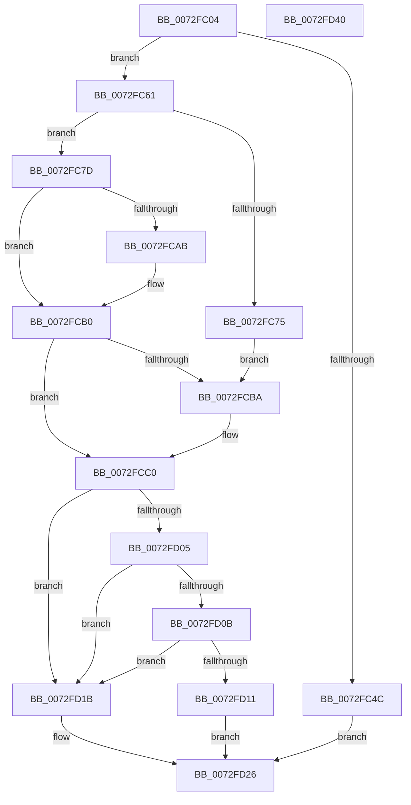

# PiPnpRtlGatherDeviceDeleteInfo

- RVA: `0x0072FC04`–`0x0072FD41` (길이 `317` bytes)
- VA: `0x000000014072FC04`
- 실행 섹션: `PAGE`
- PDB 이름 있음: `예`; PDB Function 태그: `아니요`
- unwind 정보 RVA: `0x00093878`
- 디코드: `89`개 명령, `317/317` bytes 표시
- 미해석 바이트: `0` (있으면 어셈블리에 `.byte`로 보존)

> 이 문서는 커널 이미지의 기계어와 PDB 기호를 분석해 생성했습니다. 4번과 5번은 함수 원형과 자료형을 바이너리 사용 방식에서 추정한 C 해석이며 원본 소스 복구 결과는 아닙니다.

## 1. Dependencies

- 직접 호출 지점: **5**; 고유 호출 대상: **5**
- 직접 호출자로 확인된 함수: **1**
- RIP 상대 이미지 참조: **1**

### Outgoing calls
- `0x0072FC3F` → [ExAllocatePool2](../../poolcode/B8/ExAllocatePool2_function_00B820F0.md) (function, `0x00B820F0`)
- `0x0072FC54` → [PiPnpRtlFreeDeviceDeleteInfo](PiPnpRtlFreeDeviceDeleteInfo_function_0072FAD8.md) (function, `0x0072FAD8`)
- `0x0072FC68` → [RtlInitUnicodeString](../../text/42/RtlInitUnicodeString_function_0042A780.md) (function, `0x0042A780`)
- `0x0072FCA0` → [ZwPlugPlayControl](../../text/6A/ZwPlugPlayControl_function_006AF890.md) (function, `0x006AF890`)
- `0x0072FCFA` → [CmGetDeviceRegProp](../8E/CmGetDeviceRegProp_function_008ED870.md) (function, `0x008ED870`)

### Direct callers
- [PiPnpRtlCmActionCallback](../8E/PiPnpRtlCmActionCallback_function_008EF110.md) at `0x008EF729`

### Static image references
- `0x0072FCDF` → RVA `0x00E66398` (`.data`; read)

## 2. Other-region calls and transfers

- 다른 실행 섹션으로 향하는 call: **3**
  - `0x0072FC3F` → [ExAllocatePool2](../../poolcode/B8/ExAllocatePool2_function_00B820F0.md) (`PAGE` → `POOLCODE`)
  - `0x0072FC68` → [RtlInitUnicodeString](../../text/42/RtlInitUnicodeString_function_0042A780.md) (`PAGE` → `.text`)
  - `0x0072FCA0` → [ZwPlugPlayControl](../../text/6A/ZwPlugPlayControl_function_006AF890.md) (`PAGE` → `.text`)
- 별도 외부 분기/꼬리 이동을 확인하지 못했습니다.

## 3. Assembly (complete function range)

```asm
0072FC04  48 89 5C 24 08                  mov qword ptr [rsp + 8], rbx
0072FC09  48 89 74 24 20                  mov qword ptr [rsp + 0x20], rsi
0072FC0E  55                              push rbp
0072FC0F  57                              push rdi
0072FC10  41 56                           push r14
0072FC12  48 8B EC                        mov rbp, rsp
0072FC15  48 81 EC 80 00 00 00            sub rsp, 0x80
0072FC1C  45 33 F6                        xor r14d, r14d
0072FC1F  48 8B DA                        mov rbx, rdx
0072FC22  48 8B F1                        mov rsi, rcx
0072FC25  44 89 75 28                     mov dword ptr [rbp + 0x28], r14d
0072FC29  0F 57 C0                        xorps xmm0, xmm0
0072FC2C  B9 00 01 00 00                  mov ecx, 0x100
0072FC31  41 B8 50 6E 70 47               mov r8d, 0x47706e50
0072FC37  41 8D 56 54                     lea edx, [r14 + 0x54]
0072FC3B  0F 11 45 C0                     movups xmmword ptr [rbp - 0x40], xmm0
0072FC3F  E8 AC 24 45 00                  call 0x140b820f0
0072FC44  48 89 03                        mov qword ptr [rbx], rax
0072FC47  48 85 C0                        test rax, rax
0072FC4A  75 15                           jne 0x14072fc61
0072FC4C  41 8B CE                        mov ecx, r14d
0072FC4F  BF 9A 00 00 C0                  mov edi, 0xc000009a
0072FC54  E8 7F FE FF FF                  call 0x14072fad8
0072FC59  4C 89 33                        mov qword ptr [rbx], r14
0072FC5C  E9 C5 00 00 00                  jmp 0x14072fd26
0072FC61  48 8B D6                        mov rdx, rsi
0072FC64  48 8D 4D C0                     lea rcx, [rbp - 0x40]
0072FC68  E8 13 AB CF FF                  call 0x14042a780
0072FC6D  48 8B 3B                        mov rdi, qword ptr [rbx]
0072FC70  48 85 FF                        test rdi, rdi
0072FC73  75 08                           jne 0x14072fc7d
0072FC75  48 8B C7                        mov rax, rdi
0072FC78  48 8B CF                        mov rcx, rdi
0072FC7B  EB 3D                           jmp 0x14072fcba
0072FC7D  0F 10 45 C0                     movups xmm0, xmmword ptr [rbp - 0x40]
0072FC81  41 B8 28 00 00 00               mov r8d, 0x28
0072FC87  4C 89 75 F0                     mov qword ptr [rbp - 0x10], r14
0072FC8B  48 8D 55 D0                     lea rdx, [rbp - 0x30]
0072FC8F  4C 89 75 E0                     mov qword ptr [rbp - 0x20], r14
0072FC93  F3 0F 7F 45 D0                  movdqu xmmword ptr [rbp - 0x30], xmm0
0072FC98  4C 89 75 E8                     mov qword ptr [rbp - 0x18], r14
0072FC9C  41 8D 48 E6                     lea ecx, [r8 - 0x1a]
0072FCA0  E8 EB FB F7 FF                  call 0x1406af890
0072FCA5  8B D0                           mov edx, eax
0072FCA7  85 C0                           test eax, eax
0072FCA9  78 05                           js 0x14072fcb0
0072FCAB  8B 4D E8                        mov ecx, dword ptr [rbp - 0x18]
0072FCAE  89 0F                           mov dword ptr [rdi], ecx
0072FCB0  48 8B 03                        mov rax, qword ptr [rbx]
0072FCB3  48 8B C8                        mov rcx, rax
0072FCB6  85 D2                           test edx, edx
0072FCB8  79 06                           jns 0x14072fcc0
0072FCBA  C7 00 2D 00 00 00               mov dword ptr [rax], 0x2d
0072FCC0  48 8D 41 04                     lea rax, [rcx + 4]
0072FCC4  44 89 74 24 38                  mov dword ptr [rsp + 0x38], r14d
0072FCC9  48 8D 4D 30                     lea rcx, [rbp + 0x30]
0072FCCD  C7 45 30 4E 00 00 00            mov dword ptr [rbp + 0x30], 0x4e
0072FCD4  48 89 4C 24 30                  mov qword ptr [rsp + 0x30], rcx
0072FCD9  41 B9 09 00 00 00               mov r9d, 9
0072FCDF  48 8B 0D B2 66 73 00            mov rcx, qword ptr [rip + 0x7366b2]
0072FCE6  45 33 C0                        xor r8d, r8d
0072FCE9  48 89 44 24 28                  mov qword ptr [rsp + 0x28], rax
0072FCEE  48 8B D6                        mov rdx, rsi
0072FCF1  48 8D 45 28                     lea rax, [rbp + 0x28]
0072FCF5  48 89 44 24 20                  mov qword ptr [rsp + 0x20], rax
0072FCFA  E8 71 DB 1B 00                  call 0x1408ed870
0072FCFF  8B F8                           mov edi, eax
0072FD01  85 C0                           test eax, eax
0072FD03  78 16                           js 0x14072fd1b
0072FD05  83 7D 28 01                     cmp dword ptr [rbp + 0x28], 1
0072FD09  75 10                           jne 0x14072fd1b
0072FD0B  83 7D 30 02                     cmp dword ptr [rbp + 0x30], 2
0072FD0F  76 0A                           jbe 0x14072fd1b
0072FD11  48 8B 0B                        mov rcx, qword ptr [rbx]
0072FD14  66 44 89 71 50                  mov word ptr [rcx + 0x50], r14w
0072FD19  EB 0B                           jmp 0x14072fd26
0072FD1B  48 8B 03                        mov rax, qword ptr [rbx]
0072FD1E  41 8B FE                        mov edi, r14d
0072FD21  66 44 89 70 04                  mov word ptr [rax + 4], r14w
0072FD26  4C 8D 9C 24 80 00 00 00         lea r11, [rsp + 0x80]
0072FD2E  8B C7                           mov eax, edi
0072FD30  49 8B 5B 20                     mov rbx, qword ptr [r11 + 0x20]
0072FD34  49 8B 73 38                     mov rsi, qword ptr [r11 + 0x38]
0072FD38  49 8B E3                        mov rsp, r11
0072FD3B  41 5E                           pop r14
0072FD3D  5F                              pop rdi
0072FD3E  5D                              pop rbp
0072FD3F  C3                              ret
0072FD40  CC                              int3
```

## 4. C-style interpretation (structured pseudocode)

```c
__int64 __fastcall PiPnpRtlGatherDeviceDeleteInfo(__int64 a1, __int64 a2)
{
    __int64 result;
    __int64 v_r14;
    __int64 v_rsp;
    unsigned __int64 v_stack_m18;
    unsigned __int64 v_stack_m28;
    unsigned __int64 v_stack_m30;
    unsigned __int64 v_stack_m38;
    unsigned __int64 v_stack_m48;
    unsigned __int64 v_stack_m58;
    unsigned int v_stack_m60;
    unsigned __int64 v_stack_m68;
    unsigned __int64 v_stack_m70;
    unsigned __int64 v_stack_m78;
    unsigned int v_stack_p10;
    unsigned __int64 v_stack_p18;
    unsigned __int64 v_stack_p20;
    unsigned __int64 v_stack_p8;

    v_stack_p8 = v_rbx;
    v_stack_p20 = v_rsi;
    v_rsp = (v_rsp) - (128);
    v_r14 = 0;
    v_stack_p10 = 0;
    v_stack_m58 = v_xmm0;
    result = ExAllocatePool2(256, v_r14 + 84, (unsigned int)(0x47706E50ULL), a4);
    *(unsigned __int64 *)(a2) = result;
    if (result != 0) goto loc_0072FC61;
    result = PiPnpRtlFreeDeviceDeleteInfo(0, v_r14 + 84, (unsigned int)(0x47706E50ULL), a4);
    *(unsigned __int64 *)(a2) = 0;
    goto loc_0072FD26;
loc_0072FC61:
    result = RtlInitUnicodeString(v_stack_m58, a1, (unsigned int)(0x47706E50ULL), a4);
    if (*(unsigned __int64 *)(a2) != 0) goto loc_0072FC7D;
    goto loc_0072FCBA;
loc_0072FC7D:
    v_stack_m28 = 0;
    v_stack_m38 = 0;
    v_stack_m48 = v_xmm0;
    v_stack_m30 = 0;
    result = ZwPlugPlayControl(40 - 26, v_stack_m48, 40, a4);
    if (!(sign_flag)) {
        a1 = v_stack_m30;
        *(unsigned int *)(*(unsigned __int64 *)(a2)) = (unsigned int)(a1);
    }
    if (sign_flag) {
        *(unsigned int *)(*(unsigned __int64 *)(a2)) = 45;
    }
    v_stack_m60 = 0;
    v_stack_p18 = 78;
    v_stack_m68 = v_stack_p18;
    a3 = 0;
    v_stack_m70 = *(unsigned __int64 *)(a2) + 4;
    v_stack_m78 = v_stack_p10;
    result = CmGetDeviceRegProp(*(unsigned __int64 *)(v_rip + 7562930), a1, a3, 9);
    if (sign_flag) goto loc_0072FD1B;
    if (v_stack_p10 != 1) goto loc_0072FD1B;
    if (v_stack_p18 <= 2) goto loc_0072FD1B;
    *(unsigned __int16 *)(*(unsigned __int64 *)(a2) + 80) = 0;
    goto loc_0072FD26;
loc_0072FD1B:
    *(unsigned __int16 *)(*(unsigned __int64 *)(a2) + 4) = 0;
loc_0072FD26:
    return 0;
}
```

## 5. (Beta) C Style

```c
int64_t PiPnpRtlGatherDeviceDeleteInfo(int64_t Arg1, void *Arg2)
{
    uint8_t *arg2 = (uint8_t *)Arg2;

    int64_t result;
    int64_t local_r14;
    int64_t local_rsp;
    uint64_t v_stack_m18;
    uint64_t v_stack_m28;
    uint64_t v_stack_m30;
    uint64_t v_stack_m38;
    uint64_t v_stack_m48;
    uint64_t v_stack_m58;
    uint32_t v_stack_m60;
    uint64_t v_stack_m68;
    uint64_t v_stack_m70;
    uint64_t v_stack_m78;
    uint32_t v_stack_p10;
    uint64_t v_stack_p18;
    uint64_t v_stack_p20;
    uint64_t v_stack_p8;

    v_stack_p8 = local_rbx;
    v_stack_p20 = local_rsi;
    local_rsp = (local_rsp) - (128);
    local_r14 = 0;
    v_stack_p10 = 0;
    v_stack_m58 = v_xmm0;
    result = ExAllocatePool2(256, local_r14 + 84, (uint32_t)(0x47706E50ULL), a4);
    *(uint64_t *)(arg2) = result;
    if (result != 0) goto loc_0072FC61;
    result = PiPnpRtlFreeDeviceDeleteInfo(0, local_r14 + 84, (uint32_t)(0x47706E50ULL), a4);
    *(uint64_t *)(arg2) = 0;
    goto loc_0072FD26;
loc_0072FC61:
    result = RtlInitUnicodeString(v_stack_m58, Arg1, (uint32_t)(0x47706E50ULL), a4);
    if (*(uint64_t *)(arg2) != 0) goto loc_0072FC7D;
    goto loc_0072FCBA;
loc_0072FC7D:
    v_stack_m28 = 0;
    v_stack_m38 = 0;
    v_stack_m48 = v_xmm0;
    v_stack_m30 = 0;
    result = ZwPlugPlayControl(40 - 26, v_stack_m48, 40, a4);
    if (!(sign_flag)) {
        Arg1 = v_stack_m30;
        *(uint32_t *)(*(uint64_t *)(arg2)) = (uint32_t)(Arg1);
    }
    if (sign_flag) {
        *(uint32_t *)(*(uint64_t *)(arg2)) = 45;
    }
    v_stack_m60 = 0;
    v_stack_p18 = 78;
    v_stack_m68 = v_stack_p18;
    a3 = 0;
    v_stack_m70 = *(uint64_t *)(arg2) + 4;
    v_stack_m78 = v_stack_p10;
    result = CmGetDeviceRegProp(*(uint64_t *)(v_rip + 0x7366B2), Arg1, a3, 9);
    if (sign_flag) goto loc_0072FD1B;
    if (v_stack_p10 != 1) goto loc_0072FD1B;
    if (v_stack_p18 <= 2) goto loc_0072FD1B;
    *(uint16_t *)(*(uint64_t *)(arg2) + 0x50) = 0;
    goto loc_0072FD26;
loc_0072FD1B:
    *(uint16_t *)(*(uint64_t *)(arg2) + 0x4) = 0;
loc_0072FD26:
    return 0;
}
```

### 관측된 메모리 오프셋

구조체 형식이 확인되지 않은 접근은 인자 기준의 오프셋으로만 기록했습니다.

| 기준 인자 | 오프셋 표현 | 폭 (bit) | 접근 |
|---|---:|---:|---|
| `Arg2` | `+ 0x0` | `64` | `R` |
| `Arg2` | `+ 0x0` | `64` | `W` |

## 6. Execution-region graph

[열기: 2D/3D 그래프와 함수 탐색 컨트롤 패널](../../../control-panel.html?section=page&rva=0x0072FC04&view=graph)

- 2D 그래프는 위에서 아래로 흐르고, 3D 그래프는 빈 공간을 드래그해 회전합니다. Shift+드래그는 이동, 휠은 확대·축소, 함수 노드 선택은 대상 보고서 이동입니다.

### Static fallback


