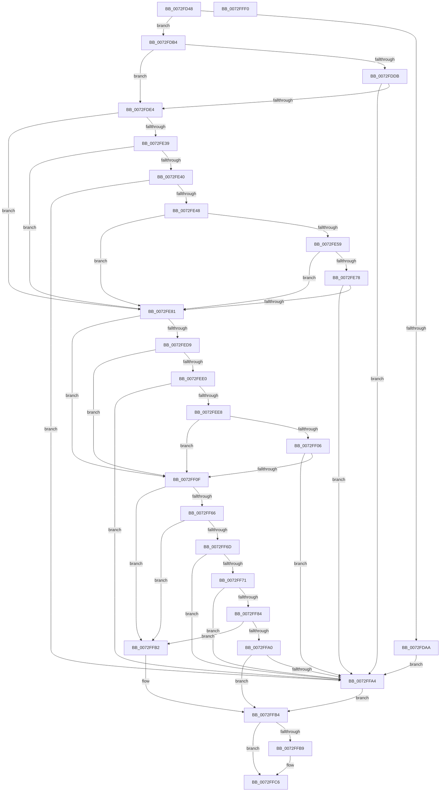

# PiPnpRtlGatherInterfaceDeleteInfo

- RVA: `0x0072FD48`–`0x0072FFF1` (길이 `681` bytes)
- VA: `0x000000014072FD48`
- 실행 섹션: `PAGE`
- PDB 이름 있음: `예`; PDB Function 태그: `아니요`
- unwind 정보 RVA: `0x000C88D8`
- 디코드: `179`개 명령, `681/681` bytes 표시
- 미해석 바이트: `0` (있으면 어셈블리에 `.byte`로 보존)

> 이 문서는 커널 이미지의 기계어와 PDB 기호를 분석해 생성했습니다. 4번과 5번은 함수 원형과 자료형을 바이너리 사용 방식에서 추정한 C 해석이며 원본 소스 복구 결과는 아닙니다.

## 1. Dependencies

- 직접 호출 지점: **13**; 고유 호출 대상: **8**
- 직접 호출자로 확인된 함수: **1**
- RIP 상대 이미지 참조: **5**

### Outgoing calls
- `0x0072FD9D` → [ExAllocatePool2](../../poolcode/B8/ExAllocatePool2_function_00B820F0.md) (function, `0x00B820F0`)
- `0x0072FDBF` → [PiDmGetObject](../8D/PiDmGetObject_function_008DFAE0.md) (function, `0x008DFAE0`)
- `0x0072FE2D` → [PnpGetObjectProperty](../8E/PnpGetObjectProperty_function_008E2180.md) (function, `0x008E2180`)
- `0x0072FE50` → [PnpStringFromGuid](../8F/PnpStringFromGuid_function_008F5A2C.md) (function, `0x008F5A2C`)
- `0x0072FE69` → [PiDmGetObject](../8D/PiDmGetObject_function_008DFAE0.md) (function, `0x008DFAE0`)
- `0x0072FEC9` → [PnpGetObjectProperty](../8E/PnpGetObjectProperty_function_008E1110.md) (function, `0x008E1110`)
- `0x0072FEF7` → [PiDmGetObject](../8D/PiDmGetObject_function_008DFAE0.md) (function, `0x008DFAE0`)
- `0x0072FF5A` → [PnpGetObjectProperty](../8E/PnpGetObjectProperty_function_008E2180.md) (function, `0x008E2180`)
- `0x0072FF79` → [PnpStringFromGuid](../8F/PnpStringFromGuid_function_008F5A2C.md) (function, `0x008F5A2C`)
- `0x0072FF94` → [PiDmGetObject](../8D/PiDmGetObject_function_008DFAE0.md) (function, `0x008DFAE0`)
- `0x0072FFA7` → [PiPnpRtlFreeInterfaceDeleteInfo](PiPnpRtlFreeInterfaceDeleteInfo_function_0072FAF8.md) (function, `0x0072FAF8`)
- `0x0072FFC1` → [ExFreePoolWithTag](../../poolcode/B8/ExFreePoolWithTag_function_00B82870.md) (function, `0x00B82870`)
- `0x0072FFCF` → [_security_check_cookie](../../text/6A/_security_check_cookie_function_006AC640.md) (function, `0x006AC640`)

### Direct callers
- [sub_00B1DC0E](../B1/Unknown_function_00B1DC0E.md) at `0x00B1DC7B`

### Static image references
- `0x0072FD66` → RVA `0x00E0A740` (`.data`; read)
- `0x0072FDEC` → RVA `0x00E66398` (`.data`; read)
- `0x0072FE1C` → RVA `0x000114B8` (`.rdata`; read)
- `0x0072FEB3` → RVA `0x00011490` (`.rdata`; read)
- `0x0072FF48` → RVA `0x00011568` (`.rdata`; read)

## 2. Other-region calls and transfers

- 다른 실행 섹션으로 향하는 call: **3**
  - `0x0072FD9D` → [ExAllocatePool2](../../poolcode/B8/ExAllocatePool2_function_00B820F0.md) (`PAGE` → `POOLCODE`)
  - `0x0072FFC1` → [ExFreePoolWithTag](../../poolcode/B8/ExFreePoolWithTag_function_00B82870.md) (`PAGE` → `POOLCODE`)
  - `0x0072FFCF` → [_security_check_cookie](../../text/6A/_security_check_cookie_function_006AC640.md) (`PAGE` → `.text`)
- 별도 외부 분기/꼬리 이동을 확인하지 못했습니다.

## 3. Assembly (complete function range)

```asm
0072FD48  48 89 5C 24 18                  mov qword ptr [rsp + 0x18], rbx
0072FD4D  48 89 74 24 20                  mov qword ptr [rsp + 0x20], rsi
0072FD52  55                              push rbp
0072FD53  57                              push rdi
0072FD54  41 54                           push r12
0072FD56  41 55                           push r13
0072FD58  41 56                           push r14
0072FD5A  48 8D 6C 24 C9                  lea rbp, [rsp - 0x37]
0072FD5F  48 81 EC E0 00 00 00            sub rsp, 0xe0
0072FD66  48 8B 05 D3 A9 6D 00            mov rax, qword ptr [rip + 0x6da9d3]
0072FD6D  48 33 C4                        xor rax, rsp
0072FD70  48 89 45 27                     mov qword ptr [rbp + 0x27], rax
0072FD74  83 65 BB 00                     and dword ptr [rbp - 0x45], 0
0072FD78  33 F6                           xor esi, esi
0072FD7A  83 65 B7 00                     and dword ptr [rbp - 0x49], 0
0072FD7E  48 8B FA                        mov rdi, rdx
0072FD81  4C 8B F1                        mov r14, rcx
0072FD84  48 89 75 BF                     mov qword ptr [rbp - 0x41], rsi
0072FD88  0F 57 C0                        xorps xmm0, xmm0
0072FD8B  B9 00 01 00 00                  mov ecx, 0x100
0072FD90  8D 56 20                        lea edx, [rsi + 0x20]
0072FD93  41 B8 50 6E 70 47               mov r8d, 0x47706e50
0072FD99  0F 11 45 C7                     movups xmmword ptr [rbp - 0x39], xmm0
0072FD9D  E8 4E 23 45 00                  call 0x140b820f0
0072FDA2  48 89 07                        mov qword ptr [rdi], rax
0072FDA5  48 85 C0                        test rax, rax
0072FDA8  75 0A                           jne 0x14072fdb4
0072FDAA  BB 9A 00 00 C0                  mov ebx, 0xc000009a
0072FDAF  E9 F0 01 00 00                  jmp 0x14072ffa4
0072FDB4  4C 8B C0                        mov r8, rax
0072FDB7  49 8B D6                        mov rdx, r14
0072FDBA  B9 03 00 00 00                  mov ecx, 3
0072FDBF  E8 1C FD 1A 00                  call 0x1408dfae0
0072FDC4  41 BD 00 00 00 80               mov r13d, 0x80000000
0072FDCA  8B D8                           mov ebx, eax
0072FDCC  41 BC 34 00 00 C0               mov r12d, 0xc0000034
0072FDD2  42 8D 0C 28                     lea ecx, [rax + r13]
0072FDD6  41 85 CD                        test r13d, ecx
0072FDD9  75 09                           jne 0x14072fde4
0072FDDB  41 3B C4                        cmp eax, r12d
0072FDDE  0F 85 C0 01 00 00               jne 0x14072ffa4
0072FDE4  21 74 24 50                     and dword ptr [rsp + 0x50], esi
0072FDE8  48 8D 45 B7                     lea rax, [rbp - 0x49]
0072FDEC  48 8B 0D A5 65 73 00            mov rcx, qword ptr [rip + 0x7365a5]
0072FDF3  45 33 C9                        xor r9d, r9d
0072FDF6  48 89 44 24 48                  mov qword ptr [rsp + 0x48], rax
0072FDFB  49 8B D6                        mov rdx, r14
0072FDFE  C7 44 24 40 10 00 00 00         mov dword ptr [rsp + 0x40], 0x10
0072FE06  48 8D 45 C7                     lea rax, [rbp - 0x39]
0072FE0A  48 89 44 24 38                  mov qword ptr [rsp + 0x38], rax
0072FE0F  48 8D 45 BB                     lea rax, [rbp - 0x45]
0072FE13  48 89 44 24 30                  mov qword ptr [rsp + 0x30], rax
0072FE18  45 8D 41 03                     lea r8d, [r9 + 3]
0072FE1C  48 8D 05 95 16 8E FF            lea rax, [rip - 0x71e96b]
0072FE23  48 89 44 24 28                  mov qword ptr [rsp + 0x28], rax
0072FE28  48 21 74 24 20                  and qword ptr [rsp + 0x20], rsi
0072FE2D  E8 4E 23 1B 00                  call 0x1408e2180
0072FE32  8B D8                           mov ebx, eax
0072FE34  41 3B C4                        cmp eax, r12d
0072FE37  74 48                           je 0x14072fe81
0072FE39  3D 25 02 00 C0                  cmp eax, 0xc0000225
0072FE3E  74 41                           je 0x14072fe81
0072FE40  85 C0                           test eax, eax
0072FE42  0F 88 5C 01 00 00               js 0x14072ffa4
0072FE48  48 8D 55 D7                     lea rdx, [rbp - 0x29]
0072FE4C  48 8D 4D C7                     lea rcx, [rbp - 0x39]
0072FE50  E8 D7 5B 1C 00                  call 0x1408f5a2c
0072FE55  85 C0                           test eax, eax
0072FE57  78 28                           js 0x14072fe81
0072FE59  4C 8B 07                        mov r8, qword ptr [rdi]
0072FE5C  48 8D 55 D7                     lea rdx, [rbp - 0x29]
0072FE60  49 83 C0 08                     add r8, 8
0072FE64  B9 04 00 00 00                  mov ecx, 4
0072FE69  E8 72 FC 1A 00                  call 0x1408dfae0
0072FE6E  8B D8                           mov ebx, eax
0072FE70  41 03 C5                        add eax, r13d
0072FE73  41 85 C5                        test r13d, eax
0072FE76  75 09                           jne 0x14072fe81
0072FE78  41 3B DC                        cmp ebx, r12d
0072FE7B  0F 85 23 01 00 00               jne 0x14072ffa4
0072FE81  21 74 24 50                     and dword ptr [rsp + 0x50], esi
0072FE85  48 8D 45 B7                     lea rax, [rbp - 0x49]
0072FE89  48 89 44 24 48                  mov qword ptr [rsp + 0x48], rax
0072FE8E  41 B9 03 00 00 00               mov r9d, 3
0072FE94  48 8D 45 BF                     lea rax, [rbp - 0x41]
0072FE98  4D 8B C6                        mov r8, r14
0072FE9B  48 89 44 24 40                  mov qword ptr [rsp + 0x40], rax
0072FEA0  BA C8 00 00 00                  mov edx, 0xc8
0072FEA5  48 8D 45 BB                     lea rax, [rbp - 0x45]
0072FEA9  B9 50 6E 70 47                  mov ecx, 0x47706e50
0072FEAE  48 89 44 24 38                  mov qword ptr [rsp + 0x38], rax
0072FEB3  48 8D 05 D6 15 8E FF            lea rax, [rip - 0x71ea2a]
0072FEBA  48 89 44 24 30                  mov qword ptr [rsp + 0x30], rax
0072FEBF  48 21 74 24 28                  and qword ptr [rsp + 0x28], rsi
0072FEC4  48 21 74 24 20                  and qword ptr [rsp + 0x20], rsi
0072FEC9  E8 42 12 1B 00                  call 0x1408e1110
0072FECE  48 8B 75 BF                     mov rsi, qword ptr [rbp - 0x41]
0072FED2  8B D8                           mov ebx, eax
0072FED4  41 3B C4                        cmp eax, r12d
0072FED7  74 36                           je 0x14072ff0f
0072FED9  3D 25 02 00 C0                  cmp eax, 0xc0000225
0072FEDE  74 2F                           je 0x14072ff0f
0072FEE0  85 C0                           test eax, eax
0072FEE2  0F 88 BC 00 00 00               js 0x14072ffa4
0072FEE8  4C 8B 07                        mov r8, qword ptr [rdi]
0072FEEB  48 8B D6                        mov rdx, rsi
0072FEEE  49 83 C0 10                     add r8, 0x10
0072FEF2  B9 01 00 00 00                  mov ecx, 1
0072FEF7  E8 E4 FB 1A 00                  call 0x1408dfae0
0072FEFC  8B D8                           mov ebx, eax
0072FEFE  41 03 C5                        add eax, r13d
0072FF01  41 85 C5                        test r13d, eax
0072FF04  75 09                           jne 0x14072ff0f
0072FF06  41 3B DC                        cmp ebx, r12d
0072FF09  0F 85 95 00 00 00               jne 0x14072ffa4
0072FF0F  83 64 24 50 00                  and dword ptr [rsp + 0x50], 0
0072FF14  48 8D 45 B7                     lea rax, [rbp - 0x49]
0072FF18  48 8B 0D 79 64 73 00            mov rcx, qword ptr [rip + 0x736479]
0072FF1F  45 33 C9                        xor r9d, r9d
0072FF22  48 89 44 24 48                  mov qword ptr [rsp + 0x48], rax
0072FF27  49 8B D6                        mov rdx, r14
0072FF2A  C7 44 24 40 10 00 00 00         mov dword ptr [rsp + 0x40], 0x10
0072FF32  48 8D 45 C7                     lea rax, [rbp - 0x39]
0072FF36  48 89 44 24 38                  mov qword ptr [rsp + 0x38], rax
0072FF3B  48 8D 45 BB                     lea rax, [rbp - 0x45]
0072FF3F  48 89 44 24 30                  mov qword ptr [rsp + 0x30], rax
0072FF44  45 8D 41 03                     lea r8d, [r9 + 3]
0072FF48  48 8D 05 19 16 8E FF            lea rax, [rip - 0x71e9e7]
0072FF4F  48 89 44 24 28                  mov qword ptr [rsp + 0x28], rax
0072FF54  48 83 64 24 20 00               and qword ptr [rsp + 0x20], 0
0072FF5A  E8 21 22 1B 00                  call 0x1408e2180
0072FF5F  8B D8                           mov ebx, eax
0072FF61  41 3B C4                        cmp eax, r12d
0072FF64  74 4C                           je 0x14072ffb2
0072FF66  3D 25 02 00 C0                  cmp eax, 0xc0000225
0072FF6B  74 45                           je 0x14072ffb2
0072FF6D  85 C0                           test eax, eax
0072FF6F  78 33                           js 0x14072ffa4
0072FF71  48 8D 55 D7                     lea rdx, [rbp - 0x29]
0072FF75  48 8D 4D C7                     lea rcx, [rbp - 0x39]
0072FF79  E8 AE 5A 1C 00                  call 0x1408f5a2c
0072FF7E  8B D8                           mov ebx, eax
0072FF80  85 C0                           test eax, eax
0072FF82  78 20                           js 0x14072ffa4
0072FF84  4C 8B 07                        mov r8, qword ptr [rdi]
0072FF87  48 8D 55 D7                     lea rdx, [rbp - 0x29]
0072FF8B  49 83 C0 18                     add r8, 0x18
0072FF8F  B9 05 00 00 00                  mov ecx, 5
0072FF94  E8 47 FB 1A 00                  call 0x1408dfae0
0072FF99  8B D8                           mov ebx, eax
0072FF9B  41 3B C4                        cmp eax, r12d
0072FF9E  74 12                           je 0x14072ffb2
0072FFA0  85 C0                           test eax, eax
0072FFA2  79 10                           jns 0x14072ffb4
0072FFA4  48 8B 0F                        mov rcx, qword ptr [rdi]
0072FFA7  E8 4C FB FF FF                  call 0x14072faf8
0072FFAC  48 83 27 00                     and qword ptr [rdi], 0
0072FFB0  EB 02                           jmp 0x14072ffb4
0072FFB2  33 DB                           xor ebx, ebx
0072FFB4  48 85 F6                        test rsi, rsi
0072FFB7  74 0D                           je 0x14072ffc6
0072FFB9  BA 50 6E 70 47                  mov edx, 0x47706e50
0072FFBE  48 8B CE                        mov rcx, rsi
0072FFC1  E8 AA 28 45 00                  call 0x140b82870
0072FFC6  8B C3                           mov eax, ebx
0072FFC8  48 8B 4D 27                     mov rcx, qword ptr [rbp + 0x27]
0072FFCC  48 33 CC                        xor rcx, rsp
0072FFCF  E8 6C C6 F7 FF                  call 0x1406ac640
0072FFD4  4C 8D 9C 24 E0 00 00 00         lea r11, [rsp + 0xe0]
0072FFDC  49 8B 5B 40                     mov rbx, qword ptr [r11 + 0x40]
0072FFE0  49 8B 73 48                     mov rsi, qword ptr [r11 + 0x48]
0072FFE4  49 8B E3                        mov rsp, r11
0072FFE7  41 5E                           pop r14
0072FFE9  41 5D                           pop r13
0072FFEB  41 5C                           pop r12
0072FFED  5F                              pop rdi
0072FFEE  5D                              pop rbp
0072FFEF  C3                              ret
0072FFF0  CC                              int3
```

## 4. C-style interpretation (structured pseudocode)

```c
__int64 __fastcall PiPnpRtlGatherInterfaceDeleteInfo(__int64 a1, __int64 a2, __int64 a3, int a4)
{
    __int64 result;
    __int64 v_rbx;
    __int64 v_rsi;
    __int64 v_rsp;
    unsigned __int64 v_stack_m28;
    unsigned __int64 v_stack_m38;
    unsigned __int64 v_stack_m5F;
    unsigned __int64 v_stack_m88;
    unsigned __int64 v_stack_m98;
    unsigned __int64 v_stack_mA0;
    unsigned int v_stack_mA4;
    unsigned int v_stack_mA8;
    unsigned int v_stack_mB8;
    unsigned __int64 v_stack_mC0;
    unsigned int v_stack_mC8;
    unsigned __int64 v_stack_mD0;
    unsigned __int64 v_stack_mD8;
    unsigned __int64 v_stack_mE0;
    unsigned __int64 v_stack_mE8;
    unsigned __int64 v_stack_p18;
    unsigned __int64 v_stack_p20;

    v_stack_p18 = v_rbx;
    v_stack_p20 = v_rsi;
    v_rsp = (v_rsp) - (224);
    result = (*(unsigned __int64 *)(v_rip + 7186899)) ^ (v_rsp);
    v_stack_m38 = result;
    v_rsi = 0;
    v_stack_mA0 = 0;
    v_stack_m98 = v_xmm0;
    result = ExAllocatePool2(256, v_rsi + 32, (unsigned int)(0x47706E50ULL), a4);
    *(unsigned __int64 *)(a2) = result;
    if (result != 0) goto loc_0072FDB4;
    goto loc_0072FFA4;
loc_0072FDB4:
    result = PiDmGetObject(3, a1, result, a4);
    if ((((unsigned int)((unsigned int)(0x80000000ULL))) & ((unsigned int)(result + (unsigned int)(0x80000000ULL) * 1))) != 0) goto loc_0072FDE4;
    if (((unsigned int)(result)) != ((unsigned int)((unsigned int)(0xC0000034ULL)))) goto loc_0072FFA4;
loc_0072FDE4:
    a4 = 0;
    v_stack_mC0 = v_stack_mA8;
    v_stack_mC8 = 16;
    v_stack_mD0 = v_stack_m98;
    v_stack_mD8 = v_stack_mA4;
    v_stack_mE0 = v_rip - 7465323;
    result = PnpGetObjectProperty(*(unsigned __int64 *)(v_rip + 7562661), a1, a4 + 3, a4);
    if (((unsigned int)(result)) == ((unsigned int)((unsigned int)(0xC0000034ULL)))) goto loc_0072FE81;
    if (((unsigned int)(result)) == 0xC0000225ULL) goto loc_0072FE81;
    if (sign_flag) goto loc_0072FFA4;
    result = PnpStringFromGuid(v_stack_m98, v_stack_m88, a4 + 3, a4);
    if (sign_flag) goto loc_0072FE81;
    a3 = (*(unsigned __int64 *)(a2)) + (8);
    result = PiDmGetObject(4, v_stack_m88, a3, a4);
    result = (unsigned int)((result) + ((unsigned int)((unsigned int)(0x80000000ULL))));
    if ((((unsigned int)((unsigned int)(0x80000000ULL))) & ((unsigned int)(result))) != 0) goto loc_0072FE81;
    if (((unsigned int)((unsigned int)((unsigned int)(result)))) != ((unsigned int)((unsigned int)(0xC0000034ULL)))) goto loc_0072FFA4;
loc_0072FE81:
    v_stack_mC0 = v_stack_mA8;
    v_stack_mC8 = v_stack_mA0;
    v_stack_mD0 = v_stack_mA4;
    v_stack_mD8 = v_rip - 7465514;
    result = PnpGetObjectProperty((unsigned int)(0x47706E50ULL), 200, a1, 3);
    if (((unsigned int)(result)) == ((unsigned int)((unsigned int)(0xC0000034ULL)))) goto loc_0072FF0F;
    if (((unsigned int)(result)) == 0xC0000225ULL) goto loc_0072FF0F;
    if (sign_flag) goto loc_0072FFA4;
    a3 = (*(unsigned __int64 *)(a2)) + (16);
    result = PiDmGetObject(1, v_stack_mA0, a3, 3);
    result = (unsigned int)((result) + ((unsigned int)((unsigned int)(0x80000000ULL))));
    if ((((unsigned int)((unsigned int)(0x80000000ULL))) & ((unsigned int)(result))) != 0) goto loc_0072FF0F;
    if (((unsigned int)((unsigned int)((unsigned int)(result)))) != ((unsigned int)((unsigned int)(0xC0000034ULL)))) goto loc_0072FFA4;
loc_0072FF0F:
    a4 = 0;
    v_stack_mC0 = v_stack_mA8;
    v_stack_mC8 = 16;
    v_stack_mD0 = v_stack_m98;
    v_stack_mD8 = v_stack_mA4;
    v_stack_mE0 = v_rip - 7465447;
    result = PnpGetObjectProperty(*(unsigned __int64 *)(v_rip + 7562361), a1, a4 + 3, a4);
    if (((unsigned int)(result)) == ((unsigned int)((unsigned int)(0xC0000034ULL)))) goto loc_0072FFB2;
    if (((unsigned int)(result)) == 0xC0000225ULL) goto loc_0072FFB2;
    if (sign_flag) goto loc_0072FFA4;
    result = PnpStringFromGuid(v_stack_m98, v_stack_m88, a4 + 3, a4);
    if (sign_flag) goto loc_0072FFA4;
    a3 = (*(unsigned __int64 *)(a2)) + (24);
    result = PiDmGetObject(5, v_stack_m88, a3, a4);
    if (((unsigned int)(result)) == ((unsigned int)((unsigned int)(0xC0000034ULL)))) goto loc_0072FFB2;
    if (!sign_flag) goto loc_0072FFB4;
loc_0072FFA4:
    result = PiPnpRtlFreeInterfaceDeleteInfo(*(unsigned __int64 *)(a2), v_stack_m88, a3, a4);
    goto loc_0072FFB4;
loc_0072FFB2:
    v_rbx = 0;
loc_0072FFB4:
    if (v_stack_mA0 != 0) {
        a2 = 0x47706E50ULL;
        a1 = v_stack_mA0;
        result = ExFreePoolWithTag(a1, a2, a3, a4);
    }
    a1 = (v_stack_m38) ^ (v_rsp);
    result = _security_check_cookie(a1, a2, a3, a4);
    return result;
}
```

## 5. (Beta) C Style

```c
int64_t PiPnpRtlGatherInterfaceDeleteInfo(int64_t Arg1, void *Arg2, int64_t Arg3, int32_t Arg4)
{
    uint8_t *arg2 = (uint8_t *)Arg2;

    int64_t result;
    int64_t local_rbx;
    int64_t local_rsi;
    int64_t local_rsp;
    uint64_t v_stack_m28;
    uint64_t v_stack_m38;
    uint64_t v_stack_m5F;
    uint64_t v_stack_m88;
    uint64_t v_stack_m98;
    uint64_t v_stack_mA0;
    uint32_t v_stack_mA4;
    uint32_t v_stack_mA8;
    uint32_t v_stack_mB8;
    uint64_t v_stack_mC0;
    uint32_t v_stack_mC8;
    uint64_t v_stack_mD0;
    uint64_t v_stack_mD8;
    uint64_t v_stack_mE0;
    uint64_t v_stack_mE8;
    uint64_t v_stack_p18;
    uint64_t v_stack_p20;

    v_stack_p18 = local_rbx;
    v_stack_p20 = local_rsi;
    local_rsp = (local_rsp) - (224);
    result = (*(uint64_t *)(v_rip + 0x6DA9D3)) ^ (local_rsp);
    v_stack_m38 = result;
    local_rsi = 0;
    v_stack_mA0 = 0;
    v_stack_m98 = v_xmm0;
    result = ExAllocatePool2(256, local_rsi + 32, (uint32_t)(0x47706E50ULL), Arg4);
    *(uint64_t *)(arg2) = result;
    if (result != 0) goto loc_0072FDB4;
    goto loc_0072FFA4;
loc_0072FDB4:
    result = PiDmGetObject(3, Arg1, result, Arg4);
    if ((((uint32_t)((uint32_t)(0x80000000ULL))) & ((uint32_t)(result + (uint32_t)(0x80000000ULL) * 1))) != 0) goto loc_0072FDE4;
    if (((uint32_t)(result)) != ((uint32_t)((uint32_t)(0xC0000034ULL)))) goto loc_0072FFA4;
loc_0072FDE4:
    Arg4 = 0;
    v_stack_mC0 = v_stack_mA8;
    v_stack_mC8 = 16;
    v_stack_mD0 = v_stack_m98;
    v_stack_mD8 = v_stack_mA4;
    v_stack_mE0 = v_rip - 7465323;
    result = PnpGetObjectProperty(*(uint64_t *)(v_rip + 0x7365A5), Arg1, Arg4 + 3, Arg4);
    if (((uint32_t)(result)) == ((uint32_t)((uint32_t)(0xC0000034ULL)))) goto loc_0072FE81;
    if (((uint32_t)(result)) == 0xC0000225ULL) goto loc_0072FE81;
    if (sign_flag) goto loc_0072FFA4;
    result = PnpStringFromGuid(v_stack_m98, v_stack_m88, Arg4 + 3, Arg4);
    if (sign_flag) goto loc_0072FE81;
    Arg3 = (*(uint64_t *)(arg2)) + (8);
    result = PiDmGetObject(4, v_stack_m88, Arg3, Arg4);
    result = (uint32_t)((result) + ((uint32_t)((uint32_t)(0x80000000ULL))));
    if ((((uint32_t)((uint32_t)(0x80000000ULL))) & ((uint32_t)(result))) != 0) goto loc_0072FE81;
    if (((uint32_t)((uint32_t)((uint32_t)(result)))) != ((uint32_t)((uint32_t)(0xC0000034ULL)))) goto loc_0072FFA4;
loc_0072FE81:
    v_stack_mC0 = v_stack_mA8;
    v_stack_mC8 = v_stack_mA0;
    v_stack_mD0 = v_stack_mA4;
    v_stack_mD8 = v_rip - 7465514;
    result = PnpGetObjectProperty((uint32_t)(0x47706E50ULL), 200, Arg1, 3);
    if (((uint32_t)(result)) == ((uint32_t)((uint32_t)(0xC0000034ULL)))) goto loc_0072FF0F;
    if (((uint32_t)(result)) == 0xC0000225ULL) goto loc_0072FF0F;
    if (sign_flag) goto loc_0072FFA4;
    Arg3 = (*(uint64_t *)(arg2)) + (16);
    result = PiDmGetObject(1, v_stack_mA0, Arg3, 3);
    result = (uint32_t)((result) + ((uint32_t)((uint32_t)(0x80000000ULL))));
    if ((((uint32_t)((uint32_t)(0x80000000ULL))) & ((uint32_t)(result))) != 0) goto loc_0072FF0F;
    if (((uint32_t)((uint32_t)((uint32_t)(result)))) != ((uint32_t)((uint32_t)(0xC0000034ULL)))) goto loc_0072FFA4;
loc_0072FF0F:
    Arg4 = 0;
    v_stack_mC0 = v_stack_mA8;
    v_stack_mC8 = 16;
    v_stack_mD0 = v_stack_m98;
    v_stack_mD8 = v_stack_mA4;
    v_stack_mE0 = v_rip - 7465447;
    result = PnpGetObjectProperty(*(uint64_t *)(v_rip + 0x736479), Arg1, Arg4 + 3, Arg4);
    if (((uint32_t)(result)) == ((uint32_t)((uint32_t)(0xC0000034ULL)))) goto loc_0072FFB2;
    if (((uint32_t)(result)) == 0xC0000225ULL) goto loc_0072FFB2;
    if (sign_flag) goto loc_0072FFA4;
    result = PnpStringFromGuid(v_stack_m98, v_stack_m88, Arg4 + 3, Arg4);
    if (sign_flag) goto loc_0072FFA4;
    Arg3 = (*(uint64_t *)(arg2)) + (24);
    result = PiDmGetObject(5, v_stack_m88, Arg3, Arg4);
    if (((uint32_t)(result)) == ((uint32_t)((uint32_t)(0xC0000034ULL)))) goto loc_0072FFB2;
    if (!sign_flag) goto loc_0072FFB4;
loc_0072FFA4:
    result = PiPnpRtlFreeInterfaceDeleteInfo(*(uint64_t *)(arg2), v_stack_m88, Arg3, Arg4);
    goto loc_0072FFB4;
loc_0072FFB2:
    local_rbx = 0;
loc_0072FFB4:
    if (v_stack_mA0 != 0) {
        Arg2 = 0x47706E50ULL;
        Arg1 = v_stack_mA0;
        result = ExFreePoolWithTag(Arg1, Arg2, Arg3, Arg4);
    }
    Arg1 = (v_stack_m38) ^ (local_rsp);
    result = _security_check_cookie(Arg1, Arg2, Arg3, Arg4);
    return result;
}
```

### 관측된 메모리 오프셋

구조체 형식이 확인되지 않은 접근은 인자 기준의 오프셋으로만 기록했습니다.

| 기준 인자 | 오프셋 표현 | 폭 (bit) | 접근 |
|---|---:|---:|---|
| `Arg2` | `+ 0x0` | `64` | `R` |
| `Arg2` | `+ 0x0` | `64` | `R/W` |
| `Arg2` | `+ 0x0` | `64` | `W` |

## 6. Execution-region graph

[열기: 2D/3D 그래프와 함수 탐색 컨트롤 패널](../../../control-panel.html?section=page&rva=0x0072FD48&view=graph)

- 2D 그래프는 위에서 아래로 흐르고, 3D 그래프는 빈 공간을 드래그해 회전합니다. Shift+드래그는 이동, 휠은 확대·축소, 함수 노드 선택은 대상 보고서 이동입니다.

### Static fallback


