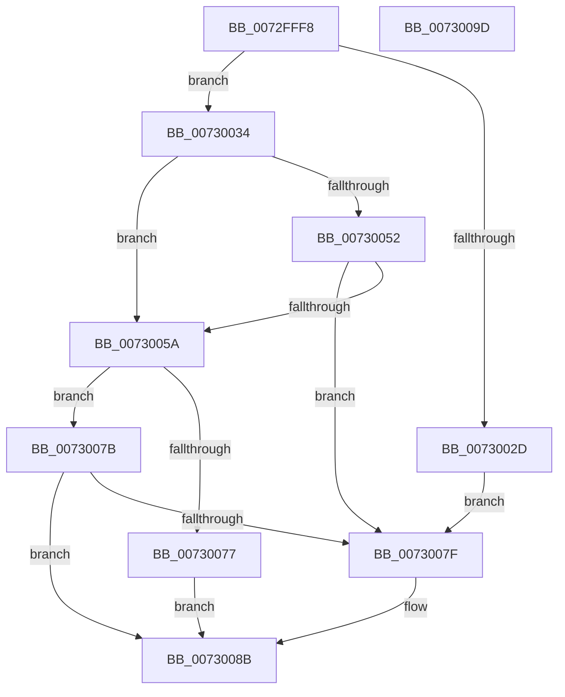

# PiPnpRtlGatherPanelRemoveInfo

- RVA: `0x0072FFF8`–`0x0073009E` (길이 `166` bytes)
- VA: `0x000000014072FFF8`
- 실행 섹션: `PAGE`
- PDB 이름 있음: `예`; PDB Function 태그: `아니요`
- unwind 정보 RVA: `0x00060BC4`
- 디코드: `49`개 명령, `166/166` bytes 표시
- 미해석 바이트: `0` (있으면 어셈블리에 `.byte`로 보존)

> 이 문서는 커널 이미지의 기계어와 PDB 기호를 분석해 생성했습니다. 4번과 5번은 함수 원형과 자료형을 바이너리 사용 방식에서 추정한 C 해석이며 원본 소스 복구 결과는 아닙니다.

## 1. Dependencies

- 직접 호출 지점: **4**; 고유 호출 대상: **3**
- 직접 호출자로 확인된 함수: **1**
- RIP 상대 이미지 참조: **0**

### Outgoing calls
- `0x00730020` → [ExAllocatePool2](../../poolcode/B8/ExAllocatePool2_function_00B820F0.md) (function, `0x00B820F0`)
- `0x0073003F` → [PiDmGetObject](../8D/PiDmGetObject_function_008DFAE0.md) (function, `0x008DFAE0`)
- `0x00730069` → [PiDmGetObject](../8D/PiDmGetObject_function_008DFAE0.md) (function, `0x008DFAE0`)
- `0x00730082` → [PiPnpRtlFreeContainerRemoveInfo](PiPnpRtlFreeContainerRemoveInfo_function_0072FA94.md) (function, `0x0072FA94`)

### Direct callers
- [sub_00B1DC0E](../B1/Unknown_function_00B1DC0E.md) at `0x00B1DC90`

### Static image references
- 디코드된 RIP-relative 메모리 참조가 없습니다.

## 2. Other-region calls and transfers

- 다른 실행 섹션으로 향하는 call: **1**
  - `0x00730020` → [ExAllocatePool2](../../poolcode/B8/ExAllocatePool2_function_00B820F0.md) (`PAGE` → `POOLCODE`)
- 별도 외부 분기/꼬리 이동을 확인하지 못했습니다.

## 3. Assembly (complete function range)

```asm
0072FFF8  48 89 5C 24 08                  mov qword ptr [rsp + 8], rbx
0072FFFD  48 89 74 24 10                  mov qword ptr [rsp + 0x10], rsi
00730002  57                              push rdi
00730003  48 83 EC 20                     sub rsp, 0x20
00730007  49 8B F8                        mov rdi, r8
0073000A  48 8B F2                        mov rsi, rdx
0073000D  48 8B D9                        mov rbx, rcx
00730010  BA 10 00 00 00                  mov edx, 0x10
00730015  B9 00 01 00 00                  mov ecx, 0x100
0073001A  41 B8 50 6E 70 47               mov r8d, 0x47706e50
00730020  E8 CB 20 45 00                  call 0x140b820f0
00730025  48 89 07                        mov qword ptr [rdi], rax
00730028  48 85 C0                        test rax, rax
0073002B  75 07                           jne 0x140730034
0073002D  BB 9A 00 00 C0                  mov ebx, 0xc000009a
00730032  EB 4B                           jmp 0x14073007f
00730034  4C 8B C0                        mov r8, rax
00730037  48 8B D3                        mov rdx, rbx
0073003A  B9 01 00 00 00                  mov ecx, 1
0073003F  E8 9C FA 1A 00                  call 0x1408dfae0
00730044  8B D8                           mov ebx, eax
00730046  B8 00 00 00 80                  mov eax, 0x80000000
0073004B  8D 0C 03                        lea ecx, [rbx + rax]
0073004E  85 C8                           test eax, ecx
00730050  75 08                           jne 0x14073005a
00730052  81 FB 34 00 00 C0               cmp ebx, 0xc0000034
00730058  75 25                           jne 0x14073007f
0073005A  4C 8B 07                        mov r8, qword ptr [rdi]
0073005D  48 8B D6                        mov rdx, rsi
00730060  49 83 C0 08                     add r8, 8
00730064  B9 06 00 00 00                  mov ecx, 6
00730069  E8 72 FA 1A 00                  call 0x1408dfae0
0073006E  8B D8                           mov ebx, eax
00730070  3D 34 00 00 C0                  cmp eax, 0xc0000034
00730075  75 04                           jne 0x14073007b
00730077  33 DB                           xor ebx, ebx
00730079  EB 10                           jmp 0x14073008b
0073007B  85 C0                           test eax, eax
0073007D  79 0C                           jns 0x14073008b
0073007F  48 8B 0F                        mov rcx, qword ptr [rdi]
00730082  E8 0D FA FF FF                  call 0x14072fa94
00730087  48 83 27 00                     and qword ptr [rdi], 0
0073008B  48 8B 74 24 38                  mov rsi, qword ptr [rsp + 0x38]
00730090  8B C3                           mov eax, ebx
00730092  48 8B 5C 24 30                  mov rbx, qword ptr [rsp + 0x30]
00730097  48 83 C4 20                     add rsp, 0x20
0073009B  5F                              pop rdi
0073009C  C3                              ret
0073009D  CC                              int3
```

## 4. C-style interpretation (structured pseudocode)

```c
__int64 __fastcall PiPnpRtlGatherPanelRemoveInfo(__int64 a1, __int64 a2, __int64 a3)
{
    __int64 result;
    __int64 v_rbx;
    __int64 v_rsp;
    unsigned __int64 v_stack_p10;
    unsigned __int64 v_stack_p8;

    v_stack_p8 = v_rbx;
    v_stack_p10 = v_rsi;
    v_rsp = (v_rsp) - (32);
    result = ExAllocatePool2(256, 16, (unsigned int)(0x47706E50ULL), a4);
    *(unsigned __int64 *)(a3) = result;
    if (result != 0) goto loc_00730034;
    goto loc_0073007F;
loc_00730034:
    result = PiDmGetObject(1, (unsigned int)(0xC000009AULL), result, a4);
    if ((((unsigned int)((unsigned int)(0x80000000ULL))) & ((unsigned int)((unsigned int)((unsigned int)(result)) + (unsigned int)(0x80000000ULL) * 1))) != 0) goto loc_0073005A;
    if (((unsigned int)((unsigned int)((unsigned int)(result)))) != 0xC0000034ULL) goto loc_0073007F;
loc_0073005A:
    a3 = (*(unsigned __int64 *)(a3)) + (8);
    result = PiDmGetObject(6, a2, a3, a4);
    if (((unsigned int)(result)) != 0xC0000034ULL) goto loc_0073007B;
    v_rbx = 0;
    goto loc_0073008B;
loc_0073007B:
    if (sign_flag) {
        a1 = *(unsigned __int64 *)(a3);
        result = PiPnpRtlFreeContainerRemoveInfo(a1, a2, a3, a4);
    }
    v_rsp = (v_rsp) + (32);
    return 0;
}
```

## 5. (Beta) C Style

```c
int64_t PiPnpRtlGatherPanelRemoveInfo(int64_t Arg1, int64_t Arg2, void *Arg3)
{
    uint8_t *arg3 = (uint8_t *)Arg3;

    int64_t result;
    int64_t local_rbx;
    int64_t local_rsp;
    uint64_t v_stack_p10;
    uint64_t v_stack_p8;

    v_stack_p8 = local_rbx;
    v_stack_p10 = local_rsi;
    local_rsp = (local_rsp) - (32);
    result = ExAllocatePool2(256, 16, (uint32_t)(0x47706E50ULL), a4);
    *(uint64_t *)(arg3) = result;
    if (result != 0) goto loc_00730034;
    goto loc_0073007F;
loc_00730034:
    result = PiDmGetObject(1, (uint32_t)(0xC000009AULL), result, a4);
    if ((((uint32_t)((uint32_t)(0x80000000ULL))) & ((uint32_t)((uint32_t)((uint32_t)(result)) + (uint32_t)(0x80000000ULL) * 1))) != 0) goto loc_0073005A;
    if (((uint32_t)((uint32_t)((uint32_t)(result)))) != 0xC0000034ULL) goto loc_0073007F;
loc_0073005A:
    Arg3 = (*(uint64_t *)(arg3)) + (8);
    result = PiDmGetObject(6, Arg2, Arg3, a4);
    if (((uint32_t)(result)) != 0xC0000034ULL) goto loc_0073007B;
    local_rbx = 0;
    goto loc_0073008B;
loc_0073007B:
    if (sign_flag) {
        Arg1 = *(uint64_t *)(arg3);
        result = PiPnpRtlFreeContainerRemoveInfo(Arg1, Arg2, Arg3, a4);
    }
    local_rsp = (local_rsp) + (32);
    return 0;
}
```

### 관측된 메모리 오프셋

구조체 형식이 확인되지 않은 접근은 인자 기준의 오프셋으로만 기록했습니다.

| 기준 인자 | 오프셋 표현 | 폭 (bit) | 접근 |
|---|---:|---:|---|
| `Arg3` | `+ 0x0` | `64` | `R` |
| `Arg3` | `+ 0x0` | `64` | `R/W` |
| `Arg3` | `+ 0x0` | `64` | `W` |

## 6. Execution-region graph

[열기: 2D/3D 그래프와 함수 탐색 컨트롤 패널](../../../control-panel.html?section=page&rva=0x0072FFF8&view=graph)

- 2D 그래프는 위에서 아래로 흐르고, 3D 그래프는 빈 공간을 드래그해 회전합니다. Shift+드래그는 이동, 휠은 확대·축소, 함수 노드 선택은 대상 보고서 이동입니다.

### Static fallback


