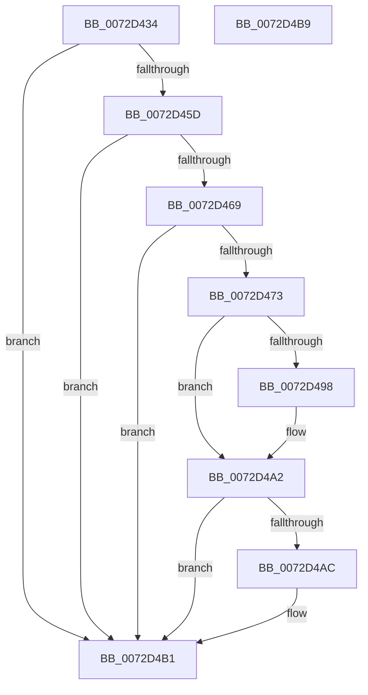

# PiProcessAddBootDevices

- RVA: `0x0072D434`–`0x0072D4BA` (길이 `134` bytes)
- VA: `0x000000014072D434`
- 실행 섹션: `PAGE`
- PDB 이름 있음: `예`; PDB Function 태그: `아니요`
- unwind 정보 RVA: `0x0005CF00`
- 디코드: `33`개 명령, `134/134` bytes 표시
- 미해석 바이트: `0` (있으면 어셈블리에 `.byte`로 보존)

> 이 문서는 커널 이미지의 기계어와 PDB 기호를 분석해 생성했습니다. 4번과 5번은 함수 원형과 자료형을 바이너리 사용 방식에서 추정한 C 해석이며 원본 소스 복구 결과는 아닙니다.

## 1. Dependencies

- 직접 호출 지점: **4**; 고유 호출 대상: **4**
- 직접 호출자로 확인된 함수: **1**
- RIP 상대 이미지 참조: **1**

### Outgoing calls
- `0x0072D478` → [PiPnpRtlBeginOperation](../8E/PiPnpRtlBeginOperation_function_008E033C.md) (function, `0x008E033C`)
- `0x0072D48F` → [PipCallDriverAddDevice](../A2/PipCallDriverAddDevice_function_00A272E0.md) (function, `0x00A272E0`)
- `0x0072D49D` → [PoFxPrepareDevice](../../text/49/PoFxPrepareDevice_function_00499F0C.md) (function, `0x00499F0C`)
- `0x0072D4AC` → [PiPnpRtlEndOperation](../8E/PiPnpRtlEndOperation_function_008E0518.md) (function, `0x008E0518`)

### Direct callers
- [PipAddDevicesToBootDriverWorker](../../init/C3/PipAddDevicesToBootDriverWorker_function_00C30448.md) at `0x00C30466`

### Static image references
- `0x0072D47D` → RVA `0x00F8C5FA` (`.data`; read)

## 2. Other-region calls and transfers

- 다른 실행 섹션으로 향하는 call: **1**
  - `0x0072D49D` → [PoFxPrepareDevice](../../text/49/PoFxPrepareDevice_function_00499F0C.md) (`PAGE` → `.text`)
- 별도 외부 분기/꼬리 이동을 확인하지 못했습니다.

## 3. Assembly (complete function range)

```asm
0072D434  40 53                           push rbx
0072D436  48 83 EC 20                     sub rsp, 0x20
0072D43A  48 83 64 24 30 00               and qword ptr [rsp + 0x30], 0
0072D440  48 8B 81 38 01 00 00            mov rax, qword ptr [rcx + 0x138]
0072D447  48 83 64 24 38 00               and qword ptr [rsp + 0x38], 0
0072D44D  48 8B 58 28                     mov rbx, qword ptr [rax + 0x28]
0072D451  81 BB 2C 01 00 00 04 03 00 00   cmp dword ptr [rbx + 0x12c], 0x304
0072D45B  75 54                           jne 0x14072d4b1
0072D45D  F7 83 8C 01 00 00 02 60 00 00   test dword ptr [rbx + 0x18c], 0x6002
0072D467  75 48                           jne 0x14072d4b1
0072D469  48 83 BB B0 01 00 00 00         cmp qword ptr [rbx + 0x1b0], 0
0072D471  75 3E                           jne 0x14072d4b1
0072D473  48 8D 4C 24 38                  lea rcx, [rsp + 0x38]
0072D478  E8 BF 2E 1B 00                  call 0x1408e033c
0072D47D  8A 05 77 F1 85 00               mov al, byte ptr [rip + 0x85f177]
0072D483  48 8D 54 24 30                  lea rdx, [rsp + 0x30]
0072D488  48 8B CB                        mov rcx, rbx
0072D48B  88 44 24 34                     mov byte ptr [rsp + 0x34], al
0072D48F  E8 4C 9E 2F 00                  call 0x140a272e0
0072D494  85 C0                           test eax, eax
0072D496  78 0A                           js 0x14072d4a2
0072D498  33 D2                           xor edx, edx
0072D49A  48 8B CB                        mov rcx, rbx
0072D49D  E8 6A CA D6 FF                  call 0x140499f0c
0072D4A2  48 8B 4C 24 38                  mov rcx, qword ptr [rsp + 0x38]
0072D4A7  48 85 C9                        test rcx, rcx
0072D4AA  74 05                           je 0x14072d4b1
0072D4AC  E8 67 30 1B 00                  call 0x1408e0518
0072D4B1  33 C0                           xor eax, eax
0072D4B3  48 83 C4 20                     add rsp, 0x20
0072D4B7  5B                              pop rbx
0072D4B8  C3                              ret
0072D4B9  CC                              int3
```

## 4. C-style interpretation (structured pseudocode)

```c
__int64 __fastcall PiProcessAddBootDevices(__int64 a1)
{
    __int64 result;
    __int64 v_rsp;
    unsigned __int64 v_stack_p10;
    unsigned __int64 v_stack_p8;
    unsigned __int8 v_stack_pC;

    v_rsp = (v_rsp) - (32);
    if ((*(unsigned int *)(*(unsigned __int64 *)(*(unsigned __int64 *)(a1 + 312) + 40) + 300)) != 772) goto loc_0072D4B1;
    if (((*(unsigned int *)(*(unsigned __int64 *)(*(unsigned __int64 *)(a1 + 312) + 40) + 396)) & (0x6002ULL)) != 0) goto loc_0072D4B1;
    if ((*(unsigned __int64 *)(*(unsigned __int64 *)(*(unsigned __int64 *)(a1 + 312) + 40) + 432)) != 0) goto loc_0072D4B1;
    result = PiPnpRtlBeginOperation(v_stack_p10, a2, a3, a4);
    v_stack_pC = (unsigned __int8)(*(unsigned __int8 *)(v_rip + 8778103));
    result = PipCallDriverAddDevice(*(unsigned __int64 *)(*(unsigned __int64 *)(a1 + 312) + 40), v_stack_p8, a3, a4);
    if (!(sign_flag)) {
        a2 = 0;
        a1 = *(unsigned __int64 *)(*(unsigned __int64 *)(a1 + 312) + 40);
        result = PoFxPrepareDevice(a1, a2, a3, a4);
    }
    if (v_stack_p10 != 0) {
        result = PiPnpRtlEndOperation(v_stack_p10, a2, a3, a4);
    }
    result = 0;
    v_rsp = (v_rsp) + (32);
    return result;
}
```

## 5. (Beta) C Style

```c
int64_t PiProcessAddBootDevices(void *Arg1)
{
    uint8_t *arg1 = (uint8_t *)Arg1;

    int64_t result;
    int64_t local_rsp;
    uint64_t v_stack_p10;
    uint64_t v_stack_p8;
    uint8_t v_stack_pC;

    local_rsp = (local_rsp) - (32);
    if ((*(uint32_t *)(*(uint64_t *)(*(uint64_t *)(arg1 + 0x138) + 0x28) + 0x12C)) != 772) goto loc_0072D4B1;
    if (((*(uint32_t *)(*(uint64_t *)(*(uint64_t *)(arg1 + 0x138) + 0x28) + 0x18C)) & (0x6002ULL)) != 0) goto loc_0072D4B1;
    if ((*(uint64_t *)(*(uint64_t *)(*(uint64_t *)(arg1 + 0x138) + 0x28) + 0x1B0)) != 0) goto loc_0072D4B1;
    result = PiPnpRtlBeginOperation(v_stack_p10, a2, a3, a4);
    v_stack_pC = (uint8_t)(*(uint8_t *)(v_rip + 0x85F177));
    result = PipCallDriverAddDevice(*(uint64_t *)(*(uint64_t *)(arg1 + 0x138) + 0x28), v_stack_p8, a3, a4);
    if (!(sign_flag)) {
        a2 = 0;
        Arg1 = *(uint64_t *)(*(uint64_t *)(arg1 + 0x138) + 0x28);
        result = PoFxPrepareDevice(Arg1, a2, a3, a4);
    }
    if (v_stack_p10 != 0) {
        result = PiPnpRtlEndOperation(v_stack_p10, a2, a3, a4);
    }
    result = 0;
    local_rsp = (local_rsp) + (32);
    return result;
}
```

### 관측된 메모리 오프셋

구조체 형식이 확인되지 않은 접근은 인자 기준의 오프셋으로만 기록했습니다.

| 기준 인자 | 오프셋 표현 | 폭 (bit) | 접근 |
|---|---:|---:|---|
| `Arg1` | `+ 0x138` | `64` | `R` |

## 6. Execution-region graph

[열기: 2D/3D 그래프와 함수 탐색 컨트롤 패널](../../../control-panel.html?section=page&rva=0x0072D434&view=graph)

- 2D 그래프는 위에서 아래로 흐르고, 3D 그래프는 빈 공간을 드래그해 회전합니다. Shift+드래그는 이동, 휠은 확대·축소, 함수 노드 선택은 대상 보고서 이동입니다.

### Static fallback


