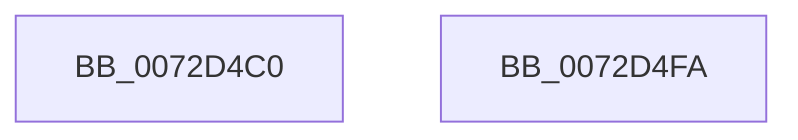

# PiProcessNewDeviceNodeWorker

- RVA: `0x0072D4C0`–`0x0072D4FB` (길이 `59` bytes)
- VA: `0x000000014072D4C0`
- 실행 섹션: `PAGE`
- PDB 이름 있음: `예`; PDB Function 태그: `아니요`
- unwind 정보 RVA: `0x0005CAAC`
- 디코드: `18`개 명령, `59/59` bytes 표시
- 미해석 바이트: `0` (있으면 어셈블리에 `.byte`로 보존)

> 이 문서는 커널 이미지의 기계어와 PDB 기호를 분석해 생성했습니다. 4번과 5번은 함수 원형과 자료형을 바이너리 사용 방식에서 추정한 C 해석이며 원본 소스 복구 결과는 아닙니다.

## 1. Dependencies

- 직접 호출 지점: **3**; 고유 호출 대상: **3**
- 직접 호출자로 확인된 함수: **0**
- RIP 상대 이미지 참조: **0**

### Outgoing calls
- `0x0072D4D5` → [PiProcessNewDeviceNode](../A2/PiProcessNewDeviceNode_function_00A28F20.md) (function, `0x00A28F20`)
- `0x0072D4E0` → [PnpDeviceCompletionQueueDispatchedEntryCompleted](../../text/26/PnpDeviceCompletionQueueDispatchedEntryCompleted_function_0026E778.md) (function, `0x0026E778`)
- `0x0072D4EA` → [ExFreePoolWithTag](../../poolcode/B8/ExFreePoolWithTag_function_00B82870.md) (function, `0x00B82870`)

### Direct callers
- 이 함수 시작 RVA로 연결되는 직접 call은 확인되지 않았습니다. 간접 호출은 완전히 역산할 수 없습니다.

### Static image references
- 디코드된 RIP-relative 메모리 참조가 없습니다.

## 2. Other-region calls and transfers

- 다른 실행 섹션으로 향하는 call: **2**
  - `0x0072D4E0` → [PnpDeviceCompletionQueueDispatchedEntryCompleted](../../text/26/PnpDeviceCompletionQueueDispatchedEntryCompleted_function_0026E778.md) (`PAGE` → `.text`)
  - `0x0072D4EA` → [ExFreePoolWithTag](../../poolcode/B8/ExFreePoolWithTag_function_00B82870.md) (`PAGE` → `POOLCODE`)
- 별도 외부 분기/꼬리 이동을 확인하지 못했습니다.

## 3. Assembly (complete function range)

```asm
0072D4C0  48 89 5C 24 08                  mov qword ptr [rsp + 8], rbx
0072D4C5  57                              push rdi
0072D4C6  48 83 EC 20                     sub rsp, 0x20
0072D4CA  48 8B 79 18                     mov rdi, qword ptr [rcx + 0x18]
0072D4CE  48 8B D9                        mov rbx, rcx
0072D4D1  48 8B 49 10                     mov rcx, qword ptr [rcx + 0x10]
0072D4D5  E8 46 BA 2F 00                  call 0x140a28f20
0072D4DA  48 8B D3                        mov rdx, rbx
0072D4DD  89 43 28                        mov dword ptr [rbx + 0x28], eax
0072D4E0  E8 93 12 B4 FF                  call 0x14026e778
0072D4E5  33 D2                           xor edx, edx
0072D4E7  48 8B CF                        mov rcx, rdi
0072D4EA  E8 81 53 45 00                  call 0x140b82870
0072D4EF  48 8B 5C 24 30                  mov rbx, qword ptr [rsp + 0x30]
0072D4F4  48 83 C4 20                     add rsp, 0x20
0072D4F8  5F                              pop rdi
0072D4F9  C3                              ret
0072D4FA  CC                              int3
```

## 4. C-style interpretation (structured pseudocode)

```c
__int64 __fastcall PiProcessNewDeviceNodeWorker(__int64 a1)
{
    __int64 result;
    __int64 v_rsp;
    unsigned __int64 v_stack_p8;

    v_stack_p8 = v_rbx;
    v_rsp = (v_rsp) - (32);
    result = PiProcessNewDeviceNode(*(unsigned __int64 *)(a1 + 16), a2, a3, a4);
    *(unsigned int *)(a1 + 40) = (unsigned int)(result);
    result = PnpDeviceCompletionQueueDispatchedEntryCompleted(*(unsigned __int64 *)(a1 + 16), a1, a3, a4);
    a2 = 0;
    result = ExFreePoolWithTag(*(unsigned __int64 *)(a1 + 24), a2, a3, a4);
    v_rsp = (v_rsp) + (32);
    return result;
}
```

## 5. (Beta) C Style

```c
int64_t PiProcessNewDeviceNodeWorker(void *Arg1)
{
    uint8_t *arg1 = (uint8_t *)Arg1;

    int64_t result;
    int64_t local_rsp;
    uint64_t v_stack_p8;

    v_stack_p8 = local_rbx;
    local_rsp = (local_rsp) - (32);
    result = PiProcessNewDeviceNode(*(uint64_t *)(arg1 + 0x10), a2, a3, a4);
    *(uint32_t *)(arg1 + 0x28) = (uint32_t)(result);
    result = PnpDeviceCompletionQueueDispatchedEntryCompleted(*(uint64_t *)(arg1 + 0x10), Arg1, a3, a4);
    a2 = 0;
    result = ExFreePoolWithTag(*(uint64_t *)(arg1 + 0x18), a2, a3, a4);
    local_rsp = (local_rsp) + (32);
    return result;
}
```

### 관측된 메모리 오프셋

구조체 형식이 확인되지 않은 접근은 인자 기준의 오프셋으로만 기록했습니다.

| 기준 인자 | 오프셋 표현 | 폭 (bit) | 접근 |
|---|---:|---:|---|
| `Arg1` | `+ 0x10` | `64` | `R` |
| `Arg1` | `+ 0x18` | `64` | `R` |
| `Arg1` | `+ 0x28` | `32` | `W` |

## 6. Execution-region graph

[열기: 2D/3D 그래프와 함수 탐색 컨트롤 패널](../../../control-panel.html?section=page&rva=0x0072D4C0&view=graph)

- 2D 그래프는 위에서 아래로 흐르고, 3D 그래프는 빈 공간을 드래그해 회전합니다. Shift+드래그는 이동, 휠은 확대·축소, 함수 노드 선택은 대상 보고서 이동입니다.

### Static fallback


