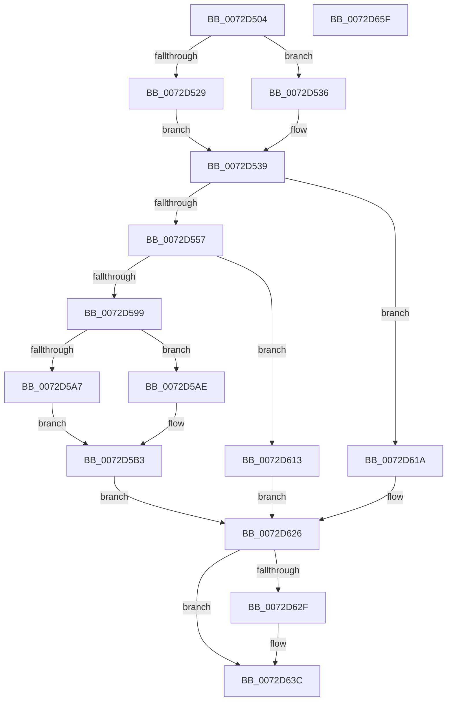

# PiProcessResourceRequirementsChanged

- RVA: `0x0072D504`–`0x0072D660` (길이 `348` bytes)
- VA: `0x000000014072D504`
- 실행 섹션: `PAGE`
- PDB 이름 있음: `예`; PDB Function 태그: `아니요`
- unwind 정보 RVA: `0x0009CA28`
- 디코드: `87`개 명령, `348/348` bytes 표시
- 미해석 바이트: `0` (있으면 어셈블리에 `.byte`로 보존)

> 이 문서는 커널 이미지의 기계어와 PDB 기호를 분석해 생성했습니다. 4번과 5번은 함수 원형과 자료형을 바이너리 사용 방식에서 추정한 C 해석이며 원본 소스 복구 결과는 아닙니다.

## 1. Dependencies

- 직접 호출 지점: **12**; 고유 호출 대상: **10**
- 직접 호출자로 확인된 함수: **1**
- RIP 상대 이미지 참조: **2**

### Outgoing calls
- `0x0072D53E` → [ObfReferenceObjectWithTag](../../text/21/ObfReferenceObjectWithTag_function_00210710.md) (function, `0x00210710`)
- `0x0072D55B` → [PoFxActivateDevice](../../text/4A/PoFxActivateDevice_function_004A0DAC.md) (function, `0x004A0DAC`)
- `0x0072D573` → [PipClearDevNodeFlags](../8F/PipClearDevNodeFlags_function_008F9F54.md) (function, `0x008F9F54`)
- `0x0072D580` → [PipSetDevNodeFlags](../8F/PipSetDevNodeFlags_function_008FC048.md) (function, `0x008FC048`)
- `0x0072D588` → [PipClearDevNodeProblem](../A2/PipClearDevNodeProblem_function_00A27C8C.md) (function, `0x00A27C8C`)
- `0x0072D5A7` → [PipSetDevNodeFlags](../8F/PipSetDevNodeFlags_function_008FC048.md) (function, `0x008FC048`)
- `0x0072D5AE` → [PipClearDevNodeFlags](../8F/PipClearDevNodeFlags_function_008F9F54.md) (function, `0x008F9F54`)
- `0x0072D5B6` → [PnpReallocateResources](../73/PnpReallocateResources_function_0073E924.md) (function, `0x0073E924`)
- `0x0072D5DC` → [ObfReferenceObject](../../text/20/ObfReferenceObject_function_0020FA20.md) (function, `0x0020FA20`)
- `0x0072D607` → [PipProcessDevNodeTree](../8F/PipProcessDevNodeTree_function_008F9068.md) (function, `0x008F9068`)
- `0x0072D633` → [PoFxIdleDevice](../../text/48/PoFxIdleDevice_function_00483EE8.md) (function, `0x00483EE8`)
- `0x0072D645` → [ObfDereferenceObjectWithTag](../../text/2F/ObfDereferenceObjectWithTag_function_002F78E0.md) (function, `0x002F78E0`)

### Direct callers
- [PnpDeviceActionWorker](../../text/47/PnpDeviceActionWorker_function_00478400.md) at `0x00478A28`

### Static image references
- `0x0072D5BB` → RVA `0x00F8C438` (`.data`; read)
- `0x0072D5C2` → RVA `0x00F8C5FA` (`.data`; read)

## 2. Other-region calls and transfers

- 다른 실행 섹션으로 향하는 call: **5**
  - `0x0072D53E` → [ObfReferenceObjectWithTag](../../text/21/ObfReferenceObjectWithTag_function_00210710.md) (`PAGE` → `.text`)
  - `0x0072D55B` → [PoFxActivateDevice](../../text/4A/PoFxActivateDevice_function_004A0DAC.md) (`PAGE` → `.text`)
  - `0x0072D5DC` → [ObfReferenceObject](../../text/20/ObfReferenceObject_function_0020FA20.md) (`PAGE` → `.text`)
  - `0x0072D633` → [PoFxIdleDevice](../../text/48/PoFxIdleDevice_function_00483EE8.md) (`PAGE` → `.text`)
  - `0x0072D645` → [ObfDereferenceObjectWithTag](../../text/2F/ObfDereferenceObjectWithTag_function_002F78E0.md) (`PAGE` → `.text`)
- 별도 외부 분기/꼬리 이동을 확인하지 못했습니다.

## 3. Assembly (complete function range)

```asm
0072D504  48 89 5C 24 10                  mov qword ptr [rsp + 0x10], rbx
0072D509  48 89 6C 24 18                  mov qword ptr [rsp + 0x18], rbp
0072D50E  56                              push rsi
0072D50F  57                              push rdi
0072D510  41 56                           push r14
0072D512  48 83 EC 40                     sub rsp, 0x40
0072D516  33 F6                           xor esi, esi
0072D518  48 8B E9                        mov rbp, rcx
0072D51B  48 8B 49 10                     mov rcx, qword ptr [rcx + 0x10]
0072D51F  48 89 74 24 60                  mov qword ptr [rsp + 0x60], rsi
0072D524  48 85 C9                        test rcx, rcx
0072D527  74 0D                           je 0x14072d536
0072D529  48 8B 81 38 01 00 00            mov rax, qword ptr [rcx + 0x138]
0072D530  48 8B 78 28                     mov rdi, qword ptr [rax + 0x28]
0072D534  EB 03                           jmp 0x14072d539
0072D536  48 8B FE                        mov rdi, rsi
0072D539  BA 50 6E 70 65                  mov edx, 0x65706e50
0072D53E  E8 CD 31 AE FF                  call 0x140210710
0072D543  8B 87 2C 01 00 00               mov eax, dword ptr [rdi + 0x12c]
0072D549  2D 15 03 00 00                  sub eax, 0x315
0072D54E  83 F8 01                        cmp eax, 1
0072D551  0F 86 C3 00 00 00               jbe 0x14072d61a
0072D557  48 8B 4D 10                     mov rcx, qword ptr [rbp + 0x10]
0072D55B  E8 4C 38 D7 FF                  call 0x1404a0dac
0072D560  4C 8D B7 C0 02 00 00            lea r14, [rdi + 0x2c0]
0072D567  BA 00 01 00 00                  mov edx, 0x100
0072D56C  41 83 0E 40                     or dword ptr [r14], 0x40
0072D570  48 8B CF                        mov rcx, rdi
0072D573  E8 DC C9 1C 00                  call 0x1408f9f54
0072D578  BA 00 04 00 00                  mov edx, 0x400
0072D57D  48 8B CF                        mov rcx, rdi
0072D580  E8 C3 EA 1C 00                  call 0x1408fc048
0072D585  48 8B CF                        mov rcx, rdi
0072D588  E8 FF A6 2F 00                  call 0x140a27c8c
0072D58D  81 BF 2C 01 00 00 0A 03 00 00   cmp dword ptr [rdi + 0x12c], 0x30a
0072D597  75 7A                           jne 0x14072d613
0072D599  BA 00 08 00 00                  mov edx, 0x800
0072D59E  48 8B CF                        mov rcx, rdi
0072D5A1  40 38 75 28                     cmp byte ptr [rbp + 0x28], sil
0072D5A5  75 07                           jne 0x14072d5ae
0072D5A7  E8 9C EA 1C 00                  call 0x1408fc048
0072D5AC  EB 05                           jmp 0x14072d5b3
0072D5AE  E8 A1 C9 1C 00                  call 0x1408f9f54
0072D5B3  48 8B CF                        mov rcx, rdi
0072D5B6  E8 69 13 01 00                  call 0x14073e924
0072D5BB  48 8B 0D 76 EE 85 00            mov rcx, qword ptr [rip + 0x85ee76]
0072D5C2  8A 05 32 F0 85 00               mov al, byte ptr [rip + 0x85f032]
0072D5C8  48 8B 5D 30                     mov rbx, qword ptr [rbp + 0x30]
0072D5CC  C7 44 24 60 03 00 00 00         mov dword ptr [rsp + 0x60], 3
0072D5D4  88 44 24 64                     mov byte ptr [rsp + 0x64], al
0072D5D8  48 8B 49 20                     mov rcx, qword ptr [rcx + 0x20]
0072D5DC  E8 3F 24 AE FF                  call 0x14020fa20
0072D5E1  48 8B 0D 50 EE 85 00            mov rcx, qword ptr [rip + 0x85ee50]
0072D5E8  4C 8D 44 24 60                  lea r8, [rsp + 0x60]
0072D5ED  40 88 74 24 30                  mov byte ptr [rsp + 0x30], sil
0072D5F2  48 85 DB                        test rbx, rbx
0072D5F5  48 8B D5                        mov rdx, rbp
0072D5F8  0F 95 C0                        setne al
0072D5FB  45 33 C9                        xor r9d, r9d
0072D5FE  88 44 24 28                     mov byte ptr [rsp + 0x28], al
0072D602  40 88 74 24 20                  mov byte ptr [rsp + 0x20], sil
0072D607  E8 5C BA 1C 00                  call 0x1408f9068
0072D60C  85 C0                           test eax, eax
0072D60E  0F 49 F0                        cmovns esi, eax
0072D611  EB 13                           jmp 0x14072d626
0072D613  BE 01 00 00 C0                  mov esi, 0xc0000001
0072D618  EB 0C                           jmp 0x14072d626
0072D61A  BE 56 00 00 C0                  mov esi, 0xc0000056
0072D61F  4C 8D B7 C0 02 00 00            lea r14, [rdi + 0x2c0]
0072D626  45 8B 06                        mov r8d, dword ptr [r14]
0072D629  41 F6 C0 40                     test r8b, 0x40
0072D62D  74 0D                           je 0x14072d63c
0072D62F  48 8B 4F 20                     mov rcx, qword ptr [rdi + 0x20]
0072D633  E8 B0 68 D5 FF                  call 0x140483ee8
0072D638  41 83 26 BF                     and dword ptr [r14], 0xffffffbf
0072D63C  48 8B 4D 10                     mov rcx, qword ptr [rbp + 0x10]
0072D640  BA 50 6E 70 65                  mov edx, 0x65706e50
0072D645  E8 96 A2 BC FF                  call 0x1402f78e0
0072D64A  48 8B 5C 24 68                  mov rbx, qword ptr [rsp + 0x68]
0072D64F  8B C6                           mov eax, esi
0072D651  48 8B 6C 24 70                  mov rbp, qword ptr [rsp + 0x70]
0072D656  48 83 C4 40                     add rsp, 0x40
0072D65A  41 5E                           pop r14
0072D65C  5F                              pop rdi
0072D65D  5E                              pop rsi
0072D65E  C3                              ret
0072D65F  CC                              int3
```

## 4. C-style interpretation (structured pseudocode)

```c
__int64 __fastcall PiProcessResourceRequirementsChanged(__int64 a1, __int64 a2, __int64 a3, int a4)
{
    __int64 result;
    __int64 v_rsi;
    __int64 v_rsp;
    unsigned __int8 v_stack_m28;
    unsigned __int8 v_stack_m30;
    unsigned __int8 v_stack_m38;
    unsigned __int64 v_stack_p10;
    unsigned __int64 v_stack_p18;
    unsigned __int64 v_stack_p8;
    unsigned __int8 v_stack_pC;

    v_stack_p10 = v_rbx;
    v_stack_p18 = v_rbp;
    v_rsp = (v_rsp) - (64);
    v_rsi = 0;
    v_stack_p8 = 0;
    if (*(unsigned __int64 *)(a1 + 16) == 0) goto loc_0072D536;
    goto loc_0072D539;
loc_0072D536:
loc_0072D539:
    result = ObfReferenceObjectWithTag(*(unsigned __int64 *)(a1 + 16), (unsigned int)(0x65706E50ULL), a3, a4);
    result = (unsigned int)(((unsigned int)(*(unsigned int *)(0 + 300))) - (789));
    if (((unsigned int)(result)) <= 1) goto loc_0072D61A;
    result = PoFxActivateDevice(*(unsigned __int64 *)(a1 + 16), (unsigned int)(0x65706E50ULL), a3, a4);
    result = PipClearDevNodeFlags(0, 256, a3, a4);
    result = PipSetDevNodeFlags(0, (unsigned int)(0x400ULL), a3, a4);
    result = PipClearDevNodeProblem(0, (unsigned int)(0x400ULL), a3, a4);
    if ((*(unsigned int *)(0 + 300)) != 778) goto loc_0072D613;
    if ((*(unsigned __int8 *)(a1 + 40)) != 0) goto loc_0072D5AE;
    result = PipSetDevNodeFlags(0, (unsigned int)(0x800ULL), a3, a4);
    goto loc_0072D5B3;
loc_0072D5AE:
    result = PipClearDevNodeFlags(0, (unsigned int)(0x800ULL), a3, a4);
loc_0072D5B3:
    result = PnpReallocateResources(0, (unsigned int)(0x800ULL), a3, a4);
    v_stack_p8 = 3;
    v_stack_pC = (unsigned __int8)(*(unsigned __int8 *)(v_rip + 8777778));
    result = ObfReferenceObject(*(unsigned __int64 *)(*(unsigned __int64 *)(v_rip + 8777334) + 32), (unsigned int)(0x800ULL), a3, a4);
    v_stack_m28 = 0;
    result = (*(unsigned __int64 *)(a1 + 48) != 0) ? 1 : 0;
    a4 = 0;
    v_stack_m30 = (unsigned __int8)(result);
    v_stack_m38 = 0;
    result = PipProcessDevNodeTree(*(unsigned __int64 *)(v_rip + 8777296), a1, v_stack_p8, a4);
    if (!sign_flag) { v_rsi = (unsigned int)(result); }
    goto loc_0072D626;
loc_0072D613:
    goto loc_0072D626;
loc_0072D61A:
loc_0072D626:
    if ((((unsigned __int8)((unsigned int)(*(unsigned int *)(0 + 704)))) & (64)) != 0) {
        a1 = *(unsigned __int64 *)(0 + 32);
        result = PoFxIdleDevice(a1, a1, (unsigned int)(*(unsigned int *)(0 + 704)), a4);
    }
    result = ObfDereferenceObjectWithTag(*(unsigned __int64 *)(a1 + 16), (unsigned int)(0x65706E50ULL), (unsigned int)(*(unsigned int *)(0 + 704)), a4);
    v_rsp = (v_rsp) + (64);
    return (unsigned int)((unsigned int)((unsigned int)(0xC0000056ULL)));
}
```

## 5. (Beta) C Style

```c
int64_t PiProcessResourceRequirementsChanged(void *Arg1, int64_t Arg2, int64_t Arg3, int32_t Arg4)
{
    uint8_t *arg1 = (uint8_t *)Arg1;

    int64_t result;
    int64_t local_rsi;
    int64_t local_rsp;
    uint8_t v_stack_m28;
    uint8_t v_stack_m30;
    uint8_t v_stack_m38;
    uint64_t v_stack_p10;
    uint64_t v_stack_p18;
    uint64_t v_stack_p8;
    uint8_t v_stack_pC;

    v_stack_p10 = local_rbx;
    v_stack_p18 = local_rbp;
    local_rsp = (local_rsp) - (64);
    local_rsi = 0;
    v_stack_p8 = 0;
    if (*(uint64_t *)(arg1 + 0x10) == 0) goto loc_0072D536;
    goto loc_0072D539;
loc_0072D536:
loc_0072D539:
    result = ObfReferenceObjectWithTag(*(uint64_t *)(arg1 + 0x10), (uint32_t)(0x65706E50ULL), Arg3, Arg4);
    result = (uint32_t)(((uint32_t)(*(uint32_t *)(0 + 0x12C))) - (789));
    if (((uint32_t)(result)) <= 1) goto loc_0072D61A;
    result = PoFxActivateDevice(*(uint64_t *)(arg1 + 0x10), (uint32_t)(0x65706E50ULL), Arg3, Arg4);
    result = PipClearDevNodeFlags(0, 256, Arg3, Arg4);
    result = PipSetDevNodeFlags(0, (uint32_t)(0x400ULL), Arg3, Arg4);
    result = PipClearDevNodeProblem(0, (uint32_t)(0x400ULL), Arg3, Arg4);
    if ((*(uint32_t *)(0 + 0x12C)) != 778) goto loc_0072D613;
    if ((*(uint8_t *)(arg1 + 0x28)) != 0) goto loc_0072D5AE;
    result = PipSetDevNodeFlags(0, (uint32_t)(0x800ULL), Arg3, Arg4);
    goto loc_0072D5B3;
loc_0072D5AE:
    result = PipClearDevNodeFlags(0, (uint32_t)(0x800ULL), Arg3, Arg4);
loc_0072D5B3:
    result = PnpReallocateResources(0, (uint32_t)(0x800ULL), Arg3, Arg4);
    v_stack_p8 = 3;
    v_stack_pC = (uint8_t)(*(uint8_t *)(v_rip + 0x85F032));
    result = ObfReferenceObject(*(uint64_t *)(*(uint64_t *)(v_rip + 0x85EE76) + 0x20), (uint32_t)(0x800ULL), Arg3, Arg4);
    v_stack_m28 = 0;
    result = (*(uint64_t *)(arg1 + 0x30) != 0) ? 1 : 0;
    Arg4 = 0;
    v_stack_m30 = (uint8_t)(result);
    v_stack_m38 = 0;
    result = PipProcessDevNodeTree(*(uint64_t *)(v_rip + 0x85EE50), Arg1, v_stack_p8, Arg4);
    if (!sign_flag) { local_rsi = (uint32_t)(result); }
    goto loc_0072D626;
loc_0072D613:
    goto loc_0072D626;
loc_0072D61A:
loc_0072D626:
    if ((((uint8_t)((uint32_t)(*(uint32_t *)(0 + 0x2C0)))) & (64)) != 0) {
        Arg1 = *(uint64_t *)(0 + 0x20);
        result = PoFxIdleDevice(Arg1, Arg1, (uint32_t)(*(uint32_t *)(0 + 0x2C0)), Arg4);
    }
    result = ObfDereferenceObjectWithTag(*(uint64_t *)(arg1 + 0x10), (uint32_t)(0x65706E50ULL), (uint32_t)(*(uint32_t *)(0 + 0x2C0)), Arg4);
    local_rsp = (local_rsp) + (64);
    return (uint32_t)((uint32_t)((uint32_t)(0xC0000056ULL)));
}
```

### 관측된 메모리 오프셋

구조체 형식이 확인되지 않은 접근은 인자 기준의 오프셋으로만 기록했습니다.

| 기준 인자 | 오프셋 표현 | 폭 (bit) | 접근 |
|---|---:|---:|---|
| `Arg1` | `+ 0x10` | `64` | `R` |
| `Arg1` | `+ 0x28` | `8` | `R` |
| `Arg1` | `+ 0x30` | `64` | `R` |

## 6. Execution-region graph

[열기: 2D/3D 그래프와 함수 탐색 컨트롤 패널](../../../control-panel.html?section=page&rva=0x0072D504&view=graph)

- 2D 그래프는 위에서 아래로 흐르고, 3D 그래프는 빈 공간을 드래그해 회전합니다. Shift+드래그는 이동, 휠은 확대·축소, 함수 노드 선택은 대상 보고서 이동입니다.

### Static fallback


