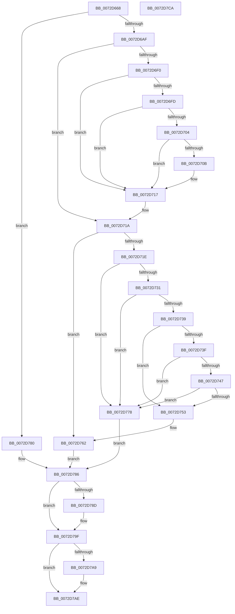

# PiProcessSetDeviceProblem

- RVA: `0x0072D668`–`0x0072D7CB` (길이 `355` bytes)
- VA: `0x000000014072D668`
- 실행 섹션: `PAGE`
- PDB 이름 있음: `예`; PDB Function 태그: `아니요`
- unwind 정보 RVA: `0x0006B074`
- 디코드: `102`개 명령, `355/355` bytes 표시
- 미해석 바이트: `0` (있으면 어셈블리에 `.byte`로 보존)

> 이 문서는 커널 이미지의 기계어와 PDB 기호를 분석해 생성했습니다. 4번과 5번은 함수 원형과 자료형을 바이너리 사용 방식에서 추정한 C 해석이며 원본 소스 복구 결과는 아닙니다.

## 1. Dependencies

- 직접 호출 지점: **8**; 고유 호출 대상: **8**
- 직접 호출자로 확인된 함수: **1**
- RIP 상대 이미지 참조: **0**

### Outgoing calls
- `0x0072D6B6` → [PiPnpRtlBeginOperation](../8E/PiPnpRtlBeginOperation_function_008E033C.md) (function, `0x008E033C`)
- `0x0072D712` → [PnpLogDeviceRequiresReboot](PnpLogDeviceRequiresReboot_function_0072C818.md) (function, `0x0072C818`)
- `0x0072D74A` → [PipIsProblemReadonly](PipIsProblemReadonly_function_0072DA44.md) (function, `0x0072DA44`)
- `0x0072D75D` → [PipSetDevNodeProblem](../8F/PipSetDevNodeProblem_function_008FDE0C.md) (function, `0x008FDE0C`)
- `0x0072D767` → [PipSetDevNodeFlags](../8F/PipSetDevNodeFlags_function_008FC048.md) (function, `0x008FC048`)
- `0x0072D771` → [PipSetDevNodeUserFlags](../8F/PipSetDevNodeUserFlags_function_008FB8FC.md) (function, `0x008FB8FC`)
- `0x0072D795` → [ExFreePoolWithTag](../../poolcode/B8/ExFreePoolWithTag_function_00B82870.md) (function, `0x00B82870`)
- `0x0072D7A9` → [PiPnpRtlEndOperation](../8E/PiPnpRtlEndOperation_function_008E0518.md) (function, `0x008E0518`)

### Direct callers
- [sub_006F45AA](../../text/6F/Unknown_function_006F45AA.md) at `0x006F46A2`

### Static image references
- 디코드된 RIP-relative 메모리 참조가 없습니다.

## 2. Other-region calls and transfers

- 다른 실행 섹션으로 향하는 call: **1**
  - `0x0072D795` → [ExFreePoolWithTag](../../poolcode/B8/ExFreePoolWithTag_function_00B82870.md) (`PAGE` → `POOLCODE`)
- 별도 외부 분기/꼬리 이동을 확인하지 못했습니다.

## 3. Assembly (complete function range)

```asm
0072D668  4C 8B DC                        mov r11, rsp
0072D66B  49 89 5B 10                     mov qword ptr [r11 + 0x10], rbx
0072D66F  49 89 6B 18                     mov qword ptr [r11 + 0x18], rbp
0072D673  49 89 73 20                     mov qword ptr [r11 + 0x20], rsi
0072D677  57                              push rdi
0072D678  41 56                           push r14
0072D67A  41 57                           push r15
0072D67C  48 83 EC 20                     sub rsp, 0x20
0072D680  48 8B 41 10                     mov rax, qword ptr [rcx + 0x10]
0072D684  4C 8B F1                        mov r14, rcx
0072D687  49 83 63 08 00                  and qword ptr [r11 + 8], 0
0072D68C  48 8B 71 28                     mov rsi, qword ptr [rcx + 0x28]
0072D690  48 8B 90 38 01 00 00            mov rdx, qword ptr [rax + 0x138]
0072D697  48 8B 5A 28                     mov rbx, qword ptr [rdx + 0x28]
0072D69B  8B 83 2C 01 00 00               mov eax, dword ptr [rbx + 0x12c]
0072D6A1  2D 15 03 00 00                  sub eax, 0x315
0072D6A6  83 F8 01                        cmp eax, 1
0072D6A9  0F 86 D1 00 00 00               jbe 0x14072d780
0072D6AF  49 8D 4B 08                     lea rcx, [r11 + 8]
0072D6B3  45 33 FF                        xor r15d, r15d
0072D6B6  E8 81 2C 1B 00                  call 0x1408e033c
0072D6BB  8B 56 14                        mov edx, dword ptr [rsi + 0x14]
0072D6BE  8B CA                           mov ecx, edx
0072D6C0  C1 E9 12                        shr ecx, 0x12
0072D6C3  8B C2                           mov eax, edx
0072D6C5  83 E1 01                        and ecx, 1
0072D6C8  8B E9                           mov ebp, ecx
0072D6CA  83 CD 04                        or ebp, 4
0072D6CD  0F BA E2 08                     bt edx, 8
0072D6D1  0F 43 E9                        cmovae ebp, ecx
0072D6D4  D1 E8                           shr eax, 1
0072D6D6  25 00 40 00 00                  and eax, 0x4000
0072D6DB  8B C8                           mov ecx, eax
0072D6DD  0F BA E9 0D                     bts ecx, 0xd
0072D6E1  0F BA E2 0A                     bt edx, 0xa
0072D6E5  0F 43 C8                        cmovae ecx, eax
0072D6E8  83 7E 18 0E                     cmp dword ptr [rsi + 0x18], 0xe
0072D6EC  8B F9                           mov edi, ecx
0072D6EE  75 2A                           jne 0x14072d71a
0072D6F0  8B 83 2C 01 00 00               mov eax, dword ptr [rbx + 0x12c]
0072D6F6  3D 04 03 00 00                  cmp eax, 0x304
0072D6FB  74 1A                           je 0x14072d717
0072D6FD  3D 03 03 00 00                  cmp eax, 0x303
0072D702  74 13                           je 0x14072d717
0072D704  3D 14 03 00 00                  cmp eax, 0x314
0072D709  74 0C                           je 0x14072d717
0072D70B  0F BA F7 0D                     btr edi, 0xd
0072D70F  48 8B CB                        mov rcx, rbx
0072D712  E8 01 F1 FF FF                  call 0x14072c818
0072D717  83 CD 04                        or ebp, 4
0072D71A  85 FF                           test edi, edi
0072D71C  74 44                           je 0x14072d762
0072D71E  8B 8B 2C 01 00 00               mov ecx, dword ptr [rbx + 0x12c]
0072D724  8D 81 FD FC FF FF               lea eax, [rcx - 0x303]
0072D72A  A9 EE FF FF FF                  test eax, 0xffffffee
0072D72F  75 47                           jne 0x14072d778
0072D731  81 F9 13 03 00 00               cmp ecx, 0x313
0072D737  74 3F                           je 0x14072d778
0072D739  0F BA E7 0E                     bt edi, 0xe
0072D73D  72 14                           jb 0x14072d753
0072D73F  8B 56 18                        mov edx, dword ptr [rsi + 0x18]
0072D742  83 FA 3A                        cmp edx, 0x3a
0072D745  73 31                           jae 0x14072d778
0072D747  48 8B CB                        mov rcx, rbx
0072D74A  E8 F5 02 00 00                  call 0x14072da44
0072D74F  85 C0                           test eax, eax
0072D751  75 25                           jne 0x14072d778
0072D753  44 8B 46 20                     mov r8d, dword ptr [rsi + 0x20]
0072D757  48 8B CB                        mov rcx, rbx
0072D75A  8B 56 18                        mov edx, dword ptr [rsi + 0x18]
0072D75D  E8 AA 06 1D 00                  call 0x1408fde0c
0072D762  8B D7                           mov edx, edi
0072D764  48 8B CB                        mov rcx, rbx
0072D767  E8 DC E8 1C 00                  call 0x1408fc048
0072D76C  8B D5                           mov edx, ebp
0072D76E  48 8B CB                        mov rcx, rbx
0072D771  E8 86 E1 1C 00                  call 0x1408fb8fc
0072D776  EB 0E                           jmp 0x14072d786
0072D778  41 BF F0 00 00 C0               mov r15d, 0xc00000f0
0072D77E  EB 06                           jmp 0x14072d786
0072D780  41 BF 56 00 00 C0               mov r15d, 0xc0000056
0072D786  8B 46 1C                        mov eax, dword ptr [rsi + 0x1c]
0072D789  A8 01                           test al, 1
0072D78B  74 12                           je 0x14072d79f
0072D78D  BA 50 6E 70 55                  mov edx, 0x55706e50
0072D792  48 8B CE                        mov rcx, rsi
0072D795  E8 D6 50 45 00                  call 0x140b82870
0072D79A  49 83 66 28 00                  and qword ptr [r14 + 0x28], 0
0072D79F  48 8B 4C 24 40                  mov rcx, qword ptr [rsp + 0x40]
0072D7A4  48 85 C9                        test rcx, rcx
0072D7A7  74 05                           je 0x14072d7ae
0072D7A9  E8 6A 2D 1B 00                  call 0x1408e0518
0072D7AE  48 8B 5C 24 48                  mov rbx, qword ptr [rsp + 0x48]
0072D7B3  41 8B C7                        mov eax, r15d
0072D7B6  48 8B 6C 24 50                  mov rbp, qword ptr [rsp + 0x50]
0072D7BB  48 8B 74 24 58                  mov rsi, qword ptr [rsp + 0x58]
0072D7C0  48 83 C4 20                     add rsp, 0x20
0072D7C4  41 5F                           pop r15
0072D7C6  41 5E                           pop r14
0072D7C8  5F                              pop rdi
0072D7C9  C3                              ret
0072D7CA  CC                              int3
```

## 4. C-style interpretation (structured pseudocode)

```c
__int64 __fastcall PiProcessSetDeviceProblem(__int64 a1)
{
    __int64 result;
    __int64 v_r15;
    __int64 v_rbp;
    __int64 v_rsp;
    unsigned __int64 v_stack_p10;
    unsigned __int64 v_stack_p18;
    unsigned __int64 v_stack_p20;
    unsigned __int64 v_stack_p8;

    *(unsigned __int64 *)(v_rsp + 16) = v_rbx;
    *(unsigned __int64 *)(v_rsp + 24) = v_rbp;
    *(unsigned __int64 *)(v_rsp + 32) = v_rsi;
    v_rsp = (v_rsp) - (32);
    result = (unsigned int)(((unsigned int)(*(unsigned int *)(*(unsigned __int64 *)(*(unsigned __int64 *)(*(unsigned __int64 *)(a1 + 16) + 312) + 40) + 300))) - (789));
    if (((unsigned int)(result)) <= 1) goto loc_0072D780;
    v_r15 = 0;
    result = PiPnpRtlBeginOperation(v_rsp + 8, *(unsigned __int64 *)(*(unsigned __int64 *)(a1 + 16) + 312), a3, a4);
    a1 = (unsigned int)(((unsigned int)((unsigned int)((unsigned int)(*(unsigned int *)(*(unsigned __int64 *)(a1 + 40) + 20))))) >> (18));
    a1 = (unsigned int)((a1) & (1));
    v_rbp = (unsigned int)(((unsigned int)((unsigned int)(a1))) | (4));
    if (condition_is_above_or_equal) { v_rbp = (unsigned int)(a1); }
    result = (unsigned int)(((unsigned int)((unsigned int)((unsigned int)(*(unsigned int *)(*(unsigned __int64 *)(a1 + 40) + 20))))) >> (1));
    result = (unsigned int)((result) & (0x4000ULL));
    a1 = (unsigned int)((unsigned int)(result));
    if (condition_is_above_or_equal) { a1 = (unsigned int)(result); }
    if ((*(unsigned int *)(*(unsigned __int64 *)(a1 + 40) + 24)) != 14) goto loc_0072D71A;
    if (((unsigned int)((unsigned int)(*(unsigned int *)(*(unsigned __int64 *)(*(unsigned __int64 *)(*(unsigned __int64 *)(a1 + 16) + 312) + 40) + 300)))) == 772) goto loc_0072D717;
    if (((unsigned int)((unsigned int)(*(unsigned int *)(*(unsigned __int64 *)(*(unsigned __int64 *)(*(unsigned __int64 *)(a1 + 16) + 312) + 40) + 300)))) == 771) goto loc_0072D717;
    result = (unsigned int)(*(unsigned int *)(*(unsigned __int64 *)(*(unsigned __int64 *)(*(unsigned __int64 *)(a1 + 16) + 312) + 40) + 300));
    if (((unsigned int)((unsigned int)(*(unsigned int *)(*(unsigned __int64 *)(*(unsigned __int64 *)(*(unsigned __int64 *)(a1 + 16) + 312) + 40) + 300)))) != 788) {
        a1 = *(unsigned __int64 *)(*(unsigned __int64 *)(*(unsigned __int64 *)(a1 + 16) + 312) + 40);
        result = PnpLogDeviceRequiresReboot(a1, (unsigned int)(*(unsigned int *)(*(unsigned __int64 *)(a1 + 40) + 20)), a3, a4);
    }
    v_rbp = (unsigned int)((v_rbp) | (4));
loc_0072D71A:
    if ((unsigned int)((unsigned int)((unsigned int)(a1))) == 0) goto loc_0072D762;
    if ((((unsigned int)((unsigned int)(*(unsigned int *)(*(unsigned __int64 *)(*(unsigned __int64 *)(*(unsigned __int64 *)(a1 + 16) + 312) + 40) + 300)) - 771)) & (0xFFFFFFEEULL)) != 0) goto loc_0072D778;
    if (((unsigned int)((unsigned int)(*(unsigned int *)(*(unsigned __int64 *)(*(unsigned __int64 *)(*(unsigned __int64 *)(a1 + 16) + 312) + 40) + 300)))) == 787) goto loc_0072D778;
    if (((unsigned int)((unsigned int)(*(unsigned int *)(*(unsigned __int64 *)(*(unsigned __int64 *)(*(unsigned __int64 *)(a1 + 16) + 312) + 40) + 300)))) < 787) goto loc_0072D753;
    if (((unsigned int)((unsigned int)(*(unsigned int *)(*(unsigned __int64 *)(a1 + 40) + 24)))) >= 58) goto loc_0072D778;
    result = PipIsProblemReadonly(*(unsigned __int64 *)(*(unsigned __int64 *)(*(unsigned __int64 *)(a1 + 16) + 312) + 40), (unsigned int)(*(unsigned int *)(*(unsigned __int64 *)(a1 + 40) + 24)), a3, a4);
    if ((unsigned int)(result) != 0) goto loc_0072D778;
loc_0072D753:
    result = PipSetDevNodeProblem(*(unsigned __int64 *)(*(unsigned __int64 *)(*(unsigned __int64 *)(a1 + 16) + 312) + 40), (unsigned int)(*(unsigned int *)(*(unsigned __int64 *)(a1 + 40) + 24)), (unsigned int)(*(unsigned int *)(*(unsigned __int64 *)(a1 + 40) + 32)), a4);
loc_0072D762:
    result = PipSetDevNodeFlags(*(unsigned __int64 *)(*(unsigned __int64 *)(*(unsigned __int64 *)(a1 + 16) + 312) + 40), (unsigned int)((unsigned int)((unsigned int)((unsigned int)(a1)))), (unsigned int)(*(unsigned int *)(*(unsigned __int64 *)(a1 + 40) + 32)), a4);
    result = PipSetDevNodeUserFlags(*(unsigned __int64 *)(*(unsigned __int64 *)(*(unsigned __int64 *)(a1 + 16) + 312) + 40), (unsigned int)((unsigned int)(v_rbp)), (unsigned int)(*(unsigned int *)(*(unsigned __int64 *)(a1 + 40) + 32)), a4);
    goto loc_0072D786;
loc_0072D778:
    goto loc_0072D786;
loc_0072D780:
loc_0072D786:
    result = (unsigned int)(*(unsigned int *)(*(unsigned __int64 *)(a1 + 40) + 28));
    if ((((unsigned __int8)((unsigned int)(*(unsigned int *)(*(unsigned __int64 *)(a1 + 40) + 28)))) & (1)) != 0) {
        a2 = 0x55706E50ULL;
        a1 = *(unsigned __int64 *)(a1 + 40);
        result = ExFreePoolWithTag(a1, a2, (unsigned int)(*(unsigned int *)(*(unsigned __int64 *)(a1 + 40) + 32)), a4);
    }
    if (v_stack_p8 != 0) {
        result = PiPnpRtlEndOperation(v_stack_p8, a2, (unsigned int)(*(unsigned int *)(*(unsigned __int64 *)(a1 + 40) + 32)), a4);
    }
    v_rsp = (v_rsp) + (32);
    return (unsigned int)((unsigned int)((unsigned int)(0xC0000056ULL)));
}
```

## 5. (Beta) C Style

```c
int64_t PiProcessSetDeviceProblem(void *Arg1)
{
    uint8_t *arg1 = (uint8_t *)Arg1;

    int64_t result;
    int64_t local_r15;
    int64_t local_rbp;
    int64_t local_rsp;
    uint64_t v_stack_p10;
    uint64_t v_stack_p18;
    uint64_t v_stack_p20;
    uint64_t v_stack_p8;

    *(uint64_t *)(local_rsp + 0x10) = local_rbx;
    *(uint64_t *)(local_rsp + 0x18) = local_rbp;
    *(uint64_t *)(local_rsp + 0x20) = local_rsi;
    local_rsp = (local_rsp) - (32);
    result = (uint32_t)(((uint32_t)(*(uint32_t *)(*(uint64_t *)(*(uint64_t *)(*(uint64_t *)(arg1 + 0x10) + 0x138) + 0x28) + 0x12C))) - (789));
    if (((uint32_t)(result)) <= 1) goto loc_0072D780;
    local_r15 = 0;
    result = PiPnpRtlBeginOperation(local_rsp + 8, *(uint64_t *)(*(uint64_t *)(arg1 + 0x10) + 0x138), a3, a4);
    Arg1 = (uint32_t)(((uint32_t)((uint32_t)((uint32_t)(*(uint32_t *)(*(uint64_t *)(arg1 + 0x28) + 0x14))))) >> (18));
    Arg1 = (uint32_t)((Arg1) & (1));
    local_rbp = (uint32_t)(((uint32_t)((uint32_t)(Arg1))) | (4));
    if (condition_is_above_or_equal) { local_rbp = (uint32_t)(Arg1); }
    result = (uint32_t)(((uint32_t)((uint32_t)((uint32_t)(*(uint32_t *)(*(uint64_t *)(arg1 + 0x28) + 0x14))))) >> (1));
    result = (uint32_t)((result) & (0x4000ULL));
    Arg1 = (uint32_t)((uint32_t)(result));
    if (condition_is_above_or_equal) { Arg1 = (uint32_t)(result); }
    if ((*(uint32_t *)(*(uint64_t *)(arg1 + 0x28) + 0x18)) != 14) goto loc_0072D71A;
    if (((uint32_t)((uint32_t)(*(uint32_t *)(*(uint64_t *)(*(uint64_t *)(*(uint64_t *)(arg1 + 0x10) + 0x138) + 0x28) + 0x12C)))) == 772) goto loc_0072D717;
    if (((uint32_t)((uint32_t)(*(uint32_t *)(*(uint64_t *)(*(uint64_t *)(*(uint64_t *)(arg1 + 0x10) + 0x138) + 0x28) + 0x12C)))) == 771) goto loc_0072D717;
    result = (uint32_t)(*(uint32_t *)(*(uint64_t *)(*(uint64_t *)(*(uint64_t *)(arg1 + 0x10) + 0x138) + 0x28) + 0x12C));
    if (((uint32_t)((uint32_t)(*(uint32_t *)(*(uint64_t *)(*(uint64_t *)(*(uint64_t *)(arg1 + 0x10) + 0x138) + 0x28) + 0x12C)))) != 788) {
        Arg1 = *(uint64_t *)(*(uint64_t *)(*(uint64_t *)(arg1 + 0x10) + 0x138) + 0x28);
        result = PnpLogDeviceRequiresReboot(Arg1, (uint32_t)(*(uint32_t *)(*(uint64_t *)(arg1 + 0x28) + 0x14)), a3, a4);
    }
    local_rbp = (uint32_t)((local_rbp) | (4));
loc_0072D71A:
    if ((uint32_t)((uint32_t)((uint32_t)(Arg1))) == 0) goto loc_0072D762;
    if ((((uint32_t)((uint32_t)(*(uint32_t *)(*(uint64_t *)(*(uint64_t *)(*(uint64_t *)(arg1 + 0x10) + 0x138) + 0x28) + 0x12C)) - 771)) & (0xFFFFFFEEULL)) != 0) goto loc_0072D778;
    if (((uint32_t)((uint32_t)(*(uint32_t *)(*(uint64_t *)(*(uint64_t *)(*(uint64_t *)(arg1 + 0x10) + 0x138) + 0x28) + 0x12C)))) == 787) goto loc_0072D778;
    if (((uint32_t)((uint32_t)(*(uint32_t *)(*(uint64_t *)(*(uint64_t *)(*(uint64_t *)(arg1 + 0x10) + 0x138) + 0x28) + 0x12C)))) < 787) goto loc_0072D753;
    if (((uint32_t)((uint32_t)(*(uint32_t *)(*(uint64_t *)(arg1 + 0x28) + 0x18)))) >= 58) goto loc_0072D778;
    result = PipIsProblemReadonly(*(uint64_t *)(*(uint64_t *)(*(uint64_t *)(arg1 + 0x10) + 0x138) + 0x28), (uint32_t)(*(uint32_t *)(*(uint64_t *)(arg1 + 0x28) + 0x18)), a3, a4);
    if ((uint32_t)(result) != 0) goto loc_0072D778;
loc_0072D753:
    result = PipSetDevNodeProblem(*(uint64_t *)(*(uint64_t *)(*(uint64_t *)(arg1 + 0x10) + 0x138) + 0x28), (uint32_t)(*(uint32_t *)(*(uint64_t *)(arg1 + 0x28) + 0x18)), (uint32_t)(*(uint32_t *)(*(uint64_t *)(arg1 + 0x28) + 0x20)), a4);
loc_0072D762:
    result = PipSetDevNodeFlags(*(uint64_t *)(*(uint64_t *)(*(uint64_t *)(arg1 + 0x10) + 0x138) + 0x28), (uint32_t)((uint32_t)((uint32_t)((uint32_t)(Arg1)))), (uint32_t)(*(uint32_t *)(*(uint64_t *)(arg1 + 0x28) + 0x20)), a4);
    result = PipSetDevNodeUserFlags(*(uint64_t *)(*(uint64_t *)(*(uint64_t *)(arg1 + 0x10) + 0x138) + 0x28), (uint32_t)((uint32_t)(local_rbp)), (uint32_t)(*(uint32_t *)(*(uint64_t *)(arg1 + 0x28) + 0x20)), a4);
    goto loc_0072D786;
loc_0072D778:
    goto loc_0072D786;
loc_0072D780:
loc_0072D786:
    result = (uint32_t)(*(uint32_t *)(*(uint64_t *)(arg1 + 0x28) + 0x1C));
    if ((((uint8_t)((uint32_t)(*(uint32_t *)(*(uint64_t *)(arg1 + 0x28) + 0x1C)))) & (1)) != 0) {
        a2 = 0x55706E50ULL;
        Arg1 = *(uint64_t *)(arg1 + 0x28);
        result = ExFreePoolWithTag(Arg1, a2, (uint32_t)(*(uint32_t *)(*(uint64_t *)(arg1 + 0x28) + 0x20)), a4);
    }
    if (v_stack_p8 != 0) {
        result = PiPnpRtlEndOperation(v_stack_p8, a2, (uint32_t)(*(uint32_t *)(*(uint64_t *)(arg1 + 0x28) + 0x20)), a4);
    }
    local_rsp = (local_rsp) + (32);
    return (uint32_t)((uint32_t)((uint32_t)(0xC0000056ULL)));
}
```

### 관측된 메모리 오프셋

구조체 형식이 확인되지 않은 접근은 인자 기준의 오프셋으로만 기록했습니다.

| 기준 인자 | 오프셋 표현 | 폭 (bit) | 접근 |
|---|---:|---:|---|
| `Arg1` | `+ 0x10` | `64` | `R` |
| `Arg1` | `+ 0x28` | `64` | `R` |
| `Arg1` | `+ 0x28` | `64` | `R/W` |

## 6. Execution-region graph

[열기: 2D/3D 그래프와 함수 탐색 컨트롤 패널](../../../control-panel.html?section=page&rva=0x0072D668&view=graph)

- 2D 그래프는 위에서 아래로 흐르고, 3D 그래프는 빈 공간을 드래그해 회전합니다. Shift+드래그는 이동, 휠은 확대·축소, 함수 노드 선택은 대상 보고서 이동입니다.

### Static fallback


