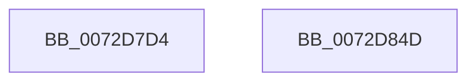

# PiProcessStartSystemDevices

- RVA: `0x0072D7D4`–`0x0072D84E` (길이 `122` bytes)
- VA: `0x000000014072D7D4`
- 실행 섹션: `PAGE`
- PDB 이름 있음: `예`; PDB Function 태그: `아니요`
- unwind 정보 RVA: `0x000697A4`
- 디코드: `30`개 명령, `122/122` bytes 표시
- 미해석 바이트: `0` (있으면 어셈블리에 `.byte`로 보존)

> 이 문서는 커널 이미지의 기계어와 PDB 기호를 분석해 생성했습니다. 4번과 5번은 함수 원형과 자료형을 바이너리 사용 방식에서 추정한 C 해석이며 원본 소스 복구 결과는 아닙니다.

## 1. Dependencies

- 직접 호출 지점: **3**; 고유 호출 대상: **2**
- 직접 호출자로 확인된 함수: **1**
- RIP 상대 이미지 참조: **3**

### Outgoing calls
- `0x0072D7EF` → [PnpDiagnosticTrace](../../text/26/PnpDiagnosticTrace_function_0026E384.md) (function, `0x0026E384`)
- `0x0072D82F` → [PipProcessDevNodeTree](../8F/PipProcessDevNodeTree_function_008F9068.md) (function, `0x008F9068`)
- `0x0072D840` → [PnpDiagnosticTrace](../../text/26/PnpDiagnosticTrace_function_0026E384.md) (function, `0x0026E384`)

### Direct callers
- [sub_006F45AA](../../text/6F/Unknown_function_006F45AA.md) at `0x006F463E`

### Static image references
- `0x0072D7E3` → RVA `0x000273B0` (`.rdata`; read)
- `0x0072D816` → RVA `0x00F8C5FA` (`.data`; read)
- `0x0072D837` → RVA `0x00027270` (`.rdata`; read)

## 2. Other-region calls and transfers

- 다른 실행 섹션으로 향하는 call: **2**
  - `0x0072D7EF` → [PnpDiagnosticTrace](../../text/26/PnpDiagnosticTrace_function_0026E384.md) (`PAGE` → `.text`)
  - `0x0072D840` → [PnpDiagnosticTrace](../../text/26/PnpDiagnosticTrace_function_0026E384.md) (`PAGE` → `.text`)
- 별도 외부 분기/꼬리 이동을 확인하지 못했습니다.

## 3. Assembly (complete function range)

```asm
0072D7D4  40 53                           push rbx
0072D7D6  48 83 EC 40                     sub rsp, 0x40
0072D7DA  48 83 64 24 50 00               and qword ptr [rsp + 0x50], 0
0072D7E0  48 8B D9                        mov rbx, rcx
0072D7E3  48 8D 0D C6 9B 8F FF            lea rcx, [rip - 0x70643a]
0072D7EA  45 33 C0                        xor r8d, r8d
0072D7ED  33 D2                           xor edx, edx
0072D7EF  E8 90 0B B4 FF                  call 0x14026e384
0072D7F4  48 8B 43 10                     mov rax, qword ptr [rbx + 0x10]
0072D7F8  4C 8D 44 24 50                  lea r8, [rsp + 0x50]
0072D7FD  C6 44 24 30 00                  mov byte ptr [rsp + 0x30], 0
0072D802  45 33 C9                        xor r9d, r9d
0072D805  C6 44 24 28 00                  mov byte ptr [rsp + 0x28], 0
0072D80A  C6 44 24 20 00                  mov byte ptr [rsp + 0x20], 0
0072D80F  48 8B 90 38 01 00 00            mov rdx, qword ptr [rax + 0x138]
0072D816  8A 05 DE ED 85 00               mov al, byte ptr [rip + 0x85edde]
0072D81C  48 8B 4A 28                     mov rcx, qword ptr [rdx + 0x28]
0072D820  48 8B D3                        mov rdx, rbx
0072D823  C7 44 24 50 03 00 00 00         mov dword ptr [rsp + 0x50], 3
0072D82B  88 44 24 54                     mov byte ptr [rsp + 0x54], al
0072D82F  E8 34 B8 1C 00                  call 0x1408f9068
0072D834  45 33 C0                        xor r8d, r8d
0072D837  48 8D 0D 32 9A 8F FF            lea rcx, [rip - 0x7065ce]
0072D83E  33 D2                           xor edx, edx
0072D840  E8 3F 0B B4 FF                  call 0x14026e384
0072D845  33 C0                           xor eax, eax
0072D847  48 83 C4 40                     add rsp, 0x40
0072D84B  5B                              pop rbx
0072D84C  C3                              ret
0072D84D  CC                              int3
```

## 4. C-style interpretation (structured pseudocode)

```c
__int64 __fastcall PiProcessStartSystemDevices(__int64 a1, int a2, int a3, int a4)
{
    __int64 result;
    __int64 v_rsp;
    unsigned __int8 v_stack_m18;
    unsigned __int8 v_stack_m20;
    unsigned __int8 v_stack_m28;
    unsigned __int64 v_stack_p8;
    unsigned __int8 v_stack_pC;

    v_rsp = (v_rsp) - (64);
    a3 = 0;
    a2 = 0;
    result = PnpDiagnosticTrace(v_rip - 7365690, a2, a3, a4);
    v_stack_m18 = 0;
    a4 = 0;
    v_stack_m20 = 0;
    v_stack_m28 = 0;
    v_stack_p8 = 3;
    v_stack_pC = (unsigned __int8)(*(unsigned __int8 *)(v_rip + 8777182));
    result = PipProcessDevNodeTree(*(unsigned __int64 *)(*(unsigned __int64 *)(*(unsigned __int64 *)(a1 + 16) + 312) + 40), a1, v_stack_p8, a4);
    a3 = 0;
    a2 = 0;
    result = PnpDiagnosticTrace(v_rip - 7366094, a2, a3, a4);
    result = 0;
    v_rsp = (v_rsp) + (64);
    return result;
}
```

## 5. (Beta) C Style

```c
int64_t PiProcessStartSystemDevices(void *Arg1, int32_t Arg2, int32_t Arg3, int32_t Arg4)
{
    uint8_t *arg1 = (uint8_t *)Arg1;

    int64_t result;
    int64_t local_rsp;
    uint8_t v_stack_m18;
    uint8_t v_stack_m20;
    uint8_t v_stack_m28;
    uint64_t v_stack_p8;
    uint8_t v_stack_pC;

    local_rsp = (local_rsp) - (64);
    Arg3 = 0;
    Arg2 = 0;
    result = PnpDiagnosticTrace(v_rip - 7365690, Arg2, Arg3, Arg4);
    v_stack_m18 = 0;
    Arg4 = 0;
    v_stack_m20 = 0;
    v_stack_m28 = 0;
    v_stack_p8 = 3;
    v_stack_pC = (uint8_t)(*(uint8_t *)(v_rip + 0x85EDDE));
    result = PipProcessDevNodeTree(*(uint64_t *)(*(uint64_t *)(*(uint64_t *)(arg1 + 0x10) + 0x138) + 0x28), Arg1, v_stack_p8, Arg4);
    Arg3 = 0;
    Arg2 = 0;
    result = PnpDiagnosticTrace(v_rip - 7366094, Arg2, Arg3, Arg4);
    result = 0;
    local_rsp = (local_rsp) + (64);
    return result;
}
```

### 관측된 메모리 오프셋

구조체 형식이 확인되지 않은 접근은 인자 기준의 오프셋으로만 기록했습니다.

| 기준 인자 | 오프셋 표현 | 폭 (bit) | 접근 |
|---|---:|---:|---|
| `Arg1` | `+ 0x10` | `64` | `R` |

## 6. Execution-region graph

[열기: 2D/3D 그래프와 함수 탐색 컨트롤 패널](../../../control-panel.html?section=page&rva=0x0072D7D4&view=graph)

- 2D 그래프는 위에서 아래로 흐르고, 3D 그래프는 빈 공간을 드래그해 회전합니다. Shift+드래그는 이동, 휠은 확대·축소, 함수 노드 선택은 대상 보고서 이동입니다.

### Static fallback


