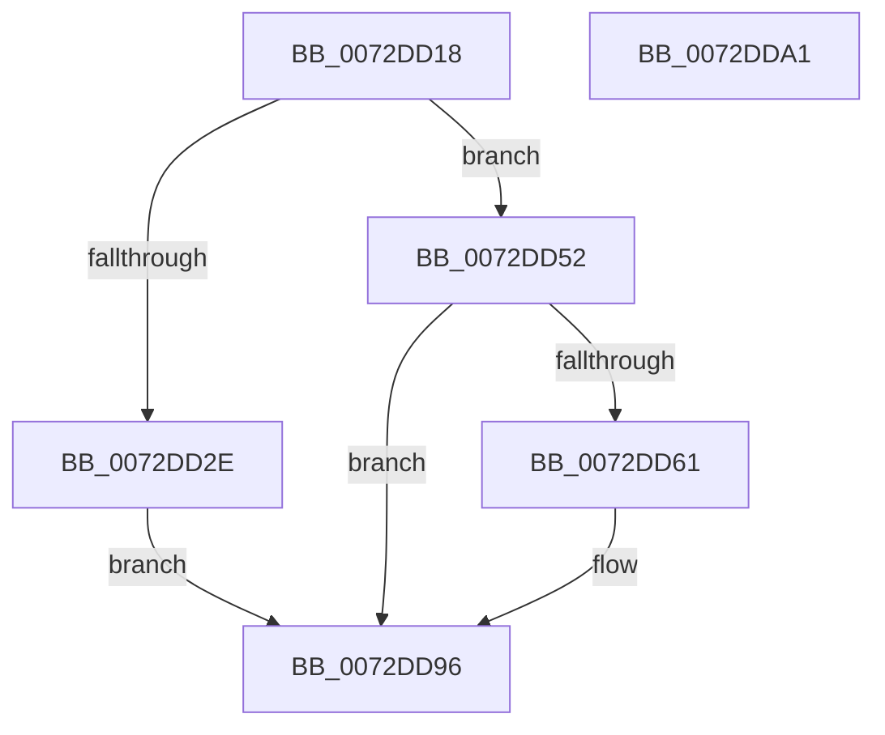

# PiUEventBroadcastHardwareProfilesChangedEvent

- RVA: `0x0072DD18`–`0x0072DDA2` (길이 `138` bytes)
- VA: `0x000000014072DD18`
- 실행 섹션: `PAGE`
- PDB 이름 있음: `예`; PDB Function 태그: `아니요`
- unwind 정보 RVA: `0x000C8834`
- 디코드: `38`개 명령, `138/138` bytes 표시
- 미해석 바이트: `0` (있으면 어셈블리에 `.byte`로 보존)

> 이 문서는 커널 이미지의 기계어와 PDB 기호를 분석해 생성했습니다. 4번과 5번은 함수 원형과 자료형을 바이너리 사용 방식에서 추정한 C 해석이며 원본 소스 복구 결과는 아닙니다.

## 1. Dependencies

- 직접 호출 지점: **4**; 고유 호출 대상: **3**
- 직접 호출자로 확인된 함수: **1**
- RIP 상대 이미지 참조: **2**

### Outgoing calls
- `0x0072DD4B` → [ZwUpdateWnfStateData](../../text/6B/ZwUpdateWnfStateData_function_006B0D10.md) (function, `0x006B0D10`)
- `0x0072DD52` → [PsGetSessionById](../../text/22/PsGetSessionById_function_00225150.md) (function, `0x00225150`)
- `0x0072DD84` → [ZwUpdateWnfStateData](../../text/6B/ZwUpdateWnfStateData_function_006B0D10.md) (function, `0x006B0D10`)
- `0x0072DD91` → [ObfDereferenceObjectWithTag](../../text/2F/ObfDereferenceObjectWithTag_function_002F78E0.md) (function, `0x002F78E0`)

### Direct callers
- [sub_00B413CC](../B4/Unknown_function_00B413CC.md) at `0x00B413D3`

### Static image references
- `0x0072DD30` → RVA `0x000208A0` (`.rdata`; read)
- `0x0072DD65` → RVA `0x00020BA8` (`.rdata`; read)

## 2. Other-region calls and transfers

- 다른 실행 섹션으로 향하는 call: **4**
  - `0x0072DD4B` → [ZwUpdateWnfStateData](../../text/6B/ZwUpdateWnfStateData_function_006B0D10.md) (`PAGE` → `.text`)
  - `0x0072DD52` → [PsGetSessionById](../../text/22/PsGetSessionById_function_00225150.md) (`PAGE` → `.text`)
  - `0x0072DD84` → [ZwUpdateWnfStateData](../../text/6B/ZwUpdateWnfStateData_function_006B0D10.md) (`PAGE` → `.text`)
  - `0x0072DD91` → [ObfDereferenceObjectWithTag](../../text/2F/ObfDereferenceObjectWithTag_function_002F78E0.md) (`PAGE` → `.text`)
- 별도 외부 분기/꼬리 이동을 확인하지 못했습니다.

## 3. Assembly (complete function range)

```asm
0072DD18  48 89 5C 24 10                  mov qword ptr [rsp + 0x10], rbx
0072DD1D  89 4C 24 08                     mov dword ptr [rsp + 8], ecx
0072DD21  57                              push rdi
0072DD22  48 83 EC 40                     sub rsp, 0x40
0072DD26  48 8B DA                        mov rbx, rdx
0072DD29  83 F9 FF                        cmp ecx, -1
0072DD2C  75 24                           jne 0x14072dd52
0072DD2E  33 C0                           xor eax, eax
0072DD30  48 8D 0D 69 2B 8F FF            lea rcx, [rip - 0x70d497]
0072DD37  89 44 24 30                     mov dword ptr [rsp + 0x30], eax
0072DD3B  45 33 C9                        xor r9d, r9d
0072DD3E  89 44 24 28                     mov dword ptr [rsp + 0x28], eax
0072DD42  48 89 44 24 20                  mov qword ptr [rsp + 0x20], rax
0072DD47  44 8D 40 10                     lea r8d, [rax + 0x10]
0072DD4B  E8 C0 2F F8 FF                  call 0x1406b0d10
0072DD50  EB 44                           jmp 0x14072dd96
0072DD52  E8 F9 73 AF FF                  call 0x140225150
0072DD57  48 8B F8                        mov rdi, rax
0072DD5A  33 C0                           xor eax, eax
0072DD5C  48 85 FF                        test rdi, rdi
0072DD5F  74 35                           je 0x14072dd96
0072DD61  89 44 24 30                     mov dword ptr [rsp + 0x30], eax
0072DD65  48 8D 0D 3C 2E 8F FF            lea rcx, [rip - 0x70d1c4]
0072DD6C  89 44 24 28                     mov dword ptr [rsp + 0x28], eax
0072DD70  45 33 C9                        xor r9d, r9d
0072DD73  48 8D 44 24 50                  lea rax, [rsp + 0x50]
0072DD78  48 8B D3                        mov rdx, rbx
0072DD7B  48 89 44 24 20                  mov qword ptr [rsp + 0x20], rax
0072DD80  45 8D 41 10                     lea r8d, [r9 + 0x10]
0072DD84  E8 87 2F F8 FF                  call 0x1406b0d10
0072DD89  BA 50 73 51 79                  mov edx, 0x79517350
0072DD8E  48 8B CF                        mov rcx, rdi
0072DD91  E8 4A 9B BC FF                  call 0x1402f78e0
0072DD96  48 8B 5C 24 58                  mov rbx, qword ptr [rsp + 0x58]
0072DD9B  48 83 C4 40                     add rsp, 0x40
0072DD9F  5F                              pop rdi
0072DDA0  C3                              ret
0072DDA1  CC                              int3
```

## 4. C-style interpretation (structured pseudocode)

```c
__int64 __fastcall PiUEventBroadcastHardwareProfilesChangedEvent(int a1, __int64 a2, __int64 a3, int a4)
{
    __int64 result;
    __int64 v_rsp;
    unsigned int v_stack_m18;
    unsigned int v_stack_m20;
    unsigned __int64 v_stack_m28;
    unsigned __int64 v_stack_p10;
    unsigned int v_stack_p8;

    v_stack_p10 = v_rbx;
    v_stack_p8 = a1;
    v_rsp = (v_rsp) - (64);
    if (a1 != -1) goto loc_0072DD52;
    result = 0;
    v_stack_m18 = 0;
    a4 = 0;
    v_stack_m20 = 0;
    v_stack_m28 = 0;
    result = ZwUpdateWnfStateData(v_rip - 7394455, a2, result + 16, a4);
    goto loc_0072DD96;
loc_0072DD52:
    result = PsGetSessionById(v_rip - 7394455, a2, result + 16, a4);
    result = 0;
    if (0 != 0) {
        v_stack_m18 = 0;
        a1 = v_rip - 7393732;
        v_stack_m20 = 0;
        a4 = 0;
        result = v_stack_p8;
        a2 = a2;
        v_stack_m28 = result;
        a3 = a4 + 16;
        result = ZwUpdateWnfStateData(a1, a2, a3, a4);
        a2 = 0x79517350ULL;
        a1 = result;
        result = ObfDereferenceObjectWithTag(a1, a2, a3, a4);
    }
    v_rsp = (v_rsp) + (64);
    return result;
}
```

## 5. (Beta) C Style

```c
int64_t PiUEventBroadcastHardwareProfilesChangedEvent(int32_t Arg1, int64_t Arg2, int64_t Arg3, int32_t Arg4)
{
    int64_t result;
    int64_t local_rsp;
    uint32_t v_stack_m18;
    uint32_t v_stack_m20;
    uint64_t v_stack_m28;
    uint64_t v_stack_p10;
    uint32_t v_stack_p8;

    v_stack_p10 = local_rbx;
    v_stack_p8 = Arg1;
    local_rsp = (local_rsp) - (64);
    if (Arg1 != -1) goto loc_0072DD52;
    result = 0;
    v_stack_m18 = 0;
    Arg4 = 0;
    v_stack_m20 = 0;
    v_stack_m28 = 0;
    result = ZwUpdateWnfStateData(v_rip - 7394455, Arg2, result + 16, Arg4);
    goto loc_0072DD96;
loc_0072DD52:
    result = PsGetSessionById(v_rip - 7394455, Arg2, result + 16, Arg4);
    result = 0;
    if (0 != 0) {
        v_stack_m18 = 0;
        Arg1 = v_rip - 7393732;
        v_stack_m20 = 0;
        Arg4 = 0;
        result = v_stack_p8;
        Arg2 = Arg2;
        v_stack_m28 = result;
        Arg3 = Arg4 + 16;
        result = ZwUpdateWnfStateData(Arg1, Arg2, Arg3, Arg4);
        Arg2 = 0x79517350ULL;
        Arg1 = result;
        result = ObfDereferenceObjectWithTag(Arg1, Arg2, Arg3, Arg4);
    }
    local_rsp = (local_rsp) + (64);
    return result;
}
```

## 6. Execution-region graph

[열기: 2D/3D 그래프와 함수 탐색 컨트롤 패널](../../../control-panel.html?section=page&rva=0x0072DD18&view=graph)

- 2D 그래프는 위에서 아래로 흐르고, 3D 그래프는 빈 공간을 드래그해 회전합니다. Shift+드래그는 이동, 휠은 확대·축소, 함수 노드 선택은 대상 보고서 이동입니다.

### Static fallback


