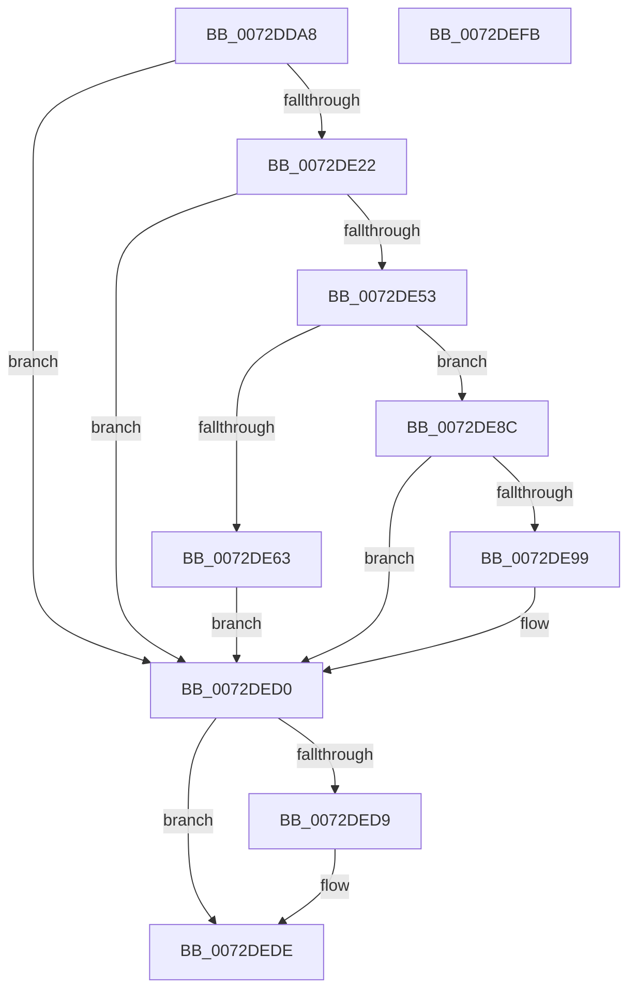

# PiUEventBroadcastPortsChangedEvent

- RVA: `0x0072DDA8`–`0x0072DEFC` (길이 `340` bytes)
- VA: `0x000000014072DDA8`
- 실행 섹션: `PAGE`
- PDB 이름 있음: `예`; PDB Function 태그: `아니요`
- unwind 정보 RVA: `0x000C8818`
- 디코드: `82`개 명령, `340/340` bytes 표시
- 미해석 바이트: `0` (있으면 어셈블리에 `.byte`로 보존)

> 이 문서는 커널 이미지의 기계어와 PDB 기호를 분석해 생성했습니다. 4번과 5번은 함수 원형과 자료형을 바이너리 사용 방식에서 추정한 C 해석이며 원본 소스 복구 결과는 아닙니다.

## 1. Dependencies

- 직접 호출 지점: **8**; 고유 호출 대상: **7**
- 직접 호출자로 확인된 함수: **1**
- RIP 상대 이미지 참조: **5**

### Outgoing calls
- `0x0072DE15` → [_CmOpenDeviceRegKey](../8E/_CmOpenDeviceRegKey_function_008EE540.md) (function, `0x008EE540`)
- `0x0072DE4A` → [PnpCtxRegQueryValue](../99/PnpCtxRegQueryValue_function_009940FC.md) (function, `0x009940FC`)
- `0x0072DE85` → [ZwUpdateWnfStateData](../../text/6B/ZwUpdateWnfStateData_function_006B0D10.md) (function, `0x006B0D10`)
- `0x0072DE8C` → [PsGetSessionById](../../text/22/PsGetSessionById_function_00225150.md) (function, `0x00225150`)
- `0x0072DEBE` → [ZwUpdateWnfStateData](../../text/6B/ZwUpdateWnfStateData_function_006B0D10.md) (function, `0x006B0D10`)
- `0x0072DECB` → [ObfDereferenceObjectWithTag](../../text/2F/ObfDereferenceObjectWithTag_function_002F78E0.md) (function, `0x002F78E0`)
- `0x0072DED9` → [ZwClose](../../text/6A/ZwClose_function_006AD2B0.md) (function, `0x006AD2B0`)
- `0x0072DEE5` → [_security_check_cookie](../../text/6A/_security_check_cookie_function_006AC640.md) (function, `0x006AC640`)

### Direct callers
- [PiUEventBroadcastEventWorker](../A7/PiUEventBroadcastEventWorker_function_00A764D0.md) at `0x00A765F0`

### Static image references
- `0x0072DDBB` → RVA `0x00E0A740` (`.data`; read)
- `0x0072DDF1` → RVA `0x00E66398` (`.data`; read)
- `0x0072DE3E` → RVA `0x00AFDFE0` (` ?? ::NNGAKEGL::`string'`; read)
- `0x0072DE71` → RVA `0x00020958` (`.rdata`; read)
- `0x0072DEB3` → RVA `0x000208B0` (`.rdata`; read)

## 2. Other-region calls and transfers

- 다른 실행 섹션으로 향하는 call: **6**
  - `0x0072DE85` → [ZwUpdateWnfStateData](../../text/6B/ZwUpdateWnfStateData_function_006B0D10.md) (`PAGE` → `.text`)
  - `0x0072DE8C` → [PsGetSessionById](../../text/22/PsGetSessionById_function_00225150.md) (`PAGE` → `.text`)
  - `0x0072DEBE` → [ZwUpdateWnfStateData](../../text/6B/ZwUpdateWnfStateData_function_006B0D10.md) (`PAGE` → `.text`)
  - `0x0072DECB` → [ObfDereferenceObjectWithTag](../../text/2F/ObfDereferenceObjectWithTag_function_002F78E0.md) (`PAGE` → `.text`)
  - `0x0072DED9` → [ZwClose](../../text/6A/ZwClose_function_006AD2B0.md) (`PAGE` → `.text`)
  - `0x0072DEE5` → [_security_check_cookie](../../text/6A/_security_check_cookie_function_006AC640.md) (`PAGE` → `.text`)
- 별도 외부 분기/꼬리 이동을 확인하지 못했습니다.

## 3. Assembly (complete function range)

```asm
0072DDA8  4C 8B DC                        mov r11, rsp
0072DDAB  49 89 5B 20                     mov qword ptr [r11 + 0x20], rbx
0072DDAF  55                              push rbp
0072DDB0  49 8D 6B A1                     lea rbp, [r11 - 0x5f]
0072DDB4  48 81 EC 90 00 00 00            sub rsp, 0x90
0072DDBB  48 8B 05 7E C9 6D 00            mov rax, qword ptr [rip + 0x6dc97e]
0072DDC2  48 33 C4                        xor rax, rsp
0072DDC5  48 89 45 4F                     mov qword ptr [rbp + 0x4f], rax
0072DDC9  49 83 63 A0 00                  and qword ptr [r11 - 0x60], 0
0072DDCE  0F 57 C0                        xorps xmm0, xmm0
0072DDD1  48 83 65 17 00                  and qword ptr [rbp + 0x17], 0
0072DDD6  49 8B C0                        mov rax, r8
0072DDD9  83 65 13 00                     and dword ptr [rbp + 0x13], 0
0072DDDD  45 33 C9                        xor r9d, r9d
0072DDE0  89 4D 07                        mov dword ptr [rbp + 7], ecx
0072DDE3  48 8B DA                        mov rbx, rdx
0072DDE6  48 8D 4D 17                     lea rcx, [rbp + 0x17]
0072DDEA  48 8B D0                        mov rdx, rax
0072DDED  49 89 4B 98                     mov qword ptr [r11 - 0x68], rcx
0072DDF1  48 8B 0D A0 85 73 00            mov rcx, qword ptr [rip + 0x7385a0]
0072DDF8  45 8D 41 11                     lea r8d, [r9 + 0x11]
0072DDFC  C6 44 24 28 00                  mov byte ptr [rsp + 0x28], 0
0072DE01  0F 11 45 1F                     movups xmmword ptr [rbp + 0x1f], xmm0
0072DE05  C7 44 24 20 19 00 02 00         mov dword ptr [rsp + 0x20], 0x20019
0072DE0D  0F 11 45 2F                     movups xmmword ptr [rbp + 0x2f], xmm0
0072DE11  0F 11 45 3F                     movups xmmword ptr [rbp + 0x3f], xmm0
0072DE15  E8 26 07 1C 00                  call 0x1408ee540
0072DE1A  85 C0                           test eax, eax
0072DE1C  0F 88 AE 00 00 00               js 0x14072ded0
0072DE22  48 8B 55 17                     mov rdx, qword ptr [rbp + 0x17]
0072DE26  48 8D 45 0F                     lea rax, [rbp + 0xf]
0072DE2A  48 89 44 24 28                  mov qword ptr [rsp + 0x28], rax
0072DE2F  4C 8D 4D 13                     lea r9, [rbp + 0x13]
0072DE33  48 8D 45 2F                     lea rax, [rbp + 0x2f]
0072DE37  C7 45 0F 20 00 00 00            mov dword ptr [rbp + 0xf], 0x20
0072DE3E  4C 8D 05 9B 01 3D 00            lea r8, [rip + 0x3d019b]
0072DE45  48 89 44 24 20                  mov qword ptr [rsp + 0x20], rax
0072DE4A  E8 AD 62 26 00                  call 0x1409940fc
0072DE4F  85 C0                           test eax, eax
0072DE51  78 7D                           js 0x14072ded0
0072DE53  0F 10 03                        movups xmm0, xmmword ptr [rbx]
0072DE56  8B 4D 07                        mov ecx, dword ptr [rbp + 7]
0072DE59  F3 0F 7F 45 1F                  movdqu xmmword ptr [rbp + 0x1f], xmm0
0072DE5E  83 F9 FF                        cmp ecx, -1
0072DE61  75 29                           jne 0x14072de8c
0072DE63  83 64 24 30 00                  and dword ptr [rsp + 0x30], 0
0072DE68  48 8D 55 1F                     lea rdx, [rbp + 0x1f]
0072DE6C  83 64 24 28 00                  and dword ptr [rsp + 0x28], 0
0072DE71  48 8D 0D E0 2A 8F FF            lea rcx, [rip - 0x70d520]
0072DE78  48 83 64 24 20 00               and qword ptr [rsp + 0x20], 0
0072DE7E  45 33 C9                        xor r9d, r9d
0072DE81  45 8D 41 30                     lea r8d, [r9 + 0x30]
0072DE85  E8 86 2E F8 FF                  call 0x1406b0d10
0072DE8A  EB 44                           jmp 0x14072ded0
0072DE8C  E8 BF 72 AF FF                  call 0x140225150
0072DE91  48 8B D8                        mov rbx, rax
0072DE94  48 85 C0                        test rax, rax
0072DE97  74 37                           je 0x14072ded0
0072DE99  83 64 24 30 00                  and dword ptr [rsp + 0x30], 0
0072DE9E  48 8D 45 07                     lea rax, [rbp + 7]
0072DEA2  83 64 24 28 00                  and dword ptr [rsp + 0x28], 0
0072DEA7  48 8D 55 1F                     lea rdx, [rbp + 0x1f]
0072DEAB  45 33 C9                        xor r9d, r9d
0072DEAE  48 89 44 24 20                  mov qword ptr [rsp + 0x20], rax
0072DEB3  48 8D 0D F6 29 8F FF            lea rcx, [rip - 0x70d60a]
0072DEBA  45 8D 41 30                     lea r8d, [r9 + 0x30]
0072DEBE  E8 4D 2E F8 FF                  call 0x1406b0d10
0072DEC3  BA 50 73 51 79                  mov edx, 0x79517350
0072DEC8  48 8B CB                        mov rcx, rbx
0072DECB  E8 10 9A BC FF                  call 0x1402f78e0
0072DED0  48 8B 4D 17                     mov rcx, qword ptr [rbp + 0x17]
0072DED4  48 85 C9                        test rcx, rcx
0072DED7  74 05                           je 0x14072dede
0072DED9  E8 D2 F3 F7 FF                  call 0x1406ad2b0
0072DEDE  48 8B 4D 4F                     mov rcx, qword ptr [rbp + 0x4f]
0072DEE2  48 33 CC                        xor rcx, rsp
0072DEE5  E8 56 E7 F7 FF                  call 0x1406ac640
0072DEEA  48 8B 9C 24 B8 00 00 00         mov rbx, qword ptr [rsp + 0xb8]
0072DEF2  48 81 C4 90 00 00 00            add rsp, 0x90
0072DEF9  5D                              pop rbp
0072DEFA  C3                              ret
0072DEFB  CC                              int3
```

## 4. C-style interpretation (structured pseudocode)

```c
__int64 __fastcall PiUEventBroadcastPortsChangedEvent(int a1, __int64 a2, __int64 a3, int a4)
{
    __int64 result;
    __int64 v_rsp;
    unsigned int v_stack_m68;
    unsigned __int8 v_stack_m70;
    unsigned int v_stack_m78;
    unsigned __int64 v_stack_p20;

    *(unsigned __int64 *)(v_rsp + 32) = v_rbx;
    v_rsp = (v_rsp) - (144);
    result = (*(unsigned __int64 *)(v_rip + 7195006)) ^ (v_rsp);
    *(unsigned __int64 *)(v_rsp - 95 + 79) = result;
    a4 = 0;
    *(unsigned int *)(v_rsp - 95 + 7) = a1;
    *(unsigned __int64 *)(v_rsp - 104) = v_rsp - 95 + 23;
    v_stack_m70 = 0;
    *(unsigned __int64 *)(v_rsp - 95 + 31) = v_xmm0;
    v_stack_m78 = 0x20019ULL;
    *(unsigned __int64 *)(v_rsp - 95 + 47) = v_xmm0;
    *(unsigned __int64 *)(v_rsp - 95 + 63) = v_xmm0;
    result = _CmOpenDeviceRegKey(*(unsigned __int64 *)(v_rip + 7570848), a3, a4 + 17, a4);
    if (sign_flag) goto loc_0072DED0;
    v_stack_m70 = v_rsp - 95 + 15;
    *(unsigned int *)(v_rsp - 95 + 15) = 32;
    v_stack_m78 = v_rsp - 95 + 47;
    result = PnpCtxRegQueryValue(*(unsigned __int64 *)(v_rip + 7570848), *(unsigned __int64 *)(v_rsp - 95 + 23), v_rip + 3998107, v_rsp - 95 + 19);
    if (sign_flag) goto loc_0072DED0;
    *(unsigned __int64 *)(v_rsp - 95 + 31) = v_xmm0;
    if (((unsigned int)((unsigned int)(*(unsigned int *)(v_rsp - 95 + 7)))) != -1) goto loc_0072DE8C;
    a4 = 0;
    result = ZwUpdateWnfStateData(v_rip - 7394592, v_rsp - 95 + 31, a4 + 48, a4);
    goto loc_0072DED0;
loc_0072DE8C:
    result = PsGetSessionById(v_rip - 7394592, v_rsp - 95 + 31, a4 + 48, a4);
    if (result != 0) {
        result = v_rsp - 95 + 7;
        a2 = v_rsp - 95 + 31;
        a4 = 0;
        v_stack_m78 = result;
        a1 = v_rip - 7394826;
        a3 = a4 + 48;
        result = ZwUpdateWnfStateData(a1, a2, a3, a4);
        a2 = 0x79517350ULL;
        a1 = result;
        result = ObfDereferenceObjectWithTag(a1, a2, a3, a4);
    }
    if (*(unsigned __int64 *)(v_rsp - 95 + 23) != 0) {
        result = ZwClose(*(unsigned __int64 *)(v_rsp - 95 + 23), a2, a3, a4);
    }
    a1 = (*(unsigned __int64 *)(v_rsp - 95 + 79)) ^ (v_rsp);
    result = _security_check_cookie(a1, a2, a3, a4);
    v_rsp = (v_rsp) + (144);
    return result;
}
```

## 5. (Beta) C Style

```c
int64_t PiUEventBroadcastPortsChangedEvent(int32_t Arg1, void *Arg2, int64_t Arg3, int32_t Arg4)
{
    uint8_t *arg2 = (uint8_t *)Arg2;

    int64_t result;
    int64_t local_rsp;
    uint32_t v_stack_m68;
    uint8_t v_stack_m70;
    uint32_t v_stack_m78;
    uint64_t v_stack_p20;

    *(uint64_t *)(local_rsp + 0x20) = local_rbx;
    local_rsp = (local_rsp) - (144);
    result = (*(uint64_t *)(v_rip + 0x6DC97E)) ^ (local_rsp);
    *(uint64_t *)(local_rsp - 0x5F + 0x4F) = result;
    Arg4 = 0;
    *(uint32_t *)(local_rsp - 0x5F + 0x7) = Arg1;
    *(uint64_t *)(local_rsp - 0x68) = local_rsp - 95 + 23;
    v_stack_m70 = 0;
    *(uint64_t *)(local_rsp - 0x5F + 0x1F) = v_xmm0;
    v_stack_m78 = 0x20019ULL;
    *(uint64_t *)(local_rsp - 0x5F + 0x2F) = v_xmm0;
    *(uint64_t *)(local_rsp - 0x5F + 0x3F) = v_xmm0;
    result = _CmOpenDeviceRegKey(*(uint64_t *)(v_rip + 0x7385A0), Arg3, Arg4 + 17, Arg4);
    if (sign_flag) goto loc_0072DED0;
    v_stack_m70 = local_rsp - 95 + 15;
    *(uint32_t *)(local_rsp - 0x5F + 0xF) = 32;
    v_stack_m78 = local_rsp - 95 + 47;
    result = PnpCtxRegQueryValue(*(uint64_t *)(v_rip + 0x7385A0), *(uint64_t *)(local_rsp - 0x5F + 0x17), v_rip + 3998107, local_rsp - 95 + 19);
    if (sign_flag) goto loc_0072DED0;
    *(uint64_t *)(local_rsp - 0x5F + 0x1F) = v_xmm0;
    if (((uint32_t)((uint32_t)(*(uint32_t *)(local_rsp - 0x5F + 0x7)))) != -1) goto loc_0072DE8C;
    Arg4 = 0;
    result = ZwUpdateWnfStateData(v_rip - 7394592, local_rsp - 95 + 31, Arg4 + 48, Arg4);
    goto loc_0072DED0;
loc_0072DE8C:
    result = PsGetSessionById(v_rip - 7394592, local_rsp - 95 + 31, Arg4 + 48, Arg4);
    if (result != 0) {
        result = local_rsp - 95 + 7;
        Arg2 = local_rsp - 95 + 31;
        Arg4 = 0;
        v_stack_m78 = result;
        Arg1 = v_rip - 7394826;
        Arg3 = Arg4 + 48;
        result = ZwUpdateWnfStateData(Arg1, Arg2, Arg3, Arg4);
        Arg2 = 0x79517350ULL;
        Arg1 = result;
        result = ObfDereferenceObjectWithTag(Arg1, Arg2, Arg3, Arg4);
    }
    if (*(uint64_t *)(local_rsp - 0x5F + 0x17) != 0) {
        result = ZwClose(*(uint64_t *)(local_rsp - 0x5F + 0x17), Arg2, Arg3, Arg4);
    }
    Arg1 = (*(uint64_t *)(local_rsp - 0x5F + 0x4F)) ^ (local_rsp);
    result = _security_check_cookie(Arg1, Arg2, Arg3, Arg4);
    local_rsp = (local_rsp) + (144);
    return result;
}
```

### 관측된 메모리 오프셋

구조체 형식이 확인되지 않은 접근은 인자 기준의 오프셋으로만 기록했습니다.

| 기준 인자 | 오프셋 표현 | 폭 (bit) | 접근 |
|---|---:|---:|---|
| `Arg2` | `+ 0x0` | `128` | `R` |

## 6. Execution-region graph

[열기: 2D/3D 그래프와 함수 탐색 컨트롤 패널](../../../control-panel.html?section=page&rva=0x0072DDA8&view=graph)

- 2D 그래프는 위에서 아래로 흐르고, 3D 그래프는 빈 공간을 드래그해 회전합니다. Shift+드래그는 이동, 휠은 확대·축소, 함수 노드 선택은 대상 보고서 이동입니다.

### Static fallback


