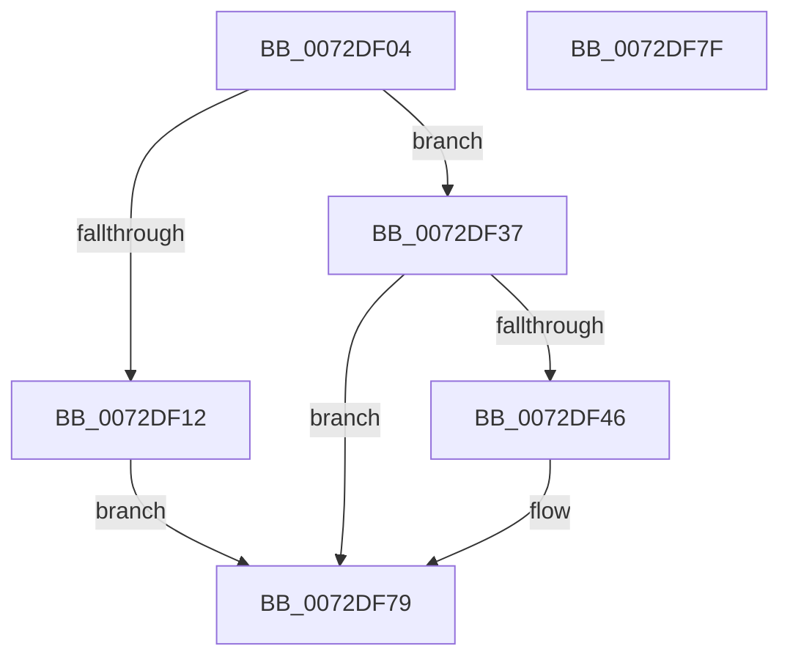

# PiUEventBroadcastVolumesChangedEvent

- RVA: `0x0072DF04`–`0x0072DF80` (길이 `124` bytes)
- VA: `0x000000014072DF04`
- 실행 섹션: `PAGE`
- PDB 이름 있음: `예`; PDB Function 태그: `아니요`
- unwind 정보 RVA: `0x000C8844`
- 디코드: `36`개 명령, `124/124` bytes 표시
- 미해석 바이트: `0` (있으면 어셈블리에 `.byte`로 보존)

> 이 문서는 커널 이미지의 기계어와 PDB 기호를 분석해 생성했습니다. 4번과 5번은 함수 원형과 자료형을 바이너리 사용 방식에서 추정한 C 해석이며 원본 소스 복구 결과는 아닙니다.

## 1. Dependencies

- 직접 호출 지점: **4**; 고유 호출 대상: **3**
- 직접 호출자로 확인된 함수: **1**
- RIP 상대 이미지 참조: **2**

### Outgoing calls
- `0x0072DF30` → [ZwUpdateWnfStateData](../../text/6B/ZwUpdateWnfStateData_function_006B0D10.md) (function, `0x006B0D10`)
- `0x0072DF37` → [PsGetSessionById](../../text/22/PsGetSessionById_function_00225150.md) (function, `0x00225150`)
- `0x0072DF67` → [ZwUpdateWnfStateData](../../text/6B/ZwUpdateWnfStateData_function_006B0D10.md) (function, `0x006B0D10`)
- `0x0072DF74` → [ObfDereferenceObjectWithTag](../../text/2F/ObfDereferenceObjectWithTag_function_002F78E0.md) (function, `0x002F78E0`)

### Direct callers
- [sub_00B413CC](../B4/Unknown_function_00B413CC.md) at `0x00B413E1`

### Static image references
- `0x0072DF14` → RVA `0x00020BD8` (`.rdata`; read)
- `0x0072DF4A` → RVA `0x000209A0` (`.rdata`; read)

## 2. Other-region calls and transfers

- 다른 실행 섹션으로 향하는 call: **4**
  - `0x0072DF30` → [ZwUpdateWnfStateData](../../text/6B/ZwUpdateWnfStateData_function_006B0D10.md) (`PAGE` → `.text`)
  - `0x0072DF37` → [PsGetSessionById](../../text/22/PsGetSessionById_function_00225150.md) (`PAGE` → `.text`)
  - `0x0072DF67` → [ZwUpdateWnfStateData](../../text/6B/ZwUpdateWnfStateData_function_006B0D10.md) (`PAGE` → `.text`)
  - `0x0072DF74` → [ObfDereferenceObjectWithTag](../../text/2F/ObfDereferenceObjectWithTag_function_002F78E0.md) (`PAGE` → `.text`)
- 별도 외부 분기/꼬리 이동을 확인하지 못했습니다.

## 3. Assembly (complete function range)

```asm
0072DF04  89 4C 24 08                     mov dword ptr [rsp + 8], ecx
0072DF08  53                              push rbx
0072DF09  48 83 EC 40                     sub rsp, 0x40
0072DF0D  83 F9 FF                        cmp ecx, -1
0072DF10  75 25                           jne 0x14072df37
0072DF12  33 C0                           xor eax, eax
0072DF14  48 8D 0D BD 2C 8F FF            lea rcx, [rip - 0x70d343]
0072DF1B  89 44 24 30                     mov dword ptr [rsp + 0x30], eax
0072DF1F  45 33 C9                        xor r9d, r9d
0072DF22  89 44 24 28                     mov dword ptr [rsp + 0x28], eax
0072DF26  45 33 C0                        xor r8d, r8d
0072DF29  33 D2                           xor edx, edx
0072DF2B  48 89 44 24 20                  mov qword ptr [rsp + 0x20], rax
0072DF30  E8 DB 2D F8 FF                  call 0x1406b0d10
0072DF35  EB 42                           jmp 0x14072df79
0072DF37  E8 14 72 AF FF                  call 0x140225150
0072DF3C  48 8B D8                        mov rbx, rax
0072DF3F  33 C0                           xor eax, eax
0072DF41  48 85 DB                        test rbx, rbx
0072DF44  74 33                           je 0x14072df79
0072DF46  89 44 24 30                     mov dword ptr [rsp + 0x30], eax
0072DF4A  48 8D 0D 4F 2A 8F FF            lea rcx, [rip - 0x70d5b1]
0072DF51  89 44 24 28                     mov dword ptr [rsp + 0x28], eax
0072DF55  45 33 C9                        xor r9d, r9d
0072DF58  48 8D 44 24 50                  lea rax, [rsp + 0x50]
0072DF5D  45 33 C0                        xor r8d, r8d
0072DF60  33 D2                           xor edx, edx
0072DF62  48 89 44 24 20                  mov qword ptr [rsp + 0x20], rax
0072DF67  E8 A4 2D F8 FF                  call 0x1406b0d10
0072DF6C  BA 50 73 51 79                  mov edx, 0x79517350
0072DF71  48 8B CB                        mov rcx, rbx
0072DF74  E8 67 99 BC FF                  call 0x1402f78e0
0072DF79  48 83 C4 40                     add rsp, 0x40
0072DF7D  5B                              pop rbx
0072DF7E  C3                              ret
0072DF7F  CC                              int3
```

## 4. C-style interpretation (structured pseudocode)

```c
__int64 __fastcall PiUEventBroadcastVolumesChangedEvent(int a1, int a2, int a3, int a4)
{
    __int64 result;
    __int64 v_rsp;
    unsigned int v_stack_m18;
    unsigned int v_stack_m20;
    unsigned __int64 v_stack_m28;
    unsigned int v_stack_p8;

    v_stack_p8 = a1;
    v_rsp = (v_rsp) - (64);
    if (a1 != -1) goto loc_0072DF37;
    result = 0;
    v_stack_m18 = 0;
    a4 = 0;
    v_stack_m20 = 0;
    a3 = 0;
    a2 = 0;
    v_stack_m28 = 0;
    result = ZwUpdateWnfStateData(v_rip - 7394115, a2, a3, a4);
    goto loc_0072DF79;
loc_0072DF37:
    result = PsGetSessionById(v_rip - 7394115, a2, a3, a4);
    result = 0;
    if (0 != 0) {
        v_stack_m18 = 0;
        a1 = v_rip - 7394737;
        v_stack_m20 = 0;
        a4 = 0;
        result = v_stack_p8;
        a3 = 0;
        a2 = 0;
        v_stack_m28 = result;
        result = ZwUpdateWnfStateData(a1, a2, a3, a4);
        a2 = 0x79517350ULL;
        a1 = result;
        result = ObfDereferenceObjectWithTag(a1, a2, a3, a4);
    }
    v_rsp = (v_rsp) + (64);
    return result;
}
```

## 5. (Beta) C Style

```c
int64_t PiUEventBroadcastVolumesChangedEvent(int32_t Arg1, int32_t Arg2, int32_t Arg3, int32_t Arg4)
{
    int64_t result;
    int64_t local_rsp;
    uint32_t v_stack_m18;
    uint32_t v_stack_m20;
    uint64_t v_stack_m28;
    uint32_t v_stack_p8;

    v_stack_p8 = Arg1;
    local_rsp = (local_rsp) - (64);
    if (Arg1 != -1) goto loc_0072DF37;
    result = 0;
    v_stack_m18 = 0;
    Arg4 = 0;
    v_stack_m20 = 0;
    Arg3 = 0;
    Arg2 = 0;
    v_stack_m28 = 0;
    result = ZwUpdateWnfStateData(v_rip - 7394115, Arg2, Arg3, Arg4);
    goto loc_0072DF79;
loc_0072DF37:
    result = PsGetSessionById(v_rip - 7394115, Arg2, Arg3, Arg4);
    result = 0;
    if (0 != 0) {
        v_stack_m18 = 0;
        Arg1 = v_rip - 7394737;
        v_stack_m20 = 0;
        Arg4 = 0;
        result = v_stack_p8;
        Arg3 = 0;
        Arg2 = 0;
        v_stack_m28 = result;
        result = ZwUpdateWnfStateData(Arg1, Arg2, Arg3, Arg4);
        Arg2 = 0x79517350ULL;
        Arg1 = result;
        result = ObfDereferenceObjectWithTag(Arg1, Arg2, Arg3, Arg4);
    }
    local_rsp = (local_rsp) + (64);
    return result;
}
```

## 6. Execution-region graph

[열기: 2D/3D 그래프와 함수 탐색 컨트롤 패널](../../../control-panel.html?section=page&rva=0x0072DF04&view=graph)

- 2D 그래프는 위에서 아래로 흐르고, 3D 그래프는 빈 공간을 드래그해 회전합니다. Shift+드래그는 이동, 휠은 확대·축소, 함수 노드 선택은 대상 보고서 이동입니다.

### Static fallback


