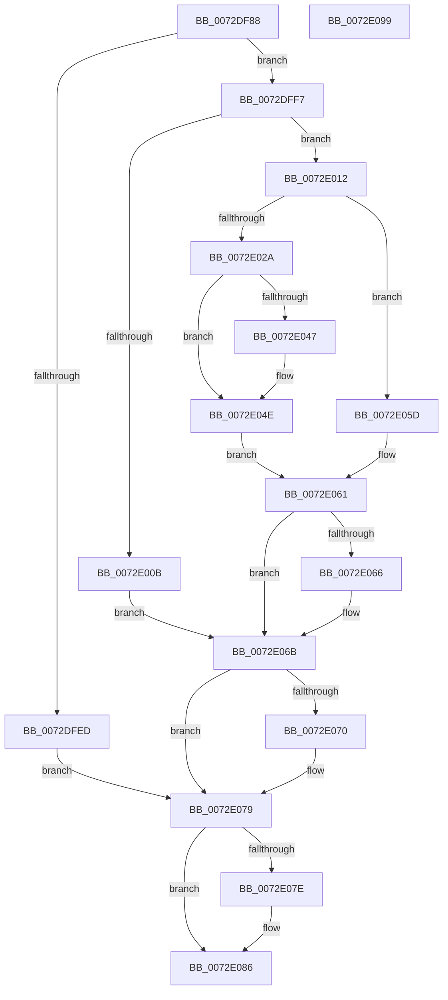

# PiUEventGetDmObjectFromUserHandle

- RVA: `0x0072DF88`–`0x0072E09A` (길이 `274` bytes)
- VA: `0x000000014072DF88`
- 실행 섹션: `PAGE`
- PDB 이름 있음: `예`; PDB Function 태그: `아니요`
- unwind 정보 RVA: `0x000C8850`
- 디코드: `78`개 명령, `274/274` bytes 표시
- 미해석 바이트: `0` (있으면 어셈블리에 `.byte`로 보존)

> 이 문서는 커널 이미지의 기계어와 PDB 기호를 분석해 생성했습니다. 4번과 5번은 함수 원형과 자료형을 바이너리 사용 방식에서 추정한 C 해석이며 원본 소스 복구 결과는 아닙니다.

## 1. Dependencies

- 직접 호출 지점: **7**; 고유 호출 대상: **6**
- 직접 호출자로 확인된 함수: **1**
- RIP 상대 이미지 참조: **1**

### Outgoing calls
- `0x0072DFE0` → [ObReferenceObjectByHandle](../86/ObReferenceObjectByHandle_function_00868DB0.md) (function, `0x00868DB0`)
- `0x0072DFFE` → [PnpGetRelatedTargetDevice](../../text/27/PnpGetRelatedTargetDevice_function_00271F54.md) (function, `0x00271F54`)
- `0x0072E01F` → [PiDmGetObject](../8D/PiDmGetObject_function_008DFAE0.md) (function, `0x008DFAE0`)
- `0x0072E03A` → [PsIsProcessAppContainer](../A3/PsIsProcessAppContainer_function_00A38C44.md) (function, `0x00A38C44`)
- `0x0072E066` → [PiDmObjectRelease](../8E/PiDmObjectRelease_function_008E4F70.md) (function, `0x008E4F70`)
- `0x0072E074` → [ObfDereferenceObject](../../text/2F/ObfDereferenceObject_function_002F9350.md) (function, `0x002F9350`)
- `0x0072E081` → [ObfDereferenceObject](../../text/2F/ObfDereferenceObject_function_002F9350.md) (function, `0x002F9350`)

### Direct callers
- [PiUEventHandleRegistration](../9C/PiUEventHandleRegistration_function_009C3304.md) at `0x009C34E6`

### Static image references
- `0x0072DFB4` → RVA `0x00FC6AE0` (`ALMOSTRO`; read)

## 2. Other-region calls and transfers

- 다른 실행 섹션으로 향하는 call: **3**
  - `0x0072DFFE` → [PnpGetRelatedTargetDevice](../../text/27/PnpGetRelatedTargetDevice_function_00271F54.md) (`PAGE` → `.text`)
  - `0x0072E074` → [ObfDereferenceObject](../../text/2F/ObfDereferenceObject_function_002F9350.md) (`PAGE` → `.text`)
  - `0x0072E081` → [ObfDereferenceObject](../../text/2F/ObfDereferenceObject_function_002F9350.md) (`PAGE` → `.text`)
- 별도 외부 분기/꼬리 이동을 확인하지 못했습니다.

## 3. Assembly (complete function range)

```asm
0072DF88  48 89 5C 24 08                  mov qword ptr [rsp + 8], rbx
0072DF8D  55                              push rbp
0072DF8E  56                              push rsi
0072DF8F  57                              push rdi
0072DF90  41 56                           push r14
0072DF92  41 57                           push r15
0072DF94  48 8B EC                        mov rbp, rsp
0072DF97  48 83 EC 30                     sub rsp, 0x30
0072DF9B  48 83 22 00                     and qword ptr [rdx], 0
0072DF9F  4D 8B F0                        mov r14, r8
0072DFA2  65 48 8B 04 25 88 01 00 00      mov rax, qword ptr gs:[0x188]
0072DFAB  4C 8B FA                        mov r15, rdx
0072DFAE  49 83 20 00                     and qword ptr [r8], 0
0072DFB2  33 D2                           xor edx, edx
0072DFB4  4C 8B 05 25 8B 89 00            mov r8, qword ptr [rip + 0x898b25]
0072DFBB  48 83 64 24 28 00               and qword ptr [rsp + 0x28], 0
0072DFC1  44 8A 88 32 02 00 00            mov r9b, byte ptr [rax + 0x232]
0072DFC8  48 8D 45 40                     lea rax, [rbp + 0x40]
0072DFCC  48 83 65 38 00                  and qword ptr [rbp + 0x38], 0
0072DFD1  48 83 65 48 00                  and qword ptr [rbp + 0x48], 0
0072DFD6  48 83 65 40 00                  and qword ptr [rbp + 0x40], 0
0072DFDB  48 89 44 24 20                  mov qword ptr [rsp + 0x20], rax
0072DFE0  E8 CB AD 13 00                  call 0x140868db0
0072DFE5  48 8B 75 40                     mov rsi, qword ptr [rbp + 0x40]
0072DFE9  85 C0                           test eax, eax
0072DFEB  79 0A                           jns 0x14072dff7
0072DFED  BB 0D 00 00 C0                  mov ebx, 0xc000000d
0072DFF2  E9 82 00 00 00                  jmp 0x14072e079
0072DFF7  48 8D 55 38                     lea rdx, [rbp + 0x38]
0072DFFB  48 8B CE                        mov rcx, rsi
0072DFFE  E8 51 3F B4 FF                  call 0x140271f54
0072E003  48 8B 7D 38                     mov rdi, qword ptr [rbp + 0x38]
0072E007  85 C0                           test eax, eax
0072E009  79 07                           jns 0x14072e012
0072E00B  BB 0D 00 00 C0                  mov ebx, 0xc000000d
0072E010  EB 59                           jmp 0x14072e06b
0072E012  48 8B 57 30                     mov rdx, qword ptr [rdi + 0x30]
0072E016  4C 8D 45 48                     lea r8, [rbp + 0x48]
0072E01A  B9 01 00 00 00                  mov ecx, 1
0072E01F  E8 BC 1A 1B 00                  call 0x1408dfae0
0072E024  8B D8                           mov ebx, eax
0072E026  85 C0                           test eax, eax
0072E028  78 33                           js 0x14072e05d
0072E02A  65 48 8B 0C 25 88 01 00 00      mov rcx, qword ptr gs:[0x188]
0072E033  48 8B 89 B8 00 00 00            mov rcx, qword ptr [rcx + 0xb8]
0072E03A  E8 05 AC 30 00                  call 0x140a38c44
0072E03F  48 8B 7D 38                     mov rdi, qword ptr [rbp + 0x38]
0072E043  84 C0                           test al, al
0072E045  74 07                           je 0x14072e04e
0072E047  48 8B 4F 20                     mov rcx, qword ptr [rdi + 0x20]
0072E04B  49 89 0E                        mov qword ptr [r14], rcx
0072E04E  48 8B 45 48                     mov rax, qword ptr [rbp + 0x48]
0072E052  33 C9                           xor ecx, ecx
0072E054  48 8B 75 40                     mov rsi, qword ptr [rbp + 0x40]
0072E058  49 89 07                        mov qword ptr [r15], rax
0072E05B  EB 04                           jmp 0x14072e061
0072E05D  48 8B 4D 48                     mov rcx, qword ptr [rbp + 0x48]
0072E061  48 85 C9                        test rcx, rcx
0072E064  74 05                           je 0x14072e06b
0072E066  E8 05 6F 1B 00                  call 0x1408e4f70
0072E06B  48 85 FF                        test rdi, rdi
0072E06E  74 09                           je 0x14072e079
0072E070  48 8B 4F 20                     mov rcx, qword ptr [rdi + 0x20]
0072E074  E8 D7 B2 BC FF                  call 0x1402f9350
0072E079  48 85 F6                        test rsi, rsi
0072E07C  74 08                           je 0x14072e086
0072E07E  48 8B CE                        mov rcx, rsi
0072E081  E8 CA B2 BC FF                  call 0x1402f9350
0072E086  8B C3                           mov eax, ebx
0072E088  48 8B 5C 24 60                  mov rbx, qword ptr [rsp + 0x60]
0072E08D  48 83 C4 30                     add rsp, 0x30
0072E091  41 5F                           pop r15
0072E093  41 5E                           pop r14
0072E095  5F                              pop rdi
0072E096  5E                              pop rsi
0072E097  5D                              pop rbp
0072E098  C3                              ret
0072E099  CC                              int3
```

## 4. C-style interpretation (structured pseudocode)

```c
__int64 __fastcall PiUEventGetDmObjectFromUserHandle(__int64 a1, __int64 a2, __int64 a3)
{
    __int64 result;
    __int64 v_rsp;
    unsigned __int64 v_stack_m30;
    unsigned __int64 v_stack_m38;
    unsigned __int64 v_stack_p10;
    unsigned __int64 v_stack_p18;
    unsigned __int64 v_stack_p20;
    unsigned __int64 v_stack_p8;

    v_stack_p8 = v_rbx;
    v_rsp = (v_rsp) - (48);
    a2 = 0;
    v_stack_m38 = v_stack_p18;
    result = ObReferenceObjectByHandle(a1, a2, *(unsigned __int64 *)(v_rip + 9014053), *(unsigned __int8 *)(*(unsigned __int64 *)(gs_base + (0 + 392)) + 562));
    if (!sign_flag) goto loc_0072DFF7;
    goto loc_0072E079;
loc_0072DFF7:
    result = PnpGetRelatedTargetDevice(v_stack_p18, v_stack_p10, *(unsigned __int64 *)(v_rip + 9014053), *(unsigned __int8 *)(*(unsigned __int64 *)(gs_base + (0 + 392)) + 562));
    if (!sign_flag) goto loc_0072E012;
    goto loc_0072E06B;
loc_0072E012:
    result = PiDmGetObject(1, *(unsigned __int64 *)(v_stack_p10 + 48), v_stack_p20, *(unsigned __int8 *)(*(unsigned __int64 *)(gs_base + (0 + 392)) + 562));
    if (sign_flag) goto loc_0072E05D;
    result = PsIsProcessAppContainer(*(unsigned __int64 *)(*(unsigned __int64 *)(gs_base + (0 + 392)) + 184), *(unsigned __int64 *)(v_stack_p10 + 48), v_stack_p20, *(unsigned __int8 *)(*(unsigned __int64 *)(gs_base + (0 + 392)) + 562));
    if ((unsigned __int8)(result) != 0) {
        a1 = *(unsigned __int64 *)(v_stack_p10 + 32);
        *(unsigned __int64 *)(a3) = a1;
    }
    a1 = 0;
    *(unsigned __int64 *)(a2) = v_stack_p20;
    goto loc_0072E061;
loc_0072E05D:
loc_0072E061:
    result = v_stack_p20;
    if (v_stack_p20 != 0) {
        result = PiDmObjectRelease(v_stack_p20, *(unsigned __int64 *)(v_stack_p10 + 48), v_stack_p20, *(unsigned __int8 *)(*(unsigned __int64 *)(gs_base + (0 + 392)) + 562));
    }
    if (v_stack_p10 != 0) {
        a1 = *(unsigned __int64 *)(v_stack_p10 + 32);
        result = ObfDereferenceObject(a1, *(unsigned __int64 *)(v_stack_p10 + 48), v_stack_p20, *(unsigned __int8 *)(*(unsigned __int64 *)(gs_base + (0 + 392)) + 562));
    }
    if (v_stack_p18 != 0) {
        a1 = v_stack_p18;
        result = ObfDereferenceObject(a1, *(unsigned __int64 *)(v_stack_p10 + 48), v_stack_p20, *(unsigned __int8 *)(*(unsigned __int64 *)(gs_base + (0 + 392)) + 562));
    }
    v_rsp = (v_rsp) + (48);
    return (unsigned int)((unsigned int)((unsigned int)((unsigned int)(result))));
}
```

## 5. (Beta) C Style

```c
int64_t PiUEventGetDmObjectFromUserHandle(int64_t Arg1, void *Arg2, void *Arg3)
{
    uint8_t *arg2 = (uint8_t *)Arg2;
    uint8_t *arg3 = (uint8_t *)Arg3;

    int64_t result;
    int64_t local_rsp;
    uint64_t v_stack_m30;
    uint64_t v_stack_m38;
    uint64_t v_stack_p10;
    uint64_t v_stack_p18;
    uint64_t v_stack_p20;
    uint64_t v_stack_p8;

    v_stack_p8 = local_rbx;
    local_rsp = (local_rsp) - (48);
    Arg2 = 0;
    v_stack_m38 = v_stack_p18;
    result = ObReferenceObjectByHandle(Arg1, Arg2, *(uint64_t *)(v_rip + 0x898B25), *(uint8_t *)(*(uint64_t *)(gs_base + (0 + 0x188)) + 0x232));
    if (!sign_flag) goto loc_0072DFF7;
    goto loc_0072E079;
loc_0072DFF7:
    result = PnpGetRelatedTargetDevice(v_stack_p18, v_stack_p10, *(uint64_t *)(v_rip + 0x898B25), *(uint8_t *)(*(uint64_t *)(gs_base + (0 + 0x188)) + 0x232));
    if (!sign_flag) goto loc_0072E012;
    goto loc_0072E06B;
loc_0072E012:
    result = PiDmGetObject(1, *(uint64_t *)(v_stack_p10 + 0x30), v_stack_p20, *(uint8_t *)(*(uint64_t *)(gs_base + (0 + 0x188)) + 0x232));
    if (sign_flag) goto loc_0072E05D;
    result = PsIsProcessAppContainer(*(uint64_t *)(*(uint64_t *)(gs_base + (0 + 0x188)) + 0xB8), *(uint64_t *)(v_stack_p10 + 0x30), v_stack_p20, *(uint8_t *)(*(uint64_t *)(gs_base + (0 + 0x188)) + 0x232));
    if ((uint8_t)(result) != 0) {
        Arg1 = *(uint64_t *)(v_stack_p10 + 0x20);
        *(uint64_t *)(arg3) = Arg1;
    }
    Arg1 = 0;
    *(uint64_t *)(arg2) = v_stack_p20;
    goto loc_0072E061;
loc_0072E05D:
loc_0072E061:
    result = v_stack_p20;
    if (v_stack_p20 != 0) {
        result = PiDmObjectRelease(v_stack_p20, *(uint64_t *)(v_stack_p10 + 0x30), v_stack_p20, *(uint8_t *)(*(uint64_t *)(gs_base + (0 + 0x188)) + 0x232));
    }
    if (v_stack_p10 != 0) {
        Arg1 = *(uint64_t *)(v_stack_p10 + 0x20);
        result = ObfDereferenceObject(Arg1, *(uint64_t *)(v_stack_p10 + 0x30), v_stack_p20, *(uint8_t *)(*(uint64_t *)(gs_base + (0 + 0x188)) + 0x232));
    }
    if (v_stack_p18 != 0) {
        Arg1 = v_stack_p18;
        result = ObfDereferenceObject(Arg1, *(uint64_t *)(v_stack_p10 + 0x30), v_stack_p20, *(uint8_t *)(*(uint64_t *)(gs_base + (0 + 0x188)) + 0x232));
    }
    local_rsp = (local_rsp) + (48);
    return (uint32_t)((uint32_t)((uint32_t)((uint32_t)(result))));
}
```

### 관측된 메모리 오프셋

구조체 형식이 확인되지 않은 접근은 인자 기준의 오프셋으로만 기록했습니다.

| 기준 인자 | 오프셋 표현 | 폭 (bit) | 접근 |
|---|---:|---:|---|
| `Arg2` | `+ 0x0` | `64` | `R/W` |
| `Arg2` | `+ 0x0` | `64` | `W` |
| `Arg3` | `+ 0x0` | `64` | `R/W` |
| `Arg3` | `+ 0x0` | `64` | `W` |

## 6. Execution-region graph

[열기: 2D/3D 그래프와 함수 탐색 컨트롤 패널](../../../control-panel.html?section=page&rva=0x0072DF88&view=graph)

- 2D 그래프는 위에서 아래로 흐르고, 3D 그래프는 빈 공간을 드래그해 회전합니다. Shift+드래그는 이동, 휠은 확대·축소, 함수 노드 선택은 대상 보고서 이동입니다.

### Static fallback


