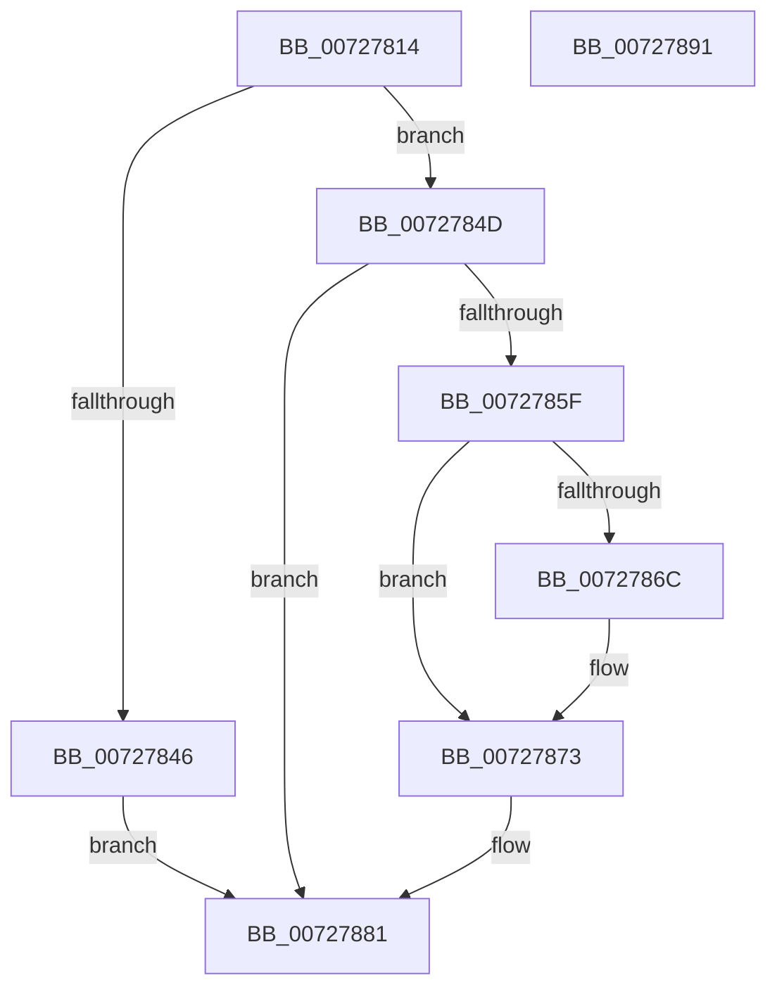

# PipAddBindingId

- RVA: `0x00727814`–`0x00727892` (길이 `126` bytes)
- VA: `0x0000000140727814`
- 실행 섹션: `PAGE`
- PDB 이름 있음: `예`; PDB Function 태그: `아니요`
- unwind 정보 RVA: `0x00060BC4`
- 디코드: `37`개 명령, `126/126` bytes 표시
- 미해석 바이트: `0` (있으면 어셈블리에 `.byte`로 보존)

> 이 문서는 커널 이미지의 기계어와 PDB 기호를 분석해 생성했습니다. 4번과 5번은 함수 원형과 자료형을 바이너리 사용 방식에서 추정한 C 해석이며 원본 소스 복구 결과는 아닙니다.

## 1. Dependencies

- 직접 호출 지점: **2**; 고유 호출 대상: **2**
- 직접 호출자로 확인된 함수: **2**
- RIP 상대 이미지 참조: **0**

### Outgoing calls
- `0x00727839` → [ExAllocatePool2](../../poolcode/B8/ExAllocatePool2_function_00B820F0.md) (function, `0x00B820F0`)
- `0x00727856` → [RtlDuplicateUnicodeString](../93/RtlDuplicateUnicodeString_function_009321F0.md) (function, `0x009321F0`)

### Direct callers
- [IoResolveDependency](../../text/4C/IoResolveDependency_function_004C4380.md) at `0x004C43FA`
- [IoResolveDependency](../../text/4C/IoResolveDependency_function_004C4380.md) at `0x004C446C`
- [PipCreateDependencyNode](PipCreateDependencyNode_function_00727B0C.md) at `0x00727BAA`

### Static image references
- 디코드된 RIP-relative 메모리 참조가 없습니다.

## 2. Other-region calls and transfers

- 다른 실행 섹션으로 향하는 call: **1**
  - `0x00727839` → [ExAllocatePool2](../../poolcode/B8/ExAllocatePool2_function_00B820F0.md) (`PAGE` → `POOLCODE`)
- 별도 외부 분기/꼬리 이동을 확인하지 못했습니다.

## 3. Assembly (complete function range)

```asm
00727814  48 89 5C 24 08                  mov qword ptr [rsp + 8], rbx
00727819  48 89 74 24 10                  mov qword ptr [rsp + 0x10], rsi
0072781E  57                              push rdi
0072781F  48 83 EC 20                     sub rsp, 0x20
00727823  48 8B F2                        mov rsi, rdx
00727826  48 8B F9                        mov rdi, rcx
00727829  BA 20 00 00 00                  mov edx, 0x20
0072782E  B9 00 01 00 00                  mov ecx, 0x100
00727833  41 B8 50 6E 70 53               mov r8d, 0x53706e50
00727839  E8 B2 A8 45 00                  call 0x140b820f0
0072783E  48 8B D8                        mov rbx, rax
00727841  48 85 C0                        test rax, rax
00727844  75 07                           jne 0x14072784d
00727846  B8 9A 00 00 C0                  mov eax, 0xc000009a
0072784B  EB 34                           jmp 0x140727881
0072784D  4C 8D 40 10                     lea r8, [rax + 0x10]
00727851  48 8B D6                        mov rdx, rsi
00727854  33 C9                           xor ecx, ecx
00727856  E8 95 A9 20 00                  call 0x1409321f0
0072785B  85 C0                           test eax, eax
0072785D  78 22                           js 0x140727881
0072785F  48 8D 4F 38                     lea rcx, [rdi + 0x38]
00727863  48 8B 51 08                     mov rdx, qword ptr [rcx + 8]
00727867  48 39 0A                        cmp qword ptr [rdx], rcx
0072786A  74 07                           je 0x140727873
0072786C  B9 03 00 00 00                  mov ecx, 3
00727871  CD 29                           int 0x29
00727873  48 89 0B                        mov qword ptr [rbx], rcx
00727876  48 89 53 08                     mov qword ptr [rbx + 8], rdx
0072787A  48 89 1A                        mov qword ptr [rdx], rbx
0072787D  48 89 59 08                     mov qword ptr [rcx + 8], rbx
00727881  48 8B 5C 24 30                  mov rbx, qword ptr [rsp + 0x30]
00727886  48 8B 74 24 38                  mov rsi, qword ptr [rsp + 0x38]
0072788B  48 83 C4 20                     add rsp, 0x20
0072788F  5F                              pop rdi
00727890  C3                              ret
00727891  CC                              int3
```

## 4. C-style interpretation (structured pseudocode)

```c
__int64 __fastcall PipAddBindingId(__int64 a1, __int64 a2)
{
    __int64 result;
    __int64 v_rsp;
    unsigned __int64 v_stack_p10;
    unsigned __int64 v_stack_p8;

    v_stack_p8 = v_rbx;
    v_stack_p10 = v_rsi;
    v_rsp = (v_rsp) - (32);
    result = ExAllocatePool2(256, 32, (unsigned int)(0x53706E50ULL), a4);
    if (result != 0) goto loc_0072784D;
    goto loc_00727881;
loc_0072784D:
    a1 = 0;
    result = RtlDuplicateUnicodeString(a1, a2, (unsigned int)(0xC000009AULL) + 16, a4);
    if (sign_flag) goto loc_00727881;
    if ((*(unsigned __int64 *)(*(unsigned __int64 *)(a1 + 56 + 8))) != (a1 + 56)) {
        a1 = 3;
    }
    *(unsigned __int64 *)(result) = a1;
    *(unsigned __int64 *)(result + 8) = *(unsigned __int64 *)(a1 + 56 + 8);
    *(unsigned __int64 *)(*(unsigned __int64 *)(a1 + 56 + 8)) = result;
    *(unsigned __int64 *)(a1 + 8) = result;
loc_00727881:
    v_rsp = (v_rsp) + (32);
    return result;
}
```

## 5. (Beta) C Style

```c
int64_t PipAddBindingId(void *Arg1, int64_t Arg2)
{
    uint8_t *arg1 = (uint8_t *)Arg1;

    int64_t result;
    int64_t local_rsp;
    uint64_t v_stack_p10;
    uint64_t v_stack_p8;

    v_stack_p8 = local_rbx;
    v_stack_p10 = local_rsi;
    local_rsp = (local_rsp) - (32);
    result = ExAllocatePool2(256, 32, (uint32_t)(0x53706E50ULL), a4);
    if (result != 0) goto loc_0072784D;
    goto loc_00727881;
loc_0072784D:
    Arg1 = 0;
    result = RtlDuplicateUnicodeString(Arg1, Arg2, (uint32_t)(0xC000009AULL) + 16, a4);
    if (sign_flag) goto loc_00727881;
    if ((*(uint64_t *)(*(uint64_t *)(arg1 + 0x38 + 0x8))) != (Arg1 + 56)) {
        Arg1 = 3;
    }
    *(void **)(result) = Arg1;
    *(uint64_t *)(result + 0x8) = *(uint64_t *)(arg1 + 0x38 + 0x8);
    *(uint64_t *)(*(uint64_t *)(arg1 + 0x38 + 0x8)) = result;
    *(uint64_t *)(arg1 + 0x8) = result;
loc_00727881:
    local_rsp = (local_rsp) + (32);
    return result;
}
```

### 관측된 메모리 오프셋

구조체 형식이 확인되지 않은 접근은 인자 기준의 오프셋으로만 기록했습니다.

| 기준 인자 | 오프셋 표현 | 폭 (bit) | 접근 |
|---|---:|---:|---|
| `Arg1` | `+ 0x8` | `64` | `R` |
| `Arg1` | `+ 0x38` | `64` | `R` |

## 6. Execution-region graph

[열기: 2D/3D 그래프와 함수 탐색 컨트롤 패널](../../../control-panel.html?section=page&rva=0x00727814&view=graph)

- 2D 그래프는 위에서 아래로 흐르고, 3D 그래프는 빈 공간을 드래그해 회전합니다. Shift+드래그는 이동, 휠은 확대·축소, 함수 노드 선택은 대상 보고서 이동입니다.

### Static fallback


