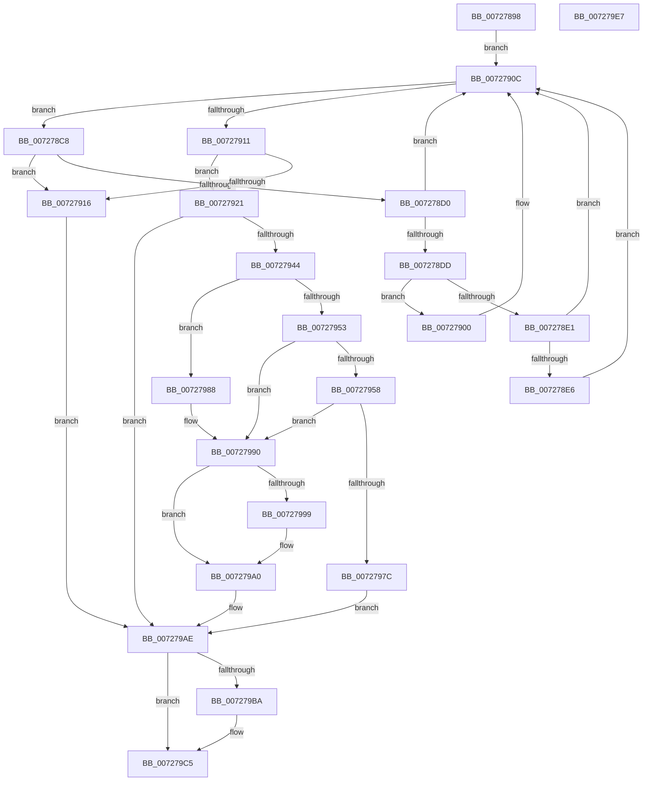

# PipAddRequestToEdge

- RVA: `0x00727898`–`0x007279E8` (길이 `336` bytes)
- VA: `0x0000000140727898`
- 실행 섹션: `PAGE`
- PDB 이름 있음: `예`; PDB Function 태그: `아니요`
- unwind 정보 RVA: `0x0008A350`
- 디코드: `107`개 명령, `336/336` bytes 표시
- 미해석 바이트: `0` (있으면 어셈블리에 `.byte`로 보존)

> 이 문서는 커널 이미지의 기계어와 PDB 기호를 분석해 생성했습니다. 4번과 5번은 함수 원형과 자료형을 바이너리 사용 방식에서 추정한 C 해석이며 원본 소스 복구 결과는 아닙니다.

## 1. Dependencies

- 직접 호출 지점: **6**; 고유 호출 대상: **5**
- 직접 호출자로 확인된 함수: **3**
- RIP 상대 이미지 참조: **0**

### Outgoing calls
- `0x007278F1` → [RtlEqualUnicodeString](../93/RtlEqualUnicodeString_function_00932A20.md) (function, `0x00932A20`)
- `0x00727937` → [ExAllocatePool2](../../poolcode/B8/ExAllocatePool2_function_00B820F0.md) (function, `0x00B820F0`)
- `0x00727961` → [ExAllocatePool2](../../poolcode/B8/ExAllocatePool2_function_00B820F0.md) (function, `0x00B820F0`)
- `0x00727973` → [RtlDuplicateUnicodeString](../93/RtlDuplicateUnicodeString_function_009321F0.md) (function, `0x009321F0`)
- `0x0072797F` → [PipFreeBindingRequestEntry](PipFreeBindingRequestEntry_function_00727C84.md) (function, `0x00727C84`)
- `0x007279C0` → [PipMergeDependencyTypes](../../text/5A/PipMergeDependencyTypes_function_005A56CC.md) (function, `0x005A56CC`)

### Direct callers
- [PipAddDependencyEdgeBetweenNodes](../../text/5A/PipAddDependencyEdgeBetweenNodes_function_005A5520.md) at `0x005A5555`
- [PipCreateNewDependencyEdge](../../text/5A/PipCreateNewDependencyEdge_function_005A55BC.md) at `0x005A5615`
- [PipMergeDependencyEdgeList](PipMergeDependencyEdgeList_function_00727D4C.md) at `0x00727E1D`

### Static image references
- 디코드된 RIP-relative 메모리 참조가 없습니다.

## 2. Other-region calls and transfers

- 다른 실행 섹션으로 향하는 call: **3**
  - `0x00727937` → [ExAllocatePool2](../../poolcode/B8/ExAllocatePool2_function_00B820F0.md) (`PAGE` → `POOLCODE`)
  - `0x00727961` → [ExAllocatePool2](../../poolcode/B8/ExAllocatePool2_function_00B820F0.md) (`PAGE` → `POOLCODE`)
  - `0x007279C0` → [PipMergeDependencyTypes](../../text/5A/PipMergeDependencyTypes_function_005A56CC.md) (`PAGE` → `.text`)
- 별도 외부 분기/꼬리 이동을 확인하지 못했습니다.

## 3. Assembly (complete function range)

```asm
00727898  48 8B C4                        mov rax, rsp
0072789B  48 89 58 08                     mov qword ptr [rax + 8], rbx
0072789F  48 89 68 10                     mov qword ptr [rax + 0x10], rbp
007278A3  48 89 70 18                     mov qword ptr [rax + 0x18], rsi
007278A7  48 89 78 20                     mov qword ptr [rax + 0x20], rdi
007278AB  41 55                           push r13
007278AD  41 56                           push r14
007278AF  41 57                           push r15
007278B1  48 83 EC 20                     sub rsp, 0x20
007278B5  33 FF                           xor edi, edi
007278B7  4C 8D 71 38                     lea r14, [rcx + 0x38]
007278BB  4D 8B 3E                        mov r15, qword ptr [r14]
007278BE  33 DB                           xor ebx, ebx
007278C0  48 8B F2                        mov rsi, rdx
007278C3  4C 8B E9                        mov r13, rcx
007278C6  EB 44                           jmp 0x14072790c
007278C8  49 8B EF                        mov rbp, r15
007278CB  48 85 DB                        test rbx, rbx
007278CE  75 46                           jne 0x140727916
007278D0  49 8B CF                        mov rcx, r15
007278D3  4D 8B 3F                        mov r15, qword ptr [r15]
007278D6  8B 51 10                        mov edx, dword ptr [rcx + 0x10]
007278D9  3B 16                           cmp edx, dword ptr [rsi]
007278DB  75 2F                           jne 0x14072790c
007278DD  85 D2                           test edx, edx
007278DF  74 1F                           je 0x140727900
007278E1  83 FA 01                        cmp edx, 1
007278E4  75 26                           jne 0x14072790c
007278E6  48 8B 56 08                     mov rdx, qword ptr [rsi + 8]
007278EA  45 33 C0                        xor r8d, r8d
007278ED  48 8B 49 18                     mov rcx, qword ptr [rcx + 0x18]
007278F1  E8 2A B1 20 00                  call 0x140932a20
007278F6  F6 D8                           neg al
007278F8  48 1B DB                        sbb rbx, rbx
007278FB  48 23 DD                        and rbx, rbp
007278FE  EB 0C                           jmp 0x14072790c
00727900  48 8B 46 08                     mov rax, qword ptr [rsi + 8]
00727904  48 39 41 18                     cmp qword ptr [rcx + 0x18], rax
00727908  48 0F 44 D9                     cmove rbx, rcx
0072790C  4D 3B FE                        cmp r15, r14
0072790F  75 B7                           jne 0x1407278c8
00727911  48 85 DB                        test rbx, rbx
00727914  74 0B                           je 0x140727921
00727916  8B 46 10                        mov eax, dword ptr [rsi + 0x10]
00727919  09 43 20                        or dword ptr [rbx + 0x20], eax
0072791C  E9 8D 00 00 00                  jmp 0x1407279ae
00727921  BD 50 6E 70 53                  mov ebp, 0x53706e50
00727926  41 BF 00 01 00 00               mov r15d, 0x100
0072792C  44 8B C5                        mov r8d, ebp
0072792F  41 8B CF                        mov ecx, r15d
00727932  BA 28 00 00 00                  mov edx, 0x28
00727937  E8 B4 A7 45 00                  call 0x140b820f0
0072793C  48 8B F8                        mov rdi, rax
0072793F  48 85 C0                        test rax, rax
00727942  74 6A                           je 0x1407279ae
00727944  8B 56 10                        mov edx, dword ptr [rsi + 0x10]
00727947  89 50 20                        mov dword ptr [rax + 0x20], edx
0072794A  8B 06                           mov eax, dword ptr [rsi]
0072794C  89 47 10                        mov dword ptr [rdi + 0x10], eax
0072794F  85 C0                           test eax, eax
00727951  74 35                           je 0x140727988
00727953  83 F8 01                        cmp eax, 1
00727956  75 38                           jne 0x140727990
00727958  44 8B C5                        mov r8d, ebp
0072795B  8D 50 0F                        lea edx, [rax + 0xf]
0072795E  41 8B CF                        mov ecx, r15d
00727961  E8 8A A7 45 00                  call 0x140b820f0
00727966  48 89 47 18                     mov qword ptr [rdi + 0x18], rax
0072796A  4C 8B C0                        mov r8, rax
0072796D  48 8B 56 08                     mov rdx, qword ptr [rsi + 8]
00727971  33 C9                           xor ecx, ecx
00727973  E8 78 A8 20 00                  call 0x1409321f0
00727978  85 C0                           test eax, eax
0072797A  79 14                           jns 0x140727990
0072797C  48 8B CF                        mov rcx, rdi
0072797F  E8 00 03 00 00                  call 0x140727c84
00727984  33 FF                           xor edi, edi
00727986  EB 26                           jmp 0x1407279ae
00727988  48 8B 46 08                     mov rax, qword ptr [rsi + 8]
0072798C  48 89 47 18                     mov qword ptr [rdi + 0x18], rax
00727990  49 8B 46 08                     mov rax, qword ptr [r14 + 8]
00727994  4C 39 30                        cmp qword ptr [rax], r14
00727997  74 07                           je 0x1407279a0
00727999  B9 03 00 00 00                  mov ecx, 3
0072799E  CD 29                           int 0x29
007279A0  4C 89 37                        mov qword ptr [rdi], r14
007279A3  48 89 47 08                     mov qword ptr [rdi + 8], rax
007279A7  48 89 38                        mov qword ptr [rax], rdi
007279AA  49 89 7E 08                     mov qword ptr [r14 + 8], rdi
007279AE  48 85 DB                        test rbx, rbx
007279B1  48 0F 44 DF                     cmove rbx, rdi
007279B5  48 85 DB                        test rbx, rbx
007279B8  74 0B                           je 0x1407279c5
007279BA  8B 56 10                        mov edx, dword ptr [rsi + 0x10]
007279BD  49 8B CD                        mov rcx, r13
007279C0  E8 07 DD E7 FF                  call 0x1405a56cc
007279C5  48 8B 6C 24 48                  mov rbp, qword ptr [rsp + 0x48]
007279CA  48 8B C3                        mov rax, rbx
007279CD  48 8B 5C 24 40                  mov rbx, qword ptr [rsp + 0x40]
007279D2  48 8B 74 24 50                  mov rsi, qword ptr [rsp + 0x50]
007279D7  48 8B 7C 24 58                  mov rdi, qword ptr [rsp + 0x58]
007279DC  48 83 C4 20                     add rsp, 0x20
007279E0  41 5F                           pop r15
007279E2  41 5E                           pop r14
007279E4  41 5D                           pop r13
007279E6  C3                              ret
007279E7  CC                              int3
```

## 4. C-style interpretation (structured pseudocode)

```c
__int64 __fastcall PipAddRequestToEdge(__int64 a1, __int64 a2, int a3)
{
    __int64 result;
    __int64 v_rbx;
    __int64 v_rdi;
    __int64 v_rsp;
    unsigned __int64 v_stack_p10;
    unsigned __int64 v_stack_p18;
    unsigned __int64 v_stack_p20;
    unsigned __int64 v_stack_p8;

    *(unsigned __int64 *)(v_rsp + 8) = v_rbx;
    *(unsigned __int64 *)(v_rsp + 16) = v_rbp;
    *(unsigned __int64 *)(v_rsp + 24) = v_rsi;
    *(unsigned __int64 *)(v_rsp + 32) = v_rdi;
    v_rsp = (v_rsp) - (32);
    v_rdi = 0;
    v_rbx = 0;
    goto loc_0072790C;
loc_007278C8:
    if (0 != 0) goto loc_00727916;
    if (((unsigned int)((unsigned int)(*(unsigned int *)(*(unsigned __int64 *)(a1 + 56) + 16)))) != (*(unsigned int *)(a2))) goto loc_0072790C;
    if ((unsigned int)((unsigned int)(*(unsigned int *)(*(unsigned __int64 *)(a1 + 56) + 16))) == 0) goto loc_00727900;
    if (((unsigned int)((unsigned int)(*(unsigned int *)(*(unsigned __int64 *)(a1 + 56) + 16)))) != 1) goto loc_0072790C;
    a3 = 0;
    result = RtlEqualUnicodeString(*(unsigned __int64 *)(*(unsigned __int64 *)(a1 + 56) + 24), *(unsigned __int64 *)(a2 + 8), a3, a4);
    result = (unsigned __int8)(-(result));
    v_rbx = (v_rbx) & (*(unsigned __int64 *)(a1 + 56));
    goto loc_0072790C;
loc_00727900:
    if ((*(unsigned __int64 *)(*(unsigned __int64 *)(*(unsigned __int64 *)(a1 + 56) + 24) + 24)) == (*(unsigned __int64 *)(a2 + 8))) { v_rbx = *(unsigned __int64 *)(*(unsigned __int64 *)(a1 + 56) + 24); }
loc_0072790C:
    if ((*(unsigned __int64 *)(*(unsigned __int64 *)(a1 + 56))) != (a1 + 56)) goto loc_007278C8;
    if (v_rbx == 0) goto loc_00727921;
loc_00727916:
    goto loc_007279AE;
loc_00727921:
    result = ExAllocatePool2(256, 40, (unsigned int)((unsigned int)((unsigned int)(0x53706E50ULL))), a4);
    if (result == 0) goto loc_007279AE;
    *(unsigned int *)(result + 32) = (unsigned int)((unsigned int)(*(unsigned int *)(a2 + 16)));
    *(unsigned int *)(result + 16) = (unsigned int)((unsigned int)(*(unsigned int *)(a2)));
    if ((unsigned int)((unsigned int)(*(unsigned int *)(a2))) == 0) goto loc_00727988;
    if (((unsigned int)((unsigned int)(*(unsigned int *)(a2)))) != 1) goto loc_00727990;
    result = ExAllocatePool2(256, (unsigned int)(*(unsigned int *)(a2)) + 15, (unsigned int)((unsigned int)((unsigned int)(0x53706E50ULL))), a4);
    *(unsigned __int64 *)(result + 24) = result;
    a1 = 0;
    result = RtlDuplicateUnicodeString(a1, *(unsigned __int64 *)(a2 + 8), result, a4);
    if (!sign_flag) goto loc_00727990;
    result = PipFreeBindingRequestEntry(result, *(unsigned __int64 *)(a2 + 8), result, a4);
    v_rdi = 0;
    goto loc_007279AE;
loc_00727988:
    *(unsigned __int64 *)(v_rdi + 24) = *(unsigned __int64 *)(a2 + 8);
loc_00727990:
    if ((*(unsigned __int64 *)(*(unsigned __int64 *)(a1 + 56 + 8))) != (a1 + 56)) {
        a1 = 3;
    }
    *(unsigned __int64 *)(v_rdi) = a1 + 56;
    *(unsigned __int64 *)(v_rdi + 8) = *(unsigned __int64 *)(a1 + 56 + 8);
    *(unsigned __int64 *)(*(unsigned __int64 *)(a1 + 56 + 8)) = 0;
    *(unsigned __int64 *)(a1 + 56 + 8) = 0;
loc_007279AE:
    if (v_rbx == 0) { v_rbx = 0; }
    result = *(unsigned __int64 *)(a1 + 56 + 8);
    if (v_rbx != 0) {
        a2 = *(unsigned int *)(a2 + 16);
        a1 = a1;
        result = PipMergeDependencyTypes(a1, a2, result, a4);
    }
    v_rsp = (v_rsp) + (32);
    return v_rbx;
}
```

## 5. (Beta) C Style

```c
int64_t PipAddRequestToEdge(void *Arg1, void *Arg2, int32_t Arg3)
{
    uint8_t *arg1 = (uint8_t *)Arg1;
    uint8_t *arg2 = (uint8_t *)Arg2;

    int64_t result;
    int64_t local_rbx;
    int64_t local_rdi;
    int64_t local_rsp;
    uint64_t v_stack_p10;
    uint64_t v_stack_p18;
    uint64_t v_stack_p20;
    uint64_t v_stack_p8;

    *(uint64_t *)(local_rsp + 0x8) = local_rbx;
    *(uint64_t *)(local_rsp + 0x10) = local_rbp;
    *(uint64_t *)(local_rsp + 0x18) = local_rsi;
    *(uint64_t *)(local_rsp + 0x20) = local_rdi;
    local_rsp = (local_rsp) - (32);
    local_rdi = 0;
    local_rbx = 0;
    goto loc_0072790C;
loc_007278C8:
    if (0 != 0) goto loc_00727916;
    if (((uint32_t)((uint32_t)(*(uint32_t *)(*(uint64_t *)(arg1 + 0x38) + 0x10)))) != (*(uint32_t *)(arg2))) goto loc_0072790C;
    if ((uint32_t)((uint32_t)(*(uint32_t *)(*(uint64_t *)(arg1 + 0x38) + 0x10))) == 0) goto loc_00727900;
    if (((uint32_t)((uint32_t)(*(uint32_t *)(*(uint64_t *)(arg1 + 0x38) + 0x10)))) != 1) goto loc_0072790C;
    Arg3 = 0;
    result = RtlEqualUnicodeString(*(uint64_t *)(*(uint64_t *)(arg1 + 0x38) + 0x18), *(uint64_t *)(arg2 + 0x8), Arg3, a4);
    result = (uint8_t)(-(result));
    local_rbx = (local_rbx) & (*(uint64_t *)(arg1 + 0x38));
    goto loc_0072790C;
loc_00727900:
    if ((*(uint64_t *)(*(uint64_t *)(*(uint64_t *)(arg1 + 0x38) + 0x18) + 0x18)) == (*(uint64_t *)(arg2 + 0x8))) { local_rbx = *(uint64_t *)(*(uint64_t *)(arg1 + 0x38) + 0x18); }
loc_0072790C:
    if ((*(uint64_t *)(*(uint64_t *)(arg1 + 0x38))) != (Arg1 + 56)) goto loc_007278C8;
    if (local_rbx == 0) goto loc_00727921;
loc_00727916:
    goto loc_007279AE;
loc_00727921:
    result = ExAllocatePool2(256, 40, (uint32_t)((uint32_t)((uint32_t)(0x53706E50ULL))), a4);
    if (result == 0) goto loc_007279AE;
    *(uint32_t *)(result + 0x20) = (uint32_t)((uint32_t)(*(uint32_t *)(arg2 + 0x10)));
    *(uint32_t *)(result + 0x10) = (uint32_t)((uint32_t)(*(uint32_t *)(arg2)));
    if ((uint32_t)((uint32_t)(*(uint32_t *)(arg2))) == 0) goto loc_00727988;
    if (((uint32_t)((uint32_t)(*(uint32_t *)(arg2)))) != 1) goto loc_00727990;
    result = ExAllocatePool2(256, (uint32_t)(*(uint32_t *)(arg2)) + 15, (uint32_t)((uint32_t)((uint32_t)(0x53706E50ULL))), a4);
    *(uint64_t *)(result + 0x18) = result;
    Arg1 = 0;
    result = RtlDuplicateUnicodeString(Arg1, *(uint64_t *)(arg2 + 0x8), result, a4);
    if (!sign_flag) goto loc_00727990;
    result = PipFreeBindingRequestEntry(result, *(uint64_t *)(arg2 + 0x8), result, a4);
    local_rdi = 0;
    goto loc_007279AE;
loc_00727988:
    *(uint64_t *)(local_rdi + 0x18) = *(uint64_t *)(arg2 + 0x8);
loc_00727990:
    if ((*(uint64_t *)(*(uint64_t *)(arg1 + 0x38 + 0x8))) != (Arg1 + 56)) {
        Arg1 = 3;
    }
    *(void **)(local_rdi) = Arg1 + 56;
    *(uint64_t *)(local_rdi + 0x8) = *(uint64_t *)(arg1 + 0x38 + 0x8);
    *(uint64_t *)(*(uint64_t *)(arg1 + 0x38 + 0x8)) = 0;
    *(uint64_t *)(arg1 + 0x38 + 0x8) = 0;
loc_007279AE:
    if (local_rbx == 0) { local_rbx = 0; }
    result = *(uint64_t *)(arg1 + 0x38 + 0x8);
    if (local_rbx != 0) {
        Arg2 = *(uint32_t *)(arg2 + 0x10);
        Arg1 = Arg1;
        result = PipMergeDependencyTypes(Arg1, Arg2, result, a4);
    }
    local_rsp = (local_rsp) + (32);
    return local_rbx;
}
```

### 관측된 메모리 오프셋

구조체 형식이 확인되지 않은 접근은 인자 기준의 오프셋으로만 기록했습니다.

| 기준 인자 | 오프셋 표현 | 폭 (bit) | 접근 |
|---|---:|---:|---|
| `Arg1` | `+ 0x0` | `64` | `R` |
| `Arg1` | `+ 0x8` | `64` | `R` |
| `Arg1` | `+ 0x8` | `64` | `W` |
| `Arg1` | `+ 0x38` | `64` | `R` |
| `Arg2` | `+ 0x0` | `32` | `R` |
| `Arg2` | `+ 0x8` | `64` | `R` |
| `Arg2` | `+ 0x10` | `32` | `R` |

## 6. Execution-region graph

[열기: 2D/3D 그래프와 함수 탐색 컨트롤 패널](../../../control-panel.html?section=page&rva=0x00727898&view=graph)

- 2D 그래프는 위에서 아래로 흐르고, 3D 그래프는 빈 공간을 드래그해 회전합니다. Shift+드래그는 이동, 휠은 확대·축소, 함수 노드 선택은 대상 보고서 이동입니다.

### Static fallback


