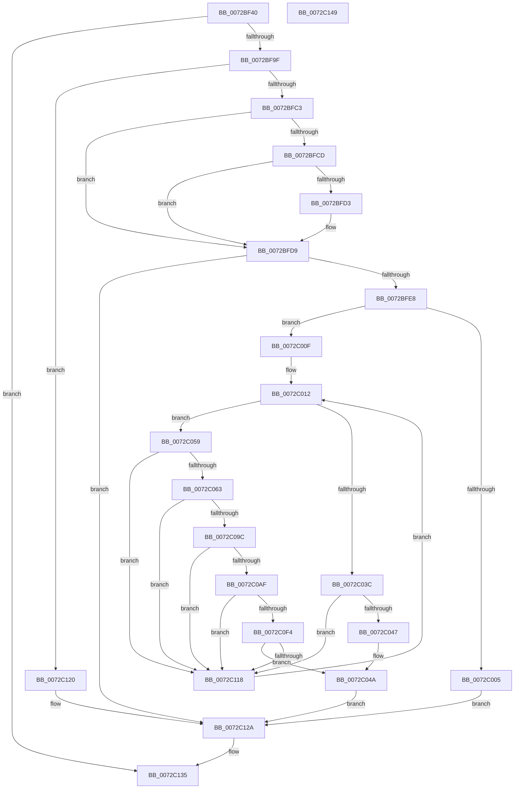

# PipApplyFunctionToServiceInstances

- RVA: `0x0072BF40`–`0x0072C14A` (길이 `522` bytes)
- VA: `0x000000014072BF40`
- 실행 섹션: `PAGE`
- PDB 이름 있음: `예`; PDB Function 태그: `아니요`
- unwind 정보 RVA: `0x000C86BC`
- 디코드: `140`개 명령, `522/522` bytes 표시
- 미해석 바이트: `0` (있으면 어셈블리에 `.byte`로 보존)

> 이 문서는 커널 이미지의 기계어와 PDB 기호를 분석해 생성했습니다. 4번과 5번은 함수 원형과 자료형을 바이너리 사용 방식에서 추정한 C 해석이며 원본 소스 복구 결과는 아닙니다.

## 1. Dependencies

- 직접 호출 지점: **13**; 고유 호출 대상: **11**
- 직접 호출자로 확인된 함수: **2**
- RIP 상대 이미지 참조: **2**

### Outgoing calls
- `0x0072BF92` → [PipOpenServiceEnumKeys](../99/PipOpenServiceEnumKeys_function_00998E94.md) (function, `0x00998E94`)
- `0x0072BFB4` → [IopGetRegistryValue](../99/IopGetRegistryValue_function_009990EC.md) (function, `0x009990EC`)
- `0x0072BFDB` → [ExFreePoolWithTag](../../poolcode/B8/ExFreePoolWithTag_function_00B82870.md) (function, `0x00B82870`)
- `0x0072BFF8` → [ExAllocatePool2](../../poolcode/B8/ExAllocatePool2_function_00B820F0.md) (function, `0x00B820F0`)
- `0x0072C033` → [ZwEnumerateValueKey](../../text/6A/ZwEnumerateValueKey_function_006AD330.md) (function, `0x006AD330`)
- `0x0072C04F` → [ExFreePoolWithTag](../../poolcode/B8/ExFreePoolWithTag_function_00B82870.md) (function, `0x00B82870`)
- `0x0072C079` → [PnpRegSzToString](../A5/PnpRegSzToString_function_00A5DC40.md) (function, `0x00A5DC40`)
- `0x0072C0A6` → [PnpUnicodeStringToWstr](../9D/PnpUnicodeStringToWstr_function_009D90C0.md) (function, `0x009D90C0`)
- `0x0072C0DC` → [_CmOpenDeviceRegKey](../8E/_CmOpenDeviceRegKey_function_008EE540.md) (function, `0x008EE540`)
- `0x0072C0EB` → [PnpUnicodeStringToWstrFree](../8F/PnpUnicodeStringToWstrFree_function_008F59F0.md) (function, `0x008F59F0`)
- `0x0072C100` → [PipAddDevicesToBootDriverWorker](../../init/C3/PipAddDevicesToBootDriverWorker_function_00C30448.md) (function, `0x00C30448`)
- `0x0072C10B` → [ZwClose](../../text/6A/ZwClose_function_006AD2B0.md) (function, `0x006AD2B0`)
- `0x0072C12E` → [ZwClose](../../text/6A/ZwClose_function_006AD2B0.md) (function, `0x006AD2B0`)

### Direct callers
- [IopInitializeBootDrivers](../../init/C2/IopInitializeBootDrivers_function_00C2E6F4.md) at `0x00C2ECAC`
- [PipInitializeCoreDriversByGroup](../../init/C7/PipInitializeCoreDriversByGroup_function_00C740DC.md) at `0x00C741EF`

### Static image references
- `0x0072BFAA` → RVA `0x00AFDA90` (` ?? ::NNGAKEGL::`string'`; read)
- `0x0072C0B7` → RVA `0x00E66398` (`.data`; read)

## 2. Other-region calls and transfers

- 다른 실행 섹션으로 향하는 call: **7**
  - `0x0072BFDB` → [ExFreePoolWithTag](../../poolcode/B8/ExFreePoolWithTag_function_00B82870.md) (`PAGE` → `POOLCODE`)
  - `0x0072BFF8` → [ExAllocatePool2](../../poolcode/B8/ExAllocatePool2_function_00B820F0.md) (`PAGE` → `POOLCODE`)
  - `0x0072C033` → [ZwEnumerateValueKey](../../text/6A/ZwEnumerateValueKey_function_006AD330.md) (`PAGE` → `.text`)
  - `0x0072C04F` → [ExFreePoolWithTag](../../poolcode/B8/ExFreePoolWithTag_function_00B82870.md) (`PAGE` → `POOLCODE`)
  - `0x0072C100` → [PipAddDevicesToBootDriverWorker](../../init/C3/PipAddDevicesToBootDriverWorker_function_00C30448.md) (`PAGE` → `INIT`)
  - `0x0072C10B` → [ZwClose](../../text/6A/ZwClose_function_006AD2B0.md) (`PAGE` → `.text`)
  - `0x0072C12E` → [ZwClose](../../text/6A/ZwClose_function_006AD2B0.md) (`PAGE` → `.text`)
- 별도 외부 분기/꼬리 이동을 확인하지 못했습니다.

## 3. Assembly (complete function range)

```asm
0072BF40  48 8B C4                        mov rax, rsp
0072BF43  48 89 58 10                     mov qword ptr [rax + 0x10], rbx
0072BF47  44 88 48 20                     mov byte ptr [rax + 0x20], r9b
0072BF4B  44 89 40 18                     mov dword ptr [rax + 0x18], r8d
0072BF4F  48 89 48 08                     mov qword ptr [rax + 8], rcx
0072BF53  55                              push rbp
0072BF54  56                              push rsi
0072BF55  57                              push rdi
0072BF56  41 56                           push r14
0072BF58  41 57                           push r15
0072BF5A  48 8B EC                        mov rbp, rsp
0072BF5D  48 83 EC 60                     sub rsp, 0x60
0072BF61  45 33 FF                        xor r15d, r15d
0072BF64  4C 8D 4D 30                     lea r9, [rbp + 0x30]
0072BF68  48 8B CA                        mov rcx, rdx
0072BF6B  4C 89 7D 30                     mov qword ptr [rbp + 0x30], r15
0072BF6F  0F 57 C0                        xorps xmm0, xmm0
0072BF72  4C 89 7D 60                     mov qword ptr [rbp + 0x60], r15
0072BF76  BA 19 00 02 00                  mov edx, 0x20019
0072BF7B  44 89 7D 40                     mov dword ptr [rbp + 0x40], r15d
0072BF7F  45 33 C0                        xor r8d, r8d
0072BF82  4C 89 7D E0                     mov qword ptr [rbp - 0x20], r15
0072BF86  0F 11 45 E8                     movups xmmword ptr [rbp - 0x18], xmm0
0072BF8A  4C 89 7D 50                     mov qword ptr [rbp + 0x50], r15
0072BF8E  44 88 78 98                     mov byte ptr [rax - 0x68], r15b
0072BF92  E8 FD CE 26 00                  call 0x140998e94
0072BF97  85 C0                           test eax, eax
0072BF99  0F 88 96 01 00 00               js 0x14072c135
0072BF9F  48 8B 4D 30                     mov rcx, qword ptr [rbp + 0x30]
0072BFA3  4C 8D 4D E0                     lea r9, [rbp - 0x20]
0072BFA7  45 33 C0                        xor r8d, r8d
0072BFAA  48 8D 15 DF 1A 3D 00            lea rdx, [rip + 0x3d1adf]
0072BFB1  41 8B DF                        mov ebx, r15d
0072BFB4  E8 33 D1 26 00                  call 0x1409990ec
0072BFB9  8B F8                           mov edi, eax
0072BFBB  85 C0                           test eax, eax
0072BFBD  0F 88 5D 01 00 00               js 0x14072c120
0072BFC3  48 8B 4D E0                     mov rcx, qword ptr [rbp - 0x20]
0072BFC7  83 79 04 04                     cmp dword ptr [rcx + 4], 4
0072BFCB  75 0C                           jne 0x14072bfd9
0072BFCD  83 79 0C 04                     cmp dword ptr [rcx + 0xc], 4
0072BFD1  72 06                           jb 0x14072bfd9
0072BFD3  8B 41 08                        mov eax, dword ptr [rcx + 8]
0072BFD6  8B 1C 08                        mov ebx, dword ptr [rax + rcx]
0072BFD9  33 D2                           xor edx, edx
0072BFDB  E8 90 68 45 00                  call 0x140b82870
0072BFE0  85 DB                           test ebx, ebx
0072BFE2  0F 84 42 01 00 00               je 0x14072c12a
0072BFE8  BA 00 02 00 00                  mov edx, 0x200
0072BFED  B9 00 01 00 00                  mov ecx, 0x100
0072BFF2  41 B8 50 70 20 20               mov r8d, 0x20207050
0072BFF8  E8 F3 60 45 00                  call 0x140b820f0
0072BFFD  48 8B F0                        mov rsi, rax
0072C000  48 85 C0                        test rax, rax
0072C003  75 0A                           jne 0x14072c00f
0072C005  BF 9A 00 00 C0                  mov edi, 0xc000009a
0072C00A  E9 1B 01 00 00                  jmp 0x14072c12a
0072C00F  45 8B F7                        mov r14d, r15d
0072C012  48 8B 4D 30                     mov rcx, qword ptr [rbp + 0x30]
0072C016  48 8D 45 40                     lea rax, [rbp + 0x40]
0072C01A  48 89 44 24 28                  mov qword ptr [rsp + 0x28], rax
0072C01F  4C 8B CE                        mov r9, rsi
0072C022  41 B8 01 00 00 00               mov r8d, 1
0072C028  C7 44 24 20 00 02 00 00         mov dword ptr [rsp + 0x20], 0x200
0072C030  41 8B D6                        mov edx, r14d
0072C033  E8 F8 12 F8 FF                  call 0x1406ad330
0072C038  85 C0                           test eax, eax
0072C03A  79 1D                           jns 0x14072c059
0072C03C  3D 1A 00 00 80                  cmp eax, 0x8000001a
0072C041  0F 85 D1 00 00 00               jne 0x14072c118
0072C047  41 8B FF                        mov edi, r15d
0072C04A  33 D2                           xor edx, edx
0072C04C  48 8B CE                        mov rcx, rsi
0072C04F  E8 1C 68 45 00                  call 0x140b82870
0072C054  E9 D1 00 00 00                  jmp 0x14072c12a
0072C059  83 7E 04 01                     cmp dword ptr [rsi + 4], 1
0072C05D  0F 85 B5 00 00 00               jne 0x14072c118
0072C063  66 44 89 7D E8                  mov word ptr [rbp - 0x18], r15w
0072C068  4C 8D 45 48                     lea r8, [rbp + 0x48]
0072C06C  8B 4E 08                        mov ecx, dword ptr [rsi + 8]
0072C06F  8B 56 0C                        mov edx, dword ptr [rsi + 0xc]
0072C072  48 03 CE                        add rcx, rsi
0072C075  44 89 7D 48                     mov dword ptr [rbp + 0x48], r15d
0072C079  E8 C2 1B 33 00                  call 0x140a5dc40
0072C07E  8B 4D 48                        mov ecx, dword ptr [rbp + 0x48]
0072C081  66 89 4D E8                     mov word ptr [rbp - 0x18], cx
0072C085  0F B7 46 0C                     movzx eax, word ptr [rsi + 0xc]
0072C089  66 89 45 EA                     mov word ptr [rbp - 0x16], ax
0072C08D  8B 46 08                        mov eax, dword ptr [rsi + 8]
0072C090  48 03 C6                        add rax, rsi
0072C093  48 89 45 F0                     mov qword ptr [rbp - 0x10], rax
0072C097  66 85 C9                        test cx, cx
0072C09A  74 7C                           je 0x14072c118
0072C09C  4C 8D 45 E8                     lea r8, [rbp - 0x18]
0072C0A0  33 D2                           xor edx, edx
0072C0A2  48 8D 4D 50                     lea rcx, [rbp + 0x50]
0072C0A6  E8 15 D0 2A 00                  call 0x1409d90c0
0072C0AB  85 C0                           test eax, eax
0072C0AD  78 69                           js 0x14072c118
0072C0AF  48 8B 55 50                     mov rdx, qword ptr [rbp + 0x50]
0072C0B3  48 8D 45 60                     lea rax, [rbp + 0x60]
0072C0B7  48 8B 0D DA A2 73 00            mov rcx, qword ptr [rip + 0x73a2da]
0072C0BE  45 33 C9                        xor r9d, r9d
0072C0C1  4C 89 7C 24 38                  mov qword ptr [rsp + 0x38], r15
0072C0C6  48 89 44 24 30                  mov qword ptr [rsp + 0x30], rax
0072C0CB  44 88 7C 24 28                  mov byte ptr [rsp + 0x28], r15b
0072C0D0  45 8D 41 10                     lea r8d, [r9 + 0x10]
0072C0D4  C7 44 24 20 3F 00 0F 00         mov dword ptr [rsp + 0x20], 0xf003f
0072C0DC  E8 5F 24 1C 00                  call 0x1408ee540
0072C0E1  48 8B 4D 50                     mov rcx, qword ptr [rbp + 0x50]
0072C0E5  48 8D 55 E8                     lea rdx, [rbp - 0x18]
0072C0E9  8B F8                           mov edi, eax
0072C0EB  E8 00 99 1C 00                  call 0x1408f59f0
0072C0F0  85 FF                           test edi, edi
0072C0F2  78 24                           js 0x14072c118
0072C0F4  4C 8B 45 58                     mov r8, qword ptr [rbp + 0x58]
0072C0F8  48 8D 55 E8                     lea rdx, [rbp - 0x18]
0072C0FC  48 8B 4D 60                     mov rcx, qword ptr [rbp + 0x60]
0072C100  E8 43 43 50 00                  call 0x140c30448
0072C105  48 8B 4D 60                     mov rcx, qword ptr [rbp + 0x60]
0072C109  8B D8                           mov ebx, eax
0072C10B  E8 A0 11 F8 FF                  call 0x1406ad2b0
0072C110  85 DB                           test ebx, ebx
0072C112  0F 84 32 FF FF FF               je 0x14072c04a
0072C118  41 FF C6                        inc r14d
0072C11B  E9 F2 FE FF FF                  jmp 0x14072c012
0072C120  81 FF 34 00 00 C0               cmp edi, 0xc0000034
0072C126  41 0F 44 FF                     cmove edi, r15d
0072C12A  48 8B 4D 30                     mov rcx, qword ptr [rbp + 0x30]
0072C12E  E8 7D 11 F8 FF                  call 0x1406ad2b0
0072C133  8B C7                           mov eax, edi
0072C135  48 8B 9C 24 98 00 00 00         mov rbx, qword ptr [rsp + 0x98]
0072C13D  48 83 C4 60                     add rsp, 0x60
0072C141  41 5F                           pop r15
0072C143  41 5E                           pop r14
0072C145  5F                              pop rdi
0072C146  5E                              pop rsi
0072C147  5D                              pop rbp
0072C148  C3                              ret
0072C149  CC                              int3
```

## 4. C-style interpretation (structured pseudocode)

```c
__int64 __fastcall PipApplyFunctionToServiceInstances(__int64 a1, __int64 a2, int a3, unsigned __int8 a4, __int64 a5, __int64 a6, __int64 a7)
{
    __int64 result;
    __int64 v_r14;
    __int64 v_r15;
    __int64 v_rbx;
    __int64 v_rdi;
    __int64 v_rsp;
    unsigned __int64 v_stack_m38;
    unsigned __int16 v_stack_m3E;
    unsigned __int64 v_stack_m40;
    unsigned __int64 v_stack_m48;
    unsigned __int64 v_stack_m50;
    unsigned __int64 v_stack_m58;
    unsigned __int64 v_stack_m60;
    unsigned int v_stack_m68;
    unsigned __int64 v_stack_p10;
    unsigned int v_stack_p18;
    unsigned __int64 v_stack_p20;
    unsigned __int64 v_stack_p28;
    unsigned __int64 v_stack_p38;
    unsigned __int64 v_stack_p8;

    *(unsigned __int64 *)(v_rsp + 16) = v_rbx;
    *(unsigned __int8 *)(v_rsp + 32) = a4;
    *(unsigned int *)(v_rsp + 24) = a3;
    *(unsigned __int64 *)(v_rsp + 8) = a1;
    v_rsp = (v_rsp) - (96);
    v_r15 = 0;
    v_stack_p8 = 0;
    v_stack_p38 = 0;
    v_stack_p18 = 0;
    a3 = 0;
    v_stack_m48 = 0;
    v_stack_m40 = v_xmm0;
    v_stack_p28 = 0;
    *(unsigned __int8 *)(v_rsp - 104) = 0;
    result = PipOpenServiceEnumKeys(a2, (unsigned int)(0x20019ULL), a3, v_stack_p8);
    if (sign_flag) goto loc_0072C135;
    a3 = 0;
    result = IopGetRegistryValue(v_stack_p8, v_rip + 4004575, a3, v_stack_m48);
    if (sign_flag) goto loc_0072C120;
    if ((*(unsigned int *)(v_stack_m48 + 4)) != 4) goto loc_0072BFD9;
    v_rbx = 0;
    if ((*(unsigned int *)(v_stack_m48 + 12)) >= 4) {
        result = *(unsigned int *)(v_stack_m48 + 8);
        v_rbx = *(unsigned int *)(result + v_stack_m48 * 1);
    }
    a2 = 0;
    result = ExFreePoolWithTag(v_stack_m48, a2, a3, v_stack_m48);
    if ((unsigned int)(v_rbx) == 0) goto loc_0072C12A;
    result = ExAllocatePool2(256, 512, (unsigned int)(0x20207050ULL), v_stack_m48);
    if (result != 0) goto loc_0072C00F;
    goto loc_0072C12A;
loc_0072C00F:
loc_0072C012:
    v_stack_m60 = v_stack_p18;
    v_stack_m68 = 512;
    result = ZwEnumerateValueKey(v_stack_p8, 0, 1, result);
    if (!sign_flag) goto loc_0072C059;
    if (((unsigned int)(result)) != 0x8000001AULL) goto loc_0072C118;
loc_0072C04A:
    a2 = 0;
    result = ExFreePoolWithTag(result, a2, 1, result);
    goto loc_0072C12A;
loc_0072C059:
    if ((*(unsigned int *)(result + 4)) != 1) goto loc_0072C118;
    v_stack_m40 = 0;
    a1 = ((unsigned int)(*(unsigned int *)(result + 8))) + (result);
    v_stack_p20 = 0;
    result = PnpRegSzToString(a1, (unsigned int)(*(unsigned int *)(result + 12)), v_stack_p20, result);
    v_stack_m40 = (unsigned __int16)((unsigned int)(v_stack_p20));
    v_stack_m3E = (unsigned __int16)(*(unsigned __int16 *)(result + 12));
    result = ((unsigned int)(*(unsigned int *)(result + 8))) + (result);
    v_stack_m38 = result;
    if ((unsigned __int16)((unsigned int)(v_stack_p20)) == 0) goto loc_0072C118;
    a2 = 0;
    result = PnpUnicodeStringToWstr(a5, a2, v_stack_m40, result);
    if (sign_flag) goto loc_0072C118;
    a4 = 0;
    v_stack_m50 = 0;
    v_stack_m58 = a7;
    v_stack_m60 = 0;
    v_stack_m68 = 0xF003FULL;
    result = _CmOpenDeviceRegKey(*(unsigned __int64 *)(v_rip + 7578330), a5, a4 + 16, a4);
    result = PnpUnicodeStringToWstrFree(a5, v_stack_m40, a4 + 16, a4);
    if (sign_flag) goto loc_0072C118;
    result = PipAddDevicesToBootDriverWorker(a7, v_stack_m40, a6, a4);
    result = ZwClose(a7, v_stack_m40, a6, a4);
    if ((unsigned int)((unsigned int)((unsigned int)(result))) == 0) goto loc_0072C04A;
loc_0072C118:
    v_r14 = (unsigned int)((0) + 1);
    goto loc_0072C012;
loc_0072C120:
    v_rdi = (unsigned int)((unsigned int)(result));
    if (((unsigned int)((unsigned int)((unsigned int)(result)))) == 0xC0000034ULL) { v_rdi = 0; }
loc_0072C12A:
    result = ZwClose(v_stack_p8, v_stack_m40, a6, a4);
loc_0072C135:
    v_rsp = (v_rsp) + (96);
    return (unsigned int)((unsigned int)(v_rdi));
}
```

## 5. (Beta) C Style

```c
int64_t PipApplyFunctionToServiceInstances(int64_t Arg1, int64_t Arg2, int32_t Arg3, uint8_t Arg4, int64_t Arg5, int64_t Arg6, int64_t Arg7)
{
    int64_t result;
    int64_t local_r14;
    int64_t local_r15;
    int64_t local_rbx;
    int64_t local_rdi;
    int64_t local_rsp;
    uint64_t v_stack_m38;
    uint16_t v_stack_m3E;
    uint64_t v_stack_m40;
    uint64_t v_stack_m48;
    uint64_t v_stack_m50;
    uint64_t v_stack_m58;
    uint64_t v_stack_m60;
    uint32_t v_stack_m68;
    uint64_t v_stack_p10;
    uint32_t v_stack_p18;
    uint64_t v_stack_p20;
    uint64_t v_stack_p28;
    uint64_t v_stack_p38;
    uint64_t v_stack_p8;

    *(uint64_t *)(local_rsp + 0x10) = local_rbx;
    *(uint8_t *)(local_rsp + 0x20) = Arg4;
    *(uint32_t *)(local_rsp + 0x18) = Arg3;
    *(uint64_t *)(local_rsp + 0x8) = Arg1;
    local_rsp = (local_rsp) - (96);
    local_r15 = 0;
    v_stack_p8 = 0;
    v_stack_p38 = 0;
    v_stack_p18 = 0;
    Arg3 = 0;
    v_stack_m48 = 0;
    v_stack_m40 = v_xmm0;
    v_stack_p28 = 0;
    *(uint8_t *)(local_rsp - 0x68) = 0;
    result = PipOpenServiceEnumKeys(Arg2, (uint32_t)(0x20019ULL), Arg3, v_stack_p8);
    if (sign_flag) goto loc_0072C135;
    Arg3 = 0;
    result = IopGetRegistryValue(v_stack_p8, v_rip + 4004575, Arg3, v_stack_m48);
    if (sign_flag) goto loc_0072C120;
    if ((*(uint32_t *)(v_stack_m48 + 0x4)) != 4) goto loc_0072BFD9;
    local_rbx = 0;
    if ((*(uint32_t *)(v_stack_m48 + 0xC)) >= 4) {
        result = *(uint32_t *)(v_stack_m48 + 0x8);
        local_rbx = *(uint32_t *)(result + v_stack_m48 * 1);
    }
    Arg2 = 0;
    result = ExFreePoolWithTag(v_stack_m48, Arg2, Arg3, v_stack_m48);
    if ((uint32_t)(local_rbx) == 0) goto loc_0072C12A;
    result = ExAllocatePool2(256, 512, (uint32_t)(0x20207050ULL), v_stack_m48);
    if (result != 0) goto loc_0072C00F;
    goto loc_0072C12A;
loc_0072C00F:
loc_0072C012:
    v_stack_m60 = v_stack_p18;
    v_stack_m68 = 512;
    result = ZwEnumerateValueKey(v_stack_p8, 0, 1, result);
    if (!sign_flag) goto loc_0072C059;
    if (((uint32_t)(result)) != 0x8000001AULL) goto loc_0072C118;
loc_0072C04A:
    Arg2 = 0;
    result = ExFreePoolWithTag(result, Arg2, 1, result);
    goto loc_0072C12A;
loc_0072C059:
    if ((*(uint32_t *)(result + 0x4)) != 1) goto loc_0072C118;
    v_stack_m40 = 0;
    Arg1 = ((uint32_t)(*(uint32_t *)(result + 0x8))) + (result);
    v_stack_p20 = 0;
    result = PnpRegSzToString(Arg1, (uint32_t)(*(uint32_t *)(result + 0xC)), v_stack_p20, result);
    v_stack_m40 = (uint16_t)((uint32_t)(v_stack_p20));
    v_stack_m3E = (uint16_t)(*(uint16_t *)(result + 0xC));
    result = ((uint32_t)(*(uint32_t *)(result + 0x8))) + (result);
    v_stack_m38 = result;
    if ((uint16_t)((uint32_t)(v_stack_p20)) == 0) goto loc_0072C118;
    Arg2 = 0;
    result = PnpUnicodeStringToWstr(Arg5, Arg2, v_stack_m40, result);
    if (sign_flag) goto loc_0072C118;
    Arg4 = 0;
    v_stack_m50 = 0;
    v_stack_m58 = Arg7;
    v_stack_m60 = 0;
    v_stack_m68 = 0xF003FULL;
    result = _CmOpenDeviceRegKey(*(uint64_t *)(v_rip + 0x73A2DA), Arg5, Arg4 + 16, Arg4);
    result = PnpUnicodeStringToWstrFree(Arg5, v_stack_m40, Arg4 + 16, Arg4);
    if (sign_flag) goto loc_0072C118;
    result = PipAddDevicesToBootDriverWorker(Arg7, v_stack_m40, Arg6, Arg4);
    result = ZwClose(Arg7, v_stack_m40, Arg6, Arg4);
    if ((uint32_t)((uint32_t)((uint32_t)(result))) == 0) goto loc_0072C04A;
loc_0072C118:
    local_r14 = (uint32_t)((0) + 1);
    goto loc_0072C012;
loc_0072C120:
    local_rdi = (uint32_t)((uint32_t)(result));
    if (((uint32_t)((uint32_t)((uint32_t)(result)))) == 0xC0000034ULL) { local_rdi = 0; }
loc_0072C12A:
    result = ZwClose(v_stack_p8, v_stack_m40, Arg6, Arg4);
loc_0072C135:
    local_rsp = (local_rsp) + (96);
    return (uint32_t)((uint32_t)(local_rdi));
}
```

## 6. Execution-region graph

[열기: 2D/3D 그래프와 함수 탐색 컨트롤 패널](../../../control-panel.html?section=page&rva=0x0072BF40&view=graph)

- 2D 그래프는 위에서 아래로 흐르고, 3D 그래프는 빈 공간을 드래그해 회전합니다. Shift+드래그는 이동, 휠은 확대·축소, 함수 노드 선택은 대상 보고서 이동입니다.

### Static fallback


