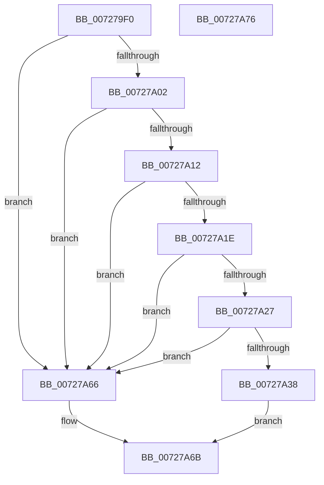

# PipAttemptDependentStart

- RVA: `0x007279F0`–`0x00727A77` (길이 `135` bytes)
- VA: `0x00000001407279F0`
- 실행 섹션: `PAGE`
- PDB 이름 있음: `예`; PDB Function 태그: `아니요`
- unwind 정보 RVA: `0x00065960`
- 디코드: `36`개 명령, `135/135` bytes 표시
- 미해석 바이트: `0` (있으면 어셈블리에 `.byte`로 보존)

> 이 문서는 커널 이미지의 기계어와 PDB 기호를 분석해 생성했습니다. 4번과 5번은 함수 원형과 자료형을 바이너리 사용 방식에서 추정한 C 해석이며 원본 소스 복구 결과는 아닙니다.

## 1. Dependencies

- 직접 호출 지점: **3**; 고유 호출 대상: **3**
- 직접 호출자로 확인된 함수: **2**
- RIP 상대 이미지 참조: **0**

### Outgoing calls
- `0x00727A2F` → [PipCheckForUnsatisfiedDependencies](../A0/PipCheckForUnsatisfiedDependencies_function_00A06E44.md) (function, `0x00A06E44`)
- `0x00727A3B` → [PipClearDevNodeProblem](../A2/PipClearDevNodeProblem_function_00A27C8C.md) (function, `0x00A27C8C`)
- `0x00727A5F` → [PnpRequestDeviceAction](../../text/47/PnpRequestDeviceAction_function_00477FF8.md) (function, `0x00477FF8`)

### Direct callers
- [PipDeleteAllDependencyRelations](../A0/PipDeleteAllDependencyRelations_function_00A06950.md) at `0x00A069F3`
- [PipAttemptDependentsStart](../A9/PipAttemptDependentsStart_function_00A9C888.md) at `0x00A9C8E9`

### Static image references
- 디코드된 RIP-relative 메모리 참조가 없습니다.

## 2. Other-region calls and transfers

- 다른 실행 섹션으로 향하는 call: **1**
  - `0x00727A5F` → [PnpRequestDeviceAction](../../text/47/PnpRequestDeviceAction_function_00477FF8.md) (`PAGE` → `.text`)
- 별도 외부 분기/꼬리 이동을 확인하지 못했습니다.

## 3. Assembly (complete function range)

```asm
007279F0  48 89 5C 24 08                  mov qword ptr [rsp + 8], rbx
007279F5  57                              push rdi
007279F6  48 83 EC 40                     sub rsp, 0x40
007279FA  48 8B F9                        mov rdi, rcx
007279FD  48 85 C9                        test rcx, rcx
00727A00  74 64                           je 0x140727a66
00727A02  48 8B 81 38 01 00 00            mov rax, qword ptr [rcx + 0x138]
00727A09  48 8B 58 28                     mov rbx, qword ptr [rax + 0x28]
00727A0D  48 85 DB                        test rbx, rbx
00727A10  74 54                           je 0x140727a66
00727A12  F7 83 8C 01 00 00 00 20 00 00   test dword ptr [rbx + 0x18c], 0x2000
00727A1C  74 48                           je 0x140727a66
00727A1E  83 BB 94 01 00 00 33            cmp dword ptr [rbx + 0x194], 0x33
00727A25  75 3F                           jne 0x140727a66
00727A27  BA 03 00 00 00                  mov edx, 3
00727A2C  48 8B CB                        mov rcx, rbx
00727A2F  E8 10 F4 2D 00                  call 0x140a06e44
00727A34  84 C0                           test al, al
00727A36  75 2E                           jne 0x140727a66
00727A38  48 8B CB                        mov rcx, rbx
00727A3B  E8 4C 02 30 00                  call 0x140a27c8c
00727A40  48 83 64 24 30 00               and qword ptr [rsp + 0x30], 0
00727A46  45 33 C9                        xor r9d, r9d
00727A49  48 83 64 24 28 00               and qword ptr [rsp + 0x28], 0
00727A4F  41 B0 01                        mov r8b, 1
00727A52  48 83 64 24 20 00               and qword ptr [rsp + 0x20], 0
00727A58  48 8B CF                        mov rcx, rdi
00727A5B  41 8D 51 10                     lea edx, [r9 + 0x10]
00727A5F  E8 94 05 D5 FF                  call 0x140477ff8
00727A64  EB 05                           jmp 0x140727a6b
00727A66  B8 01 00 00 C0                  mov eax, 0xc0000001
00727A6B  48 8B 5C 24 50                  mov rbx, qword ptr [rsp + 0x50]
00727A70  48 83 C4 40                     add rsp, 0x40
00727A74  5F                              pop rdi
00727A75  C3                              ret
00727A76  CC                              int3
```

## 4. C-style interpretation (structured pseudocode)

```c
__int64 __fastcall PipAttemptDependentStart(__int64 a1, __int64 a2, __int64 a3, int a4)
{
    __int64 result;
    __int64 v_rsp;
    unsigned __int64 v_stack_m18;
    unsigned __int64 v_stack_m20;
    unsigned __int64 v_stack_m28;
    unsigned __int64 v_stack_p8;

    v_stack_p8 = v_rbx;
    v_rsp = (v_rsp) - (64);
    if (a1 == 0) goto loc_00727A66;
    if (*(unsigned __int64 *)(*(unsigned __int64 *)(a1 + 312) + 40) == 0) goto loc_00727A66;
    if (((*(unsigned int *)(*(unsigned __int64 *)(*(unsigned __int64 *)(a1 + 312) + 40) + 396)) & (0x2000ULL)) == 0) goto loc_00727A66;
    if ((*(unsigned int *)(*(unsigned __int64 *)(*(unsigned __int64 *)(a1 + 312) + 40) + 404)) != 51) goto loc_00727A66;
    result = PipCheckForUnsatisfiedDependencies(*(unsigned __int64 *)(*(unsigned __int64 *)(a1 + 312) + 40), 3, a3, a4);
    if ((unsigned __int8)(result) != 0) goto loc_00727A66;
    result = PipClearDevNodeProblem(*(unsigned __int64 *)(*(unsigned __int64 *)(a1 + 312) + 40), 3, a3, a4);
    a4 = 0;
    result = PnpRequestDeviceAction(a1, a4 + 16, 1, a4);
    goto loc_00727A6B;
loc_00727A66:
loc_00727A6B:
    v_rsp = (v_rsp) + (64);
    return (unsigned int)(0xC0000001ULL);
}
```

## 5. (Beta) C Style

```c
int64_t PipAttemptDependentStart(int64_t Arg1, int64_t Arg2, int64_t Arg3, int32_t Arg4)
{
    int64_t result;
    int64_t local_rsp;
    uint64_t v_stack_m18;
    uint64_t v_stack_m20;
    uint64_t v_stack_m28;
    uint64_t v_stack_p8;

    v_stack_p8 = local_rbx;
    local_rsp = (local_rsp) - (64);
    if (Arg1 == 0) goto loc_00727A66;
    if (*(uint64_t *)(*(uint64_t *)(Arg1 + 0x138) + 0x28) == 0) goto loc_00727A66;
    if (((*(uint32_t *)(*(uint64_t *)(*(uint64_t *)(Arg1 + 0x138) + 0x28) + 0x18C)) & (0x2000ULL)) == 0) goto loc_00727A66;
    if ((*(uint32_t *)(*(uint64_t *)(*(uint64_t *)(Arg1 + 0x138) + 0x28) + 0x194)) != 51) goto loc_00727A66;
    result = PipCheckForUnsatisfiedDependencies(*(uint64_t *)(*(uint64_t *)(Arg1 + 0x138) + 0x28), 3, Arg3, Arg4);
    if ((uint8_t)(result) != 0) goto loc_00727A66;
    result = PipClearDevNodeProblem(*(uint64_t *)(*(uint64_t *)(Arg1 + 0x138) + 0x28), 3, Arg3, Arg4);
    Arg4 = 0;
    result = PnpRequestDeviceAction(Arg1, Arg4 + 16, 1, Arg4);
    goto loc_00727A6B;
loc_00727A66:
loc_00727A6B:
    local_rsp = (local_rsp) + (64);
    return (uint32_t)(0xC0000001ULL);
}
```

## 6. Execution-region graph

[열기: 2D/3D 그래프와 함수 탐색 컨트롤 패널](../../../control-panel.html?section=page&rva=0x007279F0&view=graph)

- 2D 그래프는 위에서 아래로 흐르고, 3D 그래프는 빈 공간을 드래그해 회전합니다. Shift+드래그는 이동, 휠은 확대·축소, 함수 노드 선택은 대상 보고서 이동입니다.

### Static fallback


