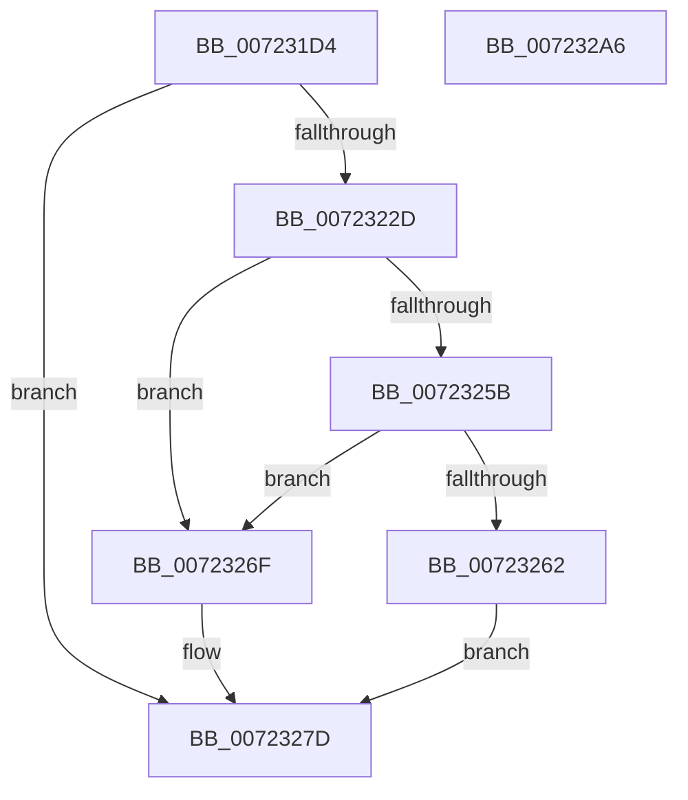

# PipCallbackHasDeviceOverrides

- RVA: `0x007231D4`–`0x007232A7` (길이 `211` bytes)
- VA: `0x00000001407231D4`
- 실행 섹션: `PAGE`
- PDB 이름 있음: `예`; PDB Function 태그: `아니요`
- unwind 정보 RVA: `0x000C80C8`
- 디코드: `58`개 명령, `211/211` bytes 표시
- 미해석 바이트: `0` (있으면 어셈블리에 `.byte`로 보존)

> 이 문서는 커널 이미지의 기계어와 PDB 기호를 분석해 생성했습니다. 4번과 5번은 함수 원형과 자료형을 바이너리 사용 방식에서 추정한 C 해석이며 원본 소스 복구 결과는 아닙니다.

## 1. Dependencies

- 직접 호출 지점: **4**; 고유 호출 대상: **4**
- 직접 호출자로 확인된 함수: **1**
- RIP 상대 이미지 참조: **1**

### Outgoing calls
- `0x00723222` → [IopOpenRegistryKeyEx](../A5/IopOpenRegistryKeyEx_function_00A51B44.md) (function, `0x00A51B44`)
- `0x00723248` → [ZwQueryKey](../../text/6A/ZwQueryKey_function_006AD390.md) (function, `0x006AD390`)
- `0x00723278` → [ZwClose](../../text/6A/ZwClose_function_006AD2B0.md) (function, `0x006AD2B0`)
- `0x0072328C` → [_security_check_cookie](../../text/6A/_security_check_cookie_function_006AC640.md) (function, `0x006AC640`)

### Direct callers
- [sub_00B38B6C](../B3/Unknown_function_00B38B6C.md) at `0x00B38B90`

### Static image references
- `0x007231E9` → RVA `0x00E0A740` (`.data`; read)

## 2. Other-region calls and transfers

- 다른 실행 섹션으로 향하는 call: **3**
  - `0x00723248` → [ZwQueryKey](../../text/6A/ZwQueryKey_function_006AD390.md) (`PAGE` → `.text`)
  - `0x00723278` → [ZwClose](../../text/6A/ZwClose_function_006AD2B0.md) (`PAGE` → `.text`)
  - `0x0072328C` → [_security_check_cookie](../../text/6A/_security_check_cookie_function_006AC640.md) (`PAGE` → `.text`)
- 별도 외부 분기/꼬리 이동을 확인하지 못했습니다.

## 3. Assembly (complete function range)

```asm
007231D4  48 89 5C 24 18                  mov qword ptr [rsp + 0x18], rbx
007231D9  48 89 7C 24 20                  mov qword ptr [rsp + 0x20], rdi
007231DE  55                              push rbp
007231DF  48 8B EC                        mov rbp, rsp
007231E2  48 81 EC 80 00 00 00            sub rsp, 0x80
007231E9  48 8B 05 50 75 6E 00            mov rax, qword ptr [rip + 0x6e7550]
007231F0  48 33 C4                        xor rax, rsp
007231F3  48 89 45 F0                     mov qword ptr [rbp - 0x10], rax
007231F7  48 83 65 B0 00                  and qword ptr [rbp - 0x50], 0
007231FC  0F 57 C0                        xorps xmm0, xmm0
007231FF  83 65 B8 00                     and dword ptr [rbp - 0x48], 0
00723203  48 8B FA                        mov rdi, rdx
00723206  4C 8B C2                        mov r8, rdx
00723209  41 B9 19 00 02 00               mov r9d, 0x20019
0072320F  48 8B D1                        mov rdx, rcx
00723212  48 8D 4D B0                     lea rcx, [rbp - 0x50]
00723216  0F 11 45 C0                     movups xmmword ptr [rbp - 0x40], xmm0
0072321A  0F 11 45 D0                     movups xmmword ptr [rbp - 0x30], xmm0
0072321E  0F 11 45 E0                     movups xmmword ptr [rbp - 0x20], xmm0
00723222  E8 1D E9 32 00                  call 0x140a51b44
00723227  8B D8                           mov ebx, eax
00723229  85 C0                           test eax, eax
0072322B  78 50                           js 0x14072327d
0072322D  48 8B 4D B0                     mov rcx, qword ptr [rbp - 0x50]
00723231  48 8D 45 B8                     lea rax, [rbp - 0x48]
00723235  41 B9 30 00 00 00               mov r9d, 0x30
0072323B  48 89 44 24 20                  mov qword ptr [rsp + 0x20], rax
00723240  4C 8D 45 C0                     lea r8, [rbp - 0x40]
00723244  41 8D 51 D2                     lea edx, [r9 - 0x2e]
00723248  E8 43 A1 F8 FF                  call 0x1406ad390
0072324D  33 DB                           xor ebx, ebx
0072324F  3D 05 00 00 80                  cmp eax, 0x80000005
00723254  0F 45 D8                        cmovne ebx, eax
00723257  85 DB                           test ebx, ebx
00723259  78 14                           js 0x14072326f
0072325B  8B 4D D4                        mov ecx, dword ptr [rbp - 0x2c]
0072325E  85 C9                           test ecx, ecx
00723260  74 0D                           je 0x14072326f
00723262  48 8B 45 B0                     mov rax, qword ptr [rbp - 0x50]
00723266  48 89 47 10                     mov qword ptr [rdi + 0x10], rax
0072326A  89 4F 18                        mov dword ptr [rdi + 0x18], ecx
0072326D  EB 0E                           jmp 0x14072327d
0072326F  48 8B 4D B0                     mov rcx, qword ptr [rbp - 0x50]
00723273  BB 01 00 00 C0                  mov ebx, 0xc0000001
00723278  E8 33 A0 F8 FF                  call 0x1406ad2b0
0072327D  C1 EB 1F                        shr ebx, 0x1f
00723280  80 F3 01                        xor bl, 1
00723283  8A C3                           mov al, bl
00723285  48 8B 4D F0                     mov rcx, qword ptr [rbp - 0x10]
00723289  48 33 CC                        xor rcx, rsp
0072328C  E8 AF 93 F8 FF                  call 0x1406ac640
00723291  4C 8D 9C 24 80 00 00 00         lea r11, [rsp + 0x80]
00723299  49 8B 5B 20                     mov rbx, qword ptr [r11 + 0x20]
0072329D  49 8B 7B 28                     mov rdi, qword ptr [r11 + 0x28]
007232A1  49 8B E3                        mov rsp, r11
007232A4  5D                              pop rbp
007232A5  C3                              ret
007232A6  CC                              int3
```

## 4. C-style interpretation (structured pseudocode)

```c
__int64 __fastcall PipCallbackHasDeviceOverrides(__int64 a1, __int64 a2)
{
    __int64 result;
    __int64 v_rbx;
    __int64 v_rsp;
    unsigned __int64 v_stack_m18;
    unsigned __int64 v_stack_m28;
    unsigned int v_stack_m34;
    unsigned __int64 v_stack_m38;
    unsigned __int64 v_stack_m48;
    unsigned int v_stack_m50;
    unsigned __int64 v_stack_m58;
    unsigned __int64 v_stack_m68;
    unsigned __int64 v_stack_m8;
    unsigned __int64 v_stack_p18;
    unsigned __int64 v_stack_p20;

    v_stack_p18 = v_rbx;
    v_stack_p20 = v_rdi;
    v_rsp = (v_rsp) - (128);
    result = (*(unsigned __int64 *)(v_rip + 7238992)) ^ (v_rsp);
    v_stack_m18 = result;
    v_stack_m48 = v_xmm0;
    v_stack_m38 = v_xmm0;
    v_stack_m28 = v_xmm0;
    result = IopOpenRegistryKeyEx(v_stack_m58, a1, a2, (unsigned int)(0x20019ULL));
    if (sign_flag) goto loc_0072327D;
    v_stack_m68 = v_stack_m50;
    result = ZwQueryKey(v_stack_m58, 48 - 46, v_stack_m48, 48);
    v_rbx = 0;
    if (((unsigned int)(result)) != 0x80000005ULL) { v_rbx = (unsigned int)(result); }
    if (sign_flag) goto loc_0072326F;
    if ((unsigned int)((unsigned int)(v_stack_m34)) == 0) goto loc_0072326F;
    *(unsigned __int64 *)(a2 + 16) = v_stack_m58;
    *(unsigned int *)(a2 + 24) = (unsigned int)((unsigned int)(v_stack_m34));
    goto loc_0072327D;
loc_0072326F:
    result = ZwClose(v_stack_m58, 48 - 46, v_stack_m48, 48);
loc_0072327D:
    v_rbx = (unsigned int)(((unsigned int)(0xC0000001ULL)) >> (31));
    v_rbx = (unsigned __int8)((v_rbx) ^ (1));
    a1 = (v_stack_m18) ^ (v_rsp);
    result = _security_check_cookie(a1, 48 - 46, v_stack_m48, 48);
    return result;
}
```

## 5. (Beta) C Style

```c
int64_t PipCallbackHasDeviceOverrides(int64_t Arg1, void *Arg2)
{
    uint8_t *arg2 = (uint8_t *)Arg2;

    int64_t result;
    int64_t local_rbx;
    int64_t local_rsp;
    uint64_t v_stack_m18;
    uint64_t v_stack_m28;
    uint32_t v_stack_m34;
    uint64_t v_stack_m38;
    uint64_t v_stack_m48;
    uint32_t v_stack_m50;
    uint64_t v_stack_m58;
    uint64_t v_stack_m68;
    uint64_t v_stack_m8;
    uint64_t v_stack_p18;
    uint64_t v_stack_p20;

    v_stack_p18 = local_rbx;
    v_stack_p20 = local_rdi;
    local_rsp = (local_rsp) - (128);
    result = (*(uint64_t *)(v_rip + 0x6E7550)) ^ (local_rsp);
    v_stack_m18 = result;
    v_stack_m48 = v_xmm0;
    v_stack_m38 = v_xmm0;
    v_stack_m28 = v_xmm0;
    result = IopOpenRegistryKeyEx(v_stack_m58, Arg1, Arg2, (uint32_t)(0x20019ULL));
    if (sign_flag) goto loc_0072327D;
    v_stack_m68 = v_stack_m50;
    result = ZwQueryKey(v_stack_m58, 48 - 46, v_stack_m48, 48);
    local_rbx = 0;
    if (((uint32_t)(result)) != 0x80000005ULL) { local_rbx = (uint32_t)(result); }
    if (sign_flag) goto loc_0072326F;
    if ((uint32_t)((uint32_t)(v_stack_m34)) == 0) goto loc_0072326F;
    *(uint64_t *)(arg2 + 0x10) = v_stack_m58;
    *(uint32_t *)(arg2 + 0x18) = (uint32_t)((uint32_t)(v_stack_m34));
    goto loc_0072327D;
loc_0072326F:
    result = ZwClose(v_stack_m58, 48 - 46, v_stack_m48, 48);
loc_0072327D:
    local_rbx = (uint32_t)(((uint32_t)(0xC0000001ULL)) >> (31));
    local_rbx = (uint8_t)((local_rbx) ^ (1));
    Arg1 = (v_stack_m18) ^ (local_rsp);
    result = _security_check_cookie(Arg1, 48 - 46, v_stack_m48, 48);
    return result;
}
```

### 관측된 메모리 오프셋

구조체 형식이 확인되지 않은 접근은 인자 기준의 오프셋으로만 기록했습니다.

| 기준 인자 | 오프셋 표현 | 폭 (bit) | 접근 |
|---|---:|---:|---|
| `Arg2` | `+ 0x10` | `64` | `W` |
| `Arg2` | `+ 0x18` | `32` | `W` |

## 6. Execution-region graph

[열기: 2D/3D 그래프와 함수 탐색 컨트롤 패널](../../../control-panel.html?section=page&rva=0x007231D4&view=graph)

- 2D 그래프는 위에서 아래로 흐르고, 3D 그래프는 빈 공간을 드래그해 회전합니다. Shift+드래그는 이동, 휠은 확대·축소, 함수 노드 선택은 대상 보고서 이동입니다.

### Static fallback


