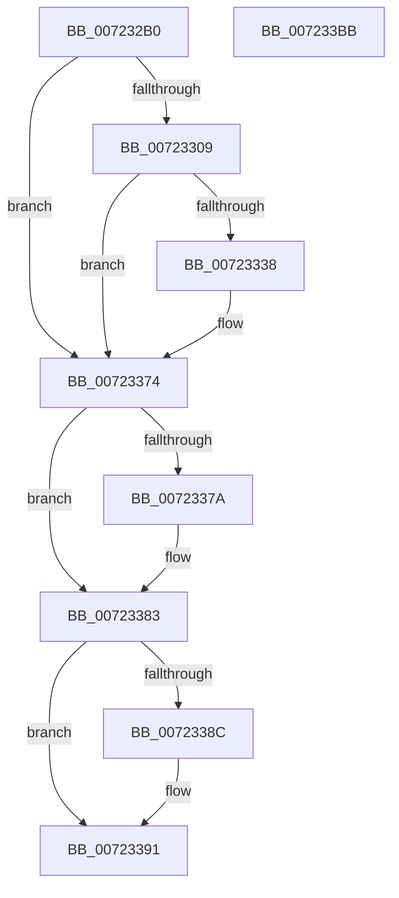

# PipCheckComputerSupported

- RVA: `0x007232B0`–`0x007233BC` (길이 `268` bytes)
- VA: `0x00000001407232B0`
- 실행 섹션: `PAGE`
- PDB 이름 있음: `예`; PDB Function 태그: `아니요`
- unwind 정보 RVA: `0x000C7FC4`
- 디코드: `71`개 명령, `268/268` bytes 표시
- 미해석 바이트: `0` (있으면 어셈블리에 `.byte`로 보존)

> 이 문서는 커널 이미지의 기계어와 PDB 기호를 분석해 생성했습니다. 4번과 5번은 함수 원형과 자료형을 바이너리 사용 방식에서 추정한 C 해석이며 원본 소스 복구 결과는 아닙니다.

## 1. Dependencies

- 직접 호출 지점: **7**; 고유 호출 대상: **6**
- 직접 호출자로 확인된 함수: **1**
- RIP 상대 이미지 참조: **2**

### Outgoing calls
- `0x007232FE` → [PipHardwareConfigOpenKey](../AD/PipHardwareConfigOpenKey_function_00AD8848.md) (function, `0x00AD8848`)
- `0x0072332D` → [IopOpenRegistryKeyEx](../A5/IopOpenRegistryKeyEx_function_00A51B44.md) (function, `0x00A51B44`)
- `0x0072333F` → [RtlInitUnicodeString](../../text/42/RtlInitUnicodeString_function_0042A780.md) (function, `0x0042A780`)
- `0x00723364` → [ZwQueryValueKey](../../text/6A/ZwQueryValueKey_function_006AD3B0.md) (function, `0x006AD3B0`)
- `0x0072337E` → [ZwClose](../../text/6A/ZwClose_function_006AD2B0.md) (function, `0x006AD2B0`)
- `0x0072338C` → [ZwClose](../../text/6A/ZwClose_function_006AD2B0.md) (function, `0x006AD2B0`)
- `0x007233A0` → [_security_check_cookie](../../text/6A/_security_check_cookie_function_006AC640.md) (function, `0x006AC640`)

### Direct callers
- [PiDevCfgQueryDriverNode](../73/PiDevCfgQueryDriverNode_function_0073435C.md) at `0x0073450C`

### Static image references
- `0x007232C7` → RVA `0x00E0A740` (`.data`; read)
- `0x0072330D` → RVA `0x00AFD480` (` ?? ::NNGAKEGL::`string'`; read)

## 2. Other-region calls and transfers

- 다른 실행 섹션으로 향하는 call: **5**
  - `0x0072333F` → [RtlInitUnicodeString](../../text/42/RtlInitUnicodeString_function_0042A780.md) (`PAGE` → `.text`)
  - `0x00723364` → [ZwQueryValueKey](../../text/6A/ZwQueryValueKey_function_006AD3B0.md) (`PAGE` → `.text`)
  - `0x0072337E` → [ZwClose](../../text/6A/ZwClose_function_006AD2B0.md) (`PAGE` → `.text`)
  - `0x0072338C` → [ZwClose](../../text/6A/ZwClose_function_006AD2B0.md) (`PAGE` → `.text`)
  - `0x007233A0` → [_security_check_cookie](../../text/6A/_security_check_cookie_function_006AC640.md) (`PAGE` → `.text`)
- 별도 외부 분기/꼬리 이동을 확인하지 못했습니다.

## 3. Assembly (complete function range)

```asm
007232B0  48 89 5C 24 10                  mov qword ptr [rsp + 0x10], rbx
007232B5  48 89 74 24 18                  mov qword ptr [rsp + 0x18], rsi
007232BA  4C 89 74 24 20                  mov qword ptr [rsp + 0x20], r14
007232BF  55                              push rbp
007232C0  48 8B EC                        mov rbp, rsp
007232C3  48 83 EC 70                     sub rsp, 0x70
007232C7  48 8B 05 72 74 6E 00            mov rax, qword ptr [rip + 0x6e7472]
007232CE  48 33 C4                        xor rax, rsp
007232D1  48 89 45 F8                     mov qword ptr [rbp - 8], rax
007232D5  45 33 F6                        xor r14d, r14d
007232D8  4C 8D 45 C0                     lea r8, [rbp - 0x40]
007232DC  0F 57 C0                        xorps xmm0, xmm0
007232DF  4C 89 75 C0                     mov qword ptr [rbp - 0x40], r14
007232E3  0F 57 C9                        xorps xmm1, xmm1
007232E6  4C 89 75 D0                     mov qword ptr [rbp - 0x30], r14
007232EA  BA 3F 00 0F 00                  mov edx, 0xf003f
007232EF  44 89 75 C8                     mov dword ptr [rbp - 0x38], r14d
007232F3  0F 11 45 D8                     movups xmmword ptr [rbp - 0x28], xmm0
007232F7  48 8B F1                        mov rsi, rcx
007232FA  0F 11 4D E8                     movups xmmword ptr [rbp - 0x18], xmm1
007232FE  E8 45 55 3B 00                  call 0x140ad8848
00723303  8B D8                           mov ebx, eax
00723305  85 C0                           test eax, eax
00723307  78 6B                           js 0x140723374
00723309  48 8B 55 C0                     mov rdx, qword ptr [rbp - 0x40]
0072330D  48 8D 05 6C A1 3D 00            lea rax, [rip + 0x3da16c]
00723314  41 B9 19 00 02 00               mov r9d, 0x20019
0072331A  48 89 45 E0                     mov qword ptr [rbp - 0x20], rax
0072331E  4C 8D 45 D8                     lea r8, [rbp - 0x28]
00723322  C7 45 D8 16 00 18 00            mov dword ptr [rbp - 0x28], 0x180016
00723329  48 8D 4D D0                     lea rcx, [rbp - 0x30]
0072332D  E8 12 E8 32 00                  call 0x140a51b44
00723332  8B D8                           mov ebx, eax
00723334  85 C0                           test eax, eax
00723336  78 3C                           js 0x140723374
00723338  48 8B D6                        mov rdx, rsi
0072333B  48 8D 4D D8                     lea rcx, [rbp - 0x28]
0072333F  E8 3C 74 D0 FF                  call 0x14042a780
00723344  48 8B 4D D0                     mov rcx, qword ptr [rbp - 0x30]
00723348  48 8D 45 C8                     lea rax, [rbp - 0x38]
0072334C  48 89 44 24 28                  mov qword ptr [rsp + 0x28], rax
00723351  4C 8D 4D E8                     lea r9, [rbp - 0x18]
00723355  45 33 C0                        xor r8d, r8d
00723358  C7 44 24 20 10 00 00 00         mov dword ptr [rsp + 0x20], 0x10
00723360  48 8D 55 D8                     lea rdx, [rbp - 0x28]
00723364  E8 47 A0 F8 FF                  call 0x1406ad3b0
00723369  3D 05 00 00 80                  cmp eax, 0x80000005
0072336E  8B D8                           mov ebx, eax
00723370  41 0F 44 DE                     cmove ebx, r14d
00723374  4C 39 75 C0                     cmp qword ptr [rbp - 0x40], r14
00723378  74 09                           je 0x140723383
0072337A  48 8B 4D C0                     mov rcx, qword ptr [rbp - 0x40]
0072337E  E8 2D 9F F8 FF                  call 0x1406ad2b0
00723383  48 8B 4D D0                     mov rcx, qword ptr [rbp - 0x30]
00723387  48 85 C9                        test rcx, rcx
0072338A  74 05                           je 0x140723391
0072338C  E8 1F 9F F8 FF                  call 0x1406ad2b0
00723391  C1 EB 1F                        shr ebx, 0x1f
00723394  80 F3 01                        xor bl, 1
00723397  8A C3                           mov al, bl
00723399  48 8B 4D F8                     mov rcx, qword ptr [rbp - 8]
0072339D  48 33 CC                        xor rcx, rsp
007233A0  E8 9B 92 F8 FF                  call 0x1406ac640
007233A5  4C 8D 5C 24 70                  lea r11, [rsp + 0x70]
007233AA  49 8B 5B 18                     mov rbx, qword ptr [r11 + 0x18]
007233AE  49 8B 73 20                     mov rsi, qword ptr [r11 + 0x20]
007233B2  4D 8B 73 28                     mov r14, qword ptr [r11 + 0x28]
007233B6  49 8B E3                        mov rsp, r11
007233B9  5D                              pop rbp
007233BA  C3                              ret
007233BB  CC                              int3
```

## 4. C-style interpretation (structured pseudocode)

```c
__int64 __fastcall PipCheckComputerSupported(__int64 a1)
{
    __int64 result;
    __int64 v_r14;
    __int64 v_rbx;
    __int64 v_rsp;
    unsigned __int64 v_stack_m10;
    unsigned __int64 v_stack_m20;
    unsigned __int64 v_stack_m28;
    unsigned __int64 v_stack_m30;
    unsigned __int64 v_stack_m38;
    unsigned int v_stack_m40;
    unsigned __int64 v_stack_m48;
    unsigned __int64 v_stack_m50;
    unsigned int v_stack_m58;
    unsigned __int64 v_stack_m8;
    unsigned __int64 v_stack_p10;
    unsigned __int64 v_stack_p18;
    unsigned __int64 v_stack_p20;

    v_stack_p10 = v_rbx;
    v_stack_p18 = v_rsi;
    v_stack_p20 = v_r14;
    v_rsp = (v_rsp) - (112);
    result = (*(unsigned __int64 *)(v_rip + 7238770)) ^ (v_rsp);
    v_stack_m10 = result;
    v_r14 = 0;
    v_stack_m48 = 0;
    v_stack_m38 = 0;
    v_stack_m40 = 0;
    v_stack_m30 = v_xmm0;
    v_stack_m20 = v_xmm1;
    result = PipHardwareConfigOpenKey(a1, (unsigned int)(0xF003FULL), v_stack_m48, a4);
    if (sign_flag) goto loc_00723374;
    v_stack_m28 = v_rip + 4039020;
    v_stack_m30 = 0x180016ULL;
    result = IopOpenRegistryKeyEx(v_stack_m38, v_stack_m48, v_stack_m30, (unsigned int)(0x20019ULL));
    v_rbx = (unsigned int)((unsigned int)(result));
    if (!(sign_flag)) {
        a2 = a1;
        a1 = v_stack_m30;
        result = RtlInitUnicodeString(a1, a2, v_stack_m30, (unsigned int)(0x20019ULL));
        a1 = v_stack_m38;
        result = v_stack_m40;
        v_stack_m50 = result;
        a4 = v_stack_m20;
        a3 = 0;
        v_stack_m58 = 16;
        a2 = v_stack_m30;
        result = ZwQueryValueKey(a1, a2, a3, a4);
        v_rbx = (unsigned int)(result);
        if (((unsigned int)(result)) == 0x80000005ULL) { v_rbx = 0; }
    }
    if (v_stack_m48 != 0) {
        a1 = v_stack_m48;
        result = ZwClose(a1, a2, a3, a4);
    }
    if (v_stack_m38 != 0) {
        result = ZwClose(v_stack_m38, a2, a3, a4);
    }
    v_rbx = (unsigned int)((v_rbx) >> (31));
    v_rbx = (unsigned __int8)((v_rbx) ^ (1));
    a1 = (v_stack_m10) ^ (v_rsp);
    result = _security_check_cookie(a1, a2, a3, a4);
    return result;
}
```

## 5. (Beta) C Style

```c
int64_t PipCheckComputerSupported(int64_t Arg1)
{
    int64_t result;
    int64_t local_r14;
    int64_t local_rbx;
    int64_t local_rsp;
    uint64_t v_stack_m10;
    uint64_t v_stack_m20;
    uint64_t v_stack_m28;
    uint64_t v_stack_m30;
    uint64_t v_stack_m38;
    uint32_t v_stack_m40;
    uint64_t v_stack_m48;
    uint64_t v_stack_m50;
    uint32_t v_stack_m58;
    uint64_t v_stack_m8;
    uint64_t v_stack_p10;
    uint64_t v_stack_p18;
    uint64_t v_stack_p20;

    v_stack_p10 = local_rbx;
    v_stack_p18 = local_rsi;
    v_stack_p20 = local_r14;
    local_rsp = (local_rsp) - (112);
    result = (*(uint64_t *)(v_rip + 0x6E7472)) ^ (local_rsp);
    v_stack_m10 = result;
    local_r14 = 0;
    v_stack_m48 = 0;
    v_stack_m38 = 0;
    v_stack_m40 = 0;
    v_stack_m30 = v_xmm0;
    v_stack_m20 = v_xmm1;
    result = PipHardwareConfigOpenKey(Arg1, (uint32_t)(0xF003FULL), v_stack_m48, a4);
    if (sign_flag) goto loc_00723374;
    v_stack_m28 = v_rip + 4039020;
    v_stack_m30 = 0x180016ULL;
    result = IopOpenRegistryKeyEx(v_stack_m38, v_stack_m48, v_stack_m30, (uint32_t)(0x20019ULL));
    local_rbx = (uint32_t)((uint32_t)(result));
    if (!(sign_flag)) {
        a2 = Arg1;
        Arg1 = v_stack_m30;
        result = RtlInitUnicodeString(Arg1, a2, v_stack_m30, (uint32_t)(0x20019ULL));
        Arg1 = v_stack_m38;
        result = v_stack_m40;
        v_stack_m50 = result;
        a4 = v_stack_m20;
        a3 = 0;
        v_stack_m58 = 16;
        a2 = v_stack_m30;
        result = ZwQueryValueKey(Arg1, a2, a3, a4);
        local_rbx = (uint32_t)(result);
        if (((uint32_t)(result)) == 0x80000005ULL) { local_rbx = 0; }
    }
    if (v_stack_m48 != 0) {
        Arg1 = v_stack_m48;
        result = ZwClose(Arg1, a2, a3, a4);
    }
    if (v_stack_m38 != 0) {
        result = ZwClose(v_stack_m38, a2, a3, a4);
    }
    local_rbx = (uint32_t)((local_rbx) >> (31));
    local_rbx = (uint8_t)((local_rbx) ^ (1));
    Arg1 = (v_stack_m10) ^ (local_rsp);
    result = _security_check_cookie(Arg1, a2, a3, a4);
    return result;
}
```

## 6. Execution-region graph

[열기: 2D/3D 그래프와 함수 탐색 컨트롤 패널](../../../control-panel.html?section=page&rva=0x007232B0&view=graph)

- 2D 그래프는 위에서 아래로 흐르고, 3D 그래프는 빈 공간을 드래그해 회전합니다. Shift+드래그는 이동, 휠은 확대·축소, 함수 노드 선택은 대상 보고서 이동입니다.

### Static fallback


