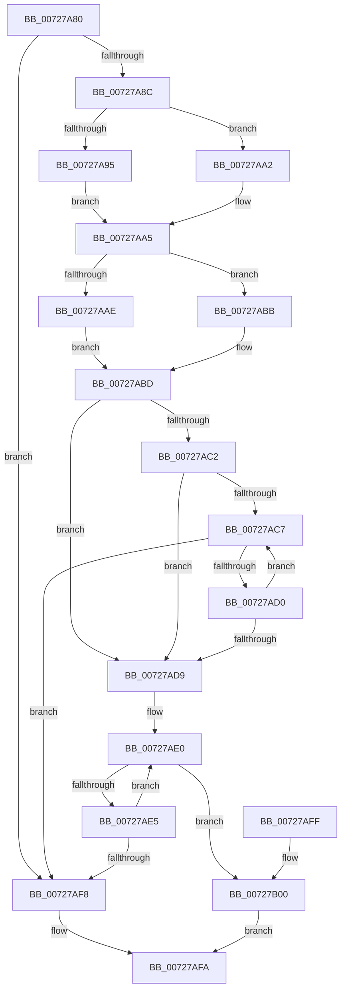

# PipCheckValidNewDependencyEdge

- RVA: `0x00727A80`–`0x00727B04` (길이 `132` bytes)
- VA: `0x0000000140727A80`
- 실행 섹션: `PAGE`
- PDB 이름 있음: `예`; PDB Function 태그: `아니요`
- unwind 정보 RVA: `0x00069B1C`
- 디코드: `43`개 명령, `132/132` bytes 표시
- 미해석 바이트: `0` (있으면 어셈블리에 `.byte`로 보존)

> 이 문서는 커널 이미지의 기계어와 PDB 기호를 분석해 생성했습니다. 4번과 5번은 함수 원형과 자료형을 바이너리 사용 방식에서 추정한 C 해석이며 원본 소스 복구 결과는 아닙니다.

## 1. Dependencies

- 직접 호출 지점: **1**; 고유 호출 대상: **1**
- 직접 호출자로 확인된 함수: **1**
- RIP 상대 이미지 참조: **1**

### Outgoing calls
- `0x00727AEA` → [PiListEntryToDependencyEdge](../../text/4F/PiListEntryToDependencyEdge_function_004F9648.md) (function, `0x004F9648`)

### Direct callers
- [PipAddDependencyEdgeBetweenNodes](../../text/5A/PipAddDependencyEdgeBetweenNodes_function_005A5520.md) at `0x005A5562`

### Static image references
- `0x00727AD0` → RVA `0x00F8C438` (`.data`; read)

## 2. Other-region calls and transfers

- 다른 실행 섹션으로 향하는 call: **1**
  - `0x00727AEA` → [PiListEntryToDependencyEdge](../../text/4F/PiListEntryToDependencyEdge_function_004F9648.md) (`PAGE` → `.text`)
- 별도 외부 분기/꼬리 이동을 확인하지 못했습니다.

## 3. Assembly (complete function range)

```asm
00727A80  48 83 EC 28                     sub rsp, 0x28
00727A84  4C 8B D1                        mov r10, rcx
00727A87  48 3B CA                        cmp rcx, rdx
00727A8A  74 6C                           je 0x140727af8
00727A8C  48 8B 41 30                     mov rax, qword ptr [rcx + 0x30]
00727A90  48 85 C0                        test rax, rax
00727A93  74 0D                           je 0x140727aa2
00727A95  48 8B 80 38 01 00 00            mov rax, qword ptr [rax + 0x138]
00727A9C  4C 8B 40 28                     mov r8, qword ptr [rax + 0x28]
00727AA0  EB 03                           jmp 0x140727aa5
00727AA2  45 33 C0                        xor r8d, r8d
00727AA5  48 8B 42 30                     mov rax, qword ptr [rdx + 0x30]
00727AA9  48 85 C0                        test rax, rax
00727AAC  74 0D                           je 0x140727abb
00727AAE  48 8B 80 38 01 00 00            mov rax, qword ptr [rax + 0x138]
00727AB5  48 8B 48 28                     mov rcx, qword ptr [rax + 0x28]
00727AB9  EB 02                           jmp 0x140727abd
00727ABB  33 C9                           xor ecx, ecx
00727ABD  4D 85 C0                        test r8, r8
00727AC0  74 17                           je 0x140727ad9
00727AC2  48 85 C9                        test rcx, rcx
00727AC5  74 12                           je 0x140727ad9
00727AC7  48 8B 49 10                     mov rcx, qword ptr [rcx + 0x10]
00727ACB  49 3B C8                        cmp rcx, r8
00727ACE  74 28                           je 0x140727af8
00727AD0  48 3B 0D 61 49 86 00            cmp rcx, qword ptr [rip + 0x864961]
00727AD7  75 EE                           jne 0x140727ac7
00727AD9  4C 8D 4A 10                     lea r9, [rdx + 0x10]
00727ADD  4D 8B 01                        mov r8, qword ptr [r9]
00727AE0  4D 3B C1                        cmp r8, r9
00727AE3  74 1B                           je 0x140727b00
00727AE5  33 D2                           xor edx, edx
00727AE7  49 8B C8                        mov rcx, r8
00727AEA  E8 59 1B DD FF                  call 0x1404f9648
00727AEF  4D 8B 00                        mov r8, qword ptr [r8]
00727AF2  4C 39 50 20                     cmp qword ptr [rax + 0x20], r10
00727AF6  75 E8                           jne 0x140727ae0
00727AF8  32 C0                           xor al, al
00727AFA  48 83 C4 28                     add rsp, 0x28
00727AFE  C3                              ret
00727AFF  CC                              int3
00727B00  B0 01                           mov al, 1
00727B02  EB F6                           jmp 0x140727afa
```

## 4. C-style interpretation (structured pseudocode)

```c
__int64 __fastcall PipCheckValidNewDependencyEdge(__int64 a1, __int64 a2)
{
    __int64 result;
    __int64 v_rsp;

    v_rsp = (v_rsp) - (40);
    if (a1 == a2) goto loc_00727AF8;
    if (*(unsigned __int64 *)(a1 + 48) == 0) goto loc_00727AA2;
    goto loc_00727AA5;
loc_00727AA2:
    a3 = 0;
loc_00727AA5:
    if (*(unsigned __int64 *)(a2 + 48) == 0) goto loc_00727ABB;
    goto loc_00727ABD;
loc_00727ABB:
    a1 = 0;
loc_00727ABD:
    if (0 == 0) goto loc_00727AD9;
    if (0 == 0) goto loc_00727AD9;
loc_00727AC7:
    if ((*(unsigned __int64 *)(a1 + 16)) == 0) goto loc_00727AF8;
    if ((*(unsigned __int64 *)(a1 + 16)) != (*(unsigned __int64 *)(v_rip + 8800609))) goto loc_00727AC7;
loc_00727AD9:
loc_00727AE0:
    if ((*(unsigned __int64 *)(a2 + 16)) == (a2 + 16)) goto loc_00727B00;
    a2 = 0;
    result = PiListEntryToDependencyEdge(*(unsigned __int64 *)(a2 + 16), a2, *(unsigned __int64 *)(a2 + 16), a2 + 16);
    if ((*(unsigned __int64 *)(result + 32)) != 0) goto loc_00727AE0;
loc_00727AF8:
    result = 0;
loc_00727AFA:
    v_rsp = (v_rsp) + (40);
    return result;
loc_00727B00:
    goto loc_00727AFA;
}
```

## 5. (Beta) C Style

```c
int64_t PipCheckValidNewDependencyEdge(int64_t Arg1, void *Arg2)
{
    uint8_t *arg2 = (uint8_t *)Arg2;

    int64_t result;
    int64_t local_rsp;

    local_rsp = (local_rsp) - (40);
    if (Arg1 == Arg2) goto loc_00727AF8;
    if (*(uint64_t *)(Arg1 + 0x30) == 0) goto loc_00727AA2;
    goto loc_00727AA5;
loc_00727AA2:
    a3 = 0;
loc_00727AA5:
    if (*(uint64_t *)(arg2 + 0x30) == 0) goto loc_00727ABB;
    goto loc_00727ABD;
loc_00727ABB:
    Arg1 = 0;
loc_00727ABD:
    if (0 == 0) goto loc_00727AD9;
    if (0 == 0) goto loc_00727AD9;
loc_00727AC7:
    if ((*(uint64_t *)(Arg1 + 0x10)) == 0) goto loc_00727AF8;
    if ((*(uint64_t *)(Arg1 + 0x10)) != (*(uint64_t *)(v_rip + 0x864961))) goto loc_00727AC7;
loc_00727AD9:
loc_00727AE0:
    if ((*(uint64_t *)(arg2 + 0x10)) == (Arg2 + 16)) goto loc_00727B00;
    Arg2 = 0;
    result = PiListEntryToDependencyEdge(*(uint64_t *)(arg2 + 0x10), Arg2, *(uint64_t *)(arg2 + 0x10), Arg2 + 16);
    if ((*(uint64_t *)(result + 0x20)) != 0) goto loc_00727AE0;
loc_00727AF8:
    result = 0;
loc_00727AFA:
    local_rsp = (local_rsp) + (40);
    return result;
loc_00727B00:
    goto loc_00727AFA;
}
```

### 관측된 메모리 오프셋

구조체 형식이 확인되지 않은 접근은 인자 기준의 오프셋으로만 기록했습니다.

| 기준 인자 | 오프셋 표현 | 폭 (bit) | 접근 |
|---|---:|---:|---|
| `Arg2` | `+ 0x0` | `64` | `R` |
| `Arg2` | `+ 0x10` | `64` | `R` |
| `Arg2` | `+ 0x30` | `64` | `R` |

## 6. Execution-region graph

[열기: 2D/3D 그래프와 함수 탐색 컨트롤 패널](../../../control-panel.html?section=page&rva=0x00727A80&view=graph)

- 2D 그래프는 위에서 아래로 흐르고, 3D 그래프는 빈 공간을 드래그해 회전합니다. Shift+드래그는 이동, 휠은 확대·축소, 함수 노드 선택은 대상 보고서 이동입니다.

### Static fallback


