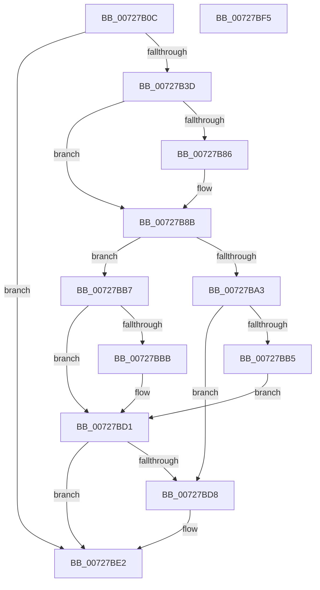

# PipCreateDependencyNode

- RVA: `0x00727B0C`–`0x00727BF6` (길이 `234` bytes)
- VA: `0x0000000140727B0C`
- 실행 섹션: `PAGE`
- PDB 이름 있음: `예`; PDB Function 태그: `아니요`
- unwind 정보 RVA: `0x00060BC4`
- 디코드: `68`개 명령, `234/234` bytes 표시
- 미해석 바이트: `0` (있으면 어셈블리에 `.byte`로 보존)

> 이 문서는 커널 이미지의 기계어와 PDB 기호를 분석해 생성했습니다. 4번과 5번은 함수 원형과 자료형을 바이너리 사용 방식에서 추정한 C 해석이며 원본 소스 복구 결과는 아닙니다.

## 1. Dependencies

- 직접 호출 지점: **3**; 고유 호출 대상: **3**
- 직접 호출자로 확인된 함수: **3**
- RIP 상대 이미지 참조: **3**

### Outgoing calls
- `0x00727B2C` → [ExAllocatePool2](../../poolcode/B8/ExAllocatePool2_function_00B820F0.md) (function, `0x00B820F0`)
- `0x00727BAA` → [PipAddBindingId](PipAddBindingId_function_00727814.md) (function, `0x00727814`)
- `0x00727BDB` → [PipDeleteDependencyNode](../6F/PipDeleteDependencyNode_function_006FE670.md) (function, `0x006FE670`)

### Direct callers
- [IoResolveDependency](../../text/4C/IoResolveDependency_function_004C4380.md) at `0x004C4452`
- [IoDuplicateDependency](IoDuplicateDependency_function_00727580.md) at `0x007275F7`
- [PipSetDependency](PipSetDependency_function_00727F24.md) at `0x00727F49`
- [PipSetDependency](PipSetDependency_function_00727F24.md) at `0x00727F73`

### Static image references
- `0x00727B41` → RVA `0x00F8CE80` (`.data`; read)
- `0x00727B7A` → RVA `0x00F8CE88` (`.data`; read)
- `0x00727B95` → RVA `0x00F8CE88` (`.data`; write)

## 2. Other-region calls and transfers

- 다른 실행 섹션으로 향하는 call: **1**
  - `0x00727B2C` → [ExAllocatePool2](../../poolcode/B8/ExAllocatePool2_function_00B820F0.md) (`PAGE` → `POOLCODE`)
- 별도 외부 분기/꼬리 이동을 확인하지 못했습니다.

## 3. Assembly (complete function range)

```asm
00727B0C  48 89 5C 24 08                  mov qword ptr [rsp + 8], rbx
00727B11  48 89 74 24 10                  mov qword ptr [rsp + 0x10], rsi
00727B16  57                              push rdi
00727B17  48 83 EC 20                     sub rsp, 0x20
00727B1B  33 FF                           xor edi, edi
00727B1D  48 8B F1                        mov rsi, rcx
00727B20  41 B8 50 6E 70 53               mov r8d, 0x53706e50
00727B26  8D 57 60                        lea edx, [rdi + 0x60]
00727B29  8D 4F 40                        lea ecx, [rdi + 0x40]
00727B2C  E8 BF A5 45 00                  call 0x140b820f0
00727B31  48 8B D8                        mov rbx, rax
00727B34  48 85 C0                        test rax, rax
00727B37  0F 84 A5 00 00 00               je 0x140727be2
00727B3D  48 83 C0 38                     add rax, 0x38
00727B41  48 8D 0D 38 53 86 00            lea rcx, [rip + 0x865338]
00727B48  48 89 40 08                     mov qword ptr [rax + 8], rax
00727B4C  48 89 00                        mov qword ptr [rax], rax
00727B4F  48 8D 43 20                     lea rax, [rbx + 0x20]
00727B53  48 89 40 08                     mov qword ptr [rax + 8], rax
00727B57  48 89 00                        mov qword ptr [rax], rax
00727B5A  48 8D 43 10                     lea rax, [rbx + 0x10]
00727B5E  48 89 40 08                     mov qword ptr [rax + 8], rax
00727B62  48 89 00                        mov qword ptr [rax], rax
00727B65  48 8D 43 48                     lea rax, [rbx + 0x48]
00727B69  48 89 40 08                     mov qword ptr [rax + 8], rax
00727B6D  48 89 00                        mov qword ptr [rax], rax
00727B70  21 7B 58                        and dword ptr [rbx + 0x58], edi
00727B73  48 21 7B 30                     and qword ptr [rbx + 0x30], rdi
00727B77  21 7B 5C                        and dword ptr [rbx + 0x5c], edi
00727B7A  48 8B 05 07 53 86 00            mov rax, qword ptr [rip + 0x865307]
00727B81  48 39 08                        cmp qword ptr [rax], rcx
00727B84  74 05                           je 0x140727b8b
00727B86  8D 4F 03                        lea ecx, [rdi + 3]
00727B89  CD 29                           int 0x29
00727B8B  48 89 0B                        mov qword ptr [rbx], rcx
00727B8E  48 89 43 08                     mov qword ptr [rbx + 8], rax
00727B92  48 89 18                        mov qword ptr [rax], rbx
00727B95  48 89 1D EC 52 86 00            mov qword ptr [rip + 0x8652ec], rbx
00727B9C  8B 06                           mov eax, dword ptr [rsi]
00727B9E  83 F8 01                        cmp eax, 1
00727BA1  75 14                           jne 0x140727bb7
00727BA3  48 8B 56 08                     mov rdx, qword ptr [rsi + 8]
00727BA7  48 8B CB                        mov rcx, rbx
00727BAA  E8 65 FC FF FF                  call 0x140727814
00727BAF  8B F8                           mov edi, eax
00727BB1  85 C0                           test eax, eax
00727BB3  78 23                           js 0x140727bd8
00727BB5  EB 1A                           jmp 0x140727bd1
00727BB7  85 C0                           test eax, eax
00727BB9  75 16                           jne 0x140727bd1
00727BBB  48 8B 46 08                     mov rax, qword ptr [rsi + 8]
00727BBF  FF 43 58                        inc dword ptr [rbx + 0x58]
00727BC2  48 89 43 30                     mov qword ptr [rbx + 0x30], rax
00727BC6  48 8B 80 38 01 00 00            mov rax, qword ptr [rax + 0x138]
00727BCD  48 89 58 50                     mov qword ptr [rax + 0x50], rbx
00727BD1  FF 43 58                        inc dword ptr [rbx + 0x58]
00727BD4  85 FF                           test edi, edi
00727BD6  79 0A                           jns 0x140727be2
00727BD8  48 8B CB                        mov rcx, rbx
00727BDB  E8 90 6A FD FF                  call 0x1406fe670
00727BE0  33 DB                           xor ebx, ebx
00727BE2  48 8B 74 24 38                  mov rsi, qword ptr [rsp + 0x38]
00727BE7  48 8B C3                        mov rax, rbx
00727BEA  48 8B 5C 24 30                  mov rbx, qword ptr [rsp + 0x30]
00727BEF  48 83 C4 20                     add rsp, 0x20
00727BF3  5F                              pop rdi
00727BF4  C3                              ret
00727BF5  CC                              int3
```

## 4. C-style interpretation (structured pseudocode)

```c
__int64 __fastcall PipCreateDependencyNode(__int64 a1)
{
    __int64 result;
    __int64 v_rbx;
    __int64 v_rdi;
    __int64 v_rsp;
    unsigned __int64 v_stack_p10;
    unsigned __int64 v_stack_p8;

    v_stack_p8 = v_rbx;
    v_stack_p10 = v_rsi;
    v_rsp = (v_rsp) - (32);
    v_rdi = 0;
    result = ExAllocatePool2(v_rdi + 64, v_rdi + 96, (unsigned int)(0x53706E50ULL), a4);
    if (result == 0) goto loc_00727BE2;
    result = (result) + (56);
    *(unsigned __int64 *)(result + 8) = result;
    *(unsigned __int64 *)(result) = result;
    *(unsigned __int64 *)(result + 32 + 8) = result + 32;
    *(unsigned __int64 *)(result + 32) = result + 32;
    *(unsigned __int64 *)(result + 16 + 8) = result + 16;
    *(unsigned __int64 *)(result + 16) = result + 16;
    *(unsigned __int64 *)(result + 72 + 8) = result + 72;
    *(unsigned __int64 *)(result + 72) = result + 72;
    if ((*(unsigned __int64 *)(*(unsigned __int64 *)(v_rip + 8803079))) != (v_rip + 8803128)) {
        a1 = v_rdi + 3;
    }
    *(unsigned __int64 *)(result) = a1;
    *(unsigned __int64 *)(result + 8) = *(unsigned __int64 *)(v_rip + 8803079);
    *(unsigned __int64 *)(*(unsigned __int64 *)(v_rip + 8803079)) = result;
    *(unsigned __int64 *)(v_rip + 8803052) = result;
    if (((unsigned int)((unsigned int)(*(unsigned int *)(a1)))) != 1) goto loc_00727BB7;
    result = PipAddBindingId(result, *(unsigned __int64 *)(a1 + 8), (unsigned int)(0x53706E50ULL), a4);
    if (sign_flag) goto loc_00727BD8;
    goto loc_00727BD1;
loc_00727BB7:
    if ((unsigned int)(result) == 0) {
        result = *(unsigned __int64 *)(a1 + 8);
        *(unsigned __int64 *)(result + 48) = result;
        result = *(unsigned __int64 *)(result + 312);
        *(unsigned __int64 *)(result + 80) = result;
    }
    v_rbx = result;
    if (sign_flag) {
        a1 = result;
        result = PipDeleteDependencyNode(a1, *(unsigned __int64 *)(a1 + 8), (unsigned int)(0x53706E50ULL), a4);
        v_rbx = 0;
    }
    v_rsp = (v_rsp) + (32);
    return 0;
}
```

## 5. (Beta) C Style

```c
int64_t PipCreateDependencyNode(void *Arg1)
{
    uint8_t *arg1 = (uint8_t *)Arg1;

    int64_t result;
    int64_t local_rbx;
    int64_t local_rdi;
    int64_t local_rsp;
    uint64_t v_stack_p10;
    uint64_t v_stack_p8;

    v_stack_p8 = local_rbx;
    v_stack_p10 = local_rsi;
    local_rsp = (local_rsp) - (32);
    local_rdi = 0;
    result = ExAllocatePool2(local_rdi + 64, local_rdi + 96, (uint32_t)(0x53706E50ULL), a4);
    if (result == 0) goto loc_00727BE2;
    result = (result) + (56);
    *(uint64_t *)(result + 0x8) = result;
    *(uint64_t *)(result) = result;
    *(uint64_t *)(result + 0x20 + 0x8) = result + 32;
    *(uint64_t *)(result + 0x20) = result + 32;
    *(uint64_t *)(result + 0x10 + 0x8) = result + 16;
    *(uint64_t *)(result + 0x10) = result + 16;
    *(uint64_t *)(result + 0x48 + 0x8) = result + 72;
    *(uint64_t *)(result + 0x48) = result + 72;
    if ((*(uint64_t *)(*(uint64_t *)(v_rip + 0x865307))) != (v_rip + 8803128)) {
        Arg1 = local_rdi + 3;
    }
    *(void **)(result) = Arg1;
    *(uint64_t *)(result + 0x8) = *(uint64_t *)(v_rip + 0x865307);
    *(uint64_t *)(*(uint64_t *)(v_rip + 0x865307)) = result;
    *(uint64_t *)(v_rip + 0x8652EC) = result;
    if (((uint32_t)((uint32_t)(*(uint32_t *)(arg1)))) != 1) goto loc_00727BB7;
    result = PipAddBindingId(result, *(uint64_t *)(arg1 + 0x8), (uint32_t)(0x53706E50ULL), a4);
    if (sign_flag) goto loc_00727BD8;
    goto loc_00727BD1;
loc_00727BB7:
    if ((uint32_t)(result) == 0) {
        result = *(uint64_t *)(arg1 + 0x8);
        *(uint64_t *)(result + 0x30) = result;
        result = *(uint64_t *)(result + 0x138);
        *(uint64_t *)(result + 0x50) = result;
    }
    local_rbx = result;
    if (sign_flag) {
        Arg1 = result;
        result = PipDeleteDependencyNode(Arg1, *(uint64_t *)(arg1 + 0x8), (uint32_t)(0x53706E50ULL), a4);
        local_rbx = 0;
    }
    local_rsp = (local_rsp) + (32);
    return 0;
}
```

### 관측된 메모리 오프셋

구조체 형식이 확인되지 않은 접근은 인자 기준의 오프셋으로만 기록했습니다.

| 기준 인자 | 오프셋 표현 | 폭 (bit) | 접근 |
|---|---:|---:|---|
| `Arg1` | `+ 0x0` | `32` | `R` |
| `Arg1` | `+ 0x8` | `64` | `R` |

## 6. Execution-region graph

[열기: 2D/3D 그래프와 함수 탐색 컨트롤 패널](../../../control-panel.html?section=page&rva=0x00727B0C&view=graph)

- 2D 그래프는 위에서 아래로 흐르고, 3D 그래프는 빈 공간을 드래그해 회전합니다. Shift+드래그는 이동, 휠은 확대·축소, 함수 노드 선택은 대상 보고서 이동입니다.

### Static fallback


