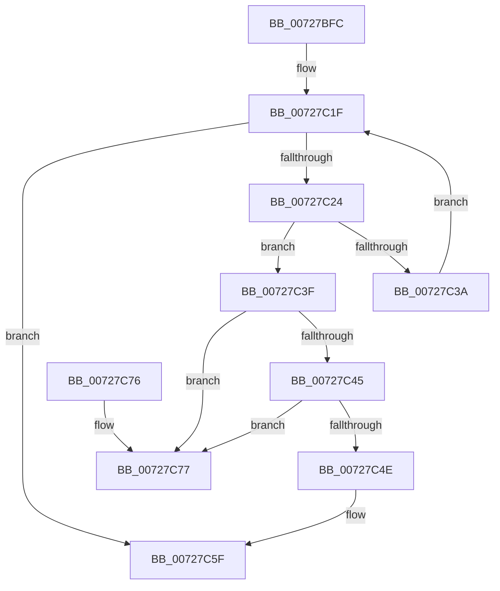

# PipDeleteBindingId

- RVA: `0x00727BFC`–`0x00727C7E` (길이 `130` bytes)
- VA: `0x0000000140727BFC`
- 실행 섹션: `PAGE`
- PDB 이름 있음: `예`; PDB Function 태그: `아니요`
- unwind 정보 RVA: `0x00069AD0`
- 디코드: `40`개 명령, `130/130` bytes 표시
- 미해석 바이트: `0` (있으면 어셈블리에 `.byte`로 보존)

> 이 문서는 커널 이미지의 기계어와 PDB 기호를 분석해 생성했습니다. 4번과 5번은 함수 원형과 자료형을 바이너리 사용 방식에서 추정한 C 해석이며 원본 소스 복구 결과는 아닙니다.

## 1. Dependencies

- 직접 호출 지점: **2**; 고유 호출 대상: **2**
- 직접 호출자로 확인된 함수: **1**
- RIP 상대 이미지 참조: **0**

### Outgoing calls
- `0x00727C2E` → [RtlEqualUnicodeString](../93/RtlEqualUnicodeString_function_00932A20.md) (function, `0x00932A20`)
- `0x00727C58` → [PipFreeBindingId](../AB/PipFreeBindingId_function_00AB657C.md) (function, `0x00AB657C`)

### Direct callers
- [IoResolveDependency](../../text/4C/IoResolveDependency_function_004C4380.md) at `0x004C43DB`

### Static image references
- 디코드된 RIP-relative 메모리 참조가 없습니다.

## 2. Other-region calls and transfers

- 다른 실행 섹션으로 향하는 call: **0**
- 별도 외부 분기/꼬리 이동을 확인하지 못했습니다.

## 3. Assembly (complete function range)

```asm
00727BFC  48 89 5C 24 08                  mov qword ptr [rsp + 8], rbx
00727C01  48 89 6C 24 10                  mov qword ptr [rsp + 0x10], rbp
00727C06  48 89 74 24 18                  mov qword ptr [rsp + 0x18], rsi
00727C0B  57                              push rdi
00727C0C  48 83 EC 20                     sub rsp, 0x20
00727C10  48 8D 71 38                     lea rsi, [rcx + 0x38]
00727C14  48 8B EA                        mov rbp, rdx
00727C17  48 8B 1E                        mov rbx, qword ptr [rsi]
00727C1A  BF 25 02 00 C0                  mov edi, 0xc0000225
00727C1F  48 3B DE                        cmp rbx, rsi
00727C22  74 3B                           je 0x140727c5f
00727C24  48 8D 4B 10                     lea rcx, [rbx + 0x10]
00727C28  45 33 C0                        xor r8d, r8d
00727C2B  48 8B D5                        mov rdx, rbp
00727C2E  E8 ED AD 20 00                  call 0x140932a20
00727C33  48 8B 0B                        mov rcx, qword ptr [rbx]
00727C36  84 C0                           test al, al
00727C38  75 05                           jne 0x140727c3f
00727C3A  48 8B D9                        mov rbx, rcx
00727C3D  EB E0                           jmp 0x140727c1f
00727C3F  48 39 59 08                     cmp qword ptr [rcx + 8], rbx
00727C43  75 32                           jne 0x140727c77
00727C45  48 8B 43 08                     mov rax, qword ptr [rbx + 8]
00727C49  48 39 18                        cmp qword ptr [rax], rbx
00727C4C  75 29                           jne 0x140727c77
00727C4E  48 89 08                        mov qword ptr [rax], rcx
00727C51  48 89 41 08                     mov qword ptr [rcx + 8], rax
00727C55  48 8B CB                        mov rcx, rbx
00727C58  E8 1F E9 38 00                  call 0x140ab657c
00727C5D  33 FF                           xor edi, edi
00727C5F  48 8B 5C 24 30                  mov rbx, qword ptr [rsp + 0x30]
00727C64  8B C7                           mov eax, edi
00727C66  48 8B 6C 24 38                  mov rbp, qword ptr [rsp + 0x38]
00727C6B  48 8B 74 24 40                  mov rsi, qword ptr [rsp + 0x40]
00727C70  48 83 C4 20                     add rsp, 0x20
00727C74  5F                              pop rdi
00727C75  C3                              ret
00727C76  CC                              int3
00727C77  B9 03 00 00 00                  mov ecx, 3
00727C7C  CD 29                           int 0x29
```

## 4. C-style interpretation (structured pseudocode)

```c
__int64 __fastcall PipDeleteBindingId(__int64 a1, __int64 a2, int a3)
{
    __int64 result;
    __int64 v_rdi;
    __int64 v_rsp;
    unsigned __int64 v_stack_p10;
    unsigned __int64 v_stack_p18;
    unsigned __int64 v_stack_p8;

    v_stack_p8 = v_rbx;
    v_stack_p10 = v_rbp;
    v_stack_p18 = v_rsi;
    v_rsp = (v_rsp) - (32);
loc_00727C1F:
    if ((*(unsigned __int64 *)(a1 + 56)) == (a1 + 56)) goto loc_00727C5F;
    a3 = 0;
    result = RtlEqualUnicodeString(*(unsigned __int64 *)(a1 + 56) + 16, a2, a3, a4);
    if ((unsigned __int8)(result) != 0) goto loc_00727C3F;
    goto loc_00727C1F;
loc_00727C3F:
    if ((*(unsigned __int64 *)(*(unsigned __int64 *)(*(unsigned __int64 *)(a1 + 56)) + 8)) != (*(unsigned __int64 *)(*(unsigned __int64 *)(a1 + 56)))) goto loc_00727C77;
    if ((*(unsigned __int64 *)(*(unsigned __int64 *)(*(unsigned __int64 *)(*(unsigned __int64 *)(a1 + 56)) + 8))) != (*(unsigned __int64 *)(*(unsigned __int64 *)(a1 + 56)))) goto loc_00727C77;
    *(unsigned __int64 *)(*(unsigned __int64 *)(*(unsigned __int64 *)(*(unsigned __int64 *)(a1 + 56)) + 8)) = *(unsigned __int64 *)(*(unsigned __int64 *)(a1 + 56));
    *(unsigned __int64 *)(*(unsigned __int64 *)(*(unsigned __int64 *)(a1 + 56)) + 8) = *(unsigned __int64 *)(*(unsigned __int64 *)(*(unsigned __int64 *)(a1 + 56)) + 8);
    result = PipFreeBindingId(*(unsigned __int64 *)(*(unsigned __int64 *)(a1 + 56)), a2, a3, a4);
    v_rdi = 0;
loc_00727C5F:
    v_rsp = (v_rsp) + (32);
    return 0;
loc_00727C77:
    return 0;
}
```

## 5. (Beta) C Style

```c
int64_t PipDeleteBindingId(void *Arg1, int64_t Arg2, int32_t Arg3)
{
    uint8_t *arg1 = (uint8_t *)Arg1;

    int64_t result;
    int64_t local_rdi;
    int64_t local_rsp;
    uint64_t v_stack_p10;
    uint64_t v_stack_p18;
    uint64_t v_stack_p8;

    v_stack_p8 = local_rbx;
    v_stack_p10 = local_rbp;
    v_stack_p18 = local_rsi;
    local_rsp = (local_rsp) - (32);
loc_00727C1F:
    if ((*(uint64_t *)(arg1 + 0x38)) == (Arg1 + 56)) goto loc_00727C5F;
    Arg3 = 0;
    result = RtlEqualUnicodeString(*(uint64_t *)(arg1 + 0x38) + 16, Arg2, Arg3, a4);
    if ((uint8_t)(result) != 0) goto loc_00727C3F;
    goto loc_00727C1F;
loc_00727C3F:
    if ((*(uint64_t *)(*(uint64_t *)(*(uint64_t *)(arg1 + 0x38)) + 0x8)) != (*(uint64_t *)(*(uint64_t *)(arg1 + 0x38)))) goto loc_00727C77;
    if ((*(uint64_t *)(*(uint64_t *)(*(uint64_t *)(*(uint64_t *)(arg1 + 0x38)) + 0x8))) != (*(uint64_t *)(*(uint64_t *)(arg1 + 0x38)))) goto loc_00727C77;
    *(uint64_t *)(*(uint64_t *)(*(uint64_t *)(*(uint64_t *)(arg1 + 0x38)) + 0x8)) = *(uint64_t *)(*(uint64_t *)(arg1 + 0x38));
    *(uint64_t *)(*(uint64_t *)(*(uint64_t *)(arg1 + 0x38)) + 0x8) = *(uint64_t *)(*(uint64_t *)(*(uint64_t *)(arg1 + 0x38)) + 0x8);
    result = PipFreeBindingId(*(uint64_t *)(*(uint64_t *)(arg1 + 0x38)), Arg2, Arg3, a4);
    local_rdi = 0;
loc_00727C5F:
    local_rsp = (local_rsp) + (32);
    return 0;
loc_00727C77:
    return 0;
}
```

### 관측된 메모리 오프셋

구조체 형식이 확인되지 않은 접근은 인자 기준의 오프셋으로만 기록했습니다.

| 기준 인자 | 오프셋 표현 | 폭 (bit) | 접근 |
|---|---:|---:|---|
| `Arg1` | `+ 0x0` | `64` | `R` |
| `Arg1` | `+ 0x38` | `64` | `R` |

## 6. Execution-region graph

[열기: 2D/3D 그래프와 함수 탐색 컨트롤 패널](../../../control-panel.html?section=page&rva=0x00727BFC&view=graph)

- 2D 그래프는 위에서 아래로 흐르고, 3D 그래프는 빈 공간을 드래그해 회전합니다. Shift+드래그는 이동, 휠은 확대·축소, 함수 노드 선택은 대상 보고서 이동입니다.

### Static fallback


