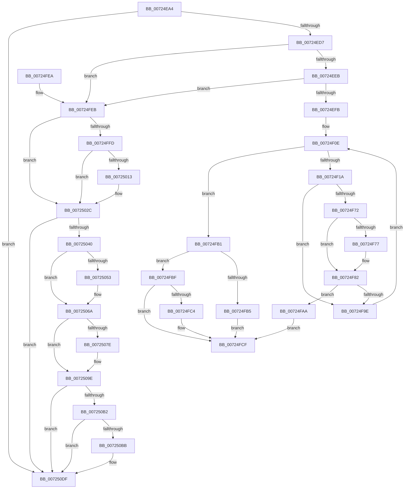

# PipGetDeviceObjectLocation

- RVA: `0x00724EA4`–`0x007250F8` (길이 `596` bytes)
- VA: `0x0000000140724EA4`
- 실행 섹션: `PAGE`
- PDB 이름 있음: `예`; PDB Function 태그: `아니요`
- unwind 정보 RVA: `0x000C8284`
- 디코드: `154`개 명령, `596/596` bytes 표시
- 미해석 바이트: `0` (있으면 어셈블리에 `.byte`로 보존)

> 이 문서는 커널 이미지의 기계어와 PDB 기호를 분석해 생성했습니다. 4번과 5번은 함수 원형과 자료형을 바이너리 사용 방식에서 추정한 C 해석이며 원본 소스 복구 결과는 아닙니다.

## 1. Dependencies

- 직접 호출 지점: **16**; 고유 호출 대상: **5**
- 직접 호출자로 확인된 함수: **3**
- RIP 상대 이미지 참조: **2**

### Outgoing calls
- `0x00724F64` → [PnpGetObjectProperty](../8E/PnpGetObjectProperty_function_008E2180.md) (function, `0x008E2180`)
- `0x00724F7D` → [ExFreePoolWithTag](../../poolcode/B8/ExFreePoolWithTag_function_00B82870.md) (function, `0x00B82870`)
- `0x00724F91` → [ExAllocatePool2](../../poolcode/B8/ExAllocatePool2_function_00B820F0.md) (function, `0x00B820F0`)
- `0x00724FCA` → [ExFreePoolWithTag](../../poolcode/B8/ExFreePoolWithTag_function_00B82870.md) (function, `0x00B82870`)
- `0x00724FEF` → [IoAddTriageDumpDataBlock](../../text/42/IoAddTriageDumpDataBlock_function_00428374.md) (function, `0x00428374`)
- `0x00725001` → [IoAddTriageDumpDataBlock](../../text/42/IoAddTriageDumpDataBlock_function_00428374.md) (function, `0x00428374`)
- `0x00725016` → [IoAddTriageDumpDataBlock](../../text/42/IoAddTriageDumpDataBlock_function_00428374.md) (function, `0x00428374`)
- `0x00725027` → [IoAddTriageDumpDataBlock](../../text/42/IoAddTriageDumpDataBlock_function_00428374.md) (function, `0x00428374`)
- `0x00725049` → [IoAddTriageDumpDataBlock](../../text/42/IoAddTriageDumpDataBlock_function_00428374.md) (function, `0x00428374`)
- `0x00725059` → [IoAddTriageDumpDataBlock](../../text/42/IoAddTriageDumpDataBlock_function_00428374.md) (function, `0x00428374`)
- `0x00725065` → [IoAddTriageDumpDataBlock](../../text/42/IoAddTriageDumpDataBlock_function_00428374.md) (function, `0x00428374`)
- `0x00725081` → [IoAddTriageDumpDataBlock](../../text/42/IoAddTriageDumpDataBlock_function_00428374.md) (function, `0x00428374`)
- `0x00725099` → [IoAddTriageDumpDataBlock](../../text/42/IoAddTriageDumpDataBlock_function_00428374.md) (function, `0x00428374`)
- `0x007250BE` → [IoAddTriageDumpDataBlock](../../text/42/IoAddTriageDumpDataBlock_function_00428374.md) (function, `0x00428374`)
- `0x007250DA` → [IoAddTriageDumpDataBlock](../../text/42/IoAddTriageDumpDataBlock_function_00428374.md) (function, `0x00428374`)
- `0x007250F2` → [KeBugCheckEx](../../text/4F/KeBugCheckEx_function_004FD660.md) (function, `0x004FD660`)

### Direct callers
- [IoReserveKsrPersistentMemoryEx](IoReserveKsrPersistentMemoryEx_function_007248C0.md) at `0x00724B07`
- [PipMatchPersistentMemory](PipMatchPersistentMemory_function_0072594C.md) at `0x007259D6`
- [PipMatchPersistentMemoryV1](PipMatchPersistentMemoryV1_function_00725A30.md) at `0x00725A72`

### Static image references
- `0x00724F32` → RVA `0x00E66398` (`.data`; read)
- `0x00724F53` → RVA `0x000116A0` (`.rdata`; read)

## 2. Other-region calls and transfers

- 다른 실행 섹션으로 향하는 call: **15**
  - `0x00724F7D` → [ExFreePoolWithTag](../../poolcode/B8/ExFreePoolWithTag_function_00B82870.md) (`PAGE` → `POOLCODE`)
  - `0x00724F91` → [ExAllocatePool2](../../poolcode/B8/ExAllocatePool2_function_00B820F0.md) (`PAGE` → `POOLCODE`)
  - `0x00724FCA` → [ExFreePoolWithTag](../../poolcode/B8/ExFreePoolWithTag_function_00B82870.md) (`PAGE` → `POOLCODE`)
  - `0x00724FEF` → [IoAddTriageDumpDataBlock](../../text/42/IoAddTriageDumpDataBlock_function_00428374.md) (`PAGE` → `.text`)
  - `0x00725001` → [IoAddTriageDumpDataBlock](../../text/42/IoAddTriageDumpDataBlock_function_00428374.md) (`PAGE` → `.text`)
  - `0x00725016` → [IoAddTriageDumpDataBlock](../../text/42/IoAddTriageDumpDataBlock_function_00428374.md) (`PAGE` → `.text`)
  - `0x00725027` → [IoAddTriageDumpDataBlock](../../text/42/IoAddTriageDumpDataBlock_function_00428374.md) (`PAGE` → `.text`)
  - `0x00725049` → [IoAddTriageDumpDataBlock](../../text/42/IoAddTriageDumpDataBlock_function_00428374.md) (`PAGE` → `.text`)
  - `0x00725059` → [IoAddTriageDumpDataBlock](../../text/42/IoAddTriageDumpDataBlock_function_00428374.md) (`PAGE` → `.text`)
  - `0x00725065` → [IoAddTriageDumpDataBlock](../../text/42/IoAddTriageDumpDataBlock_function_00428374.md) (`PAGE` → `.text`)
  - `0x00725081` → [IoAddTriageDumpDataBlock](../../text/42/IoAddTriageDumpDataBlock_function_00428374.md) (`PAGE` → `.text`)
  - `0x00725099` → [IoAddTriageDumpDataBlock](../../text/42/IoAddTriageDumpDataBlock_function_00428374.md) (`PAGE` → `.text`)
  - `0x007250BE` → [IoAddTriageDumpDataBlock](../../text/42/IoAddTriageDumpDataBlock_function_00428374.md) (`PAGE` → `.text`)
  - `0x007250DA` → [IoAddTriageDumpDataBlock](../../text/42/IoAddTriageDumpDataBlock_function_00428374.md) (`PAGE` → `.text`)
  - `0x007250F2` → [KeBugCheckEx](../../text/4F/KeBugCheckEx_function_004FD660.md) (`PAGE` → `.text`)
- 별도 외부 분기/꼬리 이동을 확인하지 못했습니다.

## 3. Assembly (complete function range)

```asm
00724EA4  4C 8B DC                        mov r11, rsp
00724EA7  49 89 5B 10                     mov qword ptr [r11 + 0x10], rbx
00724EAB  49 89 6B 18                     mov qword ptr [r11 + 0x18], rbp
00724EAF  56                              push rsi
00724EB0  57                              push rdi
00724EB1  41 54                           push r12
00724EB3  41 56                           push r14
00724EB5  41 57                           push r15
00724EB7  48 83 EC 60                     sub rsp, 0x60
00724EBB  33 ED                           xor ebp, ebp
00724EBD  4D 8B F0                        mov r14, r8
00724EC0  41 89 6B 20                     mov dword ptr [r11 + 0x20], ebp
00724EC4  4C 8B FA                        mov r15, rdx
00724EC7  48 8B D9                        mov rbx, rcx
00724ECA  44 8D 65 02                     lea r12d, [rbp + 2]
00724ECE  48 85 C9                        test rcx, rcx
00724ED1  0F 84 08 02 00 00               je 0x1407250df
00724ED7  48 8B 81 38 01 00 00            mov rax, qword ptr [rcx + 0x138]
00724EDE  48 8B 70 28                     mov rsi, qword ptr [rax + 0x28]
00724EE2  48 85 F6                        test rsi, rsi
00724EE5  0F 84 00 01 00 00               je 0x140724feb
00724EEB  F7 86 8C 01 00 00 00 00 02 00   test dword ptr [rsi + 0x18c], 0x20000
00724EF5  0F 85 F0 00 00 00               jne 0x140724feb
00724EFB  8B C5                           mov eax, ebp
00724EFD  8B FD                           mov edi, ebp
00724EFF  41 89 43 08                     mov dword ptr [r11 + 8], eax
00724F03  BB 23 00 00 C0                  mov ebx, 0xc0000023
00724F08  41 BC 50 6E 70 61               mov r12d, 0x61706e50
00724F0E  81 FB 23 00 00 C0               cmp ebx, 0xc0000023
00724F14  0F 85 97 00 00 00               jne 0x140724fb1
00724F1A  48 8B 56 30                     mov rdx, qword ptr [rsi + 0x30]
00724F1E  48 8D 8C 24 90 00 00 00         lea rcx, [rsp + 0x90]
00724F26  89 6C 24 50                     mov dword ptr [rsp + 0x50], ebp
00724F2A  45 33 C9                        xor r9d, r9d
00724F2D  48 89 4C 24 48                  mov qword ptr [rsp + 0x48], rcx
00724F32  48 8B 0D 5F 14 74 00            mov rcx, qword ptr [rip + 0x74145f]
00724F39  89 44 24 40                     mov dword ptr [rsp + 0x40], eax
00724F3D  48 8D 84 24 A8 00 00 00         lea rax, [rsp + 0xa8]
00724F45  48 89 7C 24 38                  mov qword ptr [rsp + 0x38], rdi
00724F4A  45 8D 41 01                     lea r8d, [r9 + 1]
00724F4E  48 89 44 24 30                  mov qword ptr [rsp + 0x30], rax
00724F53  48 8D 05 46 C7 8E FF            lea rax, [rip - 0x7138ba]
00724F5A  48 89 44 24 28                  mov qword ptr [rsp + 0x28], rax
00724F5F  48 89 6C 24 20                  mov qword ptr [rsp + 0x20], rbp
00724F64  E8 17 D2 1B 00                  call 0x1408e2180
00724F69  8B D8                           mov ebx, eax
00724F6B  3D 23 00 00 C0                  cmp eax, 0xc0000023
00724F70  75 2C                           jne 0x140724f9e
00724F72  48 85 FF                        test rdi, rdi
00724F75  74 0B                           je 0x140724f82
00724F77  41 8B D4                        mov edx, r12d
00724F7A  48 8B CF                        mov rcx, rdi
00724F7D  E8 EE D8 45 00                  call 0x140b82870
00724F82  8B 94 24 90 00 00 00            mov edx, dword ptr [rsp + 0x90]
00724F89  45 8B C4                        mov r8d, r12d
00724F8C  B9 40 00 00 00                  mov ecx, 0x40
00724F91  E8 5A D1 45 00                  call 0x140b820f0
00724F96  48 8B F8                        mov rdi, rax
00724F99  48 85 C0                        test rax, rax
00724F9C  74 0C                           je 0x140724faa
00724F9E  8B 84 24 90 00 00 00            mov eax, dword ptr [rsp + 0x90]
00724FA5  E9 64 FF FF FF                  jmp 0x140724f0e
00724FAA  BB 9A 00 00 C0                  mov ebx, 0xc000009a
00724FAF  EB 1E                           jmp 0x140724fcf
00724FB1  85 DB                           test ebx, ebx
00724FB3  78 0A                           js 0x140724fbf
00724FB5  D1 E8                           shr eax, 1
00724FB7  41 89 07                        mov dword ptr [r15], eax
00724FBA  49 89 3E                        mov qword ptr [r14], rdi
00724FBD  EB 10                           jmp 0x140724fcf
00724FBF  48 85 FF                        test rdi, rdi
00724FC2  74 0B                           je 0x140724fcf
00724FC4  41 8B D4                        mov edx, r12d
00724FC7  48 8B CF                        mov rcx, rdi
00724FCA  E8 A1 D8 45 00                  call 0x140b82870
00724FCF  4C 8D 5C 24 60                  lea r11, [rsp + 0x60]
00724FD4  8B C3                           mov eax, ebx
00724FD6  49 8B 5B 38                     mov rbx, qword ptr [r11 + 0x38]
00724FDA  49 8B 6B 40                     mov rbp, qword ptr [r11 + 0x40]
00724FDE  49 8B E3                        mov rsp, r11
00724FE1  41 5F                           pop r15
00724FE3  41 5E                           pop r14
00724FE5  41 5C                           pop r12
00724FE7  5F                              pop rdi
00724FE8  5E                              pop rsi
00724FE9  C3                              ret
00724FEA  CC                              int3
00724FEB  0F B7 51 02                     movzx edx, word ptr [rcx + 2]
00724FEF  E8 80 33 D0 FF                  call 0x140428374
00724FF4  48 8B 4B 08                     mov rcx, qword ptr [rbx + 8]
00724FF8  48 85 C9                        test rcx, rcx
00724FFB  74 2F                           je 0x14072502c
00724FFD  0F BF 51 02                     movsx edx, word ptr [rcx + 2]
00725001  E8 6E 33 D0 FF                  call 0x140428374
00725006  48 8B 4B 08                     mov rcx, qword ptr [rbx + 8]
0072500A  48 83 C1 38                     add rcx, 0x38
0072500E  66 39 29                        cmp word ptr [rcx], bp
00725011  74 19                           je 0x14072502c
00725013  41 8B D4                        mov edx, r12d
00725016  E8 59 33 D0 FF                  call 0x140428374
0072501B  48 8B 4B 08                     mov rcx, qword ptr [rbx + 8]
0072501F  0F B7 51 38                     movzx edx, word ptr [rcx + 0x38]
00725023  48 8B 49 40                     mov rcx, qword ptr [rcx + 0x40]
00725027  E8 48 33 D0 FF                  call 0x140428374
0072502C  48 8B 83 38 01 00 00            mov rax, qword ptr [rbx + 0x138]
00725033  48 8B 48 28                     mov rcx, qword ptr [rax + 0x28]
00725037  48 85 C9                        test rcx, rcx
0072503A  0F 84 9F 00 00 00               je 0x1407250df
00725040  BA 88 03 00 00                  mov edx, 0x388
00725045  48 8D 79 28                     lea rdi, [rcx + 0x28]
00725049  E8 26 33 D0 FF                  call 0x140428374
0072504E  66 39 2F                        cmp word ptr [rdi], bp
00725051  74 17                           je 0x14072506a
00725053  41 8B D4                        mov edx, r12d
00725056  48 8B CF                        mov rcx, rdi
00725059  E8 16 33 D0 FF                  call 0x140428374
0072505E  0F B7 17                        movzx edx, word ptr [rdi]
00725061  48 8B 4F 08                     mov rcx, qword ptr [rdi + 8]
00725065  E8 0A 33 D0 FF                  call 0x140428374
0072506A  48 8B 83 38 01 00 00            mov rax, qword ptr [rbx + 0x138]
00725071  48 8B 48 28                     mov rcx, qword ptr [rax + 0x28]
00725075  48 83 C1 38                     add rcx, 0x38
00725079  66 39 29                        cmp word ptr [rcx], bp
0072507C  74 20                           je 0x14072509e
0072507E  41 8B D4                        mov edx, r12d
00725081  E8 EE 32 D0 FF                  call 0x140428374
00725086  48 8B 83 38 01 00 00            mov rax, qword ptr [rbx + 0x138]
0072508D  48 8B 48 28                     mov rcx, qword ptr [rax + 0x28]
00725091  0F B7 51 38                     movzx edx, word ptr [rcx + 0x38]
00725095  48 8B 49 40                     mov rcx, qword ptr [rcx + 0x40]
00725099  E8 D6 32 D0 FF                  call 0x140428374
0072509E  48 8B 83 38 01 00 00            mov rax, qword ptr [rbx + 0x138]
007250A5  48 8B 48 28                     mov rcx, qword ptr [rax + 0x28]
007250A9  48 8B 41 10                     mov rax, qword ptr [rcx + 0x10]
007250AD  48 85 C0                        test rax, rax
007250B0  74 2D                           je 0x1407250df
007250B2  48 8D 48 38                     lea rcx, [rax + 0x38]
007250B6  66 39 29                        cmp word ptr [rcx], bp
007250B9  74 24                           je 0x1407250df
007250BB  41 8B D4                        mov edx, r12d
007250BE  E8 B1 32 D0 FF                  call 0x140428374
007250C3  48 8B 83 38 01 00 00            mov rax, qword ptr [rbx + 0x138]
007250CA  48 8B 48 28                     mov rcx, qword ptr [rax + 0x28]
007250CE  48 8B 49 10                     mov rcx, qword ptr [rcx + 0x10]
007250D2  0F B7 51 38                     movzx edx, word ptr [rcx + 0x38]
007250D6  48 8B 49 40                     mov rcx, qword ptr [rcx + 0x40]
007250DA  E8 95 32 D0 FF                  call 0x140428374
007250DF  45 33 C9                        xor r9d, r9d
007250E2  48 89 6C 24 20                  mov qword ptr [rsp + 0x20], rbp
007250E7  4C 8B C3                        mov r8, rbx
007250EA  49 8B D4                        mov rdx, r12
007250ED  B9 CA 00 00 00                  mov ecx, 0xca
007250F2  E8 69 85 DD FF                  call 0x1404fd660
007250F7  CC                              int3
```

## 4. C-style interpretation (structured pseudocode)

```c
__int64 __fastcall PipGetDeviceObjectLocation(__int64 a1, __int64 a2, __int64 a3, int a4)
{
    __int64 result;
    __int64 v_rbp;
    __int64 v_rsp;
    unsigned __int64 v_stack_m28;
    unsigned int v_stack_m38;
    unsigned __int64 v_stack_m40;
    unsigned int v_stack_m48;
    unsigned __int64 v_stack_m50;
    unsigned __int64 v_stack_m58;
    unsigned __int64 v_stack_m60;
    unsigned __int64 v_stack_m68;
    unsigned __int64 v_stack_p20;
    unsigned __int64 v_stack_p8;

    *(unsigned __int64 *)(v_rsp + 16) = v_rbx;
    *(unsigned __int64 *)(v_rsp + 24) = v_rbp;
    v_rsp = (v_rsp) - (96);
    v_rbp = 0;
    *(unsigned int *)(v_rsp + 32) = 0;
    if (a1 == 0) goto loc_007250DF;
    if (*(unsigned __int64 *)(*(unsigned __int64 *)(a1 + 312) + 40) == 0) goto loc_00724FEB;
    if (((*(unsigned int *)(*(unsigned __int64 *)(*(unsigned __int64 *)(a1 + 312) + 40) + 396)) & (0x20000ULL)) != 0) goto loc_00724FEB;
    *(unsigned int *)(v_rsp + 8) = 0;
loc_00724F0E:
    if (((unsigned int)((unsigned int)(0xC0000023ULL))) != 0xC0000023ULL) goto loc_00724FB1;
    v_stack_m38 = 0;
    a4 = 0;
    v_stack_m40 = v_stack_p8;
    v_stack_m48 = 0;
    v_stack_m50 = 0;
    v_stack_m58 = v_stack_p20;
    v_stack_m60 = v_rip - 7420090;
    v_stack_m68 = 0;
    result = PnpGetObjectProperty(*(unsigned __int64 *)(v_rip + 7607391), *(unsigned __int64 *)(*(unsigned __int64 *)(*(unsigned __int64 *)(a1 + 312) + 40) + 48), a4 + 1, a4);
    if (((unsigned int)(result)) != 0xC0000023ULL) goto loc_00724F9E;
    if (0 != 0) {
        a2 = (unsigned int)((unsigned int)(0x61706E50ULL));
        a1 = 0;
        result = ExFreePoolWithTag(a1, a2, a4 + 1, a4);
    }
    result = ExAllocatePool2(64, (unsigned int)(v_stack_p8), (unsigned int)((unsigned int)((unsigned int)(0x61706E50ULL))), a4);
    if (result == 0) goto loc_00724FAA;
loc_00724F9E:
    goto loc_00724F0E;
loc_00724FAA:
    goto loc_00724FCF;
loc_00724FB1:
    if (sign_flag) goto loc_00724FBF;
    result = (unsigned int)(((unsigned int)(v_stack_p8)) >> (1));
    *(unsigned int *)(a2) = (unsigned int)(result);
    *(unsigned __int64 *)(a3) = result;
    goto loc_00724FCF;
loc_00724FBF:
    if (result != 0) {
        a2 = (unsigned int)((unsigned int)(0x61706E50ULL));
        a1 = result;
        result = ExFreePoolWithTag(a1, a2, (unsigned int)((unsigned int)((unsigned int)(0x61706E50ULL))), a4);
    }
    return (unsigned int)((unsigned int)((unsigned int)(0xC000009AULL)));
loc_00724FEB:
    result = IoAddTriageDumpDataBlock(a1, *(unsigned __int16 *)(a1 + 2), (unsigned int)((unsigned int)((unsigned int)(0x61706E50ULL))), a4);
    if (*(unsigned __int64 *)(*(unsigned __int64 *)(v_stack_m28 + 56) + 8) == 0) goto loc_0072502C;
    result = IoAddTriageDumpDataBlock(*(unsigned __int64 *)(*(unsigned __int64 *)(v_stack_m28 + 56) + 8), (__int16)(*(unsigned __int16 *)(*(unsigned __int64 *)(*(unsigned __int64 *)(v_stack_m28 + 56) + 8) + 2)), (unsigned int)((unsigned int)((unsigned int)(0x61706E50ULL))), a4);
    a1 = (*(unsigned __int64 *)(*(unsigned __int64 *)(v_stack_m28 + 56) + 8)) + (56);
    if ((*(unsigned __int16 *)(a1)) != ((unsigned __int16)(*(unsigned __int64 *)(v_stack_m28 + 64)))) {
        a2 = (unsigned int)((unsigned int)(0x61706E50ULL));
        result = IoAddTriageDumpDataBlock(a1, a2, (unsigned int)((unsigned int)((unsigned int)(0x61706E50ULL))), a4);
        a1 = *(unsigned __int64 *)(*(unsigned __int64 *)(v_stack_m28 + 56) + 8);
        a2 = *(unsigned __int16 *)(a1 + 56);
        a1 = *(unsigned __int64 *)(a1 + 64);
        result = IoAddTriageDumpDataBlock(a1, a2, (unsigned int)((unsigned int)((unsigned int)(0x61706E50ULL))), a4);
    }
    if (*(unsigned __int64 *)(*(unsigned __int64 *)(*(unsigned __int64 *)(v_stack_m28 + 56) + 312) + 40) == 0) goto loc_007250DF;
    result = IoAddTriageDumpDataBlock(*(unsigned __int64 *)(*(unsigned __int64 *)(*(unsigned __int64 *)(v_stack_m28 + 56) + 312) + 40), 904, (unsigned int)((unsigned int)((unsigned int)(0x61706E50ULL))), a4);
    if ((*(unsigned __int16 *)(*(unsigned __int64 *)(*(unsigned __int64 *)(*(unsigned __int64 *)(v_stack_m28 + 56) + 312) + 40) + 40)) != ((unsigned __int16)(*(unsigned __int64 *)(v_stack_m28 + 64)))) {
        a2 = (unsigned int)((unsigned int)(0x61706E50ULL));
        a1 = *(unsigned __int64 *)(*(unsigned __int64 *)(*(unsigned __int64 *)(v_stack_m28 + 56) + 312) + 40) + 40;
        result = IoAddTriageDumpDataBlock(a1, a2, (unsigned int)((unsigned int)((unsigned int)(0x61706E50ULL))), a4);
        a2 = *(unsigned __int16 *)(*(unsigned __int64 *)(*(unsigned __int64 *)(*(unsigned __int64 *)(v_stack_m28 + 56) + 312) + 40) + 40);
        a1 = *(unsigned __int64 *)(*(unsigned __int64 *)(*(unsigned __int64 *)(*(unsigned __int64 *)(v_stack_m28 + 56) + 312) + 40) + 40 + 8);
        result = IoAddTriageDumpDataBlock(a1, a2, (unsigned int)((unsigned int)((unsigned int)(0x61706E50ULL))), a4);
    }
    a1 = (*(unsigned __int64 *)(*(unsigned __int64 *)(*(unsigned __int64 *)(v_stack_m28 + 56) + 312) + 40)) + (56);
    result = *(unsigned __int64 *)(*(unsigned __int64 *)(v_stack_m28 + 56) + 312);
    if ((*(unsigned __int16 *)(a1)) != ((unsigned __int16)(*(unsigned __int64 *)(v_stack_m28 + 64)))) {
        a2 = (unsigned int)((unsigned int)(0x61706E50ULL));
        result = IoAddTriageDumpDataBlock(a1, a2, (unsigned int)((unsigned int)((unsigned int)(0x61706E50ULL))), a4);
        result = *(unsigned __int64 *)(*(unsigned __int64 *)(v_stack_m28 + 56) + 312);
        a1 = *(unsigned __int64 *)(result + 40);
        a2 = *(unsigned __int16 *)(a1 + 56);
        a1 = *(unsigned __int64 *)(a1 + 64);
        result = IoAddTriageDumpDataBlock(a1, a2, (unsigned int)((unsigned int)((unsigned int)(0x61706E50ULL))), a4);
    }
    if (*(unsigned __int64 *)(*(unsigned __int64 *)(*(unsigned __int64 *)(*(unsigned __int64 *)(v_stack_m28 + 56) + 312) + 40) + 16) == 0) goto loc_007250DF;
    result = *(unsigned __int64 *)(*(unsigned __int64 *)(*(unsigned __int64 *)(*(unsigned __int64 *)(v_stack_m28 + 56) + 312) + 40) + 16);
    if ((*(unsigned __int16 *)(*(unsigned __int64 *)(*(unsigned __int64 *)(*(unsigned __int64 *)(*(unsigned __int64 *)(v_stack_m28 + 56) + 312) + 40) + 16) + 56)) != ((unsigned __int16)(*(unsigned __int64 *)(v_stack_m28 + 64)))) {
        a2 = (unsigned int)((unsigned int)(0x61706E50ULL));
        result = IoAddTriageDumpDataBlock(*(unsigned __int64 *)(*(unsigned __int64 *)(*(unsigned __int64 *)(*(unsigned __int64 *)(v_stack_m28 + 56) + 312) + 40) + 16) + 56, a2, (unsigned int)((unsigned int)((unsigned int)(0x61706E50ULL))), a4);
        result = *(unsigned __int64 *)(*(unsigned __int64 *)(v_stack_m28 + 56) + 312);
        a1 = *(unsigned __int64 *)(result + 40);
        a1 = *(unsigned __int64 *)(a1 + 16);
        a2 = *(unsigned __int16 *)(a1 + 56);
        a1 = *(unsigned __int64 *)(a1 + 64);
        result = IoAddTriageDumpDataBlock(a1, a2, (unsigned int)((unsigned int)((unsigned int)(0x61706E50ULL))), a4);
    }
    a4 = 0;
    v_stack_m40 = *(unsigned __int64 *)(v_stack_m28 + 64);
    result = KeBugCheckEx(202, (unsigned int)(0x61706E50ULL), *(unsigned __int64 *)(v_stack_m28 + 56), a4);
    return result;
}
```

## 5. (Beta) C Style

```c
int64_t PipGetDeviceObjectLocation(void *Arg1, void *Arg2, void *Arg3, int32_t Arg4)
{
    uint8_t *arg1 = (uint8_t *)Arg1;
    uint8_t *arg2 = (uint8_t *)Arg2;
    uint8_t *arg3 = (uint8_t *)Arg3;

    int64_t result;
    int64_t local_rbp;
    int64_t local_rsp;
    uint64_t v_stack_m28;
    uint32_t v_stack_m38;
    uint64_t v_stack_m40;
    uint32_t v_stack_m48;
    uint64_t v_stack_m50;
    uint64_t v_stack_m58;
    uint64_t v_stack_m60;
    uint64_t v_stack_m68;
    uint64_t v_stack_p20;
    uint64_t v_stack_p8;

    *(uint64_t *)(local_rsp + 0x10) = local_rbx;
    *(uint64_t *)(local_rsp + 0x18) = local_rbp;
    local_rsp = (local_rsp) - (96);
    local_rbp = 0;
    *(uint32_t *)(local_rsp + 0x20) = 0;
    if (Arg1 == NULL) goto loc_007250DF;
    if (*(uint64_t *)(*(uint64_t *)(arg1 + 0x138) + 0x28) == 0) goto loc_00724FEB;
    if (((*(uint32_t *)(*(uint64_t *)(*(uint64_t *)(arg1 + 0x138) + 0x28) + 0x18C)) & (0x20000ULL)) != 0) goto loc_00724FEB;
    *(uint32_t *)(local_rsp + 0x8) = 0;
loc_00724F0E:
    if (((uint32_t)((uint32_t)(0xC0000023ULL))) != 0xC0000023ULL) goto loc_00724FB1;
    v_stack_m38 = 0;
    Arg4 = 0;
    v_stack_m40 = v_stack_p8;
    v_stack_m48 = 0;
    v_stack_m50 = 0;
    v_stack_m58 = v_stack_p20;
    v_stack_m60 = v_rip - 7420090;
    v_stack_m68 = 0;
    result = PnpGetObjectProperty(*(uint64_t *)(v_rip + 0x74145F), *(uint64_t *)(*(uint64_t *)(*(uint64_t *)(arg1 + 0x138) + 0x28) + 0x30), Arg4 + 1, Arg4);
    if (((uint32_t)(result)) != 0xC0000023ULL) goto loc_00724F9E;
    if (0 != 0) {
        Arg2 = (uint32_t)((uint32_t)(0x61706E50ULL));
        Arg1 = 0;
        result = ExFreePoolWithTag(Arg1, Arg2, Arg4 + 1, Arg4);
    }
    result = ExAllocatePool2(64, (uint32_t)(v_stack_p8), (uint32_t)((uint32_t)((uint32_t)(0x61706E50ULL))), Arg4);
    if (result == 0) goto loc_00724FAA;
loc_00724F9E:
    goto loc_00724F0E;
loc_00724FAA:
    goto loc_00724FCF;
loc_00724FB1:
    if (sign_flag) goto loc_00724FBF;
    result = (uint32_t)(((uint32_t)(v_stack_p8)) >> (1));
    *(uint32_t *)(arg2) = (uint32_t)(result);
    *(uint64_t *)(arg3) = result;
    goto loc_00724FCF;
loc_00724FBF:
    if (result != 0) {
        Arg2 = (uint32_t)((uint32_t)(0x61706E50ULL));
        Arg1 = result;
        result = ExFreePoolWithTag(Arg1, Arg2, (uint32_t)((uint32_t)((uint32_t)(0x61706E50ULL))), Arg4);
    }
    return (uint32_t)((uint32_t)((uint32_t)(0xC000009AULL)));
loc_00724FEB:
    result = IoAddTriageDumpDataBlock(Arg1, *(uint16_t *)(arg1 + 0x2), (uint32_t)((uint32_t)((uint32_t)(0x61706E50ULL))), Arg4);
    if (*(uint64_t *)(*(uint64_t *)(v_stack_m28 + 0x38) + 0x8) == 0) goto loc_0072502C;
    result = IoAddTriageDumpDataBlock(*(uint64_t *)(*(uint64_t *)(v_stack_m28 + 0x38) + 0x8), (int16_t)(*(uint16_t *)(*(uint64_t *)(*(uint64_t *)(v_stack_m28 + 0x38) + 0x8) + 0x2)), (uint32_t)((uint32_t)((uint32_t)(0x61706E50ULL))), Arg4);
    Arg1 = (*(uint64_t *)(*(uint64_t *)(v_stack_m28 + 0x38) + 0x8)) + (56);
    if ((*(uint16_t *)(arg1)) != ((uint16_t)(*(uint64_t *)(v_stack_m28 + 0x40)))) {
        Arg2 = (uint32_t)((uint32_t)(0x61706E50ULL));
        result = IoAddTriageDumpDataBlock(Arg1, Arg2, (uint32_t)((uint32_t)((uint32_t)(0x61706E50ULL))), Arg4);
        Arg1 = *(uint64_t *)(*(uint64_t *)(v_stack_m28 + 0x38) + 0x8);
        Arg2 = *(uint16_t *)(arg1 + 0x38);
        Arg1 = *(uint64_t *)(arg1 + 0x40);
        result = IoAddTriageDumpDataBlock(Arg1, Arg2, (uint32_t)((uint32_t)((uint32_t)(0x61706E50ULL))), Arg4);
    }
    if (*(uint64_t *)(*(uint64_t *)(*(uint64_t *)(v_stack_m28 + 0x38) + 0x138) + 0x28) == 0) goto loc_007250DF;
    result = IoAddTriageDumpDataBlock(*(uint64_t *)(*(uint64_t *)(*(uint64_t *)(v_stack_m28 + 0x38) + 0x138) + 0x28), 904, (uint32_t)((uint32_t)((uint32_t)(0x61706E50ULL))), Arg4);
    if ((*(uint16_t *)(*(uint64_t *)(*(uint64_t *)(*(uint64_t *)(v_stack_m28 + 0x38) + 0x138) + 0x28) + 0x28)) != ((uint16_t)(*(uint64_t *)(v_stack_m28 + 0x40)))) {
        Arg2 = (uint32_t)((uint32_t)(0x61706E50ULL));
        Arg1 = *(uint64_t *)(*(uint64_t *)(*(uint64_t *)(v_stack_m28 + 0x38) + 0x138) + 0x28) + 40;
        result = IoAddTriageDumpDataBlock(Arg1, Arg2, (uint32_t)((uint32_t)((uint32_t)(0x61706E50ULL))), Arg4);
        Arg2 = *(uint16_t *)(*(uint64_t *)(*(uint64_t *)(*(uint64_t *)(v_stack_m28 + 0x38) + 0x138) + 0x28) + 0x28);
        Arg1 = *(uint64_t *)(*(uint64_t *)(*(uint64_t *)(*(uint64_t *)(v_stack_m28 + 0x38) + 0x138) + 0x28) + 0x28 + 0x8);
        result = IoAddTriageDumpDataBlock(Arg1, Arg2, (uint32_t)((uint32_t)((uint32_t)(0x61706E50ULL))), Arg4);
    }
    Arg1 = (*(uint64_t *)(*(uint64_t *)(*(uint64_t *)(v_stack_m28 + 0x38) + 0x138) + 0x28)) + (56);
    result = *(uint64_t *)(*(uint64_t *)(v_stack_m28 + 0x38) + 0x138);
    if ((*(uint16_t *)(arg1)) != ((uint16_t)(*(uint64_t *)(v_stack_m28 + 0x40)))) {
        Arg2 = (uint32_t)((uint32_t)(0x61706E50ULL));
        result = IoAddTriageDumpDataBlock(Arg1, Arg2, (uint32_t)((uint32_t)((uint32_t)(0x61706E50ULL))), Arg4);
        result = *(uint64_t *)(*(uint64_t *)(v_stack_m28 + 0x38) + 0x138);
        Arg1 = *(uint64_t *)(result + 0x28);
        Arg2 = *(uint16_t *)(arg1 + 0x38);
        Arg1 = *(uint64_t *)(arg1 + 0x40);
        result = IoAddTriageDumpDataBlock(Arg1, Arg2, (uint32_t)((uint32_t)((uint32_t)(0x61706E50ULL))), Arg4);
    }
    if (*(uint64_t *)(*(uint64_t *)(*(uint64_t *)(*(uint64_t *)(v_stack_m28 + 0x38) + 0x138) + 0x28) + 0x10) == 0) goto loc_007250DF;
    result = *(uint64_t *)(*(uint64_t *)(*(uint64_t *)(*(uint64_t *)(v_stack_m28 + 0x38) + 0x138) + 0x28) + 0x10);
    if ((*(uint16_t *)(*(uint64_t *)(*(uint64_t *)(*(uint64_t *)(*(uint64_t *)(v_stack_m28 + 0x38) + 0x138) + 0x28) + 0x10) + 0x38)) != ((uint16_t)(*(uint64_t *)(v_stack_m28 + 0x40)))) {
        Arg2 = (uint32_t)((uint32_t)(0x61706E50ULL));
        result = IoAddTriageDumpDataBlock(*(uint64_t *)(*(uint64_t *)(*(uint64_t *)(*(uint64_t *)(v_stack_m28 + 0x38) + 0x138) + 0x28) + 0x10) + 56, Arg2, (uint32_t)((uint32_t)((uint32_t)(0x61706E50ULL))), Arg4);
        result = *(uint64_t *)(*(uint64_t *)(v_stack_m28 + 0x38) + 0x138);
        Arg1 = *(uint64_t *)(result + 0x28);
        Arg1 = *(uint64_t *)(arg1 + 0x10);
        Arg2 = *(uint16_t *)(arg1 + 0x38);
        Arg1 = *(uint64_t *)(arg1 + 0x40);
        result = IoAddTriageDumpDataBlock(Arg1, Arg2, (uint32_t)((uint32_t)((uint32_t)(0x61706E50ULL))), Arg4);
    }
    Arg4 = 0;
    v_stack_m40 = *(uint64_t *)(v_stack_m28 + 0x40);
    result = KeBugCheckEx(202, (uint32_t)(0x61706E50ULL), *(uint64_t *)(v_stack_m28 + 0x38), Arg4);
    return result;
}
```

### 관측된 메모리 오프셋

구조체 형식이 확인되지 않은 접근은 인자 기준의 오프셋으로만 기록했습니다.

| 기준 인자 | 오프셋 표현 | 폭 (bit) | 접근 |
|---|---:|---:|---|
| `Arg1` | `+ 0x8` | `64` | `R` |
| `Arg1` | `+ 0x138` | `64` | `R` |
| `Arg2` | `+ 0x0` | `32` | `W` |
| `Arg3` | `+ 0x0` | `64` | `W` |

## 6. Execution-region graph

[열기: 2D/3D 그래프와 함수 탐색 컨트롤 패널](../../../control-panel.html?section=page&rva=0x00724EA4&view=graph)

- 2D 그래프는 위에서 아래로 흐르고, 3D 그래프는 빈 공간을 드래그해 회전합니다. Shift+드래그는 이동, 휠은 확대·축소, 함수 노드 선택은 대상 보고서 이동입니다.

### Static fallback


