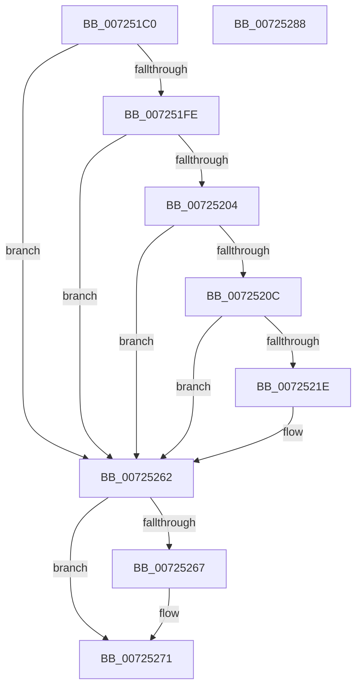

# PipGetDriverKsrGuidRegistryValue

- RVA: `0x007251C0`–`0x00725289` (길이 `201` bytes)
- VA: `0x00000001407251C0`
- 실행 섹션: `PAGE`
- PDB 이름 있음: `예`; PDB Function 태그: `아니요`
- unwind 정보 RVA: `0x000C826C`
- 디코드: `59`개 명령, `201/201` bytes 표시
- 미해석 바이트: `0` (있으면 어셈블리에 `.byte`로 보존)

> 이 문서는 커널 이미지의 기계어와 PDB 기호를 분석해 생성했습니다. 4번과 5번은 함수 원형과 자료형을 바이너리 사용 방식에서 추정한 C 해석이며 원본 소스 복구 결과는 아닙니다.

## 1. Dependencies

- 직접 호출 지점: **4**; 고유 호출 대상: **4**
- 직접 호출자로 확인된 함수: **1**
- RIP 상대 이미지 참조: **1**

### Outgoing calls
- `0x007251EE` → [IopGetRegistryValue](../99/IopGetRegistryValue_function_009990EC.md) (function, `0x009990EC`)
- `0x00725230` → [PnpRegSzToString](../A5/PnpRegSzToString_function_00A5DC40.md) (function, `0x00A5DC40`)
- `0x0072525B` → [RtlGUIDFromString](../8F/RtlGUIDFromString_function_008F1EF0.md) (function, `0x008F1EF0`)
- `0x0072526C` → [ExFreePoolWithTag](../../poolcode/B8/ExFreePoolWithTag_function_00B82870.md) (function, `0x00B82870`)

### Direct callers
- [PipGetDriverKsrGuid](PipGetDriverKsrGuid_function_00725100.md) at `0x00725180`

### Static image references
- `0x007251DD` → RVA `0x00AFD4A0` (` ?? ::NNGAKEGL::`string'`; read)

## 2. Other-region calls and transfers

- 다른 실행 섹션으로 향하는 call: **1**
  - `0x0072526C` → [ExFreePoolWithTag](../../poolcode/B8/ExFreePoolWithTag_function_00B82870.md) (`PAGE` → `POOLCODE`)
- 별도 외부 분기/꼬리 이동을 확인하지 못했습니다.

## 3. Assembly (complete function range)

```asm
007251C0  48 8B C4                        mov rax, rsp
007251C3  48 89 58 08                     mov qword ptr [rax + 8], rbx
007251C7  48 89 68 10                     mov qword ptr [rax + 0x10], rbp
007251CB  48 89 70 20                     mov qword ptr [rax + 0x20], rsi
007251CF  57                              push rdi
007251D0  48 83 EC 30                     sub rsp, 0x30
007251D4  48 8B F2                        mov rsi, rdx
007251D7  4C 8D 48 18                     lea r9, [rax + 0x18]
007251DB  33 ED                           xor ebp, ebp
007251DD  48 8D 15 BC 82 3D 00            lea rdx, [rip + 0x3d82bc]
007251E4  45 33 C0                        xor r8d, r8d
007251E7  89 68 EC                        mov dword ptr [rax - 0x14], ebp
007251EA  48 89 68 18                     mov qword ptr [rax + 0x18], rbp
007251EE  E8 F9 3E 27 00                  call 0x1409990ec
007251F3  48 8B 5C 24 50                  mov rbx, qword ptr [rsp + 0x50]
007251F8  8B F8                           mov edi, eax
007251FA  85 C0                           test eax, eax
007251FC  78 64                           js 0x140725262
007251FE  83 7B 04 01                     cmp dword ptr [rbx + 4], 1
00725202  75 5E                           jne 0x140725262
00725204  8B 4B 0C                        mov ecx, dword ptr [rbx + 0xc]
00725207  83 F9 02                        cmp ecx, 2
0072520A  72 56                           jb 0x140725262
0072520C  8B 43 08                        mov eax, dword ptr [rbx + 8]
0072520F  8B D1                           mov edx, ecx
00725211  48 D1 EA                        shr rdx, 1
00725214  48 03 C3                        add rax, rbx
00725217  66 39 6C 50 FE                  cmp word ptr [rax + rdx*2 - 2], bp
0072521C  75 44                           jne 0x140725262
0072521E  8B 4B 08                        mov ecx, dword ptr [rbx + 8]
00725221  4C 8D 44 24 50                  lea r8, [rsp + 0x50]
00725226  8B 53 0C                        mov edx, dword ptr [rbx + 0xc]
00725229  48 03 CB                        add rcx, rbx
0072522C  89 6C 24 50                     mov dword ptr [rsp + 0x50], ebp
00725230  E8 0B 8A 33 00                  call 0x140a5dc40
00725235  0F B7 43 0C                     movzx eax, word ptr [rbx + 0xc]
00725239  48 8B D6                        mov rdx, rsi
0072523C  0F B7 4C 24 50                  movzx ecx, word ptr [rsp + 0x50]
00725241  66 89 44 24 22                  mov word ptr [rsp + 0x22], ax
00725246  8B 43 08                        mov eax, dword ptr [rbx + 8]
00725249  48 03 C3                        add rax, rbx
0072524C  66 89 4C 24 20                  mov word ptr [rsp + 0x20], cx
00725251  48 8D 4C 24 20                  lea rcx, [rsp + 0x20]
00725256  48 89 44 24 28                  mov qword ptr [rsp + 0x28], rax
0072525B  E8 90 CC 1C 00                  call 0x1408f1ef0
00725260  8B F8                           mov edi, eax
00725262  48 85 DB                        test rbx, rbx
00725265  74 0A                           je 0x140725271
00725267  33 D2                           xor edx, edx
00725269  48 8B CB                        mov rcx, rbx
0072526C  E8 FF D5 45 00                  call 0x140b82870
00725271  48 8B 5C 24 40                  mov rbx, qword ptr [rsp + 0x40]
00725276  8B C7                           mov eax, edi
00725278  48 8B 6C 24 48                  mov rbp, qword ptr [rsp + 0x48]
0072527D  48 8B 74 24 58                  mov rsi, qword ptr [rsp + 0x58]
00725282  48 83 C4 30                     add rsp, 0x30
00725286  5F                              pop rdi
00725287  C3                              ret
00725288  CC                              int3
```

## 4. C-style interpretation (structured pseudocode)

```c
__int64 __fastcall PipGetDriverKsrGuidRegistryValue(__int64 a1, __int64 a2, int a3)
{
    __int64 result;
    __int64 v_rbp;
    __int64 v_rdi;
    __int64 v_rsp;
    unsigned __int64 v_stack_m10;
    unsigned __int16 v_stack_m16;
    unsigned __int16 v_stack_m18;
    unsigned __int64 v_stack_p10;
    unsigned __int64 v_stack_p18;
    unsigned __int64 v_stack_p20;
    unsigned __int64 v_stack_p8;

    *(unsigned __int64 *)(v_rsp + 8) = v_rbx;
    *(unsigned __int64 *)(v_rsp + 16) = v_rbp;
    *(unsigned __int64 *)(v_rsp + 32) = v_rsi;
    v_rsp = (v_rsp) - (48);
    v_rbp = 0;
    a3 = 0;
    *(unsigned int *)(v_rsp - 20) = 0;
    *(unsigned __int64 *)(v_rsp + 24) = 0;
    result = IopGetRegistryValue(a1, v_rip + 4031164, a3, v_rsp + 24);
    if (sign_flag) goto loc_00725262;
    if ((*(unsigned int *)(v_stack_p18 + 4)) != 1) goto loc_00725262;
    if (((unsigned int)((unsigned int)(*(unsigned int *)(v_stack_p18 + 12)))) < 2) goto loc_00725262;
    a2 = ((unsigned int)((unsigned int)((unsigned int)(*(unsigned int *)(v_stack_p18 + 12))))) >> (1);
    result = ((unsigned int)(*(unsigned int *)(v_stack_p18 + 8))) + (v_stack_p18);
    v_rdi = (unsigned int)((unsigned int)(result));
    if ((*(unsigned __int16 *)(result + a2 * 2 - 2)) == 0) {
        a1 = *(unsigned int *)(v_stack_p18 + 8);
        a3 = v_stack_p18;
        a2 = *(unsigned int *)(v_stack_p18 + 12);
        a1 = (a1) + (v_stack_p18);
        v_stack_p18 = 0;
        result = PnpRegSzToString(a1, a2, a3, v_rsp + 24);
        result = *(unsigned __int16 *)(v_stack_p18 + 12);
        a2 = a2;
        a1 = v_stack_p18;
        v_stack_m16 = (unsigned __int16)(result);
        result = *(unsigned int *)(v_stack_p18 + 8);
        result = (result) + (v_stack_p18);
        v_stack_m18 = (unsigned __int16)(a1);
        a1 = v_stack_m18;
        v_stack_m10 = result;
        result = RtlGUIDFromString(a1, a2, a3, v_rsp + 24);
        v_rdi = (unsigned int)(result);
    }
    if (v_stack_p18 != 0) {
        a2 = 0;
        a1 = v_stack_p18;
        result = ExFreePoolWithTag(a1, a2, a3, v_rsp + 24);
    }
    v_rsp = (v_rsp) + (48);
    return (unsigned int)((unsigned int)(v_rdi));
}
```

## 5. (Beta) C Style

```c
int64_t PipGetDriverKsrGuidRegistryValue(int64_t Arg1, int64_t Arg2, int32_t Arg3)
{
    int64_t result;
    int64_t local_rbp;
    int64_t local_rdi;
    int64_t local_rsp;
    uint64_t v_stack_m10;
    uint16_t v_stack_m16;
    uint16_t v_stack_m18;
    uint64_t v_stack_p10;
    uint64_t v_stack_p18;
    uint64_t v_stack_p20;
    uint64_t v_stack_p8;

    *(uint64_t *)(local_rsp + 0x8) = local_rbx;
    *(uint64_t *)(local_rsp + 0x10) = local_rbp;
    *(uint64_t *)(local_rsp + 0x20) = local_rsi;
    local_rsp = (local_rsp) - (48);
    local_rbp = 0;
    Arg3 = 0;
    *(uint32_t *)(local_rsp - 0x14) = 0;
    *(uint64_t *)(local_rsp + 0x18) = 0;
    result = IopGetRegistryValue(Arg1, v_rip + 4031164, Arg3, local_rsp + 24);
    if (sign_flag) goto loc_00725262;
    if ((*(uint32_t *)(v_stack_p18 + 0x4)) != 1) goto loc_00725262;
    if (((uint32_t)((uint32_t)(*(uint32_t *)(v_stack_p18 + 0xC)))) < 2) goto loc_00725262;
    Arg2 = ((uint32_t)((uint32_t)((uint32_t)(*(uint32_t *)(v_stack_p18 + 0xC))))) >> (1);
    result = ((uint32_t)(*(uint32_t *)(v_stack_p18 + 0x8))) + (v_stack_p18);
    local_rdi = (uint32_t)((uint32_t)(result));
    if ((*(uint16_t *)(result + Arg2 * 2 - 0x2)) == 0) {
        Arg1 = *(uint32_t *)(v_stack_p18 + 0x8);
        Arg3 = v_stack_p18;
        Arg2 = *(uint32_t *)(v_stack_p18 + 0xC);
        Arg1 = (Arg1) + (v_stack_p18);
        v_stack_p18 = 0;
        result = PnpRegSzToString(Arg1, Arg2, Arg3, local_rsp + 24);
        result = *(uint16_t *)(v_stack_p18 + 0xC);
        Arg2 = Arg2;
        Arg1 = v_stack_p18;
        v_stack_m16 = (uint16_t)(result);
        result = *(uint32_t *)(v_stack_p18 + 0x8);
        result = (result) + (v_stack_p18);
        v_stack_m18 = (uint16_t)(Arg1);
        Arg1 = v_stack_m18;
        v_stack_m10 = result;
        result = RtlGUIDFromString(Arg1, Arg2, Arg3, local_rsp + 24);
        local_rdi = (uint32_t)(result);
    }
    if (v_stack_p18 != 0) {
        Arg2 = 0;
        Arg1 = v_stack_p18;
        result = ExFreePoolWithTag(Arg1, Arg2, Arg3, local_rsp + 24);
    }
    local_rsp = (local_rsp) + (48);
    return (uint32_t)((uint32_t)(local_rdi));
}
```

## 6. Execution-region graph

[열기: 2D/3D 그래프와 함수 탐색 컨트롤 패널](../../../control-panel.html?section=page&rva=0x007251C0&view=graph)

- 2D 그래프는 위에서 아래로 흐르고, 3D 그래프는 빈 공간을 드래그해 회전합니다. Shift+드래그는 이동, 휠은 확대·축소, 함수 노드 선택은 대상 보고서 이동입니다.

### Static fallback


