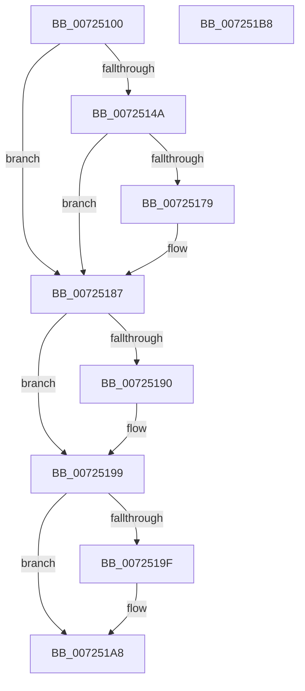

# PipGetDriverKsrGuid

- RVA: `0x00725100`–`0x007251B9` (길이 `185` bytes)
- VA: `0x0000000140725100`
- 실행 섹션: `PAGE`
- PDB 이름 있음: `예`; PDB Function 태그: `아니요`
- unwind 정보 RVA: `0x000C8258`
- 디코드: `54`개 명령, `185/185` bytes 표시
- 미해석 바이트: `0` (있으면 어셈블리에 `.byte`로 보존)

> 이 문서는 커널 이미지의 기계어와 PDB 기호를 분석해 생성했습니다. 4번과 5번은 함수 원형과 자료형을 바이너리 사용 방식에서 추정한 C 해석이며 원본 소스 복구 결과는 아닙니다.

## 1. Dependencies

- 직접 호출 지점: **5**; 고유 호출 대상: **4**
- 직접 호출자로 확인된 함수: **3**
- RIP 상대 이미지 참조: **1**

### Outgoing calls
- `0x0072513F` → [PipOpenServiceEnumKeys](../99/PipOpenServiceEnumKeys_function_00998E94.md) (function, `0x00998E94`)
- `0x0072516E` → [IopOpenRegistryKeyEx](../A5/IopOpenRegistryKeyEx_function_00A51B44.md) (function, `0x00A51B44`)
- `0x00725180` → [PipGetDriverKsrGuidRegistryValue](PipGetDriverKsrGuidRegistryValue_function_007251C0.md) (function, `0x007251C0`)
- `0x00725190` → [ZwClose](../../text/6A/ZwClose_function_006AD2B0.md) (function, `0x006AD2B0`)
- `0x007251A3` → [ZwClose](../../text/6A/ZwClose_function_006AD2B0.md) (function, `0x006AD2B0`)

### Direct callers
- [IoEnumerateKsrPersistentMemoryEx](../../text/5A/IoEnumerateKsrPersistentMemoryEx_function_005A5230.md) at `0x005A5293`
- [IoReserveKsrPersistentMemoryEx](IoReserveKsrPersistentMemoryEx_function_007248C0.md) at `0x00724ABA`
- [PipGetPersistentMemory](PipGetPersistentMemory_function_00725290.md) at `0x0072546A`

### Static image references
- `0x0072514E` → RVA `0x00AFD4B0` (` ?? ::NNGAKEGL::`string'`; read)

## 2. Other-region calls and transfers

- 다른 실행 섹션으로 향하는 call: **2**
  - `0x00725190` → [ZwClose](../../text/6A/ZwClose_function_006AD2B0.md) (`PAGE` → `.text`)
  - `0x007251A3` → [ZwClose](../../text/6A/ZwClose_function_006AD2B0.md) (`PAGE` → `.text`)
- 별도 외부 분기/꼬리 이동을 확인하지 못했습니다.

## 3. Assembly (complete function range)

```asm
00725100  48 89 5C 24 10                  mov qword ptr [rsp + 0x10], rbx
00725105  55                              push rbp
00725106  56                              push rsi
00725107  41 56                           push r14
00725109  48 8B EC                        mov rbp, rsp
0072510C  48 83 EC 40                     sub rsp, 0x40
00725110  48 8B 49 30                     mov rcx, qword ptr [rcx + 0x30]
00725114  4C 8D 45 30                     lea r8, [rbp + 0x30]
00725118  48 8B F2                        mov rsi, rdx
0072511B  C6 44 24 20 00                  mov byte ptr [rsp + 0x20], 0
00725120  0F 57 C0                        xorps xmm0, xmm0
00725123  49 83 CE FF                     or r14, 0xffffffffffffffff
00725127  48 83 C1 18                     add rcx, 0x18
0072512B  4C 89 75 20                     mov qword ptr [rbp + 0x20], r14
0072512F  45 33 C9                        xor r9d, r9d
00725132  4C 89 75 30                     mov qword ptr [rbp + 0x30], r14
00725136  BA 19 00 02 00                  mov edx, 0x20019
0072513B  0F 11 45 F0                     movups xmmword ptr [rbp - 0x10], xmm0
0072513F  E8 50 3D 27 00                  call 0x140998e94
00725144  8B D8                           mov ebx, eax
00725146  85 C0                           test eax, eax
00725148  78 3D                           js 0x140725187
0072514A  48 8B 55 30                     mov rdx, qword ptr [rbp + 0x30]
0072514E  48 8D 05 5B 83 3D 00            lea rax, [rip + 0x3d835b]
00725155  41 B9 19 00 02 00               mov r9d, 0x20019
0072515B  48 89 45 F8                     mov qword ptr [rbp - 8], rax
0072515F  4C 8D 45 F0                     lea r8, [rbp - 0x10]
00725163  C7 45 F0 14 00 16 00            mov dword ptr [rbp - 0x10], 0x160014
0072516A  48 8D 4D 20                     lea rcx, [rbp + 0x20]
0072516E  E8 D1 C9 32 00                  call 0x140a51b44
00725173  8B D8                           mov ebx, eax
00725175  85 C0                           test eax, eax
00725177  78 0E                           js 0x140725187
00725179  48 8B 4D 20                     mov rcx, qword ptr [rbp + 0x20]
0072517D  48 8B D6                        mov rdx, rsi
00725180  E8 3B 00 00 00                  call 0x1407251c0
00725185  8B D8                           mov ebx, eax
00725187  48 8B 4D 20                     mov rcx, qword ptr [rbp + 0x20]
0072518B  49 3B CE                        cmp rcx, r14
0072518E  74 09                           je 0x140725199
00725190  E8 1B 81 F8 FF                  call 0x1406ad2b0
00725195  4C 89 75 20                     mov qword ptr [rbp + 0x20], r14
00725199  4C 39 75 30                     cmp qword ptr [rbp + 0x30], r14
0072519D  74 09                           je 0x1407251a8
0072519F  48 8B 4D 30                     mov rcx, qword ptr [rbp + 0x30]
007251A3  E8 08 81 F8 FF                  call 0x1406ad2b0
007251A8  8B C3                           mov eax, ebx
007251AA  48 8B 5C 24 68                  mov rbx, qword ptr [rsp + 0x68]
007251AF  48 83 C4 40                     add rsp, 0x40
007251B3  41 5E                           pop r14
007251B5  5E                              pop rsi
007251B6  5D                              pop rbp
007251B7  C3                              ret
007251B8  CC                              int3
```

## 4. C-style interpretation (structured pseudocode)

```c
__int64 __fastcall PipGetDriverKsrGuid(__int64 a1, __int64 a2, __int64 a3, int a4)
{
    __int64 result;
    __int64 v_r14;
    __int64 v_rbx;
    __int64 v_rsp;
    unsigned __int64 v_stack_m20;
    unsigned __int64 v_stack_m28;
    unsigned __int8 v_stack_m38;
    unsigned __int64 v_stack_p10;
    unsigned __int64 v_stack_p18;
    unsigned __int64 v_stack_p8;

    v_stack_p10 = v_rbx;
    v_rsp = (v_rsp) - (64);
    v_stack_m38 = 0;
    v_r14 = (v_r14) | (-1);
    a1 = (*(unsigned __int64 *)(a1 + 48)) + (24);
    v_stack_p8 = v_r14;
    a4 = 0;
    v_stack_p18 = v_r14;
    v_stack_m28 = v_xmm0;
    result = PipOpenServiceEnumKeys(a1, (unsigned int)(0x20019ULL), v_stack_p18, a4);
    if (sign_flag) goto loc_00725187;
    v_stack_m20 = v_rip + 4031323;
    v_stack_m28 = 0x160014ULL;
    result = IopOpenRegistryKeyEx(v_stack_p8, v_stack_p18, v_stack_m28, (unsigned int)(0x20019ULL));
    v_rbx = (unsigned int)((unsigned int)(result));
    if (!(sign_flag)) {
        a1 = v_stack_p8;
        a2 = a2;
        result = PipGetDriverKsrGuidRegistryValue(a1, a2, v_stack_m28, (unsigned int)(0x20019ULL));
        v_rbx = (unsigned int)(result);
    }
    if (v_stack_p8 != v_r14) {
        result = ZwClose(v_stack_p8, a2, v_stack_m28, (unsigned int)(0x20019ULL));
        v_stack_p8 = v_r14;
    }
    if (v_stack_p18 != v_r14) {
        a1 = v_stack_p18;
        result = ZwClose(a1, a2, v_stack_m28, (unsigned int)(0x20019ULL));
    }
    v_rsp = (v_rsp) + (64);
    return (unsigned int)((unsigned int)(v_rbx));
}
```

## 5. (Beta) C Style

```c
int64_t PipGetDriverKsrGuid(void *Arg1, int64_t Arg2, int64_t Arg3, int32_t Arg4)
{
    uint8_t *arg1 = (uint8_t *)Arg1;

    int64_t result;
    int64_t local_r14;
    int64_t local_rbx;
    int64_t local_rsp;
    uint64_t v_stack_m20;
    uint64_t v_stack_m28;
    uint8_t v_stack_m38;
    uint64_t v_stack_p10;
    uint64_t v_stack_p18;
    uint64_t v_stack_p8;

    v_stack_p10 = local_rbx;
    local_rsp = (local_rsp) - (64);
    v_stack_m38 = 0;
    local_r14 = (local_r14) | (-1);
    Arg1 = (*(uint64_t *)(arg1 + 0x30)) + (24);
    v_stack_p8 = local_r14;
    Arg4 = 0;
    v_stack_p18 = local_r14;
    v_stack_m28 = v_xmm0;
    result = PipOpenServiceEnumKeys(Arg1, (uint32_t)(0x20019ULL), v_stack_p18, Arg4);
    if (sign_flag) goto loc_00725187;
    v_stack_m20 = v_rip + 4031323;
    v_stack_m28 = 0x160014ULL;
    result = IopOpenRegistryKeyEx(v_stack_p8, v_stack_p18, v_stack_m28, (uint32_t)(0x20019ULL));
    local_rbx = (uint32_t)((uint32_t)(result));
    if (!(sign_flag)) {
        Arg1 = v_stack_p8;
        Arg2 = Arg2;
        result = PipGetDriverKsrGuidRegistryValue(Arg1, Arg2, v_stack_m28, (uint32_t)(0x20019ULL));
        local_rbx = (uint32_t)(result);
    }
    if (v_stack_p8 != local_r14) {
        result = ZwClose(v_stack_p8, Arg2, v_stack_m28, (uint32_t)(0x20019ULL));
        v_stack_p8 = local_r14;
    }
    if (v_stack_p18 != local_r14) {
        Arg1 = v_stack_p18;
        result = ZwClose(Arg1, Arg2, v_stack_m28, (uint32_t)(0x20019ULL));
    }
    local_rsp = (local_rsp) + (64);
    return (uint32_t)((uint32_t)(local_rbx));
}
```

### 관측된 메모리 오프셋

구조체 형식이 확인되지 않은 접근은 인자 기준의 오프셋으로만 기록했습니다.

| 기준 인자 | 오프셋 표현 | 폭 (bit) | 접근 |
|---|---:|---:|---|
| `Arg1` | `+ 0x30` | `64` | `R` |

## 6. Execution-region graph

[열기: 2D/3D 그래프와 함수 탐색 컨트롤 패널](../../../control-panel.html?section=page&rva=0x00725100&view=graph)

- 2D 그래프는 위에서 아래로 흐르고, 3D 그래프는 빈 공간을 드래그해 회전합니다. Shift+드래그는 이동, 휠은 확대·축소, 함수 노드 선택은 대상 보고서 이동입니다.

### Static fallback


