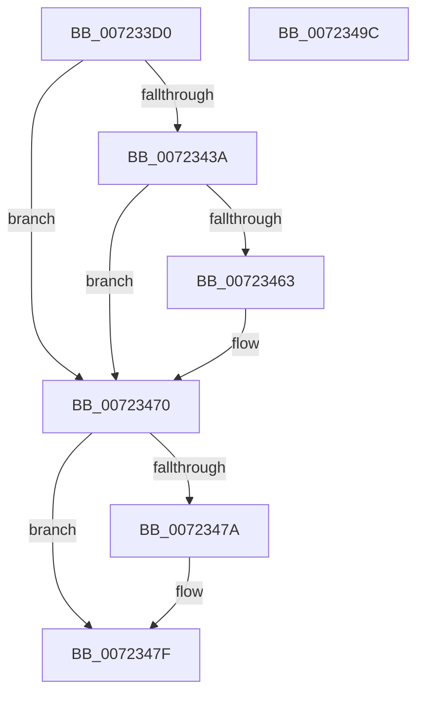

# PipHardwareConfigClearStartOverrideCallback

- RVA: `0x007233D0`–`0x0072349D` (길이 `205` bytes)
- VA: `0x00000001407233D0`
- 실행 섹션: `PAGE`
- PDB 이름 있음: `예`; PDB Function 태그: `아니요`
- unwind 정보 RVA: `0x000C8034`
- 디코드: `51`개 명령, `205/205` bytes 표시
- 미해석 바이트: `0` (있으면 어셈블리에 `.byte`로 보존)

> 이 문서는 커널 이미지의 기계어와 PDB 기호를 분석해 생성했습니다. 4번과 5번은 함수 원형과 자료형을 바이너리 사용 방식에서 추정한 C 해석이며 원본 소스 복구 결과는 아닙니다.

## 1. Dependencies

- 직접 호출 지점: **5**; 고유 호출 대상: **5**
- 직접 호출자로 확인된 함수: **0**
- RIP 상대 이미지 참조: **3**

### Outgoing calls
- `0x00723431` → [RtlStringCchPrintfExW](../../text/42/RtlStringCchPrintfExW_function_0042B390.md) (function, `0x0042B390`)
- `0x0072345A` → [PnpCtxRegOpenKey](../8E/PnpCtxRegOpenKey_function_008EF7B8.md) (function, `0x008EF7B8`)
- `0x0072346B` → [PnpCtxRegDeleteValue](../8F/PnpCtxRegDeleteValue_function_008FE5E0.md) (function, `0x008FE5E0`)
- `0x0072347A` → [ZwClose](../../text/6A/ZwClose_function_006AD2B0.md) (function, `0x006AD2B0`)
- `0x0072348C` → [_security_check_cookie](../../text/6A/_security_check_cookie_function_006AC640.md) (function, `0x006AC640`)

### Direct callers
- 이 함수 시작 RVA로 연결되는 직접 call은 확인되지 않았습니다. 간접 호출은 완전히 역산할 수 없습니다.

### Static image references
- `0x007233DB` → RVA `0x00E0A740` (`.data`; read)
- `0x007233F3` → RVA `0x00AFD350` (` ?? ::NNGAKEGL::`string'`; read)
- `0x00723407` → RVA `0x00AFD430` (` ?? ::NNGAKEGL::`string'`; read)

## 2. Other-region calls and transfers

- 다른 실행 섹션으로 향하는 call: **3**
  - `0x00723431` → [RtlStringCchPrintfExW](../../text/42/RtlStringCchPrintfExW_function_0042B390.md) (`PAGE` → `.text`)
  - `0x0072347A` → [ZwClose](../../text/6A/ZwClose_function_006AD2B0.md) (`PAGE` → `.text`)
  - `0x0072348C` → [_security_check_cookie](../../text/6A/_security_check_cookie_function_006AC640.md) (`PAGE` → `.text`)
- 별도 외부 분기/꼬리 이동을 확인하지 못했습니다.

## 3. Assembly (complete function range)

```asm
007233D0  40 53                           push rbx
007233D2  56                              push rsi
007233D3  57                              push rdi
007233D4  48 81 EC 70 02 00 00            sub rsp, 0x270
007233DB  48 8B 05 5E 73 6E 00            mov rax, qword ptr [rip + 0x6e735e]
007233E2  48 33 C4                        xor rax, rsp
007233E5  48 89 84 24 60 02 00 00         mov qword ptr [rsp + 0x260], rax
007233ED  48 83 64 24 40 00               and qword ptr [rsp + 0x40], 0
007233F3  48 8D 05 56 9F 3D 00            lea rax, [rip + 0x3d9f56]
007233FA  48 89 44 24 38                  mov qword ptr [rsp + 0x38], rax
007233FF  49 8B D9                        mov rbx, r9
00723402  4C 89 44 24 30                  mov qword ptr [rsp + 0x30], r8
00723407  48 8D 05 22 A0 3D 00            lea rax, [rip + 0x3da022]
0072340E  48 8B F2                        mov rsi, rdx
00723411  48 89 44 24 28                  mov qword ptr [rsp + 0x28], rax
00723416  48 8B F9                        mov rdi, rcx
00723419  C7 44 24 20 00 08 00 00         mov dword ptr [rsp + 0x20], 0x800
00723421  45 33 C9                        xor r9d, r9d
00723424  48 8D 4C 24 50                  lea rcx, [rsp + 0x50]
00723429  45 33 C0                        xor r8d, r8d
0072342C  BA 04 01 00 00                  mov edx, 0x104
00723431  E8 5A 7F D0 FF                  call 0x14042b390
00723436  85 C0                           test eax, eax
00723438  78 36                           js 0x140723470
0072343A  48 8D 44 24 40                  lea rax, [rsp + 0x40]
0072343F  45 33 C9                        xor r9d, r9d
00723442  48 89 44 24 28                  mov qword ptr [rsp + 0x28], rax
00723447  4C 8D 44 24 50                  lea r8, [rsp + 0x50]
0072344C  48 8B D6                        mov rdx, rsi
0072344F  C7 44 24 20 02 00 00 00         mov dword ptr [rsp + 0x20], 2
00723457  48 8B CF                        mov rcx, rdi
0072345A  E8 59 C3 1C 00                  call 0x1408ef7b8
0072345F  85 C0                           test eax, eax
00723461  78 0D                           js 0x140723470
00723463  48 8B 54 24 40                  mov rdx, qword ptr [rsp + 0x40]
00723468  4C 8B C3                        mov r8, rbx
0072346B  E8 70 B1 1D 00                  call 0x1408fe5e0
00723470  48 8B 4C 24 40                  mov rcx, qword ptr [rsp + 0x40]
00723475  48 85 C9                        test rcx, rcx
00723478  74 05                           je 0x14072347f
0072347A  E8 31 9E F8 FF                  call 0x1406ad2b0
0072347F  33 C0                           xor eax, eax
00723481  48 8B 8C 24 60 02 00 00         mov rcx, qword ptr [rsp + 0x260]
00723489  48 33 CC                        xor rcx, rsp
0072348C  E8 AF 91 F8 FF                  call 0x1406ac640
00723491  48 81 C4 70 02 00 00            add rsp, 0x270
00723498  5F                              pop rdi
00723499  5E                              pop rsi
0072349A  5B                              pop rbx
0072349B  C3                              ret
0072349C  CC                              int3
```

## 4. C-style interpretation (structured pseudocode)

```c
__int64 __fastcall PipHardwareConfigClearStartOverrideCallback(__int64 a1, __int64 a2, __int64 a3, __int64 a4)
{
    __int64 result;
    __int64 v_rsp;
    unsigned __int64 v_stack_m238;
    unsigned __int64 v_stack_m248;
    unsigned __int64 v_stack_m250;
    unsigned __int64 v_stack_m258;
    unsigned __int64 v_stack_m260;
    unsigned int v_stack_m268;
    unsigned __int64 v_stack_m28;

    v_rsp = (v_rsp) - (624);
    result = (*(unsigned __int64 *)(v_rip + 7238494)) ^ (v_rsp);
    v_stack_m28 = result;
    v_stack_m250 = v_rip + 4038486;
    v_stack_m258 = a3;
    v_stack_m260 = v_rip + 4038690;
    v_stack_m268 = 0x800ULL;
    a4 = 0;
    a3 = 0;
    result = RtlStringCchPrintfExW(v_stack_m238, 260, a3, a4);
    if (sign_flag) goto loc_00723470;
    a4 = 0;
    v_stack_m260 = v_stack_m248;
    v_stack_m268 = 2;
    result = PnpCtxRegOpenKey(a1, a2, v_stack_m238, a4);
    if (!(sign_flag)) {
        a2 = v_stack_m248;
        a3 = 0;
        result = PnpCtxRegDeleteValue(a1, a2, a3, a4);
    }
    if (v_stack_m248 != 0) {
        result = ZwClose(v_stack_m248, a2, a3, a4);
    }
    result = 0;
    a1 = (v_stack_m28) ^ (v_rsp);
    result = _security_check_cookie(a1, a2, a3, a4);
    v_rsp = (v_rsp) + (624);
    return result;
}
```

## 5. (Beta) C Style

```c
int64_t PipHardwareConfigClearStartOverrideCallback(int64_t Arg1, int64_t Arg2, int64_t Arg3, int64_t Arg4)
{
    int64_t result;
    int64_t local_rsp;
    uint64_t v_stack_m238;
    uint64_t v_stack_m248;
    uint64_t v_stack_m250;
    uint64_t v_stack_m258;
    uint64_t v_stack_m260;
    uint32_t v_stack_m268;
    uint64_t v_stack_m28;

    local_rsp = (local_rsp) - (624);
    result = (*(uint64_t *)(v_rip + 0x6E735E)) ^ (local_rsp);
    v_stack_m28 = result;
    v_stack_m250 = v_rip + 4038486;
    v_stack_m258 = Arg3;
    v_stack_m260 = v_rip + 4038690;
    v_stack_m268 = 0x800ULL;
    Arg4 = 0;
    Arg3 = 0;
    result = RtlStringCchPrintfExW(v_stack_m238, 260, Arg3, Arg4);
    if (sign_flag) goto loc_00723470;
    Arg4 = 0;
    v_stack_m260 = v_stack_m248;
    v_stack_m268 = 2;
    result = PnpCtxRegOpenKey(Arg1, Arg2, v_stack_m238, Arg4);
    if (!(sign_flag)) {
        Arg2 = v_stack_m248;
        Arg3 = 0;
        result = PnpCtxRegDeleteValue(Arg1, Arg2, Arg3, Arg4);
    }
    if (v_stack_m248 != 0) {
        result = ZwClose(v_stack_m248, Arg2, Arg3, Arg4);
    }
    result = 0;
    Arg1 = (v_stack_m28) ^ (local_rsp);
    result = _security_check_cookie(Arg1, Arg2, Arg3, Arg4);
    local_rsp = (local_rsp) + (624);
    return result;
}
```

## 6. Execution-region graph

[열기: 2D/3D 그래프와 함수 탐색 컨트롤 패널](../../../control-panel.html?section=page&rva=0x007233D0&view=graph)

- 2D 그래프는 위에서 아래로 흐르고, 3D 그래프는 빈 공간을 드래그해 회전합니다. Shift+드래그는 이동, 휠은 확대·축소, 함수 노드 선택은 대상 보고서 이동입니다.

### Static fallback


