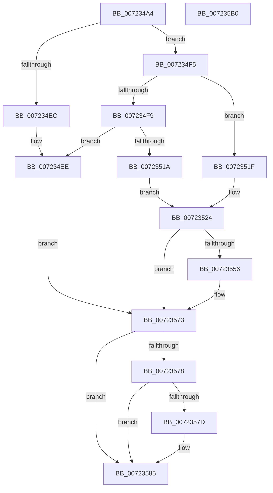

# PipHardwareConfigClearStartOverrides

- RVA: `0x007234A4`–`0x007235B1` (길이 `269` bytes)
- VA: `0x00000001407234A4`
- 실행 섹션: `PAGE`
- PDB 이름 있음: `예`; PDB Function 태그: `아니요`
- unwind 정보 RVA: `0x000C8050`
- 디코드: `68`개 명령, `269/269` bytes 표시
- 미해석 바이트: `0` (있으면 어셈블리에 `.byte`로 보존)

> 이 문서는 커널 이미지의 기계어와 PDB 기호를 분석해 생성했습니다. 4번과 5번은 함수 원형과 자료형을 바이너리 사용 방식에서 추정한 C 해석이며 원본 소스 복구 결과는 아닙니다.

## 1. Dependencies

- 직접 호출 지점: **6**; 고유 호출 대상: **6**
- 직접 호출자로 확인된 함수: **1**
- RIP 상대 이미지 참조: **4**

### Outgoing calls
- `0x007234E0` → [PiOpenDriverRedirectedStateRootKey](PiOpenDriverRedirectedStateRootKey_function_0072935C.md) (function, `0x0072935C`)
- `0x0072350A` → [_PnpCtxGetCachedContextBaseKey](../8E/_PnpCtxGetCachedContextBaseKey_function_008EFB2C.md) (function, `0x008EFB2C`)
- `0x0072354B` → [RtlStringCchPrintfExW](../../text/42/RtlStringCchPrintfExW_function_0042B390.md) (function, `0x0042B390`)
- `0x0072356C` → [PnpCtxRegEnumKeyWithCallback](../AA/PnpCtxRegEnumKeyWithCallback_function_00AA146C.md) (function, `0x00AA146C`)
- `0x00723580` → [ZwClose](../../text/6A/ZwClose_function_006AD2B0.md) (function, `0x006AD2B0`)
- `0x00723592` → [_security_check_cookie](../../text/6A/_security_check_cookie_function_006AC640.md) (function, `0x006AC640`)

### Direct callers
- [PipHardwareConfigInit](../../init/C3/PipHardwareConfigInit_function_00C30D24.md) at `0x00C3116D`

### Static image references
- `0x007234BB` → RVA `0x00E0A740` (`.data`; read)
- `0x007234F9` → RVA `0x00E66398` (`.data`; read)
- `0x0072352B` → RVA `0x00AFCAE0` (` ?? ::NNGAKEGL::`string'`; read)
- `0x00723562` → RVA `0x007233D0` (`PipHardwareConfigClearStartOverrideCallback`; read)

## 2. Other-region calls and transfers

- 다른 실행 섹션으로 향하는 call: **3**
  - `0x0072354B` → [RtlStringCchPrintfExW](../../text/42/RtlStringCchPrintfExW_function_0042B390.md) (`PAGE` → `.text`)
  - `0x00723580` → [ZwClose](../../text/6A/ZwClose_function_006AD2B0.md) (`PAGE` → `.text`)
  - `0x00723592` → [_security_check_cookie](../../text/6A/_security_check_cookie_function_006AC640.md) (`PAGE` → `.text`)
- 별도 외부 분기/꼬리 이동을 확인하지 못했습니다.

## 3. Assembly (complete function range)

```asm
007234A4  48 89 5C 24 10                  mov qword ptr [rsp + 0x10], rbx
007234A9  48 89 6C 24 18                  mov qword ptr [rsp + 0x18], rbp
007234AE  48 89 74 24 20                  mov qword ptr [rsp + 0x20], rsi
007234B3  57                              push rdi
007234B4  48 81 EC E0 00 00 00            sub rsp, 0xe0
007234BB  48 8B 05 7E 72 6E 00            mov rax, qword ptr [rip + 0x6e727e]
007234C2  48 33 C4                        xor rax, rsp
007234C5  48 89 84 24 D0 00 00 00         mov qword ptr [rsp + 0xd0], rax
007234CD  33 FF                           xor edi, edi
007234CF  48 8D 54 24 40                  lea rdx, [rsp + 0x40]
007234D4  48 21 7C 24 40                  and qword ptr [rsp + 0x40], rdi
007234D9  8B E9                           mov ebp, ecx
007234DB  48 89 7C 24 48                  mov qword ptr [rsp + 0x48], rdi
007234E0  E8 77 5E 00 00                  call 0x14072935c
007234E5  3D 25 02 00 C0                  cmp eax, 0xc0000225
007234EA  75 09                           jne 0x1407234f5
007234EC  33 F6                           xor esi, esi
007234EE  48 8B 5C 24 40                  mov rbx, qword ptr [rsp + 0x40]
007234F3  EB 7E                           jmp 0x140723573
007234F5  85 C0                           test eax, eax
007234F7  79 26                           jns 0x14072351f
007234F9  48 8B 0D 98 2E 74 00            mov rcx, qword ptr [rip + 0x742e98]
00723500  4C 8D 44 24 48                  lea r8, [rsp + 0x48]
00723505  BA 06 00 00 00                  mov edx, 6
0072350A  E8 1D C6 1C 00                  call 0x1408efb2c
0072350F  48 8B 7C 24 48                  mov rdi, qword ptr [rsp + 0x48]
00723514  8B F0                           mov esi, eax
00723516  85 C0                           test eax, eax
00723518  78 D4                           js 0x1407234ee
0072351A  48 8B DF                        mov rbx, rdi
0072351D  EB 05                           jmp 0x140723524
0072351F  48 8B 5C 24 40                  mov rbx, qword ptr [rsp + 0x40]
00723524  45 33 C9                        xor r9d, r9d
00723527  89 6C 24 30                     mov dword ptr [rsp + 0x30], ebp
0072352B  48 8D 05 AE 95 3D 00            lea rax, [rip + 0x3d95ae]
00723532  45 33 C0                        xor r8d, r8d
00723535  48 89 44 24 28                  mov qword ptr [rsp + 0x28], rax
0072353A  48 8D 4C 24 50                  lea rcx, [rsp + 0x50]
0072353F  C7 44 24 20 00 08 00 00         mov dword ptr [rsp + 0x20], 0x800
00723547  41 8D 51 40                     lea edx, [r9 + 0x40]
0072354B  E8 40 7E D0 FF                  call 0x14042b390
00723550  8B F0                           mov esi, eax
00723552  85 C0                           test eax, eax
00723554  78 1D                           js 0x140723573
00723556  48 8B 0D 3B 2E 74 00            mov rcx, qword ptr [rip + 0x742e3b]
0072355D  4C 8D 4C 24 50                  lea r9, [rsp + 0x50]
00723562  4C 8D 05 67 FE FF FF            lea r8, [rip - 0x199]
00723569  48 8B D3                        mov rdx, rbx
0072356C  E8 FB DE 37 00                  call 0x140aa146c
00723571  8B F0                           mov esi, eax
00723573  48 85 DB                        test rbx, rbx
00723576  74 0D                           je 0x140723585
00723578  48 3B DF                        cmp rbx, rdi
0072357B  74 08                           je 0x140723585
0072357D  48 8B CB                        mov rcx, rbx
00723580  E8 2B 9D F8 FF                  call 0x1406ad2b0
00723585  8B C6                           mov eax, esi
00723587  48 8B 8C 24 D0 00 00 00         mov rcx, qword ptr [rsp + 0xd0]
0072358F  48 33 CC                        xor rcx, rsp
00723592  E8 A9 90 F8 FF                  call 0x1406ac640
00723597  4C 8D 9C 24 E0 00 00 00         lea r11, [rsp + 0xe0]
0072359F  49 8B 5B 18                     mov rbx, qword ptr [r11 + 0x18]
007235A3  49 8B 6B 20                     mov rbp, qword ptr [r11 + 0x20]
007235A7  49 8B 73 28                     mov rsi, qword ptr [r11 + 0x28]
007235AB  49 8B E3                        mov rsp, r11
007235AE  5F                              pop rdi
007235AF  C3                              ret
007235B0  CC                              int3
```

## 4. C-style interpretation (structured pseudocode)

```c
__int64 __fastcall PipHardwareConfigClearStartOverrides(int a1, __int64 a2, __int64 a3, int a4)
{
    __int64 result;
    __int64 v_rdi;
    __int64 v_rsi;
    __int64 v_rsp;
    unsigned __int64 v_stack_m18;
    unsigned __int64 v_stack_m8;
    unsigned __int64 v_stack_m98;
    unsigned __int64 v_stack_mA0;
    unsigned __int64 v_stack_mA8;
    unsigned int v_stack_mB8;
    unsigned __int64 v_stack_mC0;
    unsigned int v_stack_mC8;
    unsigned __int64 v_stack_p10;
    unsigned __int64 v_stack_p18;
    unsigned __int64 v_stack_p20;

    v_stack_p10 = v_rbx;
    v_stack_p18 = v_rbp;
    v_stack_p20 = v_rsi;
    v_rsp = (v_rsp) - (224);
    result = (*(unsigned __int64 *)(v_rip + 7238270)) ^ (v_rsp);
    v_stack_m18 = result;
    v_rdi = 0;
    v_stack_mA0 = 0;
    result = PiOpenDriverRedirectedStateRootKey(a1, v_stack_mA8, a3, a4);
    if (((unsigned int)(result)) != 0xC0000225ULL) goto loc_007234F5;
    v_rsi = 0;
loc_007234EE:
    goto loc_00723573;
loc_007234F5:
    if (!sign_flag) goto loc_0072351F;
    result = _PnpCtxGetCachedContextBaseKey(*(unsigned __int64 *)(v_rip + 7614104), 6, v_stack_mA0, a4);
    if (sign_flag) goto loc_007234EE;
    goto loc_00723524;
loc_0072351F:
loc_00723524:
    a4 = 0;
    v_stack_mB8 = (unsigned int)((unsigned int)(a1));
    a3 = 0;
    v_stack_mC0 = v_rip + 4036014;
    v_stack_mC8 = 0x800ULL;
    result = RtlStringCchPrintfExW(v_stack_m98, a4 + 64, a3, a4);
    v_rsi = (unsigned int)((unsigned int)(result));
    if (!(sign_flag)) {
        a1 = *(unsigned __int64 *)(v_rip + 7614011);
        a4 = v_stack_m98;
        a3 = v_rip - 409;
        a2 = v_stack_mA8;
        result = PnpCtxRegEnumKeyWithCallback(a1, a2, a3, a4);
        v_rsi = (unsigned int)(result);
    }
    if (v_stack_mA8 == 0) goto loc_00723585;
    if (v_stack_mA8 != v_stack_mA0) {
        a1 = v_stack_mA8;
        result = ZwClose(a1, a2, a3, a4);
    }
    a1 = (v_stack_m18) ^ (v_rsp);
    result = _security_check_cookie(a1, a2, a3, a4);
    return result;
}
```

## 5. (Beta) C Style

```c
int64_t PipHardwareConfigClearStartOverrides(int32_t Arg1, int64_t Arg2, int64_t Arg3, int32_t Arg4)
{
    int64_t result;
    int64_t local_rdi;
    int64_t local_rsi;
    int64_t local_rsp;
    uint64_t v_stack_m18;
    uint64_t v_stack_m8;
    uint64_t v_stack_m98;
    uint64_t v_stack_mA0;
    uint64_t v_stack_mA8;
    uint32_t v_stack_mB8;
    uint64_t v_stack_mC0;
    uint32_t v_stack_mC8;
    uint64_t v_stack_p10;
    uint64_t v_stack_p18;
    uint64_t v_stack_p20;

    v_stack_p10 = local_rbx;
    v_stack_p18 = local_rbp;
    v_stack_p20 = local_rsi;
    local_rsp = (local_rsp) - (224);
    result = (*(uint64_t *)(v_rip + 0x6E727E)) ^ (local_rsp);
    v_stack_m18 = result;
    local_rdi = 0;
    v_stack_mA0 = 0;
    result = PiOpenDriverRedirectedStateRootKey(Arg1, v_stack_mA8, Arg3, Arg4);
    if (((uint32_t)(result)) != 0xC0000225ULL) goto loc_007234F5;
    local_rsi = 0;
loc_007234EE:
    goto loc_00723573;
loc_007234F5:
    if (!sign_flag) goto loc_0072351F;
    result = _PnpCtxGetCachedContextBaseKey(*(uint64_t *)(v_rip + 0x742E98), 6, v_stack_mA0, Arg4);
    if (sign_flag) goto loc_007234EE;
    goto loc_00723524;
loc_0072351F:
loc_00723524:
    Arg4 = 0;
    v_stack_mB8 = (uint32_t)((uint32_t)(Arg1));
    Arg3 = 0;
    v_stack_mC0 = v_rip + 4036014;
    v_stack_mC8 = 0x800ULL;
    result = RtlStringCchPrintfExW(v_stack_m98, Arg4 + 64, Arg3, Arg4);
    local_rsi = (uint32_t)((uint32_t)(result));
    if (!(sign_flag)) {
        Arg1 = *(uint64_t *)(v_rip + 0x742E3B);
        Arg4 = v_stack_m98;
        Arg3 = v_rip - 409;
        Arg2 = v_stack_mA8;
        result = PnpCtxRegEnumKeyWithCallback(Arg1, Arg2, Arg3, Arg4);
        local_rsi = (uint32_t)(result);
    }
    if (v_stack_mA8 == 0) goto loc_00723585;
    if (v_stack_mA8 != v_stack_mA0) {
        Arg1 = v_stack_mA8;
        result = ZwClose(Arg1, Arg2, Arg3, Arg4);
    }
    Arg1 = (v_stack_m18) ^ (local_rsp);
    result = _security_check_cookie(Arg1, Arg2, Arg3, Arg4);
    return result;
}
```

## 6. Execution-region graph

[열기: 2D/3D 그래프와 함수 탐색 컨트롤 패널](../../../control-panel.html?section=page&rva=0x007234A4&view=graph)

- 2D 그래프는 위에서 아래로 흐르고, 3D 그래프는 빈 공간을 드래그해 회전합니다. Shift+드래그는 이동, 휠은 확대·축소, 함수 노드 선택은 대상 보고서 이동입니다.

### Static fallback


