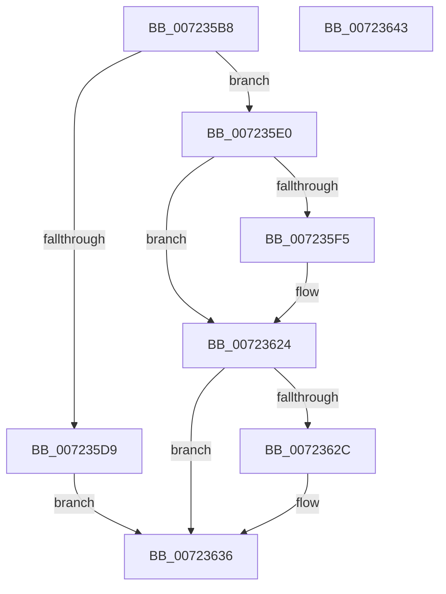

# PipHardwareConfigGetIndex

- RVA: `0x007235B8`–`0x00723644` (길이 `140` bytes)
- VA: `0x00000001407235B8`
- 실행 섹션: `PAGE`
- PDB 이름 있음: `예`; PDB Function 태그: `아니요`
- unwind 정보 RVA: `0x000AC048`
- 디코드: `37`개 명령, `140/140` bytes 표시
- 미해석 바이트: `0` (있으면 어셈블리에 `.byte`로 보존)

> 이 문서는 커널 이미지의 기계어와 PDB 기호를 분석해 생성했습니다. 4번과 5번은 함수 원형과 자료형을 바이너리 사용 방식에서 추정한 C 해석이며 원본 소스 복구 결과는 아닙니다.

## 1. Dependencies

- 직접 호출 지점: **3**; 고유 호출 대상: **3**
- 직접 호출자로 확인된 함수: **1**
- RIP 상대 이미지 참조: **1**

### Outgoing calls
- `0x007235EA` → [PipHardwareConfigOpenKey](../AD/PipHardwareConfigOpenKey_function_00AD8848.md) (function, `0x00AD8848`)
- `0x0072361D` → [PnpCtxRegQueryValue](../99/PnpCtxRegQueryValue_function_009940FC.md) (function, `0x009940FC`)
- `0x00723631` → [ZwClose](../../text/6A/ZwClose_function_006AD2B0.md) (function, `0x006AD2B0`)

### Direct callers
- [IopInitializeBootDrivers](../../init/C2/IopInitializeBootDrivers_function_00C2E6F4.md) at `0x00C2EFBC`

### Static image references
- `0x00723609` → RVA `0x00AFD410` (` ?? ::NNGAKEGL::`string'`; read)

## 2. Other-region calls and transfers

- 다른 실행 섹션으로 향하는 call: **1**
  - `0x00723631` → [ZwClose](../../text/6A/ZwClose_function_006AD2B0.md) (`PAGE` → `.text`)
- 별도 외부 분기/꼬리 이동을 확인하지 못했습니다.

## 3. Assembly (complete function range)

```asm
007235B8  48 8B C4                        mov rax, rsp
007235BB  48 89 58 20                     mov qword ptr [rax + 0x20], rbx
007235BF  48 89 48 08                     mov qword ptr [rax + 8], rcx
007235C3  56                              push rsi
007235C4  48 83 EC 30                     sub rsp, 0x30
007235C8  83 60 10 00                     and dword ptr [rax + 0x10], 0
007235CC  48 8B F2                        mov rsi, rdx
007235CF  48 83 60 18 00                  and qword ptr [rax + 0x18], 0
007235D4  48 85 D2                        test rdx, rdx
007235D7  75 07                           jne 0x1407235e0
007235D9  BB 0D 00 00 C0                  mov ebx, 0xc000000d
007235DE  EB 56                           jmp 0x140723636
007235E0  4C 8D 44 24 50                  lea r8, [rsp + 0x50]
007235E5  BA 19 00 02 00                  mov edx, 0x20019
007235EA  E8 59 52 3B 00                  call 0x140ad8848
007235EF  8B D8                           mov ebx, eax
007235F1  85 C0                           test eax, eax
007235F3  78 2F                           js 0x140723624
007235F5  48 8B 54 24 50                  mov rdx, qword ptr [rsp + 0x50]
007235FA  48 8D 44 24 40                  lea rax, [rsp + 0x40]
007235FF  48 89 44 24 28                  mov qword ptr [rsp + 0x28], rax
00723604  4C 8D 4C 24 48                  lea r9, [rsp + 0x48]
00723609  4C 8D 05 00 9E 3D 00            lea r8, [rip + 0x3d9e00]
00723610  48 89 74 24 20                  mov qword ptr [rsp + 0x20], rsi
00723615  C7 44 24 40 04 00 00 00         mov dword ptr [rsp + 0x40], 4
0072361D  E8 DA 0A 27 00                  call 0x1409940fc
00723622  8B D8                           mov ebx, eax
00723624  48 83 7C 24 50 00               cmp qword ptr [rsp + 0x50], 0
0072362A  74 0A                           je 0x140723636
0072362C  48 8B 4C 24 50                  mov rcx, qword ptr [rsp + 0x50]
00723631  E8 7A 9C F8 FF                  call 0x1406ad2b0
00723636  8B C3                           mov eax, ebx
00723638  48 8B 5C 24 58                  mov rbx, qword ptr [rsp + 0x58]
0072363D  48 83 C4 30                     add rsp, 0x30
00723641  5E                              pop rsi
00723642  C3                              ret
00723643  CC                              int3
```

## 4. C-style interpretation (structured pseudocode)

```c
__int64 __fastcall PipHardwareConfigGetIndex(__int64 a1, __int64 a2)
{
    __int64 result;
    __int64 v_rbx;
    __int64 v_rsp;
    unsigned __int64 v_stack_m10;
    unsigned __int64 v_stack_m18;
    unsigned __int64 v_stack_p10;
    unsigned __int64 v_stack_p18;
    unsigned __int64 v_stack_p20;
    unsigned __int64 v_stack_p8;

    *(unsigned __int64 *)(v_rsp + 32) = v_rbx;
    *(unsigned __int64 *)(v_rsp + 8) = a1;
    v_rsp = (v_rsp) - (48);
    if (a2 != 0) goto loc_007235E0;
    goto loc_00723636;
loc_007235E0:
    result = PipHardwareConfigOpenKey(a1, (unsigned int)(0x20019ULL), v_stack_p18, a4);
    v_rbx = (unsigned int)((unsigned int)(result));
    if (!(sign_flag)) {
        a2 = v_stack_p18;
        result = v_stack_p8;
        v_stack_m10 = result;
        a4 = v_stack_p10;
        a3 = v_rip + 4038144;
        v_stack_m18 = a2;
        v_stack_p8 = 4;
        result = PnpCtxRegQueryValue(a1, a2, a3, a4);
        v_rbx = (unsigned int)(result);
    }
    if (v_stack_p18 != 0) {
        a1 = v_stack_p18;
        result = ZwClose(a1, a2, a3, a4);
    }
    v_rsp = (v_rsp) + (48);
    return (unsigned int)((unsigned int)(v_rbx));
}
```

## 5. (Beta) C Style

```c
int64_t PipHardwareConfigGetIndex(int64_t Arg1, int64_t Arg2)
{
    int64_t result;
    int64_t local_rbx;
    int64_t local_rsp;
    uint64_t v_stack_m10;
    uint64_t v_stack_m18;
    uint64_t v_stack_p10;
    uint64_t v_stack_p18;
    uint64_t v_stack_p20;
    uint64_t v_stack_p8;

    *(uint64_t *)(local_rsp + 0x20) = local_rbx;
    *(uint64_t *)(local_rsp + 0x8) = Arg1;
    local_rsp = (local_rsp) - (48);
    if (Arg2 != 0) goto loc_007235E0;
    goto loc_00723636;
loc_007235E0:
    result = PipHardwareConfigOpenKey(Arg1, (uint32_t)(0x20019ULL), v_stack_p18, a4);
    local_rbx = (uint32_t)((uint32_t)(result));
    if (!(sign_flag)) {
        Arg2 = v_stack_p18;
        result = v_stack_p8;
        v_stack_m10 = result;
        a4 = v_stack_p10;
        a3 = v_rip + 4038144;
        v_stack_m18 = Arg2;
        v_stack_p8 = 4;
        result = PnpCtxRegQueryValue(Arg1, Arg2, a3, a4);
        local_rbx = (uint32_t)(result);
    }
    if (v_stack_p18 != 0) {
        Arg1 = v_stack_p18;
        result = ZwClose(Arg1, Arg2, a3, a4);
    }
    local_rsp = (local_rsp) + (48);
    return (uint32_t)((uint32_t)(local_rbx));
}
```

## 6. Execution-region graph

[열기: 2D/3D 그래프와 함수 탐색 컨트롤 패널](../../../control-panel.html?section=page&rva=0x007235B8&view=graph)

- 2D 그래프는 위에서 아래로 흐르고, 3D 그래프는 빈 공간을 드래그해 회전합니다. Shift+드래그는 이동, 휠은 확대·축소, 함수 노드 선택은 대상 보고서 이동입니다.

### Static fallback


