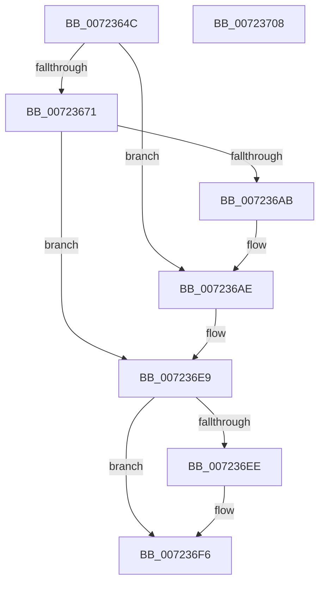

# PipHardwareConfigTriggerRespecialize

- RVA: `0x0072364C`–`0x00723709` (길이 `189` bytes)
- VA: `0x000000014072364C`
- 실행 섹션: `PAGE`
- PDB 이름 있음: `예`; PDB Function 태그: `아니요`
- unwind 정보 RVA: `0x000C8020`
- 디코드: `49`개 명령, `189/189` bytes 표시
- 미해석 바이트: `0` (있으면 어셈블리에 `.byte`로 보존)

> 이 문서는 커널 이미지의 기계어와 PDB 기호를 분석해 생성했습니다. 4번과 5번은 함수 원형과 자료형을 바이너리 사용 방식에서 추정한 C 해석이며 원본 소스 복구 결과는 아닙니다.

## 1. Dependencies

- 직접 호출 지점: **3**; 고유 호출 대상: **3**
- 직접 호출자로 확인된 함수: **1**
- RIP 상대 이미지 참조: **2**

### Outgoing calls
- `0x0072369C` → [IopCreateRegistryKeyEx](../A8/IopCreateRegistryKeyEx_function_00A89038.md) (function, `0x00A89038`)
- `0x007236E2` → [ZwSetValueKey](../../text/6A/ZwSetValueKey_function_006ADCD0.md) (function, `0x006ADCD0`)
- `0x007236F1` → [ZwClose](../../text/6A/ZwClose_function_006AD2B0.md) (function, `0x006AD2B0`)

### Direct callers
- [PipHardwareConfigInit](../../init/C3/PipHardwareConfigInit_function_00C30D24.md) at `0x00C31236`

### Static image references
- `0x00723676` → RVA `0x00AFD440` (` ?? ::NNGAKEGL::`string'`; read)
- `0x007236AE` → RVA `0x00AFD380` (` ?? ::NNGAKEGL::`string'`; read)

## 2. Other-region calls and transfers

- 다른 실행 섹션으로 향하는 call: **2**
  - `0x007236E2` → [ZwSetValueKey](../../text/6A/ZwSetValueKey_function_006ADCD0.md) (`PAGE` → `.text`)
  - `0x007236F1` → [ZwClose](../../text/6A/ZwClose_function_006AD2B0.md) (`PAGE` → `.text`)
- 별도 외부 분기/꼬리 이동을 확인하지 못했습니다.

## 3. Assembly (complete function range)

```asm
0072364C  48 89 5C 24 18                  mov qword ptr [rsp + 0x18], rbx
00723651  48 89 7C 24 20                  mov qword ptr [rsp + 0x20], rdi
00723656  55                              push rbp
00723657  48 8B EC                        mov rbp, rsp
0072365A  48 83 EC 40                     sub rsp, 0x40
0072365E  83 65 10 00                     and dword ptr [rbp + 0x10], 0
00723662  33 DB                           xor ebx, ebx
00723664  83 65 F4 00                     and dword ptr [rbp - 0xc], 0
00723668  48 89 5D 18                     mov qword ptr [rbp + 0x18], rbx
0072366C  48 85 C9                        test rcx, rcx
0072366F  75 3D                           jne 0x1407236ae
00723671  48 21 5C 24 28                  and qword ptr [rsp + 0x28], rbx
00723676  48 8D 05 C3 9D 3D 00            lea rax, [rip + 0x3d9dc3]
0072367D  21 5C 24 20                     and dword ptr [rsp + 0x20], ebx
00723681  4C 8D 45 F0                     lea r8, [rbp - 0x10]
00723685  41 B9 3F 00 0F 00               mov r9d, 0xf003f
0072368B  48 89 45 F8                     mov qword ptr [rbp - 8], rax
0072368F  33 D2                           xor edx, edx
00723691  C7 45 F0 3C 00 3E 00            mov dword ptr [rbp - 0x10], 0x3e003c
00723698  48 8D 4D 18                     lea rcx, [rbp + 0x18]
0072369C  E8 97 59 36 00                  call 0x140a89038
007236A1  48 8B 5D 18                     mov rbx, qword ptr [rbp + 0x18]
007236A5  8B F8                           mov edi, eax
007236A7  85 C0                           test eax, eax
007236A9  78 3E                           js 0x1407236e9
007236AB  48 8B CB                        mov rcx, rbx
007236AE  48 8D 05 CB 9C 3D 00            lea rax, [rip + 0x3d9ccb]
007236B5  C7 45 10 01 00 00 00            mov dword ptr [rbp + 0x10], 1
007236BC  48 89 45 F8                     mov qword ptr [rbp - 8], rax
007236C0  48 8D 55 F0                     lea rdx, [rbp - 0x10]
007236C4  41 B9 04 00 00 00               mov r9d, 4
007236CA  C7 45 F0 18 00 1A 00            mov dword ptr [rbp - 0x10], 0x1a0018
007236D1  48 8D 45 10                     lea rax, [rbp + 0x10]
007236D5  44 89 4C 24 28                  mov dword ptr [rsp + 0x28], r9d
007236DA  45 33 C0                        xor r8d, r8d
007236DD  48 89 44 24 20                  mov qword ptr [rsp + 0x20], rax
007236E2  E8 E9 A5 F8 FF                  call 0x1406adcd0
007236E7  8B F8                           mov edi, eax
007236E9  48 85 DB                        test rbx, rbx
007236EC  74 08                           je 0x1407236f6
007236EE  48 8B CB                        mov rcx, rbx
007236F1  E8 BA 9B F8 FF                  call 0x1406ad2b0
007236F6  48 8B 5C 24 60                  mov rbx, qword ptr [rsp + 0x60]
007236FB  8B C7                           mov eax, edi
007236FD  48 8B 7C 24 68                  mov rdi, qword ptr [rsp + 0x68]
00723702  48 83 C4 40                     add rsp, 0x40
00723706  5D                              pop rbp
00723707  C3                              ret
00723708  CC                              int3
```

## 4. C-style interpretation (structured pseudocode)

```c
__int64 __fastcall PipHardwareConfigTriggerRespecialize(__int64 a1, int a2)
{
    __int64 result;
    __int64 v_rbx;
    __int64 v_rsp;
    unsigned __int64 v_stack_m10;
    unsigned int v_stack_m14;
    unsigned __int64 v_stack_m18;
    unsigned __int64 v_stack_m20;
    unsigned int v_stack_m28;
    unsigned __int64 v_stack_p10;
    unsigned __int64 v_stack_p18;
    unsigned __int64 v_stack_p20;
    unsigned int v_stack_p8;

    v_stack_p18 = v_rbx;
    v_stack_p20 = v_rdi;
    v_rsp = (v_rsp) - (64);
    v_rbx = 0;
    v_stack_p10 = 0;
    if (a1 != 0) goto loc_007236AE;
    v_stack_m10 = v_rip + 4038083;
    a2 = 0;
    v_stack_m18 = 0x3E003CULL;
    result = IopCreateRegistryKeyEx(v_stack_p10, a2, v_stack_m18, (unsigned int)(0xF003FULL));
    if (sign_flag) goto loc_007236E9;
loc_007236AE:
    v_stack_p8 = 1;
    v_stack_m10 = v_rip + 4037835;
    v_stack_m18 = 0x1A0018ULL;
    v_stack_m20 = 4;
    a3 = 0;
    v_stack_m28 = v_stack_p8;
    result = ZwSetValueKey(v_stack_p10, v_stack_m18, a3, 4);
loc_007236E9:
    if (v_stack_p10 != 0) {
        a1 = v_stack_p10;
        result = ZwClose(a1, v_stack_m18, a3, 4);
    }
    v_rsp = (v_rsp) + (64);
    return (unsigned int)((unsigned int)((unsigned int)((unsigned int)(result))));
}
```

## 5. (Beta) C Style

```c
int64_t PipHardwareConfigTriggerRespecialize(int64_t Arg1, int32_t Arg2)
{
    int64_t result;
    int64_t local_rbx;
    int64_t local_rsp;
    uint64_t v_stack_m10;
    uint32_t v_stack_m14;
    uint64_t v_stack_m18;
    uint64_t v_stack_m20;
    uint32_t v_stack_m28;
    uint64_t v_stack_p10;
    uint64_t v_stack_p18;
    uint64_t v_stack_p20;
    uint32_t v_stack_p8;

    v_stack_p18 = local_rbx;
    v_stack_p20 = local_rdi;
    local_rsp = (local_rsp) - (64);
    local_rbx = 0;
    v_stack_p10 = 0;
    if (Arg1 != 0) goto loc_007236AE;
    v_stack_m10 = v_rip + 4038083;
    Arg2 = 0;
    v_stack_m18 = 0x3E003CULL;
    result = IopCreateRegistryKeyEx(v_stack_p10, Arg2, v_stack_m18, (uint32_t)(0xF003FULL));
    if (sign_flag) goto loc_007236E9;
loc_007236AE:
    v_stack_p8 = 1;
    v_stack_m10 = v_rip + 4037835;
    v_stack_m18 = 0x1A0018ULL;
    v_stack_m20 = 4;
    a3 = 0;
    v_stack_m28 = v_stack_p8;
    result = ZwSetValueKey(v_stack_p10, v_stack_m18, a3, 4);
loc_007236E9:
    if (v_stack_p10 != 0) {
        Arg1 = v_stack_p10;
        result = ZwClose(Arg1, v_stack_m18, a3, 4);
    }
    local_rsp = (local_rsp) + (64);
    return (uint32_t)((uint32_t)((uint32_t)((uint32_t)(result))));
}
```

## 6. Execution-region graph

[열기: 2D/3D 그래프와 함수 탐색 컨트롤 패널](../../../control-panel.html?section=page&rva=0x0072364C&view=graph)

- 2D 그래프는 위에서 아래로 흐르고, 3D 그래프는 빈 공간을 드래그해 회전합니다. Shift+드래그는 이동, 휠은 확대·축소, 함수 노드 선택은 대상 보고서 이동입니다.

### Static fallback


