# PipIsProblemReadonly

- RVA: `0x0072DA44`–`0x0072DB92` (길이 `334` bytes)
- VA: `0x000000014072DA44`
- 실행 섹션: `PAGE`
- PDB 이름 있음: `예`; PDB Function 태그: `아니요`
- unwind 정보 RVA: `0x000DB714`
- 디코드: `95`개 명령, `334/334` bytes 표시
- 미해석 바이트: `0` (있으면 어셈블리에 `.byte`로 보존)

> 이 문서는 커널 이미지의 기계어와 PDB 기호를 분석해 생성했습니다. 4번과 5번은 함수 원형과 자료형을 바이너리 사용 방식에서 추정한 C 해석이며 원본 소스 복구 결과는 아닙니다.

## 1. Dependencies

- 직접 호출 지점: **0**; 고유 호출 대상: **0**
- 직접 호출자로 확인된 함수: **4**
- RIP 상대 이미지 참조: **0**

### Outgoing calls
- 직접 디코드된 call 명령이 없습니다.

### Direct callers
- [PnpRemoveLockedDeviceNode](../../text/47/PnpRemoveLockedDeviceNode_function_004702AC.md) at `0x004706B8`
- [PnpRemoveLockedDeviceNode](../../text/47/PnpRemoveLockedDeviceNode_function_004702AC.md) at `0x004706CB`
- [PiProcessSetDeviceProblem](PiProcessSetDeviceProblem_function_0072D668.md) at `0x0072D74A`
- [PiProcessQueryRemoveNoFdo](../74/PiProcessQueryRemoveNoFdo_function_007442B4.md) at `0x00744300`
- [PiProcessClearDeviceProblem](../A2/PiProcessClearDeviceProblem_function_00A271CC.md) at `0x00A27245`

### Static image references
- 디코드된 RIP-relative 메모리 참조가 없습니다.

## 2. Other-region calls and transfers

- 다른 실행 섹션으로 향하는 call: **0**
- 별도 외부 분기/꼬리 이동을 확인하지 못했습니다.

## 3. Assembly (complete function range)

```asm
0072DA44  83 FA 1D                        cmp edx, 0x1d
0072DA47  0F 87 AE 00 00 00               ja 0x14072dafb
0072DA4D  0F 84 38 01 00 00               je 0x14072db8b
0072DA53  83 FA 0F                        cmp edx, 0xf
0072DA56  77 6A                           ja 0x14072dac2
0072DA58  0F 84 2D 01 00 00               je 0x14072db8b
0072DA5E  83 FA 08                        cmp edx, 8
0072DA61  77 31                           ja 0x14072da94
0072DA63  0F 84 22 01 00 00               je 0x14072db8b
0072DA69  83 EA 01                        sub edx, 1
0072DA6C  74 22                           je 0x14072da90
0072DA6E  83 EA 01                        sub edx, 1
0072DA71  0F 84 14 01 00 00               je 0x14072db8b
0072DA77  83 EA 01                        sub edx, 1
0072DA7A  0F 85 A0 00 00 00               jne 0x14072db20
0072DA80  F7 81 8C 01 00 00 00 00 02 00   test dword ptr [rcx + 0x18c], 0x20000
0072DA8A  0F 85 FB 00 00 00               jne 0x14072db8b
0072DA90  33 C0                           xor eax, eax
0072DA92  C3                              ret
0072DA93  CC                              int3
0072DA94  83 EA 09                        sub edx, 9
0072DA97  0F 84 EE 00 00 00               je 0x14072db8b
0072DA9D  83 EA 01                        sub edx, 1
0072DAA0  74 EE                           je 0x14072da90
0072DAA2  83 EA 01                        sub edx, 1
0072DAA5  0F 84 E0 00 00 00               je 0x14072db8b
0072DAAB  83 EA 01                        sub edx, 1
0072DAAE  0F 84 D7 00 00 00               je 0x14072db8b
0072DAB4  83 EA 01                        sub edx, 1
0072DAB7  0F 84 CE 00 00 00               je 0x14072db8b
0072DABD  E9 C0 00 00 00                  jmp 0x14072db82
0072DAC2  83 FA 16                        cmp edx, 0x16
0072DAC5  77 20                           ja 0x14072dae7
0072DAC7  74 C7                           je 0x14072da90
0072DAC9  83 EA 10                        sub edx, 0x10
0072DACC  0F 84 B9 00 00 00               je 0x14072db8b
0072DAD2  83 EA 01                        sub edx, 1
0072DAD5  0F 84 B0 00 00 00               je 0x14072db8b
0072DADB  83 EA 01                        sub edx, 1
0072DADE  74 B0                           je 0x14072da90
0072DAE0  83 EA 01                        sub edx, 1
0072DAE3  74 AB                           je 0x14072da90
0072DAE5  EB CD                           jmp 0x14072dab4
0072DAE7  83 EA 17                        sub edx, 0x17
0072DAEA  0F 84 9B 00 00 00               je 0x14072db8b
0072DAF0  83 EA 01                        sub edx, 1
0072DAF3  0F 84 92 00 00 00               je 0x14072db8b
0072DAF9  EB A7                           jmp 0x14072daa2
0072DAFB  83 FA 2C                        cmp edx, 0x2c
0072DAFE  77 3E                           ja 0x14072db3e
0072DB00  74 8E                           je 0x14072da90
0072DB02  83 FA 25                        cmp edx, 0x25
0072DB05  77 23                           ja 0x14072db2a
0072DB07  74 87                           je 0x14072da90
0072DB09  83 EA 1E                        sub edx, 0x1e
0072DB0C  74 7D                           je 0x14072db8b
0072DB0E  83 EA 01                        sub edx, 1
0072DB11  0F 84 79 FF FF FF               je 0x14072da90
0072DB17  83 EA 01                        sub edx, 1
0072DB1A  0F 84 70 FF FF FF               je 0x14072da90
0072DB20  83 EA 01                        sub edx, 1
0072DB23  74 66                           je 0x14072db8b
0072DB25  83 EA 01                        sub edx, 1
0072DB28  EB 61                           jmp 0x14072db8b
0072DB2A  83 EA 26                        sub edx, 0x26
0072DB2D  0F 84 5D FF FF FF               je 0x14072da90
0072DB33  83 EA 01                        sub edx, 1
0072DB36  0F 84 54 FF FF FF               je 0x14072da90
0072DB3C  EB 9D                           jmp 0x14072dadb
0072DB3E  83 FA 33                        cmp edx, 0x33
0072DB41  77 1A                           ja 0x14072db5d
0072DB43  0F 84 47 FF FF FF               je 0x14072da90
0072DB49  83 EA 2D                        sub edx, 0x2d
0072DB4C  74 3D                           je 0x14072db8b
0072DB4E  83 EA 01                        sub edx, 1
0072DB51  74 38                           je 0x14072db8b
0072DB53  83 EA 01                        sub edx, 1
0072DB56  74 33                           je 0x14072db8b
0072DB58  83 EA 01                        sub edx, 1
0072DB5B  EB 28                           jmp 0x14072db85
0072DB5D  83 EA 34                        sub edx, 0x34
0072DB60  0F 84 2A FF FF FF               je 0x14072da90
0072DB66  83 EA 01                        sub edx, 1
0072DB69  0F 84 21 FF FF FF               je 0x14072da90
0072DB6F  83 EA 01                        sub edx, 1
0072DB72  74 17                           je 0x14072db8b
0072DB74  83 EA 01                        sub edx, 1
0072DB77  74 12                           je 0x14072db8b
0072DB79  83 EA 01                        sub edx, 1
0072DB7C  0F 84 0E FF FF FF               je 0x14072da90
0072DB82  83 FA 01                        cmp edx, 1
0072DB85  0F 84 05 FF FF FF               je 0x14072da90
0072DB8B  B8 01 00 00 00                  mov eax, 1
0072DB90  C3                              ret
0072DB91  CC                              int3
```

## 4. C-style interpretation (structured pseudocode)

```c
__int64 __fastcall PipIsProblemReadonly(__int64 a1, int a2)
{
    __int64 result;

    if (a2 > 29) goto loc_0072DAFB;
    if (a2 == 29) goto loc_0072DB8B;
    if (a2 > 15) goto loc_0072DAC2;
    if (a2 == 15) goto loc_0072DB8B;
    if (a2 > 8) goto loc_0072DA94;
    if (a2 == 8) goto loc_0072DB8B;
    a2 = (unsigned int)((a2) - (1));
    if (condition_is_equal) goto loc_0072DA90;
    a2 = (unsigned int)((a2) - (1));
    if (condition_is_equal) goto loc_0072DB8B;
    a2 = (unsigned int)((a2) - (1));
    if (condition_is_not_equal) goto loc_0072DB20;
    if (((*(unsigned int *)(a1 + 396)) & (0x20000ULL)) != 0) goto loc_0072DB8B;
loc_0072DA90:
    result = 0;
    return result;
loc_0072DA94:
    a2 = (unsigned int)((a2) - (9));
    if (condition_is_equal) goto loc_0072DB8B;
    a2 = (unsigned int)((a2) - (1));
    if (condition_is_equal) goto loc_0072DA90;
loc_0072DAA2:
    a2 = (unsigned int)((a2) - (1));
    if (condition_is_equal) goto loc_0072DB8B;
    a2 = (unsigned int)((a2) - (1));
    if (condition_is_equal) goto loc_0072DB8B;
loc_0072DAB4:
    a2 = (unsigned int)((a2) - (1));
    if (condition_is_equal) goto loc_0072DB8B;
    goto loc_0072DB82;
loc_0072DAC2:
    if (a2 > 22) goto loc_0072DAE7;
    if (a2 == 22) goto loc_0072DA90;
    a2 = (unsigned int)((a2) - (16));
    if (condition_is_equal) goto loc_0072DB8B;
    a2 = (unsigned int)((a2) - (1));
    if (condition_is_equal) goto loc_0072DB8B;
loc_0072DADB:
    a2 = (unsigned int)((a2) - (1));
    if (condition_is_equal) goto loc_0072DA90;
    a2 = (unsigned int)((a2) - (1));
    if (condition_is_equal) goto loc_0072DA90;
    goto loc_0072DAB4;
loc_0072DAE7:
    a2 = (unsigned int)((a2) - (23));
    if (condition_is_equal) goto loc_0072DB8B;
    a2 = (unsigned int)((a2) - (1));
    if (condition_is_equal) goto loc_0072DB8B;
    goto loc_0072DAA2;
loc_0072DAFB:
    if (a2 > 44) goto loc_0072DB3E;
    if (a2 == 44) goto loc_0072DA90;
    if (a2 > 37) goto loc_0072DB2A;
    if (a2 == 37) goto loc_0072DA90;
    a2 = (unsigned int)((a2) - (30));
    if (condition_is_equal) goto loc_0072DB8B;
    a2 = (unsigned int)((a2) - (1));
    if (condition_is_equal) goto loc_0072DA90;
    a2 = (unsigned int)((a2) - (1));
    if (condition_is_equal) goto loc_0072DA90;
loc_0072DB20:
    a2 = (unsigned int)((a2) - (1));
    if (condition_is_equal) goto loc_0072DB8B;
    a2 = (unsigned int)((a2) - (1));
    goto loc_0072DB8B;
loc_0072DB2A:
    a2 = (unsigned int)((a2) - (38));
    if (condition_is_equal) goto loc_0072DA90;
    a2 = (unsigned int)((a2) - (1));
    if (condition_is_equal) goto loc_0072DA90;
    goto loc_0072DADB;
loc_0072DB3E:
    if (a2 > 51) goto loc_0072DB5D;
    if (a2 == 51) goto loc_0072DA90;
    a2 = (unsigned int)((a2) - (45));
    if (condition_is_equal) goto loc_0072DB8B;
    a2 = (unsigned int)((a2) - (1));
    if (condition_is_equal) goto loc_0072DB8B;
    a2 = (unsigned int)((a2) - (1));
    if (condition_is_equal) goto loc_0072DB8B;
    a2 = (unsigned int)((a2) - (1));
    goto loc_0072DB85;
loc_0072DB5D:
    a2 = (unsigned int)((a2) - (52));
    if (condition_is_equal) goto loc_0072DA90;
    a2 = (unsigned int)((a2) - (1));
    if (condition_is_equal) goto loc_0072DA90;
    a2 = (unsigned int)((a2) - (1));
    if (condition_is_equal) goto loc_0072DB8B;
    a2 = (unsigned int)((a2) - (1));
    if (condition_is_equal) goto loc_0072DB8B;
    a2 = (unsigned int)((a2) - (1));
    if (condition_is_equal) goto loc_0072DA90;
loc_0072DB82:
loc_0072DB85:
    if (a2 == 1) goto loc_0072DA90;
loc_0072DB8B:
    return 1;
}
```

## 5. (Beta) C Style

```c
int64_t PipIsProblemReadonly(void *Arg1, int32_t Arg2)
{
    uint8_t *arg1 = (uint8_t *)Arg1;

    int64_t result;

    if (Arg2 > 29) goto loc_0072DAFB;
    if (Arg2 == 29) goto loc_0072DB8B;
    if (Arg2 > 15) goto loc_0072DAC2;
    if (Arg2 == 15) goto loc_0072DB8B;
    if (Arg2 > 8) goto loc_0072DA94;
    if (Arg2 == 8) goto loc_0072DB8B;
    Arg2 = (uint32_t)((Arg2) - (1));
    if (condition_is_equal) goto loc_0072DA90;
    Arg2 = (uint32_t)((Arg2) - (1));
    if (condition_is_equal) goto loc_0072DB8B;
    Arg2 = (uint32_t)((Arg2) - (1));
    if (condition_is_not_equal) goto loc_0072DB20;
    if (((*(uint32_t *)(arg1 + 0x18C)) & (0x20000ULL)) != 0) goto loc_0072DB8B;
loc_0072DA90:
    result = 0;
    return result;
loc_0072DA94:
    Arg2 = (uint32_t)((Arg2) - (9));
    if (condition_is_equal) goto loc_0072DB8B;
    Arg2 = (uint32_t)((Arg2) - (1));
    if (condition_is_equal) goto loc_0072DA90;
loc_0072DAA2:
    Arg2 = (uint32_t)((Arg2) - (1));
    if (condition_is_equal) goto loc_0072DB8B;
    Arg2 = (uint32_t)((Arg2) - (1));
    if (condition_is_equal) goto loc_0072DB8B;
loc_0072DAB4:
    Arg2 = (uint32_t)((Arg2) - (1));
    if (condition_is_equal) goto loc_0072DB8B;
    goto loc_0072DB82;
loc_0072DAC2:
    if (Arg2 > 22) goto loc_0072DAE7;
    if (Arg2 == 22) goto loc_0072DA90;
    Arg2 = (uint32_t)((Arg2) - (16));
    if (condition_is_equal) goto loc_0072DB8B;
    Arg2 = (uint32_t)((Arg2) - (1));
    if (condition_is_equal) goto loc_0072DB8B;
loc_0072DADB:
    Arg2 = (uint32_t)((Arg2) - (1));
    if (condition_is_equal) goto loc_0072DA90;
    Arg2 = (uint32_t)((Arg2) - (1));
    if (condition_is_equal) goto loc_0072DA90;
    goto loc_0072DAB4;
loc_0072DAE7:
    Arg2 = (uint32_t)((Arg2) - (23));
    if (condition_is_equal) goto loc_0072DB8B;
    Arg2 = (uint32_t)((Arg2) - (1));
    if (condition_is_equal) goto loc_0072DB8B;
    goto loc_0072DAA2;
loc_0072DAFB:
    if (Arg2 > 44) goto loc_0072DB3E;
    if (Arg2 == 44) goto loc_0072DA90;
    if (Arg2 > 37) goto loc_0072DB2A;
    if (Arg2 == 37) goto loc_0072DA90;
    Arg2 = (uint32_t)((Arg2) - (30));
    if (condition_is_equal) goto loc_0072DB8B;
    Arg2 = (uint32_t)((Arg2) - (1));
    if (condition_is_equal) goto loc_0072DA90;
    Arg2 = (uint32_t)((Arg2) - (1));
    if (condition_is_equal) goto loc_0072DA90;
loc_0072DB20:
    Arg2 = (uint32_t)((Arg2) - (1));
    if (condition_is_equal) goto loc_0072DB8B;
    Arg2 = (uint32_t)((Arg2) - (1));
    goto loc_0072DB8B;
loc_0072DB2A:
    Arg2 = (uint32_t)((Arg2) - (38));
    if (condition_is_equal) goto loc_0072DA90;
    Arg2 = (uint32_t)((Arg2) - (1));
    if (condition_is_equal) goto loc_0072DA90;
    goto loc_0072DADB;
loc_0072DB3E:
    if (Arg2 > 51) goto loc_0072DB5D;
    if (Arg2 == 51) goto loc_0072DA90;
    Arg2 = (uint32_t)((Arg2) - (45));
    if (condition_is_equal) goto loc_0072DB8B;
    Arg2 = (uint32_t)((Arg2) - (1));
    if (condition_is_equal) goto loc_0072DB8B;
    Arg2 = (uint32_t)((Arg2) - (1));
    if (condition_is_equal) goto loc_0072DB8B;
    Arg2 = (uint32_t)((Arg2) - (1));
    goto loc_0072DB85;
loc_0072DB5D:
    Arg2 = (uint32_t)((Arg2) - (52));
    if (condition_is_equal) goto loc_0072DA90;
    Arg2 = (uint32_t)((Arg2) - (1));
    if (condition_is_equal) goto loc_0072DA90;
    Arg2 = (uint32_t)((Arg2) - (1));
    if (condition_is_equal) goto loc_0072DB8B;
    Arg2 = (uint32_t)((Arg2) - (1));
    if (condition_is_equal) goto loc_0072DB8B;
    Arg2 = (uint32_t)((Arg2) - (1));
    if (condition_is_equal) goto loc_0072DA90;
loc_0072DB82:
loc_0072DB85:
    if (Arg2 == 1) goto loc_0072DA90;
loc_0072DB8B:
    return 1;
}
```

### 관측된 메모리 오프셋

구조체 형식이 확인되지 않은 접근은 인자 기준의 오프셋으로만 기록했습니다.

| 기준 인자 | 오프셋 표현 | 폭 (bit) | 접근 |
|---|---:|---:|---|
| `Arg1` | `+ 0x18C` | `32` | `R` |

## 6. Execution-region graph

[열기: 2D/3D 그래프와 함수 탐색 컨트롤 패널](../../../control-panel.html?section=page&rva=0x0072DA44&view=graph)

- 2D 그래프는 위에서 아래로 흐르고, 3D 그래프는 빈 공간을 드래그해 회전합니다. Shift+드래그는 이동, 휠은 확대·축소, 함수 노드 선택은 대상 보고서 이동입니다.

### Static fallback

```mermaid
flowchart TD
  bb_0072DA44[BB_0072DA44]
  bb_0072DA4D[BB_0072DA4D]
  bb_0072DA53[BB_0072DA53]
  bb_0072DA58[BB_0072DA58]
  bb_0072DA5E[BB_0072DA5E]
  bb_0072DA63[BB_0072DA63]
  bb_0072DA69[BB_0072DA69]
  bb_0072DA6E[BB_0072DA6E]
  bb_0072DA77[BB_0072DA77]
  bb_0072DA80[BB_0072DA80]
  bb_0072DA90[BB_0072DA90]
  bb_0072DA93[BB_0072DA93]
  bb_0072DA94[BB_0072DA94]
  bb_0072DA9D[BB_0072DA9D]
  bb_0072DAA2[BB_0072DAA2]
  bb_0072DAAB[BB_0072DAAB]
  bb_0072DAB4[BB_0072DAB4]
  bb_0072DABD[BB_0072DABD]
  bb_0072DAC2[BB_0072DAC2]
  bb_0072DAC7[BB_0072DAC7]
  bb_0072DAC9[BB_0072DAC9]
  bb_0072DAD2[BB_0072DAD2]
  bb_0072DADB[BB_0072DADB]
  bb_0072DAE0[BB_0072DAE0]
  bb_0072DAE5[BB_0072DAE5]
  bb_0072DAE7[BB_0072DAE7]
  bb_0072DAF0[BB_0072DAF0]
  bb_0072DAF9[BB_0072DAF9]
  bb_0072DAFB[BB_0072DAFB]
  bb_0072DB00[BB_0072DB00]
  bb_0072DB02[BB_0072DB02]
  bb_0072DB07[BB_0072DB07]
  bb_0072DB09[BB_0072DB09]
  bb_0072DB0E[BB_0072DB0E]
  bb_0072DB17[BB_0072DB17]
  bb_0072DB20[BB_0072DB20]
  bb_0072DB25[BB_0072DB25]
  bb_0072DB2A[BB_0072DB2A]
  bb_0072DB33[BB_0072DB33]
  bb_0072DB3C[BB_0072DB3C]
  bb_0072DB3E[BB_0072DB3E]
  bb_0072DB43[BB_0072DB43]
  bb_0072DB49[BB_0072DB49]
  bb_0072DB4E[BB_0072DB4E]
  bb_0072DB53[BB_0072DB53]
  bb_0072DB58[BB_0072DB58]
  bb_0072DB5D[BB_0072DB5D]
  bb_0072DB66[BB_0072DB66]
  bb_0072DB6F[BB_0072DB6F]
  bb_0072DB74[BB_0072DB74]
  bb_0072DB79[BB_0072DB79]
  bb_0072DB82[BB_0072DB82]
  bb_0072DB85[BB_0072DB85]
  bb_0072DB8B[BB_0072DB8B]
  bb_0072DB91[BB_0072DB91]
  bb_0072DA44 -->|branch| bb_0072DAFB
  bb_0072DA44 -->|fallthrough| bb_0072DA4D
  bb_0072DA4D -->|branch| bb_0072DB8B
  bb_0072DA4D -->|fallthrough| bb_0072DA53
  bb_0072DA53 -->|branch| bb_0072DAC2
  bb_0072DA53 -->|fallthrough| bb_0072DA58
  bb_0072DA58 -->|branch| bb_0072DB8B
  bb_0072DA58 -->|fallthrough| bb_0072DA5E
  bb_0072DA5E -->|branch| bb_0072DA94
  bb_0072DA5E -->|fallthrough| bb_0072DA63
  bb_0072DA63 -->|branch| bb_0072DB8B
  bb_0072DA63 -->|fallthrough| bb_0072DA69
  bb_0072DA69 -->|branch| bb_0072DA90
  bb_0072DA69 -->|fallthrough| bb_0072DA6E
  bb_0072DA6E -->|branch| bb_0072DB8B
  bb_0072DA6E -->|fallthrough| bb_0072DA77
  bb_0072DA77 -->|branch| bb_0072DB20
  bb_0072DA77 -->|fallthrough| bb_0072DA80
  bb_0072DA80 -->|branch| bb_0072DB8B
  bb_0072DA80 -->|fallthrough| bb_0072DA90
  bb_0072DA93 -->|flow| bb_0072DA94
  bb_0072DA94 -->|branch| bb_0072DB8B
  bb_0072DA94 -->|fallthrough| bb_0072DA9D
  bb_0072DA9D -->|branch| bb_0072DA90
  bb_0072DA9D -->|fallthrough| bb_0072DAA2
  bb_0072DAA2 -->|branch| bb_0072DB8B
  bb_0072DAA2 -->|fallthrough| bb_0072DAAB
  bb_0072DAAB -->|branch| bb_0072DB8B
  bb_0072DAAB -->|fallthrough| bb_0072DAB4
  bb_0072DAB4 -->|branch| bb_0072DB8B
  bb_0072DAB4 -->|fallthrough| bb_0072DABD
  bb_0072DABD -->|branch| bb_0072DB82
  bb_0072DAC2 -->|branch| bb_0072DAE7
  bb_0072DAC2 -->|fallthrough| bb_0072DAC7
  bb_0072DAC7 -->|branch| bb_0072DA90
  bb_0072DAC7 -->|fallthrough| bb_0072DAC9
  bb_0072DAC9 -->|branch| bb_0072DB8B
  bb_0072DAC9 -->|fallthrough| bb_0072DAD2
  bb_0072DAD2 -->|branch| bb_0072DB8B
  bb_0072DAD2 -->|fallthrough| bb_0072DADB
  bb_0072DADB -->|branch| bb_0072DA90
  bb_0072DADB -->|fallthrough| bb_0072DAE0
  bb_0072DAE0 -->|branch| bb_0072DA90
  bb_0072DAE0 -->|fallthrough| bb_0072DAE5
  bb_0072DAE5 -->|branch| bb_0072DAB4
  bb_0072DAE7 -->|branch| bb_0072DB8B
  bb_0072DAE7 -->|fallthrough| bb_0072DAF0
  bb_0072DAF0 -->|branch| bb_0072DB8B
  bb_0072DAF0 -->|fallthrough| bb_0072DAF9
  bb_0072DAF9 -->|branch| bb_0072DAA2
  bb_0072DAFB -->|branch| bb_0072DB3E
  bb_0072DAFB -->|fallthrough| bb_0072DB00
  bb_0072DB00 -->|branch| bb_0072DA90
  bb_0072DB00 -->|fallthrough| bb_0072DB02
  bb_0072DB02 -->|branch| bb_0072DB2A
  bb_0072DB02 -->|fallthrough| bb_0072DB07
  bb_0072DB07 -->|branch| bb_0072DA90
  bb_0072DB07 -->|fallthrough| bb_0072DB09
  bb_0072DB09 -->|branch| bb_0072DB8B
  bb_0072DB09 -->|fallthrough| bb_0072DB0E
  bb_0072DB0E -->|branch| bb_0072DA90
  bb_0072DB0E -->|fallthrough| bb_0072DB17
  bb_0072DB17 -->|branch| bb_0072DA90
  bb_0072DB17 -->|fallthrough| bb_0072DB20
  bb_0072DB20 -->|branch| bb_0072DB8B
  bb_0072DB20 -->|fallthrough| bb_0072DB25
  bb_0072DB25 -->|branch| bb_0072DB8B
  bb_0072DB2A -->|branch| bb_0072DA90
  bb_0072DB2A -->|fallthrough| bb_0072DB33
  bb_0072DB33 -->|branch| bb_0072DA90
  bb_0072DB33 -->|fallthrough| bb_0072DB3C
  bb_0072DB3C -->|branch| bb_0072DADB
  bb_0072DB3E -->|branch| bb_0072DB5D
  bb_0072DB3E -->|fallthrough| bb_0072DB43
  bb_0072DB43 -->|branch| bb_0072DA90
  bb_0072DB43 -->|fallthrough| bb_0072DB49
  bb_0072DB49 -->|branch| bb_0072DB8B
  bb_0072DB49 -->|fallthrough| bb_0072DB4E
  bb_0072DB4E -->|branch| bb_0072DB8B
  bb_0072DB4E -->|fallthrough| bb_0072DB53
  bb_0072DB53 -->|branch| bb_0072DB8B
  bb_0072DB53 -->|fallthrough| bb_0072DB58
  bb_0072DB58 -->|branch| bb_0072DB85
  bb_0072DB5D -->|branch| bb_0072DA90
  bb_0072DB5D -->|fallthrough| bb_0072DB66
  bb_0072DB66 -->|branch| bb_0072DA90
  bb_0072DB66 -->|fallthrough| bb_0072DB6F
  bb_0072DB6F -->|branch| bb_0072DB8B
  bb_0072DB6F -->|fallthrough| bb_0072DB74
  bb_0072DB74 -->|branch| bb_0072DB8B
  bb_0072DB74 -->|fallthrough| bb_0072DB79
  bb_0072DB79 -->|branch| bb_0072DA90
  bb_0072DB79 -->|fallthrough| bb_0072DB82
  bb_0072DB82 -->|flow| bb_0072DB85
  bb_0072DB85 -->|branch| bb_0072DA90
  bb_0072DB85 -->|fallthrough| bb_0072DB8B
```


