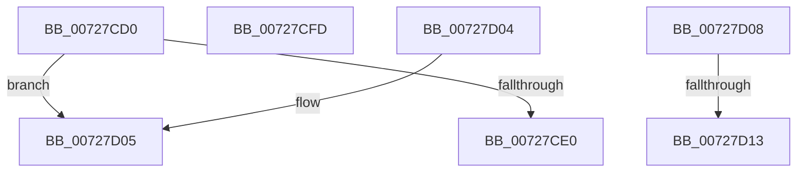

# PipIsProviderStarted

- RVA: `0x00727CD0`–`0x00727D2A` (길이 `90` bytes)
- VA: `0x0000000140727CD0`
- 실행 섹션: `PAGE`
- PDB 이름 있음: `예`; PDB Function 태그: `아니요`
- unwind 정보 RVA: `0x000DB714`
- 디코드: `35`개 명령, `90/90` bytes 표시
- 미해석 바이트: `1` (있으면 어셈블리에 `.byte`로 보존)

> 이 문서는 커널 이미지의 기계어와 PDB 기호를 분석해 생성했습니다. 4번과 5번은 함수 원형과 자료형을 바이너리 사용 방식에서 추정한 C 해석이며 원본 소스 복구 결과는 아닙니다.

## 1. Dependencies

- 직접 호출 지점: **0**; 고유 호출 대상: **0**
- 직접 호출자로 확인된 함수: **2**
- RIP 상대 이미지 참조: **1**

### Outgoing calls
- 직접 디코드된 call 명령이 없습니다.

### Direct callers
- [IoResolveDependency](../../text/4C/IoResolveDependency_function_004C4380.md) at `0x004C44BE`
- [sub_00B34610](../B3/Unknown_function_00B34610.md) at `0x00B3462B`

### Static image references
- `0x00727CE0` → RVA `0x00000000` (`image boundary/outside`; read)

## 2. Other-region calls and transfers

- 다른 실행 섹션으로 향하는 call: **0**
- call이 아닌 외부 분기/꼬리 이동: **1**
  - `0x00727D11` → [PipMergeDependencyEdgeList + 0x39](PipMergeDependencyEdgeList_function_00727D4C.md) (`tail-transfer`)

## 3. Assembly (complete function range)

```asm
00727CD0  8B 81 2C 01 00 00               mov eax, dword ptr [rcx + 0x12c]
00727CD6  05 FF FC FF FF                  add eax, 0xfffffcff
00727CDB  83 F8 15                        cmp eax, 0x15
00727CDE  77 25                           ja 0x140727d05
00727CE0  48 8D 15 19 83 8D FF            lea rdx, [rip - 0x727ce7]
00727CE7  48 98                           cdqe
00727CE9  0F B6 84 02 14 7D 72 00         movzx eax, byte ptr [rdx + rax + 0x727d14]
00727CF1  8B 8C 82 0C 7D 72 00            mov ecx, dword ptr [rdx + rax*4 + 0x727d0c]
00727CF8  48 03 CA                        add rcx, rdx
00727CFB  FF E1                           jmp rcx
00727CFD  CC                              int3
00727CFE  CC                              int3
00727CFF  CC                              int3
00727D00  CC                              int3
00727D01  B0 01                           mov al, 1
00727D03  C3                              ret
00727D04  CC                              int3
00727D05  32 C0                           xor al, al
00727D07  C3                              ret
00727D08  CC                              int3
00727D09  0F 1F 00                        nop dword ptr [rax]
00727D0C  05 7D 72 00 01                  add eax, 0x100727d
00727D11  7D 72                           jge 0x140727d85
00727D13  00 00                           add byte ptr [rax], al
00727D15  00 00                           add byte ptr [rax], al
00727D17  00 00                           add byte ptr [rax], al
00727D19  00 00                           add byte ptr [rax], al
00727D1B  00 00                           add byte ptr [rax], al
00727D1D  01 00                           add dword ptr [rax], eax
00727D1F  00 00                           add byte ptr [rax], al
00727D21  01 01                           add dword ptr [rcx], eax
00727D23  00 00                           add byte ptr [rax], al
00727D25  00 00                           add byte ptr [rax], al
00727D27  00 00                           add byte ptr [rax], al
00727D29  00                              .byte 0x00
```

## 4. C-style interpretation (structured pseudocode)

```c
__int64 __fastcall PipIsProviderStarted(__int64 a1)
{
    __int64 result;

    result = (unsigned int)(((unsigned int)(*(unsigned int *)(a1 + 300))) + (0xFFFFFCFFULL));
    if (((unsigned int)(result)) > 21) goto loc_00727D05;
    a1 = ((unsigned int)(*(unsigned int *)(v_rip - 7503079 + *(unsigned __int8 *)(v_rip - 7503079 + result * 1 + 7503124) * 4 + 7503116))) + (v_rip - 7503079);
loc_00727D05:
    result = 0;
    return result;
}
```

## 5. (Beta) C Style

```c
int64_t PipIsProviderStarted(void *Arg1)
{
    uint8_t *arg1 = (uint8_t *)Arg1;

    int64_t result;

    result = (uint32_t)(((uint32_t)(*(uint32_t *)(arg1 + 0x12C))) + (0xFFFFFCFFULL));
    if (((uint32_t)(result)) > 21) goto loc_00727D05;
    Arg1 = ((uint32_t)(*(uint32_t *)(v_rip - 0x727CE7 + *(uint8_t *)(v_rip - 0x727CE7 + result * 1 + 0x727D14) * 4 + 0x727D0C))) + (v_rip - 7503079);
loc_00727D05:
    result = 0;
    return result;
}
```

### 관측된 메모리 오프셋

구조체 형식이 확인되지 않은 접근은 인자 기준의 오프셋으로만 기록했습니다.

| 기준 인자 | 오프셋 표현 | 폭 (bit) | 접근 |
|---|---:|---:|---|
| `Arg1` | `+ 0x12C` | `32` | `R` |

## 6. Execution-region graph

[열기: 2D/3D 그래프와 함수 탐색 컨트롤 패널](../../../control-panel.html?section=page&rva=0x00727CD0&view=graph)

- 2D 그래프는 위에서 아래로 흐르고, 3D 그래프는 빈 공간을 드래그해 회전합니다. Shift+드래그는 이동, 휠은 확대·축소, 함수 노드 선택은 대상 보고서 이동입니다.

### Static fallback


