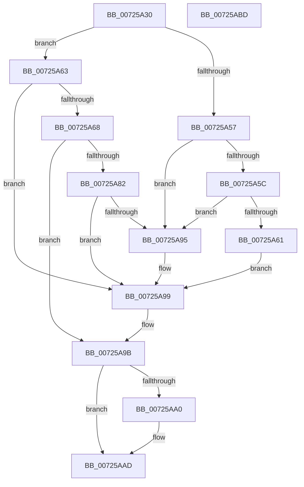

# PipMatchPersistentMemoryV1

- RVA: `0x00725A30`–`0x00725ABE` (길이 `142` bytes)
- VA: `0x0000000140725A30`
- 실행 섹션: `PAGE`
- PDB 이름 있음: `예`; PDB Function 태그: `아니요`
- unwind 정보 RVA: `0x000C8244`
- 디코드: `48`개 명령, `142/142` bytes 표시
- 미해석 바이트: `0` (있으면 어셈블리에 `.byte`로 보존)

> 이 문서는 커널 이미지의 기계어와 PDB 기호를 분석해 생성했습니다. 4번과 5번은 함수 원형과 자료형을 바이너리 사용 방식에서 추정한 C 해석이며 원본 소스 복구 결과는 아닙니다.

## 1. Dependencies

- 직접 호출 지점: **3**; 고유 호출 대상: **3**
- 직접 호출자로 확인된 함수: **2**
- RIP 상대 이미지 참조: **0**

### Outgoing calls
- `0x00725A72` → [PipGetDeviceObjectLocation](PipGetDeviceObjectLocation_function_00724EA4.md) (function, `0x00724EA4`)
- `0x00725A8C` → [PnpCompareMultiSz](../73/PnpCompareMultiSz_function_0073D27C.md) (function, `0x0073D27C`)
- `0x00725AA8` → [ExFreePoolWithTag](../../poolcode/B8/ExFreePoolWithTag_function_00B82870.md) (function, `0x00B82870`)

### Direct callers
- [PipEnumeratePersistedMemoryCallback](../../text/5A/PipEnumeratePersistedMemoryCallback_function_005A5300.md) at `0x005A543E`
- [PipGetPersistentMemory](PipGetPersistentMemory_function_00725290.md) at `0x00725623`

### Static image references
- 디코드된 RIP-relative 메모리 참조가 없습니다.

## 2. Other-region calls and transfers

- 다른 실행 섹션으로 향하는 call: **1**
  - `0x00725AA8` → [ExFreePoolWithTag](../../poolcode/B8/ExFreePoolWithTag_function_00B82870.md) (`PAGE` → `POOLCODE`)
- 별도 외부 분기/꼬리 이동을 확인하지 못했습니다.

## 3. Assembly (complete function range)

```asm
00725A30  48 89 5C 24 10                  mov qword ptr [rsp + 0x10], rbx
00725A35  56                              push rsi
00725A36  57                              push rdi
00725A37  41 56                           push r14
00725A39  48 83 EC 20                     sub rsp, 0x20
00725A3D  83 64 24 40 00                  and dword ptr [rsp + 0x40], 0
00725A42  33 DB                           xor ebx, ebx
00725A44  48 89 5C 24 58                  mov qword ptr [rsp + 0x58], rbx
00725A49  4D 8B F1                        mov r14, r9
00725A4C  41 88 19                        mov byte ptr [r9], bl
00725A4F  48 8B F2                        mov rsi, rdx
00725A52  48 85 C9                        test rcx, rcx
00725A55  75 0C                           jne 0x140725a63
00725A57  45 84 C0                        test r8b, r8b
00725A5A  75 39                           jne 0x140725a95
00725A5C  39 5A 04                        cmp dword ptr [rdx + 4], ebx
00725A5F  74 34                           je 0x140725a95
00725A61  EB 36                           jmp 0x140725a99
00725A63  39 5A 04                        cmp dword ptr [rdx + 4], ebx
00725A66  74 31                           je 0x140725a99
00725A68  4C 8D 44 24 58                  lea r8, [rsp + 0x58]
00725A6D  48 8D 54 24 40                  lea rdx, [rsp + 0x40]
00725A72  E8 2D F4 FF FF                  call 0x140724ea4
00725A77  48 8B 5C 24 58                  mov rbx, qword ptr [rsp + 0x58]
00725A7C  8B F8                           mov edi, eax
00725A7E  85 C0                           test eax, eax
00725A80  78 19                           js 0x140725a9b
00725A82  48 8D 56 10                     lea rdx, [rsi + 0x10]
00725A86  45 33 C0                        xor r8d, r8d
00725A89  48 8B CB                        mov rcx, rbx
00725A8C  E8 EB 77 01 00                  call 0x14073d27c
00725A91  84 C0                           test al, al
00725A93  74 04                           je 0x140725a99
00725A95  41 C6 06 01                     mov byte ptr [r14], 1
00725A99  33 FF                           xor edi, edi
00725A9B  48 85 DB                        test rbx, rbx
00725A9E  74 0D                           je 0x140725aad
00725AA0  BA 50 6E 70 61                  mov edx, 0x61706e50
00725AA5  48 8B CB                        mov rcx, rbx
00725AA8  E8 C3 CD 45 00                  call 0x140b82870
00725AAD  48 8B 5C 24 48                  mov rbx, qword ptr [rsp + 0x48]
00725AB2  8B C7                           mov eax, edi
00725AB4  48 83 C4 20                     add rsp, 0x20
00725AB8  41 5E                           pop r14
00725ABA  5F                              pop rdi
00725ABB  5E                              pop rsi
00725ABC  C3                              ret
00725ABD  CC                              int3
```

## 4. C-style interpretation (structured pseudocode)

```c
__int64 __fastcall PipMatchPersistentMemoryV1(__int64 a1, __int64 a2, unsigned __int8 a3, __int64 a4)
{
    __int64 result;
    __int64 v_rbx;
    __int64 v_rdi;
    __int64 v_rsp;
    unsigned __int64 v_stack_p10;
    unsigned __int64 v_stack_p20;
    unsigned int v_stack_p8;

    v_stack_p10 = v_rbx;
    v_rsp = (v_rsp) - (32);
    v_rbx = 0;
    v_stack_p20 = 0;
    *(unsigned __int8 *)(a4) = 0;
    if (a1 != 0) goto loc_00725A63;
    if (a3 != 0) goto loc_00725A95;
    if ((*(unsigned int *)(a2 + 4)) == 0) goto loc_00725A95;
    goto loc_00725A99;
loc_00725A63:
    if ((*(unsigned int *)(a2 + 4)) == 0) goto loc_00725A99;
    result = PipGetDeviceObjectLocation(a1, v_stack_p8, v_stack_p20, a4);
    if (sign_flag) goto loc_00725A9B;
    a3 = 0;
    result = PnpCompareMultiSz(v_stack_p20, a2 + 16, a3, a4);
    if ((unsigned __int8)(result) != 0) {
        *(unsigned __int8 *)(a4) = 1;
    }
    v_rdi = 0;
loc_00725A9B:
    if (v_stack_p20 != 0) {
        a2 = 0x61706E50ULL;
        a1 = v_stack_p20;
        result = ExFreePoolWithTag(a1, a2, a3, a4);
    }
    v_rsp = (v_rsp) + (32);
    return 0;
}
```

## 5. (Beta) C Style

```c
int64_t PipMatchPersistentMemoryV1(int64_t Arg1, void *Arg2, uint8_t Arg3, void *Arg4)
{
    uint8_t *arg2 = (uint8_t *)Arg2;
    uint8_t *arg4 = (uint8_t *)Arg4;

    int64_t result;
    int64_t local_rbx;
    int64_t local_rdi;
    int64_t local_rsp;
    uint64_t v_stack_p10;
    uint64_t v_stack_p20;
    uint32_t v_stack_p8;

    v_stack_p10 = local_rbx;
    local_rsp = (local_rsp) - (32);
    local_rbx = 0;
    v_stack_p20 = 0;
    *(uint8_t *)(arg4) = 0;
    if (Arg1 != 0) goto loc_00725A63;
    if (Arg3 != 0) goto loc_00725A95;
    if ((*(uint32_t *)(arg2 + 0x4)) == 0) goto loc_00725A95;
    goto loc_00725A99;
loc_00725A63:
    if ((*(uint32_t *)(arg2 + 0x4)) == 0) goto loc_00725A99;
    result = PipGetDeviceObjectLocation(Arg1, v_stack_p8, v_stack_p20, Arg4);
    if (sign_flag) goto loc_00725A9B;
    Arg3 = 0;
    result = PnpCompareMultiSz(v_stack_p20, Arg2 + 16, Arg3, Arg4);
    if ((uint8_t)(result) != 0) {
        *(uint8_t *)(arg4) = 1;
    }
    local_rdi = 0;
loc_00725A9B:
    if (v_stack_p20 != 0) {
        Arg2 = 0x61706E50ULL;
        Arg1 = v_stack_p20;
        result = ExFreePoolWithTag(Arg1, Arg2, Arg3, Arg4);
    }
    local_rsp = (local_rsp) + (32);
    return 0;
}
```

### 관측된 메모리 오프셋

구조체 형식이 확인되지 않은 접근은 인자 기준의 오프셋으로만 기록했습니다.

| 기준 인자 | 오프셋 표현 | 폭 (bit) | 접근 |
|---|---:|---:|---|
| `Arg2` | `+ 0x4` | `32` | `R` |
| `Arg2` | `+ 0x10` | `64` | `R` |
| `Arg4` | `+ 0x0` | `8` | `W` |

## 6. Execution-region graph

[열기: 2D/3D 그래프와 함수 탐색 컨트롤 패널](../../../control-panel.html?section=page&rva=0x00725A30&view=graph)

- 2D 그래프는 위에서 아래로 흐르고, 3D 그래프는 빈 공간을 드래그해 회전합니다. Shift+드래그는 이동, 휠은 확대·축소, 함수 노드 선택은 대상 보고서 이동입니다.

### Static fallback


