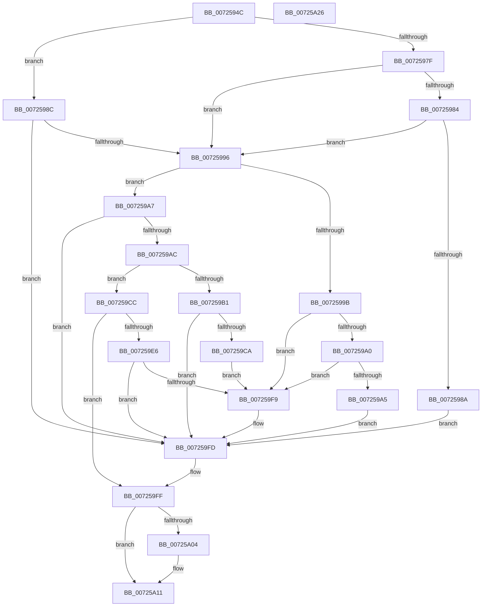

# PipMatchPersistentMemory

- RVA: `0x0072594C`–`0x00725A27` (길이 `219` bytes)
- VA: `0x000000014072594C`
- 실행 섹션: `PAGE`
- PDB 이름 있음: `예`; PDB Function 태그: `아니요`
- unwind 정보 RVA: `0x000A2264`
- 디코드: `73`개 명령, `219/219` bytes 표시
- 미해석 바이트: `0` (있으면 어셈블리에 `.byte`로 보존)

> 이 문서는 커널 이미지의 기계어와 PDB 기호를 분석해 생성했습니다. 4번과 5번은 함수 원형과 자료형을 바이너리 사용 방식에서 추정한 C 해석이며 원본 소스 복구 결과는 아닙니다.

## 1. Dependencies

- 직접 호출 지점: **4**; 고유 호출 대상: **4**
- 직접 호출자로 확인된 함수: **2**
- RIP 상대 이미지 참조: **0**

### Outgoing calls
- `0x007259BD` → [RtlCompareMemory](../../text/6B/RtlCompareMemory_function_006BA670.md) (function, `0x006BA670`)
- `0x007259D6` → [PipGetDeviceObjectLocation](PipGetDeviceObjectLocation_function_00724EA4.md) (function, `0x00724EA4`)
- `0x007259F0` → [PnpCompareMultiSz](../73/PnpCompareMultiSz_function_0073D27C.md) (function, `0x0073D27C`)
- `0x00725A0C` → [ExFreePoolWithTag](../../poolcode/B8/ExFreePoolWithTag_function_00B82870.md) (function, `0x00B82870`)

### Direct callers
- [PipEnumeratePersistedMemoryCallback](../../text/5A/PipEnumeratePersistedMemoryCallback_function_005A5300.md) at `0x005A5401`
- [PipGetPersistentMemory](PipGetPersistentMemory_function_00725290.md) at `0x007255DC`

### Static image references
- 디코드된 RIP-relative 메모리 참조가 없습니다.

## 2. Other-region calls and transfers

- 다른 실행 섹션으로 향하는 call: **2**
  - `0x007259BD` → [RtlCompareMemory](../../text/6B/RtlCompareMemory_function_006BA670.md) (`PAGE` → `.text`)
  - `0x00725A0C` → [ExFreePoolWithTag](../../poolcode/B8/ExFreePoolWithTag_function_00B82870.md) (`PAGE` → `POOLCODE`)
- 별도 외부 분기/꼬리 이동을 확인하지 못했습니다.

## 3. Assembly (complete function range)

```asm
0072594C  48 8B C4                        mov rax, rsp
0072594F  48 89 58 08                     mov qword ptr [rax + 8], rbx
00725953  48 89 68 10                     mov qword ptr [rax + 0x10], rbp
00725957  56                              push rsi
00725958  57                              push rdi
00725959  41 56                           push r14
0072595B  48 83 EC 30                     sub rsp, 0x30
0072595F  4C 8B 74 24 78                  mov r14, qword ptr [rsp + 0x78]
00725964  33 ED                           xor ebp, ebp
00725966  89 68 18                        mov dword ptr [rax + 0x18], ebp
00725969  49 8B D9                        mov rbx, r9
0072596C  44 8A 4C 24 70                  mov r9b, byte ptr [rsp + 0x70]
00725971  8B FD                           mov edi, ebp
00725973  48 89 68 D8                     mov qword ptr [rax - 0x28], rbp
00725977  41 88 2E                        mov byte ptr [r14], bpl
0072597A  4D 85 C0                        test r8, r8
0072597D  75 0D                           jne 0x14072598c
0072597F  45 84 C9                        test r9b, r9b
00725982  75 12                           jne 0x140725996
00725984  66 39 6B 10                     cmp word ptr [rbx + 0x10], bp
00725988  74 0C                           je 0x140725996
0072598A  EB 71                           jmp 0x1407259fd
0072598C  0F B7 43 10                     movzx eax, word ptr [rbx + 0x10]
00725990  66 41 39 00                     cmp word ptr [r8], ax
00725994  75 67                           jne 0x1407259fd
00725996  48 85 C9                        test rcx, rcx
00725999  75 0C                           jne 0x1407259a7
0072599B  45 84 C9                        test r9b, r9b
0072599E  75 59                           jne 0x1407259f9
007259A0  39 6B 04                        cmp dword ptr [rbx + 4], ebp
007259A3  74 54                           je 0x1407259f9
007259A5  EB 56                           jmp 0x1407259fd
007259A7  39 6B 04                        cmp dword ptr [rbx + 4], ebp
007259AA  74 51                           je 0x1407259fd
007259AC  48 85 D2                        test rdx, rdx
007259AF  74 1B                           je 0x1407259cc
007259B1  44 0F B7 02                     movzx r8d, word ptr [rdx]
007259B5  48 8D 4B 18                     lea rcx, [rbx + 0x18]
007259B9  48 8B 52 08                     mov rdx, qword ptr [rdx + 8]
007259BD  E8 AE 4C F9 FF                  call 0x1406ba670
007259C2  8B 4B 04                        mov ecx, dword ptr [rbx + 4]
007259C5  48 3B C1                        cmp rax, rcx
007259C8  75 33                           jne 0x1407259fd
007259CA  EB 2D                           jmp 0x1407259f9
007259CC  4C 8D 44 24 20                  lea r8, [rsp + 0x20]
007259D1  48 8D 54 24 60                  lea rdx, [rsp + 0x60]
007259D6  E8 C9 F4 FF FF                  call 0x140724ea4
007259DB  48 8B 7C 24 20                  mov rdi, qword ptr [rsp + 0x20]
007259E0  8B F0                           mov esi, eax
007259E2  85 C0                           test eax, eax
007259E4  78 19                           js 0x1407259ff
007259E6  48 8D 53 18                     lea rdx, [rbx + 0x18]
007259EA  45 33 C0                        xor r8d, r8d
007259ED  48 8B CF                        mov rcx, rdi
007259F0  E8 87 78 01 00                  call 0x14073d27c
007259F5  84 C0                           test al, al
007259F7  74 04                           je 0x1407259fd
007259F9  41 C6 06 01                     mov byte ptr [r14], 1
007259FD  8B F5                           mov esi, ebp
007259FF  48 85 FF                        test rdi, rdi
00725A02  74 0D                           je 0x140725a11
00725A04  BA 50 6E 70 61                  mov edx, 0x61706e50
00725A09  48 8B CF                        mov rcx, rdi
00725A0C  E8 5F CE 45 00                  call 0x140b82870
00725A11  48 8B 5C 24 50                  mov rbx, qword ptr [rsp + 0x50]
00725A16  8B C6                           mov eax, esi
00725A18  48 8B 6C 24 58                  mov rbp, qword ptr [rsp + 0x58]
00725A1D  48 83 C4 30                     add rsp, 0x30
00725A21  41 5E                           pop r14
00725A23  5F                              pop rdi
00725A24  5E                              pop rsi
00725A25  C3                              ret
00725A26  CC                              int3
```

## 4. C-style interpretation (structured pseudocode)

```c
__int64 __fastcall PipMatchPersistentMemory(__int64 a1, __int64 a2, __int64 a3, __int64 a4, unsigned __int8 a5, __int64 a6)
{
    __int64 result;
    __int64 v_rbp;
    __int64 v_rsp;
    unsigned __int64 v_stack_m28;
    unsigned __int64 v_stack_p10;
    unsigned __int64 v_stack_p18;
    unsigned __int64 v_stack_p8;

    *(unsigned __int64 *)(v_rsp + 8) = v_rbx;
    *(unsigned __int64 *)(v_rsp + 16) = v_rbp;
    v_rsp = (v_rsp) - (48);
    v_rbp = 0;
    *(unsigned int *)(v_rsp + 24) = 0;
    *(unsigned __int64 *)(v_rsp - 40) = 0;
    *(unsigned __int8 *)(a6) = 0;
    if (a3 != 0) goto loc_0072598C;
    if (a5 != 0) goto loc_00725996;
    if ((*(unsigned __int16 *)(a4 + 16)) == 0) goto loc_00725996;
    goto loc_007259FD;
loc_0072598C:
    if ((*(unsigned __int16 *)(a3)) != ((unsigned __int16)(*(unsigned __int16 *)(a4 + 16)))) goto loc_007259FD;
loc_00725996:
    if (a1 != 0) goto loc_007259A7;
    if (a5 != 0) goto loc_007259F9;
    if ((*(unsigned int *)(a4 + 4)) == 0) goto loc_007259F9;
    goto loc_007259FD;
loc_007259A7:
    if ((*(unsigned int *)(a4 + 4)) == 0) goto loc_007259FD;
    if (a2 == 0) goto loc_007259CC;
    result = RtlCompareMemory(a4 + 24, *(unsigned __int64 *)(a2 + 8), *(unsigned __int16 *)(a2), a5);
    if (result != ((unsigned int)(*(unsigned int *)(a4 + 4)))) goto loc_007259FD;
    goto loc_007259F9;
loc_007259CC:
    result = PipGetDeviceObjectLocation((unsigned int)(*(unsigned int *)(a4 + 4)), v_stack_p18, v_stack_m28, a5);
    if (sign_flag) goto loc_007259FF;
    a3 = 0;
    result = PnpCompareMultiSz(v_stack_m28, a4 + 24, a3, a5);
    if ((unsigned __int8)(result) != 0) {
        *(unsigned __int8 *)(a6) = 1;
    }
loc_007259FF:
    if (v_stack_m28 != 0) {
        a2 = 0x61706E50ULL;
        a1 = v_stack_m28;
        result = ExFreePoolWithTag(a1, a2, a3, a5);
    }
    v_rsp = (v_rsp) + (48);
    return 0;
}
```

## 5. (Beta) C Style

```c
int64_t PipMatchPersistentMemory(int64_t Arg1, int64_t Arg2, int64_t Arg3, void *Arg4, uint8_t Arg5, void *Arg6)
{
    uint8_t *arg4 = (uint8_t *)Arg4;
    uint8_t *arg6 = (uint8_t *)Arg6;

    int64_t result;
    int64_t local_rbp;
    int64_t local_rsp;
    uint64_t v_stack_m28;
    uint64_t v_stack_p10;
    uint64_t v_stack_p18;
    uint64_t v_stack_p8;

    *(uint64_t *)(local_rsp + 0x8) = local_rbx;
    *(uint64_t *)(local_rsp + 0x10) = local_rbp;
    local_rsp = (local_rsp) - (48);
    local_rbp = 0;
    *(uint32_t *)(local_rsp + 0x18) = 0;
    *(uint64_t *)(local_rsp - 0x28) = 0;
    *(uint8_t *)(arg6) = 0;
    if (Arg3 != 0) goto loc_0072598C;
    if (Arg5 != 0) goto loc_00725996;
    if ((*(uint16_t *)(arg4 + 0x10)) == 0) goto loc_00725996;
    goto loc_007259FD;
loc_0072598C:
    if ((*(uint16_t *)(Arg3)) != ((uint16_t)(*(uint16_t *)(arg4 + 0x10)))) goto loc_007259FD;
loc_00725996:
    if (Arg1 != 0) goto loc_007259A7;
    if (Arg5 != 0) goto loc_007259F9;
    if ((*(uint32_t *)(arg4 + 0x4)) == 0) goto loc_007259F9;
    goto loc_007259FD;
loc_007259A7:
    if ((*(uint32_t *)(arg4 + 0x4)) == 0) goto loc_007259FD;
    if (Arg2 == 0) goto loc_007259CC;
    result = RtlCompareMemory(Arg4 + 24, *(uint64_t *)(Arg2 + 0x8), *(uint16_t *)(Arg2), Arg5);
    if (result != ((uint32_t)(*(uint32_t *)(arg4 + 0x4)))) goto loc_007259FD;
    goto loc_007259F9;
loc_007259CC:
    result = PipGetDeviceObjectLocation((uint32_t)(*(uint32_t *)(arg4 + 0x4)), v_stack_p18, v_stack_m28, Arg5);
    if (sign_flag) goto loc_007259FF;
    Arg3 = 0;
    result = PnpCompareMultiSz(v_stack_m28, Arg4 + 24, Arg3, Arg5);
    if ((uint8_t)(result) != 0) {
        *(uint8_t *)(arg6) = 1;
    }
loc_007259FF:
    if (v_stack_m28 != 0) {
        Arg2 = 0x61706E50ULL;
        Arg1 = v_stack_m28;
        result = ExFreePoolWithTag(Arg1, Arg2, Arg3, Arg5);
    }
    local_rsp = (local_rsp) + (48);
    return 0;
}
```

### 관측된 메모리 오프셋

구조체 형식이 확인되지 않은 접근은 인자 기준의 오프셋으로만 기록했습니다.

| 기준 인자 | 오프셋 표현 | 폭 (bit) | 접근 |
|---|---:|---:|---|
| `Arg4` | `+ 0x4` | `32` | `R` |
| `Arg4` | `+ 0x10` | `16` | `R` |
| `Arg4` | `+ 0x18` | `64` | `R` |
| `Arg6` | `+ 0x0` | `8` | `W` |

## 6. Execution-region graph

[열기: 2D/3D 그래프와 함수 탐색 컨트롤 패널](../../../control-panel.html?section=page&rva=0x0072594C&view=graph)

- 2D 그래프는 위에서 아래로 흐르고, 3D 그래프는 빈 공간을 드래그해 회전합니다. Shift+드래그는 이동, 휠은 확대·축소, 함수 노드 선택은 대상 보고서 이동입니다.

### Static fallback


