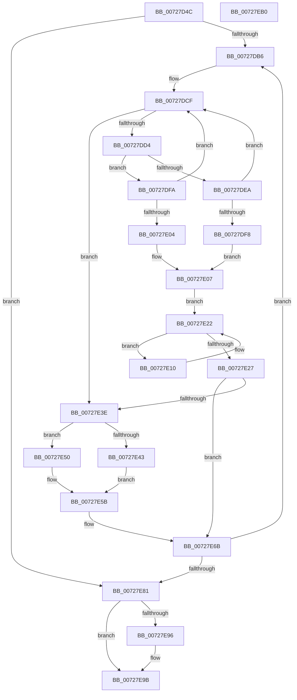

# PipMergeDependencyEdgeList

- RVA: `0x00727D4C`–`0x00727EB1` (길이 `357` bytes)
- VA: `0x0000000140727D4C`
- 실행 섹션: `PAGE`
- PDB 이름 있음: `예`; PDB Function 태그: `아니요`
- unwind 정보 RVA: `0x000C8344`
- 디코드: `110`개 명령, `357/357` bytes 표시
- 미해석 바이트: `0` (있으면 어셈블리에 `.byte`로 보존)

> 이 문서는 커널 이미지의 기계어와 PDB 기호를 분석해 생성했습니다. 4번과 5번은 함수 원형과 자료형을 바이너리 사용 방식에서 추정한 C 해석이며 원본 소스 복구 결과는 아닙니다.

## 1. Dependencies

- 직접 호출 지점: **9**; 고유 호출 대상: **8**
- 직접 호출자로 확인된 함수: **1**
- RIP 상대 이미지 참조: **0**

### Outgoing calls
- `0x00727DA5` → [PiPnpRtlBeginOperation](../8E/PiPnpRtlBeginOperation_function_008E033C.md) (function, `0x008E033C`)
- `0x00727DBC` → [PiListEntryToDependencyEdge](../../text/4F/PiListEntryToDependencyEdge_function_004F9648.md) (function, `0x004F9648`)
- `0x00727DDA` → [PiListEntryToDependencyEdge](../../text/4F/PiListEntryToDependencyEdge_function_004F9648.md) (function, `0x004F9648`)
- `0x00727E1D` → [PipAddRequestToEdge](PipAddRequestToEdge_function_00727898.md) (function, `0x00727898`)
- `0x00727E2D` → [PipFreeDependencyEdge](../../text/4D/PipFreeDependencyEdge_function_004D7658.md) (function, `0x004D7658`)
- `0x00727E5B` → [PipNotifyDependenciesChanged](../70/PipNotifyDependenciesChanged_function_007038F8.md) (function, `0x007038F8`)
- `0x00727E66` → [PipDereferenceDependencyNode](../AC/PipDereferenceDependencyNode_function_00ACD5A0.md) (function, `0x00ACD5A0`)
- `0x00727E87` → [PipMoveListEntries](../../text/5A/PipMoveListEntries_function_005A570C.md) (function, `0x005A570C`)
- `0x00727E96` → [PiPnpRtlEndOperation](../8E/PiPnpRtlEndOperation_function_008E0518.md) (function, `0x008E0518`)

### Direct callers
- [PipMergeDependencyNodes](PipMergeDependencyNodes_function_00727EB8.md) at `0x00727EEA`
- [PipMergeDependencyNodes](PipMergeDependencyNodes_function_00727EB8.md) at `0x00727EFB`

### Static image references
- 디코드된 RIP-relative 메모리 참조가 없습니다.

## 2. Other-region calls and transfers

- 다른 실행 섹션으로 향하는 call: **4**
  - `0x00727DBC` → [PiListEntryToDependencyEdge](../../text/4F/PiListEntryToDependencyEdge_function_004F9648.md) (`PAGE` → `.text`)
  - `0x00727DDA` → [PiListEntryToDependencyEdge](../../text/4F/PiListEntryToDependencyEdge_function_004F9648.md) (`PAGE` → `.text`)
  - `0x00727E2D` → [PipFreeDependencyEdge](../../text/4D/PipFreeDependencyEdge_function_004D7658.md) (`PAGE` → `.text`)
  - `0x00727E87` → [PipMoveListEntries](../../text/5A/PipMoveListEntries_function_005A570C.md) (`PAGE` → `.text`)
- 별도 외부 분기/꼬리 이동을 확인하지 못했습니다.

## 3. Assembly (complete function range)

```asm
00727D4C  4C 8B DC                        mov r11, rsp
00727D4F  49 89 5B 08                     mov qword ptr [r11 + 8], rbx
00727D53  49 89 53 10                     mov qword ptr [r11 + 0x10], rdx
00727D57  55                              push rbp
00727D58  56                              push rsi
00727D59  57                              push rdi
00727D5A  41 54                           push r12
00727D5C  41 55                           push r13
00727D5E  41 56                           push r14
00727D60  41 57                           push r15
00727D62  48 83 EC 30                     sub rsp, 0x30
00727D66  49 83 63 B8 00                  and qword ptr [r11 - 0x48], 0
00727D6B  48 8D 71 10                     lea rsi, [rcx + 0x10]
00727D6F  41 8B C0                        mov eax, r8d
00727D72  4C 8B F2                        mov r14, rdx
00727D75  F7 D8                           neg eax
00727D77  48 8B E9                        mov rbp, rcx
00727D7A  41 8B C0                        mov eax, r8d
00727D7D  49 8D 4B B8                     lea rcx, [r11 - 0x48]
00727D81  4D 1B C9                        sbb r9, r9
00727D84  45 8B E8                        mov r13d, r8d
00727D87  41 83 E1 10                     and r9d, 0x10
00727D8B  49 03 F1                        add rsi, r9
00727D8E  F7 D8                           neg eax
00727D90  48 89 B4 24 88 00 00 00         mov qword ptr [rsp + 0x88], rsi
00727D98  48 1B FF                        sbb rdi, rdi
00727D9B  48 83 C2 10                     add rdx, 0x10
00727D9F  83 E7 10                        and edi, 0x10
00727DA2  48 03 FA                        add rdi, rdx
00727DA5  E8 92 85 1B 00                  call 0x1408e033c
00727DAA  4C 8B 07                        mov r8, qword ptr [rdi]
00727DAD  4C 3B C7                        cmp r8, rdi
00727DB0  0F 84 CB 00 00 00               je 0x140727e81
00727DB6  41 8B D5                        mov edx, r13d
00727DB9  49 8B C8                        mov rcx, r8
00727DBC  E8 87 18 DD FF                  call 0x1404f9648
00727DC1  4D 8B 00                        mov r8, qword ptr [r8]
00727DC4  48 8B D8                        mov rbx, rax
00727DC7  4C 89 44 24 28                  mov qword ptr [rsp + 0x28], r8
00727DCC  4C 8B 06                        mov r8, qword ptr [rsi]
00727DCF  4C 3B C6                        cmp r8, rsi
00727DD2  74 6A                           je 0x140727e3e
00727DD4  41 8B D5                        mov edx, r13d
00727DD7  49 8B C8                        mov rcx, r8
00727DDA  E8 69 18 DD FF                  call 0x1404f9648
00727DDF  4D 8B 00                        mov r8, qword ptr [r8]
00727DE2  4C 8B F8                        mov r15, rax
00727DE5  45 85 ED                        test r13d, r13d
00727DE8  75 10                           jne 0x140727dfa
00727DEA  48 8B 53 20                     mov rdx, qword ptr [rbx + 0x20]
00727DEE  48 3B 50 20                     cmp rdx, qword ptr [rax + 0x20]
00727DF2  41 0F 94 C4                     sete r12b
00727DF6  75 D7                           jne 0x140727dcf
00727DF8  EB 0D                           jmp 0x140727e07
00727DFA  48 8B 40 28                     mov rax, qword ptr [rax + 0x28]
00727DFE  48 39 43 28                     cmp qword ptr [rbx + 0x28], rax
00727E02  75 CB                           jne 0x140727dcf
00727E04  41 B4 01                        mov r12b, 1
00727E07  4C 8D 73 38                     lea r14, [rbx + 0x38]
00727E0B  49 8B 36                        mov rsi, qword ptr [r14]
00727E0E  EB 12                           jmp 0x140727e22
00727E10  48 8B D6                        mov rdx, rsi
00727E13  49 8B CF                        mov rcx, r15
00727E16  48 8B 36                        mov rsi, qword ptr [rsi]
00727E19  48 83 C2 10                     add rdx, 0x10
00727E1D  E8 76 FA FF FF                  call 0x140727898
00727E22  49 3B F6                        cmp rsi, r14
00727E25  75 E9                           jne 0x140727e10
00727E27  49 8B D7                        mov rdx, r15
00727E2A  48 8B CB                        mov rcx, rbx
00727E2D  E8 26 F8 DA FF                  call 0x1404d7658
00727E32  4C 8B 74 24 78                  mov r14, qword ptr [rsp + 0x78]
00727E37  33 DB                           xor ebx, ebx
00727E39  45 84 E4                        test r12b, r12b
00727E3C  75 2D                           jne 0x140727e6b
00727E3E  45 85 ED                        test r13d, r13d
00727E41  75 0D                           jne 0x140727e50
00727E43  48 8B 53 20                     mov rdx, qword ptr [rbx + 0x20]
00727E47  48 8B CD                        mov rcx, rbp
00727E4A  48 89 6B 28                     mov qword ptr [rbx + 0x28], rbp
00727E4E  EB 0B                           jmp 0x140727e5b
00727E50  48 8B 4B 28                     mov rcx, qword ptr [rbx + 0x28]
00727E54  48 8B D5                        mov rdx, rbp
00727E57  48 89 6B 20                     mov qword ptr [rbx + 0x20], rbp
00727E5B  E8 98 BA FD FF                  call 0x1407038f8
00727E60  FF 45 58                        inc dword ptr [rbp + 0x58]
00727E63  49 8B CE                        mov rcx, r14
00727E66  E8 35 57 3A 00                  call 0x140acd5a0
00727E6B  4C 8B 44 24 28                  mov r8, qword ptr [rsp + 0x28]
00727E70  48 8B B4 24 88 00 00 00         mov rsi, qword ptr [rsp + 0x88]
00727E78  4C 3B C7                        cmp r8, rdi
00727E7B  0F 85 35 FF FF FF               jne 0x140727db6
00727E81  48 8B D7                        mov rdx, rdi
00727E84  48 8B CE                        mov rcx, rsi
00727E87  E8 80 D8 E7 FF                  call 0x1405a570c
00727E8C  48 8B 4C 24 20                  mov rcx, qword ptr [rsp + 0x20]
00727E91  48 85 C9                        test rcx, rcx
00727E94  74 05                           je 0x140727e9b
00727E96  E8 7D 86 1B 00                  call 0x1408e0518
00727E9B  48 8B 5C 24 70                  mov rbx, qword ptr [rsp + 0x70]
00727EA0  48 83 C4 30                     add rsp, 0x30
00727EA4  41 5F                           pop r15
00727EA6  41 5E                           pop r14
00727EA8  41 5D                           pop r13
00727EAA  41 5C                           pop r12
00727EAC  5F                              pop rdi
00727EAD  5E                              pop rsi
00727EAE  5D                              pop rbp
00727EAF  C3                              ret
00727EB0  CC                              int3
```

## 4. C-style interpretation (structured pseudocode)

```c
__int64 __fastcall PipMergeDependencyEdgeList(__int64 a1, __int64 a2, int a3, __int64 a4)
{
    __int64 result;
    __int64 v_r12;
    __int64 v_rbx;
    __int64 v_rdi;
    __int64 v_rsi;
    __int64 v_rsp;
    unsigned __int64 v_stack_m40;
    unsigned __int64 v_stack_m48;
    unsigned __int64 v_stack_p10;
    unsigned __int64 v_stack_p20;
    unsigned __int64 v_stack_p8;

    *(unsigned __int64 *)(v_rsp + 8) = v_rbx;
    *(unsigned __int64 *)(v_rsp + 16) = a2;
    v_rsp = (v_rsp) - (48);
    result = (unsigned int)(-((unsigned int)(a3)));
    a4 = (unsigned int)((a4) & (16));
    v_rsi = (a1 + 16) + (a4);
    result = (unsigned int)(-((unsigned int)(a3)));
    v_stack_p20 = v_rsi;
    a2 = (a2) + (16);
    v_rdi = (unsigned int)((v_rdi) & (16));
    v_rdi = (v_rdi) + (a2);
    result = PiPnpRtlBeginOperation(v_rsp - 72, a2, a3, a4);
    if ((*(unsigned __int64 *)(v_rdi)) == v_rdi) goto loc_00727E81;
loc_00727DB6:
    result = PiListEntryToDependencyEdge(*(unsigned __int64 *)(v_rdi), (unsigned int)((unsigned int)((unsigned int)(a3))), *(unsigned __int64 *)(v_rdi), a4);
    v_stack_m40 = *(unsigned __int64 *)(*(unsigned __int64 *)(v_rdi));
loc_00727DCF:
    if ((*(unsigned __int64 *)(v_rsi)) == v_rsi) goto loc_00727E3E;
    result = PiListEntryToDependencyEdge(*(unsigned __int64 *)(v_rsi), (unsigned int)((unsigned int)((unsigned int)(a3))), *(unsigned __int64 *)(v_rsi), a4);
    if ((unsigned int)((unsigned int)(a3)) != 0) goto loc_00727DFA;
    v_r12 = ((*(unsigned __int64 *)(result + 32)) == (*(unsigned __int64 *)(result + 32))) ? 1 : 0;
    if ((*(unsigned __int64 *)(result + 32)) != (*(unsigned __int64 *)(result + 32))) goto loc_00727DCF;
    goto loc_00727E07;
loc_00727DFA:
    if ((*(unsigned __int64 *)(result + 40)) != (*(unsigned __int64 *)(result + 40))) goto loc_00727DCF;
loc_00727E07:
    goto loc_00727E22;
loc_00727E10:
    a2 = (*(unsigned __int64 *)(result + 56)) + (16);
    result = PipAddRequestToEdge(result, a2, *(unsigned __int64 *)(*(unsigned __int64 *)(v_rsi)), a4);
loc_00727E22:
    if ((*(unsigned __int64 *)(*(unsigned __int64 *)(result + 56))) != (result + 56)) goto loc_00727E10;
    result = PipFreeDependencyEdge(result, result, *(unsigned __int64 *)(*(unsigned __int64 *)(v_rsi)), a4);
    v_rbx = 0;
    if (1 != 0) goto loc_00727E6B;
loc_00727E3E:
    if ((unsigned int)((unsigned int)(a3)) != 0) goto loc_00727E50;
    *(unsigned __int64 *)(v_rbx + 40) = a1;
    goto loc_00727E5B;
loc_00727E50:
    *(unsigned __int64 *)(v_rbx + 32) = a1;
loc_00727E5B:
    result = PipNotifyDependenciesChanged(*(unsigned __int64 *)(v_rbx + 40), a1, *(unsigned __int64 *)(*(unsigned __int64 *)(v_rsi)), a4);
    result = PipDereferenceDependencyNode(v_stack_p10, a1, *(unsigned __int64 *)(*(unsigned __int64 *)(v_rsi)), a4);
loc_00727E6B:
    if (v_stack_m40 != v_rdi) goto loc_00727DB6;
loc_00727E81:
    result = PipMoveListEntries(v_stack_p20, v_rdi, v_stack_m40, a4);
    if (v_stack_m48 != 0) {
        result = PiPnpRtlEndOperation(v_stack_m48, v_rdi, v_stack_m40, a4);
    }
    v_rsp = (v_rsp) + (48);
    return result;
}
```

## 5. (Beta) C Style

```c
int64_t PipMergeDependencyEdgeList(void *Arg1, int64_t Arg2, int32_t Arg3, int64_t Arg4)
{
    uint8_t *arg1 = (uint8_t *)Arg1;

    int64_t result;
    int64_t local_r12;
    int64_t local_rbx;
    int64_t local_rdi;
    int64_t local_rsi;
    int64_t local_rsp;
    uint64_t v_stack_m40;
    uint64_t v_stack_m48;
    uint64_t v_stack_p10;
    uint64_t v_stack_p20;
    uint64_t v_stack_p8;

    *(uint64_t *)(local_rsp + 0x8) = local_rbx;
    *(uint64_t *)(local_rsp + 0x10) = Arg2;
    local_rsp = (local_rsp) - (48);
    result = (uint32_t)(-((uint32_t)(Arg3)));
    Arg4 = (uint32_t)((Arg4) & (16));
    local_rsi = (Arg1 + 16) + (Arg4);
    result = (uint32_t)(-((uint32_t)(Arg3)));
    v_stack_p20 = local_rsi;
    Arg2 = (Arg2) + (16);
    local_rdi = (uint32_t)((local_rdi) & (16));
    local_rdi = (local_rdi) + (Arg2);
    result = PiPnpRtlBeginOperation(local_rsp - 72, Arg2, Arg3, Arg4);
    if ((*(uint64_t *)(local_rdi)) == local_rdi) goto loc_00727E81;
loc_00727DB6:
    result = PiListEntryToDependencyEdge(*(uint64_t *)(local_rdi), (uint32_t)((uint32_t)((uint32_t)(Arg3))), *(uint64_t *)(local_rdi), Arg4);
    v_stack_m40 = *(uint64_t *)(*(uint64_t *)(local_rdi));
loc_00727DCF:
    if ((*(uint64_t *)(local_rsi)) == local_rsi) goto loc_00727E3E;
    result = PiListEntryToDependencyEdge(*(uint64_t *)(local_rsi), (uint32_t)((uint32_t)((uint32_t)(Arg3))), *(uint64_t *)(local_rsi), Arg4);
    if ((uint32_t)((uint32_t)(Arg3)) != 0) goto loc_00727DFA;
    local_r12 = ((*(uint64_t *)(result + 0x20)) == (*(uint64_t *)(result + 0x20))) ? 1 : 0;
    if ((*(uint64_t *)(result + 0x20)) != (*(uint64_t *)(result + 0x20))) goto loc_00727DCF;
    goto loc_00727E07;
loc_00727DFA:
    if ((*(uint64_t *)(result + 0x28)) != (*(uint64_t *)(result + 0x28))) goto loc_00727DCF;
loc_00727E07:
    goto loc_00727E22;
loc_00727E10:
    Arg2 = (*(uint64_t *)(result + 0x38)) + (16);
    result = PipAddRequestToEdge(result, Arg2, *(uint64_t *)(*(uint64_t *)(local_rsi)), Arg4);
loc_00727E22:
    if ((*(uint64_t *)(*(uint64_t *)(result + 0x38))) != (result + 56)) goto loc_00727E10;
    result = PipFreeDependencyEdge(result, result, *(uint64_t *)(*(uint64_t *)(local_rsi)), Arg4);
    local_rbx = 0;
    if (1 != 0) goto loc_00727E6B;
loc_00727E3E:
    if ((uint32_t)((uint32_t)(Arg3)) != 0) goto loc_00727E50;
    *(void **)(local_rbx + 0x28) = Arg1;
    goto loc_00727E5B;
loc_00727E50:
    *(void **)(local_rbx + 0x20) = Arg1;
loc_00727E5B:
    result = PipNotifyDependenciesChanged(*(uint64_t *)(local_rbx + 0x28), Arg1, *(uint64_t *)(*(uint64_t *)(local_rsi)), Arg4);
    result = PipDereferenceDependencyNode(v_stack_p10, Arg1, *(uint64_t *)(*(uint64_t *)(local_rsi)), Arg4);
loc_00727E6B:
    if (v_stack_m40 != local_rdi) goto loc_00727DB6;
loc_00727E81:
    result = PipMoveListEntries(v_stack_p20, local_rdi, v_stack_m40, Arg4);
    if (v_stack_m48 != 0) {
        result = PiPnpRtlEndOperation(v_stack_m48, local_rdi, v_stack_m40, Arg4);
    }
    local_rsp = (local_rsp) + (48);
    return result;
}
```

### 관측된 메모리 오프셋

구조체 형식이 확인되지 않은 접근은 인자 기준의 오프셋으로만 기록했습니다.

| 기준 인자 | 오프셋 표현 | 폭 (bit) | 접근 |
|---|---:|---:|---|
| `Arg1` | `+ 0x10` | `64` | `R` |
| `Arg1` | `+ 0x58` | `32` | `R/W` |

## 6. Execution-region graph

[열기: 2D/3D 그래프와 함수 탐색 컨트롤 패널](../../../control-panel.html?section=page&rva=0x00727D4C&view=graph)

- 2D 그래프는 위에서 아래로 흐르고, 3D 그래프는 빈 공간을 드래그해 회전합니다. Shift+드래그는 이동, 휠은 확대·축소, 함수 노드 선택은 대상 보고서 이동입니다.

### Static fallback


