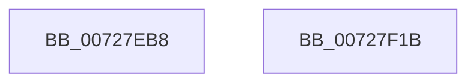

# PipMergeDependencyNodes

- RVA: `0x00727EB8`–`0x00727F1C` (길이 `100` bytes)
- VA: `0x0000000140727EB8`
- 실행 섹션: `PAGE`
- PDB 이름 있음: `예`; PDB Function 태그: `아니요`
- unwind 정보 RVA: `0x0005CAAC`
- 디코드: `29`개 명령, `100/100` bytes 표시
- 미해석 바이트: `0` (있으면 어셈블리에 `.byte`로 보존)

> 이 문서는 커널 이미지의 기계어와 PDB 기호를 분석해 생성했습니다. 4번과 5번은 함수 원형과 자료형을 바이너리 사용 방식에서 추정한 C 해석이며 원본 소스 복구 결과는 아닙니다.

## 1. Dependencies

- 직접 호출 지점: **5**; 고유 호출 대상: **3**
- 직접 호출자로 확인된 함수: **1**
- RIP 상대 이미지 참조: **0**

### Outgoing calls
- `0x00727EDC` → [PipMoveListEntries](../../text/5A/PipMoveListEntries_function_005A570C.md) (function, `0x005A570C`)
- `0x00727EEA` → [PipMergeDependencyEdgeList](PipMergeDependencyEdgeList_function_00727D4C.md) (function, `0x00727D4C`)
- `0x00727EFB` → [PipMergeDependencyEdgeList](PipMergeDependencyEdgeList_function_00727D4C.md) (function, `0x00727D4C`)
- `0x00727F03` → [PipDereferenceDependencyNode](../AC/PipDereferenceDependencyNode_function_00ACD5A0.md) (function, `0x00ACD5A0`)
- `0x00727F0B` → [PipDereferenceDependencyNode](../AC/PipDereferenceDependencyNode_function_00ACD5A0.md) (function, `0x00ACD5A0`)

### Direct callers
- [IoResolveDependency](../../text/4C/IoResolveDependency_function_004C4380.md) at `0x004C442F`

### Static image references
- 디코드된 RIP-relative 메모리 참조가 없습니다.

## 2. Other-region calls and transfers

- 다른 실행 섹션으로 향하는 call: **1**
  - `0x00727EDC` → [PipMoveListEntries](../../text/5A/PipMoveListEntries_function_005A570C.md) (`PAGE` → `.text`)
- 별도 외부 분기/꼬리 이동을 확인하지 못했습니다.

## 3. Assembly (complete function range)

```asm
00727EB8  48 89 5C 24 08                  mov qword ptr [rsp + 8], rbx
00727EBD  57                              push rdi
00727EBE  48 83 EC 20                     sub rsp, 0x20
00727EC2  FF 41 58                        inc dword ptr [rcx + 0x58]
00727EC5  48 8B FA                        mov rdi, rdx
00727EC8  FF 42 58                        inc dword ptr [rdx + 0x58]
00727ECB  48 8B D9                        mov rbx, rcx
00727ECE  8B 42 5C                        mov eax, dword ptr [rdx + 0x5c]
00727ED1  48 83 C2 38                     add rdx, 0x38
00727ED5  09 41 5C                        or dword ptr [rcx + 0x5c], eax
00727ED8  48 83 C1 38                     add rcx, 0x38
00727EDC  E8 2B D8 E7 FF                  call 0x1405a570c
00727EE1  45 33 C0                        xor r8d, r8d
00727EE4  48 8B D7                        mov rdx, rdi
00727EE7  48 8B CB                        mov rcx, rbx
00727EEA  E8 5D FE FF FF                  call 0x140727d4c
00727EEF  41 B8 01 00 00 00               mov r8d, 1
00727EF5  48 8B D7                        mov rdx, rdi
00727EF8  48 8B CB                        mov rcx, rbx
00727EFB  E8 4C FE FF FF                  call 0x140727d4c
00727F00  48 8B CB                        mov rcx, rbx
00727F03  E8 98 56 3A 00                  call 0x140acd5a0
00727F08  48 8B CF                        mov rcx, rdi
00727F0B  E8 90 56 3A 00                  call 0x140acd5a0
00727F10  48 8B 5C 24 30                  mov rbx, qword ptr [rsp + 0x30]
00727F15  48 83 C4 20                     add rsp, 0x20
00727F19  5F                              pop rdi
00727F1A  C3                              ret
00727F1B  CC                              int3
```

## 4. C-style interpretation (structured pseudocode)

```c
__int64 __fastcall PipMergeDependencyNodes(__int64 a1, __int64 a2, int a3)
{
    __int64 result;
    __int64 v_rsp;
    unsigned __int64 v_stack_p8;

    v_stack_p8 = v_rbx;
    v_rsp = (v_rsp) - (32);
    a2 = (a2) + (56);
    a1 = (a1) + (56);
    result = PipMoveListEntries(a1, a2, a3, a4);
    a3 = 0;
    result = PipMergeDependencyEdgeList(a1, a2, a3, a4);
    result = PipMergeDependencyEdgeList(a1, a2, 1, a4);
    result = PipDereferenceDependencyNode(a1, a2, 1, a4);
    result = PipDereferenceDependencyNode(a2, a2, 1, a4);
    v_rsp = (v_rsp) + (32);
    return result;
}
```

## 5. (Beta) C Style

```c
int64_t PipMergeDependencyNodes(void *Arg1, void *Arg2, int32_t Arg3)
{
    uint8_t *arg1 = (uint8_t *)Arg1;
    uint8_t *arg2 = (uint8_t *)Arg2;

    int64_t result;
    int64_t local_rsp;
    uint64_t v_stack_p8;

    v_stack_p8 = local_rbx;
    local_rsp = (local_rsp) - (32);
    Arg2 = (Arg2) + (56);
    Arg1 = (Arg1) + (56);
    result = PipMoveListEntries(Arg1, Arg2, Arg3, a4);
    Arg3 = 0;
    result = PipMergeDependencyEdgeList(Arg1, Arg2, Arg3, a4);
    result = PipMergeDependencyEdgeList(Arg1, Arg2, 1, a4);
    result = PipDereferenceDependencyNode(Arg1, Arg2, 1, a4);
    result = PipDereferenceDependencyNode(Arg2, Arg2, 1, a4);
    local_rsp = (local_rsp) + (32);
    return result;
}
```

### 관측된 메모리 오프셋

구조체 형식이 확인되지 않은 접근은 인자 기준의 오프셋으로만 기록했습니다.

| 기준 인자 | 오프셋 표현 | 폭 (bit) | 접근 |
|---|---:|---:|---|
| `Arg1` | `+ 0x58` | `32` | `R/W` |
| `Arg1` | `+ 0x5C` | `32` | `R/W` |
| `Arg2` | `+ 0x58` | `32` | `R/W` |
| `Arg2` | `+ 0x5C` | `32` | `R` |

## 6. Execution-region graph

[열기: 2D/3D 그래프와 함수 탐색 컨트롤 패널](../../../control-panel.html?section=page&rva=0x00727EB8&view=graph)

- 2D 그래프는 위에서 아래로 흐르고, 3D 그래프는 빈 공간을 드래그해 회전합니다. Shift+드래그는 이동, 휠은 확대·축소, 함수 노드 선택은 대상 보고서 이동입니다.

### Static fallback


