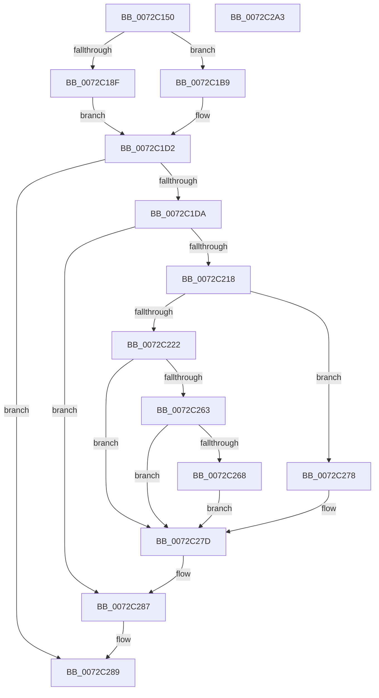

# PipServiceInstanceToDeviceInstance

- RVA: `0x0072C150`–`0x0072C2A4` (길이 `340` bytes)
- VA: `0x000000014072C150`
- 실행 섹션: `PAGE`
- PDB 이름 있음: `예`; PDB Function 태그: `아니요`
- unwind 정보 RVA: `0x000C4110`
- 디코드: `96`개 명령, `340/340` bytes 표시
- 미해석 바이트: `0` (있으면 어셈블리에 `.byte`로 보존)

> 이 문서는 커널 이미지의 기계어와 PDB 기호를 분석해 생성했습니다. 4번과 5번은 함수 원형과 자료형을 바이너리 사용 방식에서 추정한 C 해석이며 원본 소스 복구 결과는 아닙니다.

## 1. Dependencies

- 직접 호출 지점: **9**; 고유 호출 대상: **9**
- 직접 호출자로 확인된 함수: **1**
- RIP 상대 이미지 참조: **3**

### Outgoing calls
- `0x0072C1B2` → [IopOpenRegistryKeyEx](../A5/IopOpenRegistryKeyEx_function_00A51B44.md) (function, `0x00A51B44`)
- `0x0072C1CD` → [PipOpenServiceEnumKeys](../99/PipOpenServiceEnumKeys_function_00998E94.md) (function, `0x00998E94`)
- `0x0072C1ED` → [RtlStringCbPrintfW](../../text/40/RtlStringCbPrintfW_function_0040FB40.md) (function, `0x0040FB40`)
- `0x0072C204` → [IopGetRegistryValue](../99/IopGetRegistryValue_function_009990EC.md) (function, `0x009990EC`)
- `0x0072C20F` → [ZwClose](../../text/6A/ZwClose_function_006AD2B0.md) (function, `0x006AD2B0`)
- `0x0072C233` → [PnpRegSzToString](../A5/PnpRegSzToString_function_00A5DC40.md) (function, `0x00A5DC40`)
- `0x0072C26F` → [PnpConcatenateUnicodeStrings](../95/PnpConcatenateUnicodeStrings_function_00951ED0.md) (function, `0x00951ED0`)
- `0x0072C282` → [ExFreePoolWithTag](../../poolcode/B8/ExFreePoolWithTag_function_00B82870.md) (function, `0x00B82870`)
- `0x0072C290` → [_security_check_cookie](../../text/6A/_security_check_cookie_function_006AC640.md) (function, `0x006AC640`)

### Direct callers
- [PnpDriverLoadingFailed](../AB/PnpDriverLoadingFailed_function_00AB8928.md) at `0x00AB8AA0`

### Static image references
- `0x0072C161` → RVA `0x00E0A740` (`.data`; read)
- `0x0072C18F` → RVA `0x00AFDA80` (` ?? ::NNGAKEGL::`string'`; read)
- `0x0072C1DD` → RVA `0x00AFDAA0` (` ?? ::NNGAKEGL::`string'`; read)

## 2. Other-region calls and transfers

- 다른 실행 섹션으로 향하는 call: **4**
  - `0x0072C1ED` → [RtlStringCbPrintfW](../../text/40/RtlStringCbPrintfW_function_0040FB40.md) (`PAGE` → `.text`)
  - `0x0072C20F` → [ZwClose](../../text/6A/ZwClose_function_006AD2B0.md) (`PAGE` → `.text`)
  - `0x0072C282` → [ExFreePoolWithTag](../../poolcode/B8/ExFreePoolWithTag_function_00B82870.md) (`PAGE` → `POOLCODE`)
  - `0x0072C290` → [_security_check_cookie](../../text/6A/_security_check_cookie_function_006AC640.md) (`PAGE` → `.text`)
- 별도 외부 분기/꼬리 이동을 확인하지 못했습니다.

## 3. Assembly (complete function range)

```asm
0072C150  40 55                           push rbp
0072C152  53                              push rbx
0072C153  56                              push rsi
0072C154  57                              push rdi
0072C155  41 56                           push r14
0072C157  48 8B EC                        mov rbp, rsp
0072C15A  48 81 EC 80 00 00 00            sub rsp, 0x80
0072C161  48 8B 05 D8 E5 6D 00            mov rax, qword ptr [rip + 0x6de5d8]
0072C168  48 33 C4                        xor rax, rsp
0072C16B  48 89 45 F8                     mov qword ptr [rbp - 8], rax
0072C16F  45 33 F6                        xor r14d, r14d
0072C172  0F 57 C0                        xorps xmm0, xmm0
0072C175  4C 89 75 B0                     mov qword ptr [rbp - 0x50], r14
0072C179  49 8B F1                        mov rsi, r9
0072C17C  4C 89 75 B8                     mov qword ptr [rbp - 0x48], r14
0072C180  41 8B D8                        mov ebx, r8d
0072C183  48 8B C2                        mov rax, rdx
0072C186  0F 11 45 C0                     movups xmmword ptr [rbp - 0x40], xmm0
0072C18A  48 85 C9                        test rcx, rcx
0072C18D  74 2A                           je 0x14072c1b9
0072C18F  48 8D 05 EA 18 3D 00            lea rax, [rip + 0x3d18ea]
0072C196  C7 45 C0 08 00 0A 00            mov dword ptr [rbp - 0x40], 0xa0008
0072C19D  48 8B D1                        mov rdx, rcx
0072C1A0  48 89 45 C8                     mov qword ptr [rbp - 0x38], rax
0072C1A4  48 8D 4D B8                     lea rcx, [rbp - 0x48]
0072C1A8  41 B9 19 00 02 00               mov r9d, 0x20019
0072C1AE  4C 8D 45 C0                     lea r8, [rbp - 0x40]
0072C1B2  E8 8D 59 32 00                  call 0x140a51b44
0072C1B7  EB 19                           jmp 0x14072c1d2
0072C1B9  4C 8D 4D B8                     lea r9, [rbp - 0x48]
0072C1BD  44 88 74 24 20                  mov byte ptr [rsp + 0x20], r14b
0072C1C2  45 33 C0                        xor r8d, r8d
0072C1C5  BA 19 00 02 00                  mov edx, 0x20019
0072C1CA  48 8B C8                        mov rcx, rax
0072C1CD  E8 C2 CC 26 00                  call 0x140998e94
0072C1D2  85 C0                           test eax, eax
0072C1D4  0F 88 AF 00 00 00               js 0x14072c289
0072C1DA  44 8B CB                        mov r9d, ebx
0072C1DD  4C 8D 05 BC 18 3D 00            lea r8, [rip + 0x3d18bc]
0072C1E4  BA 28 00 00 00                  mov edx, 0x28
0072C1E9  48 8D 4D D0                     lea rcx, [rbp - 0x30]
0072C1ED  E8 4E 39 CE FF                  call 0x14040fb40
0072C1F2  48 8B 4D B8                     mov rcx, qword ptr [rbp - 0x48]
0072C1F6  4C 8D 4D B0                     lea r9, [rbp - 0x50]
0072C1FA  41 B8 64 00 00 00               mov r8d, 0x64
0072C200  48 8D 55 D0                     lea rdx, [rbp - 0x30]
0072C204  E8 E3 CE 26 00                  call 0x1409990ec
0072C209  48 8B 4D B8                     mov rcx, qword ptr [rbp - 0x48]
0072C20D  8B D8                           mov ebx, eax
0072C20F  E8 9C 10 F8 FF                  call 0x1406ad2b0
0072C214  85 DB                           test ebx, ebx
0072C216  78 6F                           js 0x14072c287
0072C218  48 8B 7D B0                     mov rdi, qword ptr [rbp - 0x50]
0072C21C  83 7F 04 01                     cmp dword ptr [rdi + 4], 1
0072C220  75 56                           jne 0x14072c278
0072C222  8B 4F 08                        mov ecx, dword ptr [rdi + 8]
0072C225  4C 8D 45 B0                     lea r8, [rbp - 0x50]
0072C229  8B 57 0C                        mov edx, dword ptr [rdi + 0xc]
0072C22C  48 03 CF                        add rcx, rdi
0072C22F  44 89 75 B0                     mov dword ptr [rbp - 0x50], r14d
0072C233  E8 08 1A 33 00                  call 0x140a5dc40
0072C238  44 8B 45 B0                     mov r8d, dword ptr [rbp - 0x50]
0072C23C  66 44 89 45 C0                  mov word ptr [rbp - 0x40], r8w
0072C241  0F B7 47 0C                     movzx eax, word ptr [rdi + 0xc]
0072C245  66 89 45 C2                     mov word ptr [rbp - 0x3e], ax
0072C249  8B 47 08                        mov eax, dword ptr [rdi + 8]
0072C24C  48 03 C7                        add rax, rdi
0072C24F  66 45 85 C0                     test r8w, r8w
0072C253  48 89 45 C8                     mov qword ptr [rbp - 0x38], rax
0072C257  B8 3A 00 00 C0                  mov eax, 0xc000003a
0072C25C  0F 44 D8                        cmove ebx, eax
0072C25F  85 DB                           test ebx, ebx
0072C261  78 1A                           js 0x14072c27d
0072C263  48 85 F6                        test rsi, rsi
0072C266  74 15                           je 0x14072c27d
0072C268  48 8D 55 C0                     lea rdx, [rbp - 0x40]
0072C26C  48 8B CE                        mov rcx, rsi
0072C26F  E8 5C 5C 22 00                  call 0x140951ed0
0072C274  8B D8                           mov ebx, eax
0072C276  EB 05                           jmp 0x14072c27d
0072C278  BB 61 02 00 C0                  mov ebx, 0xc0000261
0072C27D  33 D2                           xor edx, edx
0072C27F  48 8B CF                        mov rcx, rdi
0072C282  E8 E9 65 45 00                  call 0x140b82870
0072C287  8B C3                           mov eax, ebx
0072C289  48 8B 4D F8                     mov rcx, qword ptr [rbp - 8]
0072C28D  48 33 CC                        xor rcx, rsp
0072C290  E8 AB 03 F8 FF                  call 0x1406ac640
0072C295  48 81 C4 80 00 00 00            add rsp, 0x80
0072C29C  41 5E                           pop r14
0072C29E  5F                              pop rdi
0072C29F  5E                              pop rsi
0072C2A0  5B                              pop rbx
0072C2A1  5D                              pop rbp
0072C2A2  C3                              ret
0072C2A3  CC                              int3
```

## 4. C-style interpretation (structured pseudocode)

```c
__int64 __fastcall PipServiceInstanceToDeviceInstance(__int64 a1, __int64 a2, int a3, __int64 a4)
{
    __int64 result;
    __int64 v_r14;
    __int64 v_rbx;
    __int64 v_rsp;
    unsigned __int64 v_stack_m30;
    unsigned __int64 v_stack_m58;
    unsigned __int64 v_stack_m60;
    unsigned __int16 v_stack_m66;
    unsigned __int64 v_stack_m68;
    unsigned __int64 v_stack_m70;
    unsigned __int64 v_stack_m78;
    unsigned __int8 v_stack_m88;

    v_rsp = (v_rsp) - (128);
    result = (*(unsigned __int64 *)(v_rip + 7202264)) ^ (v_rsp);
    v_stack_m30 = result;
    v_r14 = 0;
    v_stack_m78 = 0;
    v_stack_m70 = 0;
    v_stack_m68 = v_xmm0;
    if (a1 == 0) goto loc_0072C1B9;
    v_stack_m68 = 0xA0008ULL;
    v_stack_m60 = v_rip + 4004074;
    result = IopOpenRegistryKeyEx(v_stack_m70, a1, v_stack_m68, (unsigned int)(0x20019ULL));
    goto loc_0072C1D2;
loc_0072C1B9:
    v_stack_m88 = 0;
    a3 = 0;
    result = PipOpenServiceEnumKeys(result, (unsigned int)(0x20019ULL), a3, v_stack_m70);
loc_0072C1D2:
    if (sign_flag) goto loc_0072C289;
    result = RtlStringCbPrintfW(v_stack_m58, 40, v_rip + 4004028, (unsigned int)((unsigned int)((unsigned int)(a3))));
    result = IopGetRegistryValue(v_stack_m70, v_stack_m58, 100, v_stack_m78);
    result = ZwClose(v_stack_m70, v_stack_m58, 100, v_stack_m78);
    if (sign_flag) goto loc_0072C287;
    if ((*(unsigned int *)(v_stack_m78 + 4)) != 1) goto loc_0072C278;
    a1 = ((unsigned int)(*(unsigned int *)(v_stack_m78 + 8))) + (v_stack_m78);
    v_stack_m78 = 0;
    result = PnpRegSzToString(a1, (unsigned int)(*(unsigned int *)(v_stack_m78 + 12)), v_stack_m78, v_stack_m78);
    v_stack_m68 = (unsigned __int16)((unsigned int)(v_stack_m78));
    v_stack_m66 = (unsigned __int16)(*(unsigned __int16 *)(v_stack_m78 + 12));
    result = ((unsigned int)(*(unsigned int *)(v_stack_m78 + 8))) + (v_stack_m78);
    v_stack_m60 = result;
    v_rbx = (unsigned int)((unsigned int)(result));
    if ((unsigned __int16)((unsigned int)(v_stack_m78)) == 0) { v_rbx = (unsigned int)((unsigned int)(0xC000003AULL)); }
    if (sign_flag) goto loc_0072C27D;
    if (a4 == 0) goto loc_0072C27D;
    result = PnpConcatenateUnicodeStrings(a4, v_stack_m68, (unsigned int)(v_stack_m78), v_stack_m78);
    goto loc_0072C27D;
loc_0072C278:
loc_0072C27D:
    a2 = 0;
    result = ExFreePoolWithTag(v_stack_m78, a2, (unsigned int)(v_stack_m78), v_stack_m78);
loc_0072C287:
loc_0072C289:
    a1 = (v_stack_m30) ^ (v_rsp);
    result = _security_check_cookie(a1, a2, (unsigned int)(v_stack_m78), v_stack_m78);
    v_rsp = (v_rsp) + (128);
    return result;
}
```

## 5. (Beta) C Style

```c
int64_t PipServiceInstanceToDeviceInstance(int64_t Arg1, int64_t Arg2, int32_t Arg3, int64_t Arg4)
{
    int64_t result;
    int64_t local_r14;
    int64_t local_rbx;
    int64_t local_rsp;
    uint64_t v_stack_m30;
    uint64_t v_stack_m58;
    uint64_t v_stack_m60;
    uint16_t v_stack_m66;
    uint64_t v_stack_m68;
    uint64_t v_stack_m70;
    uint64_t v_stack_m78;
    uint8_t v_stack_m88;

    local_rsp = (local_rsp) - (128);
    result = (*(uint64_t *)(v_rip + 0x6DE5D8)) ^ (local_rsp);
    v_stack_m30 = result;
    local_r14 = 0;
    v_stack_m78 = 0;
    v_stack_m70 = 0;
    v_stack_m68 = v_xmm0;
    if (Arg1 == 0) goto loc_0072C1B9;
    v_stack_m68 = 0xA0008ULL;
    v_stack_m60 = v_rip + 4004074;
    result = IopOpenRegistryKeyEx(v_stack_m70, Arg1, v_stack_m68, (uint32_t)(0x20019ULL));
    goto loc_0072C1D2;
loc_0072C1B9:
    v_stack_m88 = 0;
    Arg3 = 0;
    result = PipOpenServiceEnumKeys(result, (uint32_t)(0x20019ULL), Arg3, v_stack_m70);
loc_0072C1D2:
    if (sign_flag) goto loc_0072C289;
    result = RtlStringCbPrintfW(v_stack_m58, 40, v_rip + 4004028, (uint32_t)((uint32_t)((uint32_t)(Arg3))));
    result = IopGetRegistryValue(v_stack_m70, v_stack_m58, 100, v_stack_m78);
    result = ZwClose(v_stack_m70, v_stack_m58, 100, v_stack_m78);
    if (sign_flag) goto loc_0072C287;
    if ((*(uint32_t *)(v_stack_m78 + 0x4)) != 1) goto loc_0072C278;
    Arg1 = ((uint32_t)(*(uint32_t *)(v_stack_m78 + 0x8))) + (v_stack_m78);
    v_stack_m78 = 0;
    result = PnpRegSzToString(Arg1, (uint32_t)(*(uint32_t *)(v_stack_m78 + 0xC)), v_stack_m78, v_stack_m78);
    v_stack_m68 = (uint16_t)((uint32_t)(v_stack_m78));
    v_stack_m66 = (uint16_t)(*(uint16_t *)(v_stack_m78 + 0xC));
    result = ((uint32_t)(*(uint32_t *)(v_stack_m78 + 0x8))) + (v_stack_m78);
    v_stack_m60 = result;
    local_rbx = (uint32_t)((uint32_t)(result));
    if ((uint16_t)((uint32_t)(v_stack_m78)) == 0) { local_rbx = (uint32_t)((uint32_t)(0xC000003AULL)); }
    if (sign_flag) goto loc_0072C27D;
    if (Arg4 == 0) goto loc_0072C27D;
    result = PnpConcatenateUnicodeStrings(Arg4, v_stack_m68, (uint32_t)(v_stack_m78), v_stack_m78);
    goto loc_0072C27D;
loc_0072C278:
loc_0072C27D:
    Arg2 = 0;
    result = ExFreePoolWithTag(v_stack_m78, Arg2, (uint32_t)(v_stack_m78), v_stack_m78);
loc_0072C287:
loc_0072C289:
    Arg1 = (v_stack_m30) ^ (local_rsp);
    result = _security_check_cookie(Arg1, Arg2, (uint32_t)(v_stack_m78), v_stack_m78);
    local_rsp = (local_rsp) + (128);
    return result;
}
```

## 6. Execution-region graph

[열기: 2D/3D 그래프와 함수 탐색 컨트롤 패널](../../../control-panel.html?section=page&rva=0x0072C150&view=graph)

- 2D 그래프는 위에서 아래로 흐르고, 3D 그래프는 빈 공간을 드래그해 회전합니다. Shift+드래그는 이동, 휠은 확대·축소, 함수 노드 선택은 대상 보고서 이동입니다.

### Static fallback


